# MASTER: Thiết kế CSDL & Quy tắc API Liên Service
## Hệ thống Quản lý Trung tâm Ngoại ngữ — English Center

> **Trạng thái**: APPROVED — Tài liệu gốc do Leader biên soạn, dựa trên toàn bộ docs của 4 nhóm.  
> **Phiên bản**: Final 2.1 (28 bảng, 4 views, 342 cột, 35 triggers — đã kiểm chứng thực tế trên PostgreSQL 16 Docker)  
> **Cập nhật**: 2026-11-08  
> **Áp dụng cho**: Toàn bộ 4 service (Admission, Student, Learning, Finance)  
> **Từ điển Dữ liệu & Đặc tả tự động theo từng Module**:  
> - 📊 [Chỉ mục Từ điển Dữ liệu Toàn hệ thống (DATA_DICTIONARY_INDEX.md)](database/DATA_DICTIONARY_INDEX.md)  
> - 🏛️ [Schema dmission (dmission-schema-spec.md)](../services/admission/docs/admission-schema-spec.md)  
> - 🎓 [Schema student (student-schema-spec.md)](../services/student/docs/student-schema-spec.md)  
> - 📚 [Schema learning (learning-schema-spec.md)](../services/learning/docs/learning-schema-spec.md)  
> - 💰 [Schema inance (inance-schema-spec.md)](../services/finance/docs/finance-schema-spec.md)

---

## MỤC LỤC

1. [Tổng quan Kiến trúc & Sơ đồ Mermaid Toàn hệ thống](#1-tổng-quan-kiến-trúc)
2. [Nguyên tắc Nền tảng (Không được vi phạm)](#2-nguyên-tắc-nền-tảng)
3. [Chi tiết Schema ADMISSION (14 bảng)](#3-schema-admission)
4. [Chi tiết Schema STUDENT (3 bảng)](#4-schema-student)
5. [Chi tiết Schema LEARNING (2 bảng + 2 views)](#5-schema-learning)
6. [Chi tiết Schema FINANCE (9 bảng + 2 BI views)](#6-schema-finance)
7. [State Machines — Vòng đời đối tượng](#7-state-machines)
8. [API Contract Rules — Quy ước chung](#8-api-contract-rules)
9. [Inter-Service Communication — Giao tiếp liên service](#9-inter-service-communication)
10. [System Invariants — 15 Bất biến Hệ thống](#10-system-invariants)
11. [Danh mục API Endpoints (Tóm tắt)](#11-danh-mục-api-endpoints)

---

## 1. Tổng quan Kiến trúc

### 1.1. Sơ đồ Kiến trúc Tổng thể

```
                    ┌─────────────────────────────────────────┐
                    │         NGINX API GATEWAY (port 8080)    │
                    │  /api/admission/* → 8081                 │
                    │  /api/student/*   → 8082                 │
                    │  /api/learning/*  → 8083                 │
                    │  /api/finance/*   → 8084                 │
                    └────────────┬────────────────────────────┘
                                 │ HTTP REST
              ┌──────────────────┼──────────────────────────┐
              │                  │                           │
   ┌──────────▼──────┐  ┌────────▼──────┐  ┌───────────────▼──────┐  ┌──────────────▼──────┐
   │ admission-svc    │  │  student-svc  │  │   learning-svc       │  │   finance-svc        │
   │ Java Spring Boot │  │ Python FastAPI│  │  Python FastAPI      │  │  Python FastAPI      │
   │ Port: 8081       │  │ Port: 8082   │  │  Port: 8083          │  │  Port: 8084          │
   │ Schema: admission│  │ Schema:student│  │  Schema: learning    │  │  Schema: finance     │
   └──────────────────┘  └───────────────┘  └──────────────────────┘  └──────────────────────┘
              │                  │                           │                     │
              └──────────────────┴──────── PostgreSQL ───────┴─────────────────────┘
                                          english_center DB
                                    (1 instance, 4 schemas)
```

### 1.2. Phân chia Schema

| Schema | Service | Port | Tech Stack | Số bảng |
|--------|---------|------|-----------|---------|
| `admission` | admission-service | 8081 | Java Spring Boot | 14 |
| `student` | student-service | 8082 | Python FastAPI | 3 |
| `learning` | learning-service | 8083 | Python FastAPI | 2 + 2 views |
| `finance` | finance-service | 8084 | Python FastAPI | 9 + 2 views |

### 1.3. Sơ đồ Mermaid 1: Toàn cảnh 1 PostgreSQL DB (4 Schemas Cô lập) & Quy tắc Gọi API Liên Service

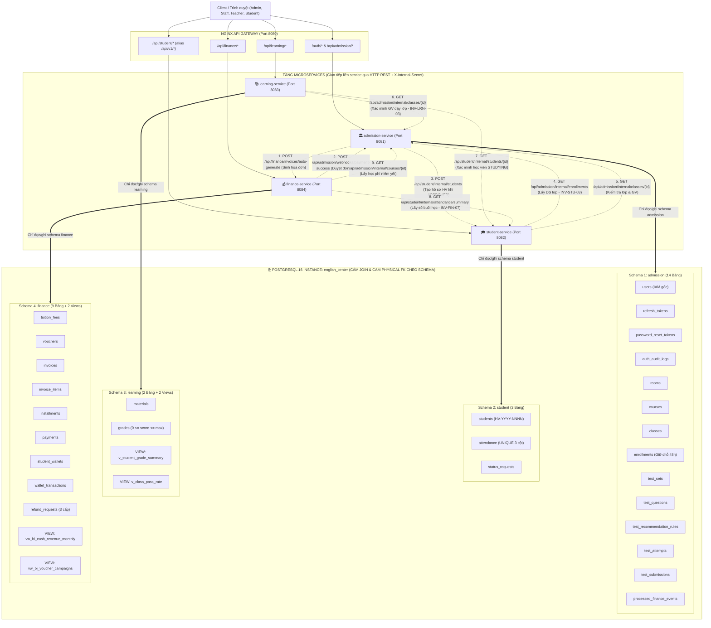

### 1.4. Sơ đồ Mermaid 2: Bản đồ Cầu nối Định danh `R-ID-1` & Liên kết Logical FK

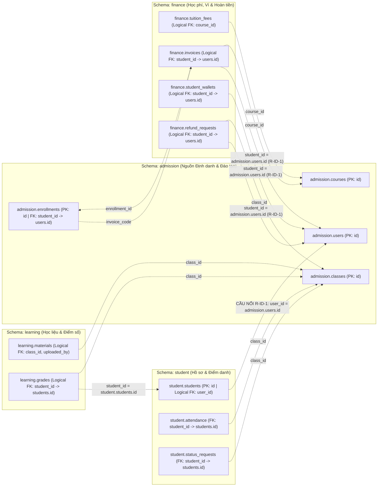

### 1.5. Sơ đồ Mermaid 3: Sequence Diagram Luồng Gọi API Liên Service Xuyên suốt 4 Phân hệ

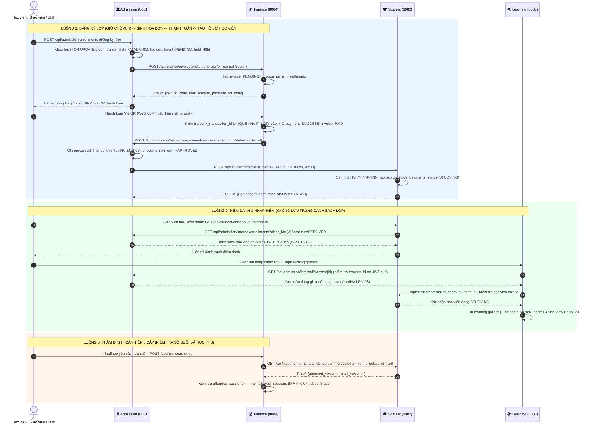

---

## 2. Nguyên tắc Nền tảng

> [!CAUTION]
> Vi phạm các nguyên tắc dưới đây sẽ phá vỡ kiến trúc microservice và gây lỗi hệ thống nghiêm trọng.

### 2.1. Schema Isolation (Bất biến INV-SYS-02)
- Mỗi service **CHỈ ĐƯỢC** truy vấn `SELECT/INSERT/UPDATE/DELETE` trên schema của chính mình.
- **TUYỆT ĐỐI KHÔNG** tạo Physical FK chéo schema.
- **TUYỆT ĐỐI KHÔNG** JOIN bảng thuộc 2 schema khác nhau.

### 2.2. Logical Foreign Key
Khi một service cần lưu ID của entity thuộc service khác, dùng kiểu `INTEGER` (không có `REFERENCES`):

```sql
-- ✅ ĐÚNG: Logical FK
student_id INTEGER NOT NULL   -- tham chiếu logic tới student.students(id)

-- ❌ SAI: Physical FK chéo schema
student_id INTEGER REFERENCES student.students(id)   -- LỖI KIẾN TRÚC
```

### 2.3. Inter-Service Communication
- Mọi dữ liệu từ service khác phải lấy qua **HTTP REST API**.
- Không dùng message queue (trừ khi mở rộng sau vòng lặp 1).
- Webhook nội bộ (Internal) dùng header `X-Internal-Secret`.

### 2.4. API Convention
- Tất cả JSON fields và query params: **`snake_case`**.
- Authorization: `Bearer <jwt_access_token>` trên mọi API cần xác thực.
- Response chuẩn:
  ```json
  // Thành công
  { "success": true, "data": { ... }, "message": "..." }
  // Lỗi
  { "success": false, "error": { "code": "ERR_CODE", "message": "..." } }
  ```

---

## 3. Schema ADMISSION

### 3.1. ERD Schema Admission

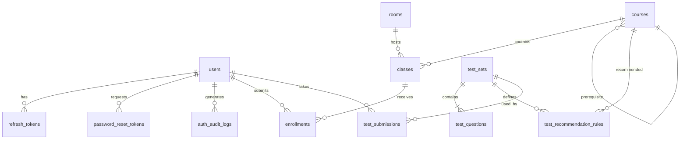

### 3.2. Danh sách 14 Bảng

#### `admission.users` — Tài khoản hệ thống
| Cột | Kiểu | Nullable | Default | Ràng buộc |
|-----|------|:--------:|---------|-----------|
| `id` | SERIAL | NO | Auto | PK |
| `email` | VARCHAR(255) | NO | – | UNIQUE NOT NULL |
| `password_hash` | VARCHAR(255) | NO | – | NOT NULL |
| `full_name` | VARCHAR(255) | NO | – | NOT NULL |
| `role` | VARCHAR(50) | NO | – | CHECK IN ('ADMIN','STAFF','TEACHER','STUDENT') |
| `phone` | VARCHAR(50) | YES | NULL | – |
| `gender` | VARCHAR(20) | YES | NULL | CHECK IN ('MALE','FEMALE','OTHER') |
| `date_of_birth` | DATE | YES | NULL | – |
| `avatar_url` | TEXT | YES | NULL | – |
| `must_change_password` | BOOLEAN | NO | FALSE | – |
| `is_active` | BOOLEAN | NO | TRUE | – |
| `email_verified_at` | TIMESTAMPTZ | YES | NULL | v3.6 – xác thực email đăng ký học viên |
| `created_at` | TIMESTAMPTZ | NO | NOW() | – |
| `updated_at` | TIMESTAMPTZ | NO | NOW() | – |

#### `admission.refresh_tokens` — Phiên đăng nhập JWT
| Cột | Kiểu | Nullable | Default | Ràng buộc |
|-----|------|:--------:|---------|-----------|
| `id` | SERIAL | NO | Auto | PK |
| `user_id` | INTEGER | NO | – | FK→users ON DELETE CASCADE |
| `token` | VARCHAR(512) | NO | – | UNIQUE NOT NULL |
| `expires_at` | TIMESTAMPTZ | NO | – | NOT NULL |
| `is_revoked` | BOOLEAN | NO | FALSE | – |
| `created_at` | TIMESTAMPTZ | NO | NOW() | – |

#### `admission.password_reset_tokens` — Token đặt lại mật khẩu
| Cột | Kiểu | Nullable | Default | Ràng buộc |
|-----|------|:--------:|---------|-----------|
| `id` | SERIAL | NO | Auto | PK |
| `user_id` | INTEGER | NO | – | FK→users ON DELETE CASCADE |
| `token` | VARCHAR(512) | NO | – | UNIQUE NOT NULL |
| `expires_at` | TIMESTAMPTZ | NO | – | NOT NULL (hết hạn 15 phút) |
| `is_used` | BOOLEAN | NO | FALSE | – |
| `created_at` | TIMESTAMPTZ | NO | NOW() | – |

#### `admission.auth_audit_logs` — Nhật ký bảo mật
| Cột | Kiểu | Nullable | Default | Ràng buộc |
|-----|------|:--------:|---------|-----------|
| `id` | SERIAL | NO | Auto | PK |
| `user_id` | INTEGER | YES | NULL | FK→users ON DELETE SET NULL |
| `action` | VARCHAR(50) | NO | – | CHECK IN ('LOGIN_SUCCESS','LOGIN_FAILED','REFRESH_TOKEN','LOGOUT','PASSWORD_CHANGED','ACCOUNT_LOCKED') |
| `ip_address` | VARCHAR(45) | YES | NULL | – |
| `user_agent` | TEXT | YES | NULL | – |
| `details` | JSONB | YES | NULL | – |
| `created_at` | TIMESTAMPTZ | NO | NOW() | – |

#### `admission.rooms` — Phòng học
| Cột | Kiểu | Nullable | Default | Ràng buộc |
|-----|------|:--------:|---------|-----------|
| `id` | SERIAL | NO | Auto | PK |
| `code` | VARCHAR(50) | NO | – | UNIQUE NOT NULL |
| `name` | VARCHAR(100) | NO | – | NOT NULL |
| `capacity` | INTEGER | NO | – | CHECK > 0 |
| `branch_name` | VARCHAR(100) | YES | 'Cơ sở chính' | – |
| `is_active` | BOOLEAN | NO | TRUE | – |
| `created_at` | TIMESTAMPTZ | NO | NOW() | – |

#### `admission.courses` — Khóa học
| Cột | Kiểu | Nullable | Default | Ràng buộc |
|-----|------|:--------:|---------|-----------|
| `id` | SERIAL | NO | Auto | PK |
| `code` | VARCHAR(50) | NO | – | UNIQUE NOT NULL (INV-ADM-02) |
| `name` | VARCHAR(255) | NO | – | NOT NULL |
| `description` | TEXT | YES | NULL | – |
| `level` | VARCHAR(50) | NO | – | CHECK IN ('Beginner','Intermediate','Advanced') |
| `target_output` | VARCHAR(100) | YES | NULL | – |
| `duration_weeks` | INTEGER | NO | – | CHECK > 0 |
| `tuition_amount` | NUMERIC(12,2) | NO | 0 | CHECK >= 0 |
| `prerequisite_course_id` | INTEGER | YES | NULL | FK→courses(id) ON DELETE SET NULL |
| `is_active` | BOOLEAN | NO | TRUE | – |
| `created_at` | TIMESTAMPTZ | NO | NOW() | – |

#### `admission.classes` — Lớp học
| Cột | Kiểu | Nullable | Default | Ràng buộc |
|-----|------|:--------:|---------|-----------|
| `id` | SERIAL | NO | Auto | PK |
| `course_id` | INTEGER | NO | – | FK→courses ON DELETE RESTRICT |
| `room_id` | INTEGER | YES | NULL | FK→rooms ON DELETE RESTRICT |
| `teacher_id` | INTEGER | YES | NULL | FK→users ON DELETE RESTRICT |
| `code` | VARCHAR(50) | NO | – | UNIQUE NOT NULL |
| `name` | VARCHAR(255) | NO | – | NOT NULL |
| `day_pattern` | VARCHAR(50) | NO | – | CHECK IN ('MON_WED_FRI','TUE_THU_SAT','SAT_SUN','DAILY','CUSTOM') |
| `start_time` | TIME | NO | – | – |
| `end_time` | TIME | NO | – | CHECK > start_time |
| `start_date` | DATE | NO | – | – |
| `end_date` | DATE | NO | – | CHECK > start_date |
| `min_students` | INTEGER | YES | 10 | CHECK > 0 |
| `max_students` | INTEGER | YES | 25 | CHECK >= min_students |
| `status` | VARCHAR(50) | NO | 'OPEN' | CHECK IN ('OPEN','IN_PROGRESS','COMPLETED','CANCELLED') |
| `created_at` | TIMESTAMPTZ | NO | NOW() | – |

#### `admission.enrollments` — Đơn tuyển sinh
| Cột | Kiểu | Nullable | Default | Ràng buộc |
|-----|------|:--------:|---------|-----------|
| `id` | SERIAL | NO | Auto | PK |
| `student_id` | INTEGER | NO | – | FK→users ON DELETE RESTRICT |
| `class_id` | INTEGER | NO | – | FK→classes ON DELETE RESTRICT |
| `status` | VARCHAR(50) | NO | 'PENDING' | CHECK IN ('PENDING','APPROVED','REJECTED','EXPIRED','CANCELLED','CANCELLED_REFUND_PENDING') |
| `hold_expires_at` | TIMESTAMPTZ | YES | NULL | Hạn giữ chỗ 48h |
| `invoice_code` | VARCHAR(50) | YES | NULL | – |
| `source` | VARCHAR(50) | YES | 'ONLINE' | CHECK IN ('ONLINE','WALK_IN','HOTLINE','FANPAGE','REFERRAL') |
| `approval_method` | VARCHAR(50) | YES | NULL | CHECK IN ('ONLINE_PAYMENT','MANUAL_CASH','STAFF_OVERRIDE') |
| `approved_by_user_id` | INTEGER | YES | NULL | FK→users ON DELETE SET NULL |
| `note` | TEXT | YES | NULL | – |
| `enrolled_at` | TIMESTAMPTZ | NO | NOW() | – |
| `approved_at` | TIMESTAMPTZ | YES | NULL | – |
| `enrollment_channel` | VARCHAR(20) | NO | 'ONLINE' | v3.6 – CHECK IN ('ONLINE','AT_COUNTER') |
| `hold_extended_by_user_id` | INTEGER | YES | NULL | v3.6 – FK→users ON DELETE SET NULL |
| `hold_extension_reason` | TEXT | YES | NULL | v3.6 – lý do gia hạn giữ chỗ |
| `student_sync_status` | VARCHAR(20) | NO | 'NOT_STARTED' | v3.6 – CHECK IN ('NOT_STARTED','PENDING','SYNCED','FAILED'); trạng thái đồng bộ sang Student Service |
| – | – | – | – | UNIQUE(student_id, class_id) |

#### `admission.test_sets` — Bộ đề thi
| Cột | Kiểu | Nullable | Default | Ràng buộc |
|-----|------|:--------:|---------|-----------|
| `id` | SERIAL | NO | Auto | PK |
| `title` | VARCHAR(255) | NO | – | NOT NULL |
| `duration_minutes` | INTEGER | NO | 45 | CHECK > 0 |
| `is_active` | BOOLEAN | NO | TRUE | – |
| `created_at` | TIMESTAMPTZ | NO | NOW() | – |

#### `admission.test_questions` — Câu hỏi trắc nghiệm
| Cột | Kiểu | Nullable | Default | Ràng buộc |
|-----|------|:--------:|---------|-----------|
| `id` | SERIAL | NO | Auto | PK |
| `test_set_id` | INTEGER | NO | – | FK→test_sets ON DELETE CASCADE |
| `skill_type` | VARCHAR(50) | NO | – | CHECK IN ('LISTENING','READING','GRAMMAR') |
| `order_index` | INTEGER | NO | 1 | – |
| `audio_url` | TEXT | YES | NULL | Chỉ dùng khi skill_type='LISTENING' |
| `passage_text` | TEXT | YES | NULL | Chỉ dùng khi skill_type='READING' |
| `question_text` | TEXT | NO | – | NOT NULL |
| `option_a/b/c/d` | TEXT | NO | – | NOT NULL |
| `correct_option` | CHAR(1) | NO | – | CHECK IN ('A','B','C','D'); ẨN khỏi API public |
| `score_weight` | NUMERIC(4,2) | NO | 1.0 | CHECK > 0 |

#### `admission.test_recommendation_rules` — Ma trận đề xuất
| Cột | Kiểu | Nullable | Default | Ràng buộc |
|-----|------|:--------:|---------|-----------|
| `id` | SERIAL | NO | Auto | PK |
| `test_set_id` | INTEGER | NO | – | FK→test_sets ON DELETE CASCADE |
| `min_score` | NUMERIC(5,2) | NO | – | CHECK >= 0 |
| `max_score` | NUMERIC(5,2) | NO | – | CHECK > min_score |
| `assessed_level` | VARCHAR(50) | NO | – | NOT NULL |
| `recommended_course_id` | INTEGER | NO | – | FK→courses ON DELETE CASCADE |
| `advice_text` | TEXT | YES | NULL | – |

#### `admission.test_attempts` — Lượt làm bài (v3.6)
| Cột | Kiểu | Nullable | Default | Ràng buộc |
|-----|------|:--------:|---------|-----------|
| `id` | SERIAL | NO | Auto | PK |
| `user_id` | INTEGER | NO | – | FK→users ON DELETE RESTRICT |
| `test_set_id` | INTEGER | NO | – | FK→test_sets ON DELETE RESTRICT |
| `status` | VARCHAR(20) | NO | 'STARTED' | CHECK IN ('STARTED','SUBMITTED','EXPIRED') |
| `started_at` | TIMESTAMPTZ | NO | NOW() | Giờ server |
| `expires_at` | TIMESTAMPTZ | NO | – | CHECK > started_at |
| `submitted_at` | TIMESTAMPTZ | YES | NULL | – |

#### `admission.test_submissions` — Kết quả bài thi
| Cột | Kiểu | Nullable | Default | Ràng buộc |
|-----|------|:--------:|---------|-----------|
| `id` | SERIAL | NO | Auto | PK |
| `attempt_id` | INTEGER | YES | NULL | v3.6 – UNIQUE, FK→test_attempts ON DELETE RESTRICT (INV-TST-02) |
| `user_id` | INTEGER | NO | – | FK→users ON DELETE CASCADE |
| `test_set_id` | INTEGER | NO | – | FK→test_sets ON DELETE RESTRICT |
| `listening_score` | NUMERIC(5,2) | NO | 0.0 | CHECK >= 0 |
| `reading_score` | NUMERIC(5,2) | NO | 0.0 | CHECK >= 0 |
| `grammar_score` | NUMERIC(5,2) | NO | 0.0 | CHECK >= 0 |
| `total_score` | NUMERIC(5,2) | NO | – | NOT NULL |
| `assessed_level` | VARCHAR(50) | YES | NULL | – |
| `recommended_course_id` | INTEGER | YES | NULL | FK→courses ON DELETE SET NULL |
| `answers_detail` | JSONB | YES | NULL | Format: [{question_id, selected, is_correct}] |
| `submitted_at` | TIMESTAMPTZ | NO | NOW() | – |

#### `admission.processed_finance_events` — Đối soát callback Finance (v3.6)
| Cột | Kiểu | Nullable | Default | Ràng buộc |
|-----|------|:--------:|---------|-----------|
| `id` | SERIAL | NO | Auto | PK |
| `enrollment_id` | INTEGER | NO | – | FK→enrollments ON DELETE RESTRICT |
| `finance_event_id` | VARCHAR(255) | NO | – | UNIQUE NOT NULL (INV-ENR-02) |
| `paid_at` | TIMESTAMPTZ | NO | – | – |
| `processed_at` | TIMESTAMPTZ | NO | NOW() | – |

---

## 4. Schema STUDENT

### 4.1. ERD Schema Student

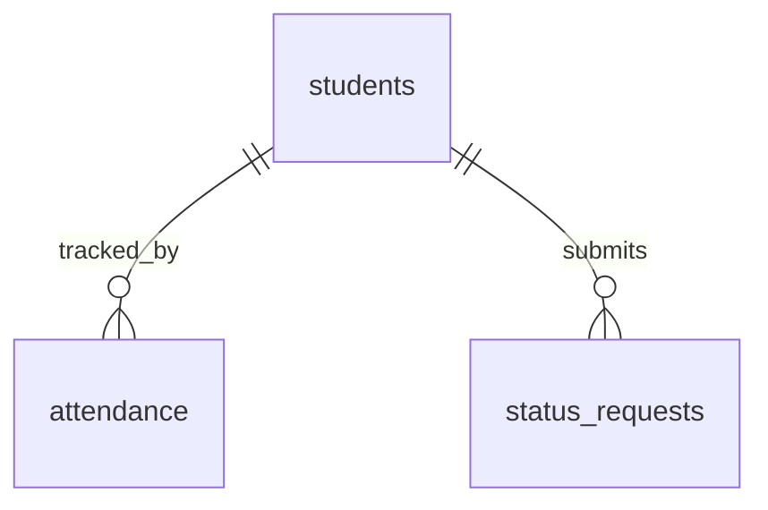

### 4.2. Danh sách 3 Bảng

#### `student.students` — Hồ sơ học viên
| Cột | Kiểu | Nullable | Default | Ràng buộc |
|-----|------|:--------:|---------|-----------|
| `id` | SERIAL | NO | Auto | PK |
| `user_id` | INTEGER | YES | NULL | **Logical FK** → admission.users(id) |
| `student_code` | VARCHAR(30) | NO | – | UNIQUE NOT NULL; format: STU-YYYYMM-XXXX |
| `full_name` | VARCHAR(255) | NO | – | NOT NULL |
| `email` | VARCHAR(255) | NO | – | UNIQUE NOT NULL |
| `phone` | VARCHAR(50) | YES | NULL | – |
| `date_of_birth` | DATE | YES | NULL | – |
| `address` | TEXT | YES | NULL | – |
| `status` | VARCHAR(50) | NO | 'STUDYING' | CHECK IN ('STUDYING','RESERVED','DROPPED','GRADUATED') |
| `created_at` | TIMESTAMPTZ | NO | NOW() | – |
| `updated_at` | TIMESTAMPTZ | NO | NOW() | – |

#### `student.attendance` — Điểm danh
| Cột | Kiểu | Nullable | Default | Ràng buộc |
|-----|------|:--------:|---------|-----------|
| `id` | SERIAL | NO | Auto | PK |
| `class_id` | INTEGER | NO | – | **Logical FK** → admission.classes(id) |
| `student_id` | INTEGER | NO | – | FK→students ON DELETE CASCADE |
| `session_date` | DATE | NO | – | NOT NULL |
| `status` | VARCHAR(20) | NO | 'PRESENT' | CHECK IN ('PRESENT','ABSENT','LATE','EXCUSED') |
| `notes` | TEXT | YES | NULL | – |
| `created_at` | TIMESTAMPTZ | NO | NOW() | – |
| – | – | – | – | UNIQUE(class_id, student_id, session_date) |

#### `student.status_requests` — Yêu cầu học vụ
| Cột | Kiểu | Nullable | Default | Ràng buộc |
|-----|------|:--------:|---------|-----------|
| `id` | SERIAL | NO | Auto | PK |
| `student_id` | INTEGER | NO | – | FK→students ON DELETE CASCADE |
| `request_type` | VARCHAR(20) | NO | – | CHECK IN ('RESERVE','TRANSFER','DROP') |
| `reason` | TEXT | NO | – | NOT NULL |
| `class_id` | INTEGER | YES | NULL | **Logical FK** → admission.classes(id) |
| `target_class_id` | INTEGER | YES | NULL | **Logical FK** → admission.classes(id); dùng khi TRANSFER |
| `status` | VARCHAR(20) | NO | 'PENDING' | CHECK IN ('PENDING','APPROVED','REJECTED') |
| `reviewed_by` | INTEGER | YES | NULL | **Logical FK** → admission.users(id) |
| `reviewed_note` | TEXT | YES | NULL | – |
| `created_at` | TIMESTAMPTZ | NO | NOW() | – |
| `reviewed_at` | TIMESTAMPTZ | YES | NULL | – |

---

## 5. Schema LEARNING

### 5.1. Danh sách 2 Bảng

#### `learning.materials` — Học liệu
| Cột | Kiểu | Nullable | Default | Ràng buộc |
|-----|------|:--------:|---------|-----------|
| `id` | SERIAL | NO | Auto | PK |
| `class_id` | INTEGER | NO | – | **Logical FK** → admission.classes(id) |
| `title` | VARCHAR(255) | NO | – | NOT NULL |
| `description` | TEXT | YES | NULL | – |
| `material_type` | VARCHAR(50) | NO | 'DOCUMENT' | CHECK IN ('DOCUMENT','VIDEO','EXERCISE','SLIDE') |
| `file_url` | TEXT | NO | – | NOT NULL |
| `original_filename` | VARCHAR(255) | YES | NULL | Tên file gốc khi upload |
| `file_size` | BIGINT | YES | NULL | Bytes; CHECK >= 0 |
| `uploaded_by` | INTEGER | YES | NULL | **Logical FK** → admission.users(id) role=TEACHER |
| `uploaded_at` | TIMESTAMPTZ | NO | NOW() | – |

#### `learning.grades` — Điểm đánh giá
| Cột | Kiểu | Nullable | Default | Ràng buộc |
|-----|------|:--------:|---------|-----------|
| `id` | SERIAL | NO | Auto | PK |
| `class_id` | INTEGER | NO | – | **Logical FK** → admission.classes(id) |
| `student_id` | INTEGER | NO | – | **Logical FK** → student.students(id) |
| `assessment_name` | VARCHAR(255) | NO | – | NOT NULL |
| `score` | NUMERIC(5,2) | NO | – | CHECK >= 0; INV-LRN-01 |
| `max_score` | NUMERIC(5,2) | NO | 100.0 | CHECK > 0 |
| `weight` | NUMERIC(3,2) | NO | 1.0 | CHECK > 0 AND <= 1.0 |
| `feedback` | TEXT | YES | NULL | – |
| `graded_by` | INTEGER | YES | NULL | **Logical FK** → admission.users(id); INV-SEC-02 |
| `graded_at` | TIMESTAMPTZ | NO | NOW() | – |
| – | – | – | – | UNIQUE(class_id, student_id, assessment_name) |
| – | – | – | – | CHECK(score <= max_score) |

### 5.2. Hai Views

| View | Mục đích | Key Columns |
|------|---------|------------|
| `v_student_grade_summary` | Điểm tổng kết theo học viên/lớp | weighted_avg_score, average_percentage, result('Pass'/'Fail') |
| `v_class_pass_rate` | Tỷ lệ Pass/Fail theo lớp | total_students, pass_count, fail_count, pass_rate_percentage |

---

## 6. Schema FINANCE

### 6.1. ERD Schema Finance

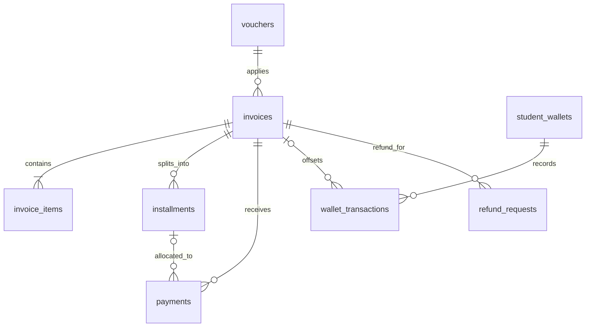

### 6.2. Danh sách 8 Bảng

#### `finance.vouchers` — Chiến dịch Voucher
| Cột | Kiểu | Nullable | Default | Ràng buộc |
|-----|------|:--------:|---------|-----------|
| `id` | SERIAL | NO | Auto | PK |
| `code` | VARCHAR(50) | NO | – | UNIQUE NOT NULL |
| `campaign_name` | VARCHAR(150) | NO | 'Chiến dịch ưu đãi học phí' | NOT NULL |
| `discount_percent` | INTEGER | NO | 0 | CHECK 0–100 |
| `discount_amount` | DECIMAL(12,2) | NO | 0 | CHECK >= 0 |
| `min_order_value` | DECIMAL(12,2) | NO | 0 | CHECK >= 0 |
| `max_discount_amount` | DECIMAL(12,2) | YES | NULL | Mức giảm tối đa (khi dùng percent) |
| `max_uses` | INTEGER | NO | 100 | CHECK > 0 |
| `current_uses` | INTEGER | NO | 0 | CHECK >= 0; <= max_uses |
| `valid_from` | TIMESTAMP | NO | NOW() | – |
| `expires_at` | TIMESTAMP | NO | – | NOT NULL; > valid_from |
| `is_active` | BOOLEAN | NO | TRUE | – |
| `created_at` | TIMESTAMP | NO | NOW() | – |

#### `finance.invoices` — Hóa đơn học phí
| Cột | Kiểu | Nullable | Default | Ràng buộc |
|-----|------|:--------:|---------|-----------|
| `id` | SERIAL | NO | Auto | PK |
| `invoice_code` | VARCHAR(50) | NO | – | UNIQUE NOT NULL |
| `student_id` | INTEGER | NO | – | **Logical FK** → student.students(id) |
| `course_id` | INTEGER | NO | – | **Logical FK** → admission.courses(id) |
| `enrollment_id` | INTEGER | YES | NULL | **Logical FK** → admission.enrollments(id) |
| `invoice_type` | VARCHAR(30) | NO | 'COURSE_PACKAGE' | CHECK IN ('COURSE_PACKAGE','STANDALONE_RETAKE','MIXED') |
| `amount` | DECIMAL(12,2) | NO | – | CHECK >= 0 |
| `voucher_id` | INTEGER | YES | NULL | FK→vouchers ON DELETE SET NULL |
| `discount_applied` | DECIMAL(12,2) | NO | 0 | CHECK >= 0 |
| `final_amount` | DECIMAL(12,2) | NO | – | CHECK >= 0; = amount - discount_applied |
| `paid_amount` | DECIMAL(12,2) | NO | 0 | CHECK >= 0; <= final_amount |
| `remaining_amount` | DECIMAL(12,2) | GENERATED | – | ALWAYS = final_amount - paid_amount |
| `status` | VARCHAR(20) | NO | 'PENDING' | CHECK IN ('PENDING','PARTIAL','PAID','CANCELLED','REFUNDED') |
| `due_date` | DATE | YES | NULL | – |
| `notes` | TEXT | YES | NULL | – |
| `created_at` | TIMESTAMP | NO | NOW() | – |
| `paid_at` | TIMESTAMP | YES | NULL | – |

#### `finance.invoice_items` — Chi tiết khoản mục
| Cột | Kiểu | Nullable | Default | Ràng buộc |
|-----|------|:--------:|---------|-----------|
| `id` | SERIAL | NO | Auto | PK |
| `invoice_id` | INTEGER | NO | – | FK→invoices ON DELETE CASCADE |
| `course_id` | INTEGER | YES | NULL | **Logical FK** → admission.courses(id) |
| `item_type` | VARCHAR(30) | NO | – | CHECK IN ('TUITION_PACKAGE','RETAKE_FEE') |
| `description` | VARCHAR(255) | NO | – | NOT NULL |
| `quantity` | INTEGER | NO | 1 | CHECK > 0 |
| `unit_price` | DECIMAL(12,2) | NO | – | CHECK >= 0 |
| `line_total` | DECIMAL(12,2) | NO | – | CHECK >= 0; = quantity × unit_price |
| `created_at` | TIMESTAMP | NO | NOW() | – |

#### `finance.installments` — Kỳ thanh toán
| Cột | Kiểu | Nullable | Default | Ràng buộc |
|-----|------|:--------:|---------|-----------|
| `id` | SERIAL | NO | Auto | PK |
| `invoice_id` | INTEGER | NO | – | FK→invoices ON DELETE CASCADE |
| `installment_no` | INTEGER | NO | – | CHECK >= 1; UNIQUE(invoice_id, installment_no) |
| `payment_ref_code` | VARCHAR(50) | NO | – | UNIQUE NOT NULL |
| `amount_due` | DECIMAL(12,2) | NO | – | CHECK > 0 |
| `amount_paid` | DECIMAL(12,2) | NO | 0 | CHECK >= 0 |
| `due_date` | DATE | NO | – | NOT NULL |
| `status` | VARCHAR(20) | NO | 'PENDING' | CHECK IN ('PENDING','PARTIAL','PAID','OVERDUE','CANCELLED') |
| `paid_at` | TIMESTAMP | YES | NULL | – |
| `created_at` | TIMESTAMP | NO | NOW() | – |

#### `finance.payments` — Phiếu thu
| Cột | Kiểu | Nullable | Default | Ràng buộc |
|-----|------|:--------:|---------|-----------|
| `id` | SERIAL | NO | Auto | PK |
| `payment_code` | VARCHAR(50) | NO | – | UNIQUE NOT NULL |
| `invoice_id` | INTEGER | NO | – | FK→invoices ON DELETE RESTRICT |
| `installment_id` | INTEGER | YES | NULL | FK→installments ON DELETE SET NULL |
| `payment_method` | VARCHAR(20) | NO | – | CHECK IN ('CASH','VIETQR','WALLET_OFFSET') |
| `amount` | DECIMAL(12,2) | NO | – | CHECK > 0 |
| `bank_transaction_id` | VARCHAR(100) | YES | NULL | UNIQUE; Idempotency INV-FIN-05 |
| `qr_reference_code` | VARCHAR(50) | YES | NULL | – |
| `webhook_payload` | JSONB | YES | NULL | Raw payload từ bank webhook |
| `received_by_staff_id` | INTEGER | YES | NULL | **Logical FK** → admission.users(id) |
| `status` | VARCHAR(20) | NO | 'SUCCESS' | CHECK IN ('PENDING','SUCCESS','FAILED') |
| `paid_at` | TIMESTAMP | NO | NOW() | – |

#### `finance.student_wallets` — Ví bảo lưu
| Cột | Kiểu | Nullable | Default | Ràng buộc |
|-----|------|:--------:|---------|-----------|
| `id` | SERIAL | NO | Auto | PK |
| `student_id` | INTEGER | NO | – | UNIQUE NOT NULL; **Logical FK** → student.students(id) |
| `balance` | DECIMAL(12,2) | NO | 0 | CHECK >= 0 |
| `is_withdrawable` | BOOLEAN | NO | FALSE | INV-FIN-06: luôn FALSE |
| `status` | VARCHAR(20) | NO | 'ACTIVE' | CHECK IN ('ACTIVE','FROZEN') |
| `updated_at` | TIMESTAMP | NO | NOW() | – |

#### `finance.wallet_transactions` — Lịch sử giao dịch ví
| Cột | Kiểu | Nullable | Default | Ràng buộc |
|-----|------|:--------:|---------|-----------|
| `id` | SERIAL | NO | Auto | PK |
| `wallet_id` | INTEGER | NO | – | FK→student_wallets ON DELETE RESTRICT |
| `tx_type` | VARCHAR(30) | NO | – | CHECK IN ('RESERVATION_CREDIT','TUITION_OFFSET','ADJUSTMENT') |
| `amount` | DECIMAL(12,2) | NO | – | CHECK > 0 |
| `related_invoice_id` | INTEGER | YES | NULL | FK→invoices ON DELETE SET NULL |
| `reason` | TEXT | NO | – | NOT NULL |
| `created_by_staff_id` | INTEGER | YES | NULL | **Logical FK** → admission.users(id) |
| `created_at` | TIMESTAMP | NO | NOW() | – |

#### `finance.refund_requests` — Yêu cầu hoàn tiền 3 cấp
| Cột | Kiểu | Nullable | Default | Ràng buộc |
|-----|------|:--------:|---------|-----------|
| `id` | SERIAL | NO | Auto | PK |
| `refund_code` | VARCHAR(50) | NO | – | UNIQUE NOT NULL |
| `invoice_id` | INTEGER | NO | – | FK→invoices ON DELETE RESTRICT |
| `student_id` | INTEGER | NO | – | **Logical FK** → student.students(id) |
| `class_id` | INTEGER | YES | NULL | **Logical FK** → admission.classes(id) |
| `total_sessions` | INTEGER | NO | – | CHECK > 0 |
| `attended_sessions` | INTEGER | NO | – | CHECK >= 0; <= max_allowed_sessions |
| `max_allowed_sessions` | INTEGER | NO | 3 | – |
| `paid_amount_snapshot` | DECIMAL(12,2) | NO | – | Snapshot tại thời điểm yêu cầu |
| `refundable_percent` | INTEGER | NO | – | CHECK BETWEEN 0 AND 100 |
| `deduction_amount` | DECIMAL(12,2) | NO | 0 | – |
| `requested_refund_amount` | DECIMAL(12,2) | NO | – | CHECK >= 0 |
| `approved_refund_amount` | DECIMAL(12,2) | YES | NULL | CHECK >= 0 |
| `reason` | TEXT | NO | – | NOT NULL |
| `bank_name` | VARCHAR(100) | YES | NULL | – |
| `bank_account_no` | VARCHAR(50) | YES | NULL | – |
| `bank_account_holder` | VARCHAR(150) | YES | NULL | – |
| `status` | VARCHAR(30) | NO | 'PENDING_ACCOUNTANT' | CHECK IN ('PENDING_ACCOUNTANT','PENDING_DIRECTOR','APPROVED','REJECTED','COMPLETED') |
| `requested_by_staff_id` | INTEGER | NO | – | **Logical FK** → admission.users(id) |
| `requested_at` | TIMESTAMP | NO | NOW() | – |
| `verified_by_accountant_id` | INTEGER | YES | NULL | **Logical FK** → admission.users(id) |
| `verified_at` | TIMESTAMP | YES | NULL | – |
| `accountant_note` | TEXT | YES | NULL | – |
| `approved_by_director_id` | INTEGER | YES | NULL | **Logical FK** → admission.users(id) role=ADMIN |
| `approved_at` | TIMESTAMP | YES | NULL | – |
| `director_note` | TEXT | YES | NULL | – |
| `completed_at` | TIMESTAMP | YES | NULL | – |

---

## 7. State Machines

### 7.1. Vòng đời Đơn tuyển sinh (`admission.enrollments.status`)

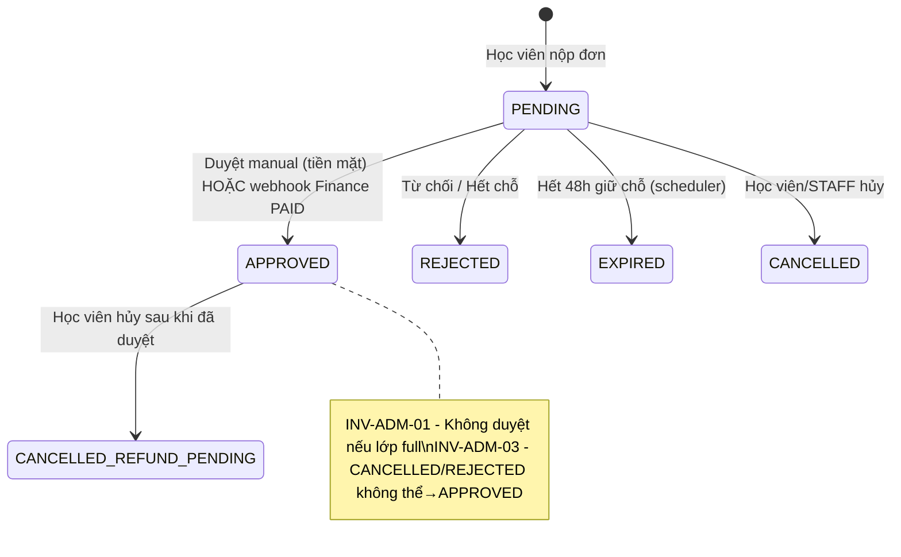

### 7.2. Vòng đời Học viên (`student.students.status`)

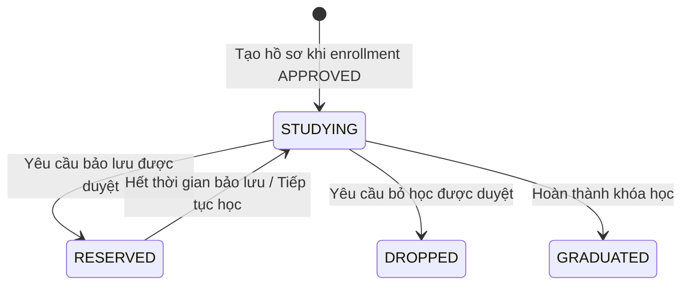

### 7.3. Vòng đời Hóa đơn (`finance.invoices.status`)

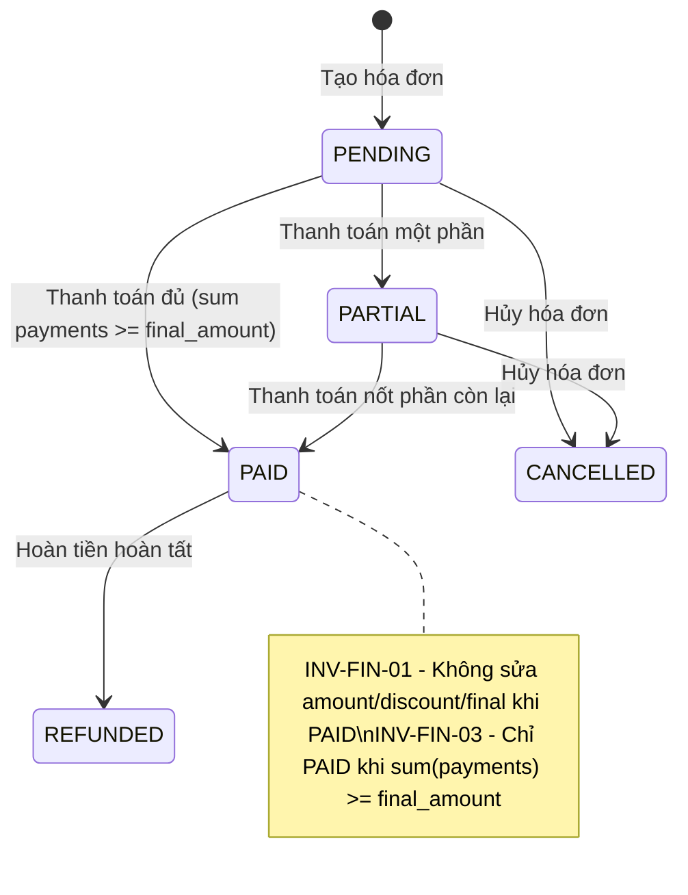

### 7.4. Vòng đời Kỳ thanh toán (`finance.installments.status`)

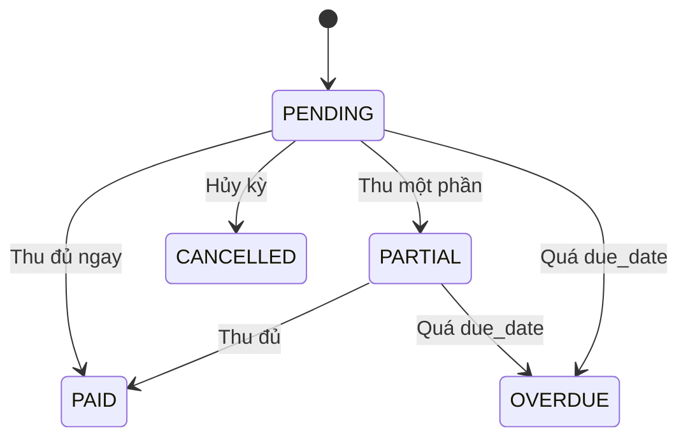

### 7.5. Vòng đời Yêu cầu Hoàn tiền (`finance.refund_requests.status`)

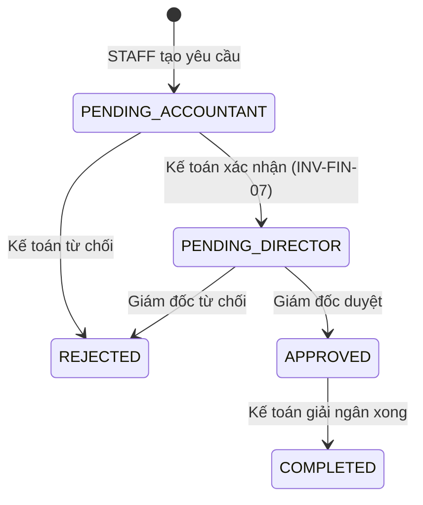

---

## 8. API Contract Rules

### 8.1. URL Pattern

| Service | Base URL (qua Gateway) | Base URL (trực tiếp) |
|---------|----------------------|---------------------|
| Admission | `http://localhost:8080/api/admission/` | `http://localhost:8081/api/admission/` |
| Student | `http://localhost:8080/api/student/` | `http://localhost:8082/api/student/` |
| Learning | `http://localhost:8080/api/learning/` | `http://localhost:8083/api/learning/` |
| Finance | `http://localhost:8080/api/finance/` | `http://localhost:8084/api/finance/` |

### 8.2. Request/Response Format

```
Content-Type: application/json
Accept: application/json
Authorization: Bearer <access_token>   (tất cả API cần xác thực)
X-Internal-Secret: <secret>            (chỉ Webhook nội bộ)
```

### 8.3. Response Structure

```json
// Thành công (200, 201)
{
  "success": true,
  "data": { ... },
  "message": "Thao tác thành công"
}

// Lỗi (400, 401, 403, 404, 409, 422, 500)
{
  "success": false,
  "error": {
    "code": "ADM_CLASS_FULL",
    "message": "Lớp học đã đủ sĩ số tối đa"
  }
}

// Danh sách có phân trang
{
  "success": true,
  "data": {
    "items": [ ... ],
    "total": 100,
    "page": 0,
    "size": 20,
    "total_pages": 5
  }
}
```

### 8.4. Mã lỗi theo Service

| Prefix | Service | Ví dụ |
|--------|---------|-------|
| `AUTH_` | Auth (Admission) | AUTH_INVALID_CREDENTIALS, AUTH_TOKEN_EXPIRED |
| `ADM_` | Admission | ADM_CLASS_FULL, ADM_COURSE_NOT_FOUND |
| `STU_` | Student | STU_NOT_FOUND, STU_DUPLICATE_ATTENDANCE |
| `LRN_` | Learning | LRN_INVALID_SCORE, LRN_MATERIAL_NOT_FOUND |
| `FIN_` | Finance | FIN_INVOICE_PAID, FIN_VOUCHER_EXPIRED |

### 8.5. HTTP Status Codes

| Code | Ý nghĩa | Khi dùng |
|------|---------|---------|
| 200 | OK | GET thành công, UPDATE thành công |
| 201 | Created | POST tạo mới thành công |
| 204 | No Content | DELETE thành công |
| 400 | Bad Request | Dữ liệu đầu vào không hợp lệ |
| 401 | Unauthorized | Thiếu hoặc hết hạn token |
| 403 | Forbidden | Không đủ quyền (sai role) |
| 404 | Not Found | Entity không tồn tại |
| 409 | Conflict | Trùng lặp (duplicate key, state conflict) |
| 422 | Unprocessable Entity | Vi phạm business rule (INV-ADM-01...) |
| 500 | Internal Server Error | Lỗi hệ thống |

### 8.6. Phân quyền RBAC

| Role | Quyền |
|------|-------|
| `ADMIN` | Toàn quyền hệ thống |
| `STAFF` | Quản lý khóa/lớp/phòng, tuyển sinh, lập hóa đơn, duyệt yêu cầu học vụ |
| `TEACHER` | Xem lớp mình dạy, điểm danh lớp mình, nhập điểm bài mình phụ trách |
| `STUDENT` | Xem thông tin cá nhân, điểm thi, tài liệu lớp đang học, hóa đơn của bản thân |

---

## 9. Inter-Service Communication

### 9.1. Sơ đồ giao tiếp liên service

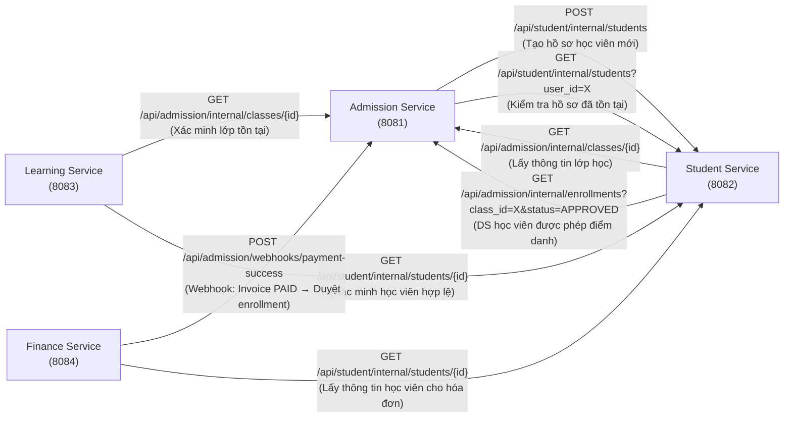

### 9.2. Chi tiết 8 Luồng Giao tiếp

#### Luồng 1: Admission → Student (Tạo hồ sơ tự động)
```
Trigger: enrollment.status chuyển sang APPROVED
Caller: Admission Service
Callee: Student Service

POST http://student-svc:8082/api/student/internal/students
Headers:
  Content-Type: application/json
  X-Internal-Secret: <INTERNAL_SECRET_KEY>

Body:
{
  "user_id": 42,
  "full_name": "Trần Văn Nam",
  "email": "nam@example.com",
  "phone": "0901234567",
  "date_of_birth": "2000-05-15"
}

Response 201:
{
  "success": true,
  "data": {
    "student_id": 1,
    "student_code": "STU-202611-0001"
  }
}

Idempotency: Nếu student với user_id đã tồn tại → trả 200 OK với data hiện có
```

#### Luồng 2: Student → Admission (Lấy danh sách enrollment)
```
Trigger: Giáo viên/STAFF điểm danh hoặc học viên xem lịch học
Caller: Student Service
Callee: Admission Service

GET http://admission-svc:8081/api/admission/internal/enrollments?class_id=5&status=APPROVED
Headers:
  X-Internal-Secret: <INTERNAL_SECRET_KEY>

Response 200:
{
  "success": true,
  "data": [
    { "student_id": 42, "enrollment_id": 100, "enrolled_at": "2026-11-01T10:00:00Z" }
  ]
}
```

#### Luồng 3: Finance → Admission (Webhook thanh toán thành công)
```
Trigger: Payment VietQR callback từ bank / Thu tiền mặt tại quầy
Caller: Finance Service
Callee: Admission Service (webhook endpoint)

POST http://admission-svc:8081/api/admission/webhooks/payment-success
Headers:
  Content-Type: application/json
  X-Internal-Secret: <INTERNAL_SECRET_KEY>

Body:
{
  "event_id": "EVT-20261108-001",
  "enrollment_id": 100,
  "invoice_id": 55,
  "invoice_code": "INV-202611-0001",
  "amount_paid": 6500000,
  "payment_method": "VIETQR",
  "paid_at": "2026-11-08T09:00:00Z"
}

Response 200: { "success": true, "data": { "enrollment_id": 100, "new_status": "APPROVED" } }
Response 422: { "success": false, "error": { "code": "ADM_CLASS_FULL", "message": "..." } }

Idempotency: event_id UNIQUE → xử lý 1 lần duy nhất
```

#### Luồng 4: Learning → Admission (Xác minh lớp học)
```
Trigger: Teacher upload học liệu hoặc nhập điểm
Caller: Learning Service
Callee: Admission Service

GET http://admission-svc:8081/api/admission/internal/classes/{class_id}
Headers: X-Internal-Secret: <INTERNAL_SECRET_KEY>

Response 200:
{
  "success": true,
  "data": {
    "id": 5,
    "code": "CLS-IELTS-FOUND-01",
    "teacher_id": 3,
    "status": "IN_PROGRESS"
  }
}
```

#### Luồng 5: Learning → Student (Xác minh học viên hợp lệ)
```
Trigger: Nhập điểm cho học viên
Caller: Learning Service
Callee: Student Service

GET http://student-svc:8082/api/student/internal/students/{student_id}
Headers: X-Internal-Secret: <INTERNAL_SECRET_KEY>

Response 200: { "success": true, "data": { "id": 1, "student_code": "STU-202611-0001", "status": "STUDYING" } }
Response 404: { "success": false, "error": { "code": "STU_NOT_FOUND", "message": "Học viên không tồn tại" } }
```

#### Luồng 6: Finance → Student (Lấy thông tin học viên)
```
Trigger: Tạo hóa đơn hoặc kiểm tra ví
Caller: Finance Service
Callee: Student Service

GET http://student-svc:8082/api/student/internal/students?user_id={user_id}
Headers: X-Internal-Secret: <INTERNAL_SECRET_KEY>
```

#### Luồng 7: Finance → Admission (Lấy thông tin khóa học)
```
Trigger: Tạo hóa đơn → cần tuition_amount của course
Caller: Finance Service
Callee: Admission Service

GET http://admission-svc:8081/api/admission/internal/courses/{course_id}
Headers: X-Internal-Secret: <INTERNAL_SECRET_KEY>
```

#### Luồng 8: Student → Finance (Kiểm tra ví bảo lưu)
```
Trigger: Học viên yêu cầu bảo lưu → Admission/Student cần kiểm tra ví
Caller: Student Service
Callee: Finance Service

GET http://finance-svc:8084/api/finance/internal/wallets?student_id={id}
Headers: X-Internal-Secret: <INTERNAL_SECRET_KEY>
```

#### Luồng 9: Admission → Finance (Sinh hóa đơn khi nộp đơn tuyển sinh)
```
Trigger: Enrollment được tạo (PENDING, giữ chỗ 48h)
Caller: Admission Service  →  Callee: Finance Service

POST http://finance-svc:8084/api/finance/invoices/auto-generate
Headers: X-Internal-Secret: <INTERNAL_SECRET_KEY>
Body: { "enrollment_id": 100, "student_id": 42, "course_id": 2, "voucher_code": null }
Response 201: { "success": true, "data": { "invoice_id": 55, "invoice_code": "INV-202611-0001" } }

Sau đó Admission lưu enrollments.invoice_code = invoice_code.
Idempotency: cùng enrollment_id chỉ sinh 1 hóa đơn.
```

#### Luồng 10: Finance → Learning / Student (Dữ liệu số buổi học để xét hoàn tiền)
```
Trigger: STAFF tạo refund request (INV-FIN-07: attended_sessions <= max_allowed_sessions)
Caller: Finance Service  →  Callee: Student Service (attendance) / Admission (total_sessions của lớp)

Finance KHÔNG tự query bảng attendance. Số buổi đã tham gia lấy qua REST:
GET http://student-svc:8082/api/student/internal/attendance/summary?student_id={id}&class_id={id}
```

#### Luồng 11: Teacher validation (Learning → Admission, INV-LRN-03 / INV-SEC-02)
```
Trước khi ghi điểm: Learning gọi GET /api/admission/internal/classes/{class_id}
và so sánh teacher_id với user_id trong JWT. Không khớp → 403 LRN_FORBIDDEN_CLASS.
```

#### Luồng 12: Admission scheduler hết hạn giữ chỗ (nội bộ Admission)
```
Job mỗi 15 phút: enrollments PENDING có hold_expires_at < NOW() → EXPIRED.
Khi tính slot (INV-ENR-01) chỉ đếm APPROVED + PENDING có hold_expires_at > NOW().
Callback PAID đến sau khi đơn EXPIRED/CANCELLED (INV-ENR-03): KHÔNG tự APPROVED,
ghi vào processed_finance_events để đối soát và chuyển nhân viên xử lý hoàn tiền/ví bảo lưu.
```

> [!NOTE]
> **Lưu ý đường dẫn Internal API:** docs của nhóm Student dùng `GET /api/v1/internal/enrollments?class_id={id}&status=APPROVED`, còn bản Master này dùng prefix `/api/<service>/internal/...`. Hai nhóm cần thống nhất một dạng duy nhất khi code. Đề xuất: dùng dạng `/api/<service>/internal/...` của bản Master.

### 9.3. Quy tắc Internal API

| Quy tắc | Mô tả |
|---------|-------|
| Prefix URL | `/api/<service>/internal/` — không expose qua Nginx Gateway |
| Bảo mật | Header `X-Internal-Secret` = env var `INTERNAL_SECRET_KEY` (giống nhau cho cả 4 service) |
| Timeout | Mặc định 5 giây; retry tối đa 3 lần với exponential backoff |
| Idempotency | Mọi POST nội bộ phải có `event_id` UNIQUE; callee tự deduplicate |
| Error Handling | Nếu callee không phản hồi → caller phải rollback transaction và log lỗi |

---

## 10. System Invariants

### 10.1. Bảng 15 Bất biến Hệ thống

| ID | Tên | Mô tả | Mức độ |
|----|-----|-------|--------|
| **INV-SEC-01** | Cô lập hồ sơ học viên | Học viên A tuyệt đối không xem/sửa hồ sơ của học viên B | P0 |
| **INV-SEC-02** | Ranh giới điểm giáo viên | Giáo viên không nhập/sửa điểm lớp không được phân công | P0 |
| **INV-SEC-03** | Bảo mật bí mật hệ thống | Không commit `.env` thật; JWT secret qua biến môi trường | P0 |
| **INV-ADM-01** | Giới hạn sĩ số tối đa | Không duyệt enrollment nếu lớp đã đủ `max_students` | P0 |
| **INV-ADM-02** | Mã khóa học duy nhất | Không tồn tại 2 khóa học cùng `code` | P0 |
| **INV-ADM-03** | State machine đăng ký | CANCELLED/REJECTED không thể chuyển sang APPROVED | P1 |
| **INV-STU-01** | Điểm danh đơn nhất | Mỗi học viên chỉ có 1 bản ghi điểm danh/buổi/lớp | P1 |
| **INV-STU-02** | Trạng thái học vụ hợp lệ | Chỉ 1 trong 4 trạng thái: STUDYING, RESERVED, DROPPED, GRADUATED | P1 |
| **INV-LRN-01** | Giới hạn điểm số hợp lệ | `0.0 <= score <= max_score` | P0 |
| **INV-LRN-02** | Cô lập điểm thi học viên | Học viên chỉ xem điểm của chính mình | P0 |
| **INV-FIN-01** | Hóa đơn đã thanh toán | Invoice PAID/REFUNDED không được sửa amount/discount/final | P0 |
| **INV-FIN-02** | Chống thanh toán trùng lặp | `bank_transaction_id` UNIQUE; Idempotency VietQR webhook | P0 |
| **INV-FIN-03** | Khớp trạng thái hóa đơn | Chỉ PAID khi `sum(payments.amount) >= final_amount` | P0 |
| **INV-SYS-01** | API JSON snake_case | Toàn bộ payload request/response dùng `snake_case` | P1 |
| **INV-SYS-02** | Cô lập Schema Database | Mỗi service chỉ truy cập schema của chính mình | P0 |

---

### 10.2. Bất biến chi tiết theo module (bổ sung từ docs các nhóm)

| ID | Module | Quy tắc |
|----|--------|---------|
| INV-ADM-01+ | Admission | Slot = APPROVED + PENDING còn hạn giữ chỗ; kiểm tra nguyên tử bằng Pessimistic Lock |
| INV-ADM-02+ | Admission | `courses.code` và `classes.code` UNIQUE |
| INV-FAC-03 | Admission | `class.max_students <= room.capacity` |
| INV-CON-01 | Admission | Không trùng phòng + khung giờ + day_pattern với lớp OPEN/IN_PROGRESS khác |
| INV-CON-02 | Admission | Không trùng giáo viên + khung giờ + day_pattern |
| INV-ENR-01 | Admission | Đơn PENDING hết hạn không chiếm slot dù job chưa chạy |
| INV-ENR-02 | Admission | `finance_event_id` UNIQUE; callback trùng trả 200 OK |
| INV-ENR-03 | Admission | PAID đến muộn sau EXPIRED/CANCELLED không tự APPROVED; ghi để đối soát |
| INV-TST-01 | Admission | Chấm điểm server-side từ `correct_option` |
| INV-TST-02 | Admission | Một attempt chỉ có một submission (`attempt_id` UNIQUE) |
| INV-STU-03 | Student | Không tạo bảng `class_members`; DS lớp lấy từ Admission qua REST |
| INV-STU-04 | Student | Bảo lưu (RESERVED) tối đa 6 tháng |
| INV-STU-05 | Student | `student_code` UNIQUE, sinh tự động |
| INV-STU-06 | Student | `students.email` UNIQUE |
| INV-LRN-03 | Learning | Giáo viên chỉ nhập điểm lớp mình dạy (kiểm tra qua Admission) |
| INV-LRN-04 | Learning | `file_url` không rỗng |
| INV-LRN-05 | Learning | Pass khi `average_percentage >= 50` |
| INV-LRN-06 | Learning | UNIQUE(class_id, student_id, assessment_name) |
| INV-FIN-04 | Finance | Voucher: `SELECT ... FOR UPDATE` trước khi tăng `current_uses` |
| INV-FIN-06 | Finance | `is_withdrawable` luôn FALSE; ví chỉ giảm qua TUITION_OFFSET |
| INV-FIN-07 | Finance | Hoàn tiền chỉ khi `attended_sessions <= max_allowed_sessions` |
| INV-FIN-08 | Finance | Hoàn tiền phải qua đủ 3 cấp duyệt |

> [!WARNING]
> **Trùng mã INV-FIN giữa hai tài liệu.** `docs/invariants.md` (cấp hệ thống) định nghĩa INV-FIN-01..03 theo nghĩa khác với `finance-schema-spec.md` (cấp module Finance). Nên đổi tiền tố bên Finance thành `INV-FINM-xx` hoặc thống nhất lại để test không nhầm.

---

## 11. Danh mục API Endpoints (Tóm tắt)

### 11.1. Admission Service (55 endpoints)

| Nhóm | Endpoints |
|------|-----------|
| **IAM - Xác thực** | POST /auth/login, /auth/refresh, /auth/logout, /auth/forgot-password, /auth/reset-password, /auth/change-password; GET /auth/me |
| **IAM - Users** | GET/POST /users; GET/PUT/PATCH /users/{id}; PATCH /users/{id}/status |
| **IAM - Audit** | GET /audit-logs |
| **FAC - Rooms** | GET/POST /rooms; GET/PUT/PATCH /rooms/{id}; PATCH /rooms/{id}/status; GET /rooms/{id}/schedule |
| **ACA - Courses** | GET/POST /courses; GET/PUT/DELETE /courses/{id} |
| **ACA - Classes** | GET/POST /classes; GET/PUT /classes/{id}; PATCH /classes/{id}/status; GET /classes/{id}/capacity; POST /classes/check-conflict |
| **TST - Tests** | GET/POST /tests/sets; GET/PUT /tests/sets/{id}; POST /tests/sets/{id}/questions; PUT/DELETE /tests/questions/{id}; GET /tests/public/{id}/start; POST /tests/public/submit; GET /tests/submissions/{id}; GET/POST /tests/rules |
| **ENR - Enrollments** | POST /enrollments; GET /enrollments; GET /enrollments/{id}; POST /enrollments/{id}/extend-hold; POST /enrollments/{id}/approve-manual; PATCH /enrollments/{id}/cancel; POST /webhooks/payment-success |
| **OPS - Export** | GET /exports/classes/{id}/roster; GET /exports/tests/{id}/results |
| **BI** | GET /bi/funnel; GET /bi/courses-revenue; GET /bi/security-engagement |

### 11.2. Student Service (theo docs nhóm Student, prefix `/api/v1`)

| Method | Endpoint | Quyền | Mô tả |
|--------|----------|-------|-------|
| GET | /api/v1/students | ADMIN, STAFF | Danh sách học viên, phân trang, tìm theo tên/mã |
| POST | /api/v1/students | ADMIN, STAFF | Tạo hồ sơ (tự sinh `student_code`) |
| GET | /api/v1/students/{id} | ADMIN, STAFF, STUDENT (own) | Chi tiết hồ sơ |
| PUT | /api/v1/students/{id} | ADMIN, STAFF, STUDENT (own) | Cập nhật thông tin |
| GET | /api/v1/classes/{class_id}/members | TEACHER, STAFF | DS học viên lớp (gọi nội bộ sang Admission) |
| POST | /api/v1/attendance | TEACHER, STAFF | Điểm danh |
| POST | /api/v1/status-requests | STUDENT | Gửi yêu cầu bảo lưu/chuyển/bỏ học |
| PUT | /api/v1/status-requests/{id}/approve | STAFF | Duyệt yêu cầu, tự cập nhật `students.status` |
| POST | /api/student/students (internal) | Admission | Tạo hồ sơ khi enrollment APPROVED |

### 11.3. Learning Service

| Method | Endpoint | Quyền | Mô tả |
|--------|----------|-------|-------|
| GET | /api/learning/materials?class_id= | Authenticated | Danh sách học liệu |
| POST | /api/learning/materials | ADMIN, STAFF, TEACHER | Thêm học liệu |
| DELETE | /api/learning/materials/{material_id} | ADMIN, STAFF, TEACHER | Xóa học liệu |
| GET | /api/learning/grades | Authenticated | Xem điểm (STUDENT chỉ xem của mình, lấy `student_id` từ JWT) |
| POST | /api/learning/grades | TEACHER, STAFF, ADMIN | Nhập điểm |

Các view `v_student_grade_summary`, `v_class_pass_rate` phục vụ báo cáo LRN-03 (endpoint báo cáo do nhóm Learning bổ sung).

### 11.4. Finance Service (port 8084)

| Method | Endpoint | Quyền | Mô tả |
|--------|----------|-------|-------|
| POST | /api/finance/vouchers | ADMIN, STAFF | Tạo chiến dịch voucher |
| GET | /api/finance/vouchers | ADMIN, STAFF | Danh sách voucher |
| POST | /api/finance/vouchers/validate | ADMIN, STAFF, STUDENT | Kiểm tra voucher và tính giảm giá |
| POST | /api/finance/invoices/auto-generate | ADMIN, STAFF, Internal | Sinh hóa đơn khi Admission chốt đăng ký |
| GET | /api/finance/invoices | ADMIN, STAFF, STUDENT | Danh sách hóa đơn |
| GET | /api/finance/invoices/{id} | ADMIN, STAFF, STUDENT | Chi tiết hóa đơn + khoản mục + trả góp |
| POST | /api/finance/payments/cash | ADMIN, STAFF | Ghi nhận thu tiền mặt |
| GET | /api/finance/invoices/{id}/vietqr | STUDENT, STAFF | Lấy mã VietQR động |
| POST | /api/finance/webhooks/vietqr | Webhook ngân hàng | Nhận webhook, gạch nợ tự động |
| GET | /api/finance/wallets/{student_id} | ADMIN, STAFF, STUDENT | Tra cứu ví bảo lưu |
| POST | /api/finance/wallets/{student_id}/reserve | ADMIN, STAFF | Cộng tiền bảo lưu / cấn trừ học phí |
| POST | /api/finance/refunds | STAFF (cấp 1) | Khởi tạo yêu cầu hoàn tiền |
| PUT | /api/finance/refunds/{id}/verify | STAFF kế toán (cấp 2) | Kế toán xác minh |
| PUT | /api/finance/refunds/{id}/approve | ADMIN giám đốc (cấp 3) | Giám đốc phê duyệt |
| PUT | /api/finance/refunds/{id}/complete | STAFF kế toán | Ghi nhận giải ngân |
| GET | /api/finance/bi/cash-revenue | ADMIN, STAFF | BI doanh thu thực thu theo tháng |
| GET | /api/finance/bi/voucher-campaigns | ADMIN, STAFF | BI hiệu quả voucher |
| GET | /api/finance/bi/refund-summary | ADMIN, STAFF | BI hoàn phí và ví bảo lưu |

---

> [!NOTE]
> File SQL đầy đủ: [`english_center/scripts/init-db.sql`](../scripts/init-db.sql)
> 
> Toàn bộ design này được tổng hợp từ docs của 4 nhóm:
> - Nhóm 1 (Admission): `services/admission/docs/` + `tasks/API_CATALOG.md`
> - Nhóm 2 (Student): `services/student/docs/`
> - Nhóm 3 (Learning): `services/learning/backend/models.py` + docs
> - Nhóm 4 (Finance): `services/finance/docs/finance-schema-spec.md`
