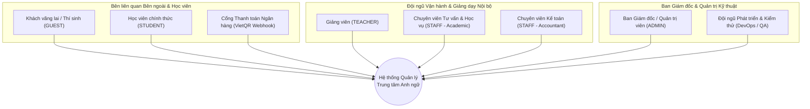
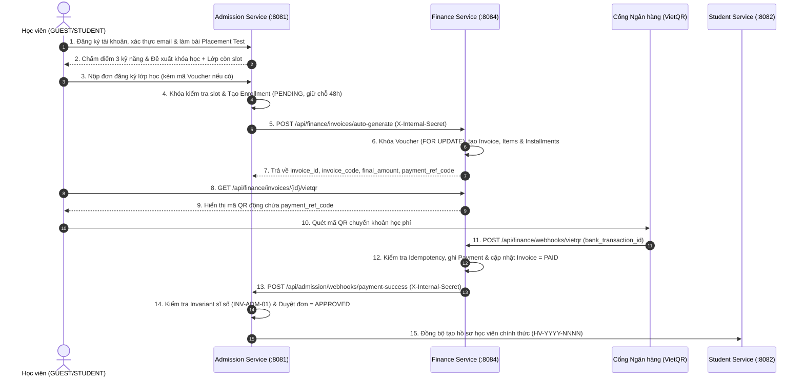

# ĐẶC TẢ YÊU CẦU CÁC BÊN LIÊN QUAN TOÀN HỆ THỐNG (STAKEHOLDER REQUIREMENTS SPECIFICATION - StRS)
## HỆ THỐNG QUẢN LÝ TRUNG TÂM ANH NGỮ (ENGLISH CENTER MANAGEMENT SYSTEM)

> **Mã tài liệu**: `EC-StRS-2026-V1`  
> **Tiêu chuẩn áp dụng**: ISO/IEC/IEEE 29148:2018 (Systems and software engineering — Life cycle processes — Requirements engineering)  
> **Kiến trúc hệ thống**: Polyglot Microservices (Nginx Gateway `:8080`, Admission `:8081`, Student `:8082`, Learning `:8083`, Finance `:8084`, PostgreSQL 16 — 4 Schemas độc lập)  
> **Phiên bản**: `1.0 — Bản hợp nhất toàn dự án`  
> **Ngày ban hành**: `2026-11-11`

---

## MỤC LỤC
1. [Giới thiệu & Mục đích Tài liệu (Introduction)](#1-giới-thiệu--mục-đích-tài-liệu-introduction)
2. [Bối cảnh Nghiệp vụ & Đặt vấn đề (Business Context & Problem Statement)](#2-bối-cảnh-nghiệp-vụ--đặt-vấn-đề-business-context--problem-statement)
3. [Hồ sơ Các Bên Liên Quan (Stakeholder Profiles)](#3-hồ-sơ-các-bên-liên-quan-stakeholder-profiles)
4. [Nhu cầu & Yêu cầu Của Các Bên Liên Quan (Stakeholder Needs & Requirements)](#4-nhu-cầu--yêu-cầu-của-các-bên-liên-quan-stakeholder-needs--requirements)
5. [Kịch bản Vận hành Xuyên Phân hệ (Operational Scenarios / End-to-End Value Streams)](#5-kịch-bản-vận-hành-xuyên-phân-hệ-operational-scenarios--end-to-end-value-streams)
6. [Yêu cầu Chất lượng, Bất biến & Ràng buộc Hệ thống (Quality Attributes, Invariants & Constraints)](#6-yêu-cầu-chất-lượng-bất-biến--ràng-buộc-hệ-thống-quality-attributes-invariants--constraints)
7. [Ma trận Truy vết Yêu cầu Toàn Dự án (End-to-End Traceability Matrix)](#7-ma-trận-truy-vết-yêu-cầu-toàn-dự-án-end-to-end-traceability-matrix)
8. [Tiêu chí Nghiệm thu & Phạm vi Loại trừ (Acceptance Criteria & Explicit Non-Goals)](#8-tiêu-chí-nghiệm-thu--phạm-vi-loại-trừ-acceptance-criteria--explicit-non-goals)

---

## 1. Giới thiệu & Mục đích Tài liệu (Introduction)

### 1.1. Mục đích (Purpose)
Tài liệu **Đặc tả Yêu cầu Các bên Liên quan (StRS - Stakeholder Requirements Specification)** xác định rõ **tại sao (Why)** hệ thống Quản lý Trung tâm Anh ngữ được xây dựng, **ai (Who)** là những bên có quyền lợi/trách nhiệm liên quan, và **những giá trị nghiệp vụ nào (What)** hệ thống bắt buộc phải mang lại cho từng nhóm đối tượng.

Tài liệu này là tầng cao nhất trong tháp đặc tả của dự án, làm cơ sở tham chiếu trực tiếp cho:
- Đặc tả Yêu cầu Nghiệp vụ & BI của 4 phân hệ (`admission-ba-bi-spec.md`, `student-ba-bi-spec.md`, `tong_hop_learning_tinh_nang_va_schema.md`, `finance-ba-bi-spec.md`).
- Thiết kế CSDL Master & Hợp đồng Giao tiếp Liên Service (`docs/MASTER_DB_AND_API_RULES.md`, `scripts/init-db.sql`).
- Bộ Kiểm thử Bất biến Tự động (`tests/invariants/test_*.py`).

### 1.2. Phạm vi Hệ thống (System Scope)
Hệ thống số hóa trọn vẹn vòng đời học viên tại Trung tâm Anh ngữ qua **4 phân hệ Microservices độc lập**:
1. **Phân hệ 1 — Tuyển sinh, Khảo thí & Định danh (`admission-service`, Port `8081`, Schema `admission`)**: Quản lý định danh tập trung (IAM), cơ sở vật chất (phòng học, ca học), danh mục khóa học/lớp học, chống xung đột lịch, khảo thí đầu vào trực tuyến (Placement Test) và giữ chỗ tuyển sinh 48 giờ.
2. **Phân hệ 2 — Quản lý Học viên & Điểm danh (`student-service`, Port `8082`, Schema `student`)**: Quản lý hồ sơ học viên 360 độ (`HV-YYYY-NNNN`), điểm danh điện tử theo buổi học và xử lý yêu cầu học vụ (Bảo lưu, Chuyển lớp, Bỏ học).
3. **Phân hệ 3 — Quản lý Học tập & Bảng điểm (`learning-service`, Port `8083`, Schema `learning`)**: Quản lý kho học liệu số theo lớp học, nhập điểm đánh giá có trọng số và tự động tổng hợp kết quả xếp loại Đạt/Trượt (`Pass`/`Fail`).
4. **Phân hệ 4 — Quản lý Tài chính & Học phí (`finance-service`, Port `8084`, Schema `finance`)**: Quản lý biểu phí, chiến dịch Voucher, tự động phát hành hóa đơn & chia kỳ trả góp, thu tiền mặt tại quầy, đối soát tự động qua Webhook VietQR, quản lý ví bảo lưu nội bộ và phê duyệt hoàn tiền 3 cấp.

### 1.3. Thuật ngữ & Từ viết tắt (Definitions & Acronyms)

| Thuật ngữ / Viết tắt | Giải nghĩa |
|---|---|
| **StRS** | Stakeholder Requirements Specification — Đặc tả Yêu cầu Các bên Liên quan. |
| **IAM / RBAC** | Identity and Access Management / Role-Based Access Control (Phân quyền theo 4 vai trò: `ADMIN`, `STAFF`, `TEACHER`, `STUDENT` + trạng thái `GUEST`). |
| **48h Slot Hold** | Cơ chế giữ chỗ tạm thời 48 giờ cho đơn đăng ký ở trạng thái `PENDING` trước khi hoàn tất đóng học phí. |
| **Logical FK** | Khóa ngoại logic (`INTEGER`) tham chiếu liên schema qua REST API / Webhook, tuyệt đối không tạo Physical FK hay JOIN SQL chéo schema. |
| **R-ID-1 (Identity Bridge)** | Quy ước định danh học viên: `admission.enrollments` và `finance.*` lưu `student_id = admission.users.id`; `student.*` và `learning.*` lưu `student_id = student.students.id`. |
| **VietQR Webhook** | Cơ chế nhận thông báo biến động số dư thời gian thực từ cổng ngân hàng để gạch nợ hóa đơn tự động (Idempotent theo `bank_transaction_id`). |
| **Cash-Basis Revenue** | Doanh thu thực thu tính trên dòng tiền thực tế đã vào quỹ (`CASH` + `VIETQR`) trừ đi tổng tiền đã hoàn trả (`COMPLETED`). |

---

## 2. Bối cảnh Nghiệp vụ & Đặt vấn đề (Business Context & Problem Statement)

### 2.1. Hiện trạng & Nỗi đau Nghiệp vụ (Current Pain Points)
Trước khi triển khai hệ thống tập trung, quy trình vận hành tại các trung tâm Anh ngữ gặp 5 điểm nghẽn nghiêm trọng:
1. **Phễu tuyển sinh rời rạc & vượt sĩ số lớp (Over-enrollment)**: Tư vấn viên giữ chỗ thủ công trên Google Sheets dẫn đến tình trạng một lớp nhận vượt sức chứa phòng học, hoặc học viên giữ chỗ ảo làm mất cơ hội của người đóng tiền thật.
2. **Xung đột lịch phòng & giảng viên**: Việc xếp lớp thủ công thường xuyên gây trùng phòng học hoặc trùng ca dạy của giáo viên.
3. **70% dữ liệu học viên bị phân mảnh**: Thông tin học viên nằm rải rác giữa bộ phận Tư vấn (Excel), Học vụ (Sheets) và Giáo viên (sổ điểm danh/Zalo), gây trùng lặp hồ sơ và thất lạc lịch sử học tập.
4. **85% giáo vụ và giảng viên quá tải vì điểm danh & tính điểm thủ công**: Sai sót khi tính điểm trung bình có trọng số và chậm trễ trong việc cảnh báo học viên nghỉ học hoặc xét điều kiện lên lớp.
5. **Rủi ro thất thoát tài chính & đối soát chậm**: Kế toán phải kiểm tra sao kê ngân hàng bằng mắt, dễ áp dụng lố số lượng Voucher khuyến mãi khi nhiều người đăng ký cùng lúc, và thiếu quy trình kiểm soát chặt chẽ khi xét duyệt hoàn tiền hoặc bảo lưu học phí.

### 2.2. Mục tiêu Chiến lược Của Dự án (Strategic Business Objectives)

| Mã mục tiêu | Mục tiêu chiến lược | Thước đo thành công (Success Metrics / KPIs) |
|---|---|---|
| **BO-01** | **Tự động hóa Phễu Tuyển sinh & Khảo thí Đầu vào** | 100% thí sinh làm bài Placement Test trực tuyến được chấm điểm tự động ngay lập tức và nhận đề xuất khóa học khớp trình độ. |
| **BO-02** | **Bảo toàn Sĩ số & Lịch học Tuyệt đối (Zero Conflict / Zero Over-capacity)** | 0% lớp học bị duyệt vượt `max_students` hoặc vượt sức chứa phòng; 0% ca học bị trùng phòng hoặc trùng giảng viên. |
| **BO-03** | **Hồ sơ Học viên 360 Độ & Số hóa Học vụ** | 100% đơn đăng ký `APPROVED` được đồng bộ tự động sang hồ sơ học viên (`HV-YYYY-NNNN`); điểm danh 1-chạm không trùng lặp. |
| **BO-04** | **Minh bạch Học tập & Đánh giá Trọng số Tự động** | 100% đầu điểm được kiểm soát trong biên `0 <= score <= max_score`; tự động chuẩn hóa thang 100% và xếp loại `Pass`/`Fail`. |
| **BO-05** | **An toàn Dòng tiền, Gạch nợ Thời gian thực & Kiểm soát Hoàn phí 3 Cấp** | 100% giao dịch VietQR đối soát tự động (Idempotent); 0% Voucher vượt trần lượt dùng; 100% yêu cầu hoàn tiền phải qua kiểm tra số buổi học (`<= 3 buổi`) và duyệt đủ 3 cấp. |

---

## 3. Hồ sơ Các Bên Liên Quan (Stakeholder Profiles)

### Bảng Phân tích Chi tiết Các Bên Liên Quan

| Mã | Bên liên quan (Stakeholder) | Vai trò Hệ thống | Mối quan tâm chính (Key Concerns) | Phân hệ Tương tác Chính |
|---|---|---|---|---|
| **SH-01** | **Khách vãng lai / Học viên tiềm năng** | `GUEST` | Xem thông tin khóa học/lịch khai giảng minh bạch; đăng ký tài khoản nhanh; làm bài test xếp lớp trực tuyến và biết ngay kết quả. | `admission` |
| **SH-02** | **Học viên chính thức** | `STUDENT` | Giữ chỗ lớp học 48h; áp mã giảm giá Voucher; quét mã VietQR đóng học phí; xem tài liệu lớp học; xem điểm thi cá nhân; xem số dư ví bảo lưu và gửi đơn xin bảo lưu/chuyển lớp. | `admission`, `student`, `learning`, `finance` |
| **SH-03** | **Giảng viên** | `TEACHER` | Xem lịch giảng dạy không bị chồng chéo; tải học liệu/slide lên cho lớp; điểm danh học viên từng buổi; nhập điểm đánh giá và nhận xét cho lớp mình phụ trách. | `admission`, `student`, `learning` |
| **SH-04** | **Chuyên viên Tư vấn & Học vụ** | `STAFF` (Academic) | Mở lớp học không trùng phòng/giáo viên; hỗ trợ đăng ký tại quầy; gia hạn giữ chỗ; duyệt đơn bảo lưu/chuyển lớp; khởi tạo yêu cầu hoàn tiền cấp 1; xuất báo cáo CSV. | `admission`, `student`, `learning`, `finance` |
| **SH-05** | **Chuyên viên Kế toán** | `STAFF` (Accountant) | Thiết lập biểu phí & chiến dịch Voucher; lập hóa đơn & chia kỳ đóng phí; thu tiền mặt tại quầy; quản lý ví bảo lưu & cấn trừ học phí; xác minh hoàn tiền cấp 2 và giải ngân UNC. | `finance`, `admission` |
| **SH-06** | **Ban Giám đốc & Quản trị viên** | `ADMIN` | Quản trị nhân sự & phân quyền; giám sát an ninh đăng nhập (`auth_audit_logs`); phê duyệt hoàn tiền cấp 3; theo dõi Dashboard BI toàn diện (Phễu tuyển sinh, Lấp đầy lớp, Doanh thu thực thu Cash-basis, Hiệu quả Voucher). | Toàn bộ 4 phân hệ |
| **SH-07** | **Cổng Ngân hàng / VietQR** | `WEBHOOK` | Truyền thông báo giao dịch chuyển khoản sang hệ thống an toàn, chính xác, không bị nhân đôi phiếu thu khi gửi lặp (Retry). | `finance` -> `admission` |
| **SH-08** | **Đội ngũ Kỹ thuật & QA** | `INTERNAL` / DevOps | Cô lập dữ liệu giữa 4 microservice (`INV-SYS-02`), chuẩn hóa giao thức JSON `snake_case` (`INV-SYS-01`), dễ dàng triển khai qua Docker Compose và kiểm thử tự động. | Toàn bộ hệ thống |

---

## 4. Nhu cầu & Yêu cầu Của Các Bên Liên Quan (Stakeholder Needs & Requirements)

### 4.1. Nhóm Yêu cầu từ Khách vãng lai & Học viên (`SH-01`, `SH-02`)

| Mã StR | Mô tả Yêu cầu của Bên liên quan (Stakeholder Requirement) | Phân hệ Đáp ứng | Mức ưu tiên |
|---|---|---|---|
| **STR-STU-01** | **Tra cứu & Khảo thí Đầu vào Trực tuyến**: Khách vãng lai và học viên có thể tra cứu khóa học, lớp học đang mở, đăng ký xác thực tài khoản và thực hiện bài thi khảo thí 3 kỹ năng (Listening, Reading, Grammar) có đồng hồ đếm ngược, tự động chấm điểm và gợi ý khóa học phù hợp kèm danh sách lớp còn chỗ. | `admission` | P0 (Bắt buộc) |
| **STR-STU-02** | **Đăng ký Lớp học & Giữ chỗ 48 Giờ**: Học viên có thể chọn lớp học để đăng ký trực tuyến, được hệ thống giữ chỗ độc quyền trong 48 giờ (`PENDING`) và tự động phát hành hóa đơn học phí tương ứng. | `admission`, `finance` | P0 (Bắt buộc) |
| **STR-STU-03** | **Áp dụng Voucher & Thanh toán VietQR Tức thời**: Học viên có thể kiểm tra mã giảm giá Voucher, lấy mã QR động VietQR theo từng đợt đóng phí (`installments`) và được duyệt vào lớp tự động ngay khi chuyển khoản thành công. | `finance`, `admission` | P0 (Bắt buộc) |
| **STR-STU-04** | **Truy cập Kho Học liệu & Tra cứu Bảng điểm Cá nhân**: Học viên chỉ xem và tải được tài liệu/slide của lớp mình đang học, đồng thời theo dõi điểm các bài kiểm tra và kết quả xếp loại tổng kết (`Pass`/`Fail`) của riêng mình (bảo mật tuyệt đối giữa các học viên). | `learning` | P0 (Bắt buộc) |
| **STR-STU-05** | **Quản lý Hồ sơ, Yêu cầu Học vụ & Ví Bảo lưu**: Học viên có thể xem hồ sơ cá nhân (`HV-YYYY-NNNN`), gửi đơn xin Bảo lưu (`RESERVE`), Chuyển lớp (`TRANSFER`) hoặc Rút hồ sơ (`DROP`), và kiểm tra số dư Ví bảo lưu để cấn trừ cho khóa học tiếp theo. | `student`, `finance` | P1 (Quan trọng) |

---

### 4.2. Nhóm Yêu cầu từ Giảng viên (`SH-03`)

| Mã StR | Mô tả Yêu cầu của Bên liên quan (Stakeholder Requirement) | Phân hệ Đáp ứng | Mức ưu tiên |
|---|---|---|---|
| **STR-TCH-01** | **Điểm danh Điện tử Theo Buổi học**: Giảng viên có thể điểm danh học viên trong lớp theo từng ngày học (`PRESENT`, `ABSENT`, `LATE`, `EXCUSED`) kèm ghi chú, hệ thống tự động chặn ghi trùng điểm danh trong cùng một buổi. | `student` | P0 (Bắt buộc) |
| **STR-TCH-02** | **Đăng tải & Phân phối Học liệu**: Giảng viên có thể đăng tải tài liệu (`DOCUMENT`, `VIDEO`, `EXERCISE`, `SLIDE`) gắn với lớp học cụ thể cho học viên. | `learning` | P1 (Quan trọng) |
| **STR-TCH-03** | **Nhập Điểm Đánh giá Có Trọng số Trong Phạm vi Phân công**: Giảng viên chỉ được nhập/cập nhật điểm (`score`, `max_score`, `weight`, `feedback`) cho các lớp mình trực tiếp giảng dạy; hệ thống tự động chặn điểm âm hoặc điểm vượt quá `max_score`. | `learning`, `admission` | P0 (Bắt buộc) |

---

### 4.3. Nhóm Yêu cầu từ Chuyên viên Tư vấn & Học vụ (`SH-04`)

| Mã StR | Mô tả Yêu cầu của Bên liên quan (Stakeholder Requirement) | Phân hệ Đáp ứng | Mức ưu tiên |
|---|---|---|---|
| **STR-ACA-01** | **Thiết lập Khóa học, Mở Lớp & Chống Xung đột Lịch**: Học vụ có thể quản lý danh mục khóa học (kèm khóa tiên quyết), mở lớp học mới gắn với phòng học và giảng viên; hệ thống tự động kiểm tra trần sức chứa phòng và chặn mọi xung đột lịch phòng/lịch giảng viên. | `admission` | P0 (Bắt buộc) |
| **STR-ACA-02** | **Điều phối Bàn Tuyển sinh, Gia hạn Giữ chỗ & Thu hồi Slot Quá hạn**: Học vụ có thể tiếp nhận học viên đăng ký tại quầy, gia hạn thời gian giữ chỗ kèm lý do nghiệp vụ, hoặc để hệ thống tự động thu hồi slot khi quá hạn 48h (`EXPIRED`). | `admission` | P0 (Bắt buộc) |
| **STR-ACA-03** | **Hủy Lớp Thiếu Sĩ số & Bảo vệ Quyền lợi Học viên (Cascade Cancellation)**: Khi lớp chưa khai giảng không đạt sĩ số tối thiểu (`min_students`), Học vụ có thể hủy lớp: các đơn `PENDING` tự động hủy giải phóng chỗ, các đơn `APPROVED` chuyển sang `CANCELLED_REFUND_PENDING` và đồng bộ yêu cầu hoàn phí 100% sang Finance. | `admission`, `finance` | P0 (Bắt buộc) |
| **STR-ACA-04** | **Xét duyệt Yêu cầu Học vụ & Khởi tạo Hoàn tiền Cấp 1**: Học vụ xem xét duyệt/từ chối đơn xin Bảo lưu, Chuyển lớp, Bỏ học của học viên; khởi tạo yêu cầu hoàn tiền Cấp 1 khi học viên rút hồ sơ sớm (học không quá 3 buổi). | `student`, `finance` | P1 (Quan trọng) |
| **STR-ACA-05** | **Xuất Dữ liệu Vận hành (CSV/Excel)**: Học vụ có thể xuất danh sách học viên theo lớp và bảng điểm khảo thí đầu vào ra file CSV an toàn (chống CSV Injection). | `admission`, `learning` | P1 (Quan trọng) |

---

### 4.4. Nhóm Yêu cầu từ Chuyên viên Kế toán (`SH-05`)

| Mã StR | Mô tả Yêu cầu của Bên liên quan (Stakeholder Requirement) | Phân hệ Đáp ứng | Mức ưu tiên |
|---|---|---|---|
| **STR-FIN-01** | **Quản trị Biểu phí & Chiến dịch Voucher Chống Race Condition**: Kế toán thiết lập học phí chuẩn theo khóa học và phát hành mã giảm giá Voucher (`discount_percent` hoặc `discount_amount`, giới hạn `max_uses`, `min_order_value`, `expires_at`) với cơ chế khóa dòng chống dùng vượt hạn mức. | `finance` | P0 (Bắt buộc) |
| **STR-FIN-02** | **Quản lý Hóa đơn, Chia kỳ Trả góp & Thu tiền mặt Tại quầy**: Kế toán theo dõi hóa đơn (` COURSE_PACKAGE`, `STANDALONE_RETAKE`, `MIXED`), lịch đóng phí nhiều đợt (`installments`), ghi nhận phiếu thu tiền mặt (`CASH`) gắn mã chứng từ duy nhất và tự động cập nhật trạng thái `PARTIAL`/`PAID`. | `finance`, `admission` | P0 (Bắt buộc) |
| **STR-FIN-03** | **Quản lý Ví Bảo lưu & Cấn trừ Học phí Nội bộ**: Kế toán ghi nhận tiền bảo lưu vào ví học viên (`RESERVATION_CREDIT`) và thực hiện cấn trừ sang hóa đơn khóa mới (`TUITION_OFFSET`), đảm bảo ví bảo lưu không bao giờ bị rút thành tiền mặt (`is_withdrawable = FALSE`). | `finance` | P0 (Bắt buộc) |
| **STR-FIN-04** | **Xác minh Hoàn tiền Cấp 2 & Giải ngân Hoàn tất**: Kế toán kiểm tra công nợ và số buổi thực học để xác minh yêu cầu hoàn tiền Cấp 2 (`PENDING_DIRECTOR`), và ghi nhận mã chứng từ Ủy nhiệm chi (`COMPLETED`) sau khi Giám đốc phê duyệt, đồng thời khóa bất biến hóa đơn ở trạng thái `REFUNDED`. | `finance` | P0 (Bắt buộc) |

---

### 4.5. Nhóm Yêu cầu từ Ban Giám đốc & Quản trị Hệ thống (`SH-06`)

| Mã StR | Mô tả Yêu cầu của Bên liên quan (Stakeholder Requirement) | Phân hệ Đáp ứng | Mức ưu tiên |
|---|---|---|---|
| **STR-ADM-01** | **Quản trị Định danh Tập trung, Nhân sự & Kiểm toán Bảo mật**: Giám đốc/Admin tạo và quản lý tài khoản nhân sự (`STAFF`, `TEACHER`), khóa/mở khóa tài khoản, giám sát nhật ký kiểm toán đăng nhập (`auth_audit_logs`) và cảnh báo tấn công Brute-force. | `admission` | P0 (Bắt buộc) |
| **STR-ADM-02** | **Phê duyệt Hoàn tiền Cấp 3 (Chốt kiểm soát cuối)**: Giám đốc là cấp duy nhất có quyền phê duyệt (`APPROVED`) hoặc từ chối (`REJECTED`) số tiền hoàn trả thực tế trên các hồ sơ hoàn phí đã qua Kế toán xác minh. | `finance` | P0 (Bắt buộc) |
| **STR-ADM-03** | **Hệ thống Báo cáo Quản trị Thông minh (Executive BI Dashboards)**: Giám đốc theo dõi trực quan các chỉ số KPI thời gian thực: Phễu chuyển đổi tuyển sinh 4 tầng, Tỷ lệ lấp đầy lớp học (`Occupancy Rate`), Doanh thu thực thu thuần theo tháng (`Cash-Basis Net Revenue`), Dư nợ học phí chờ thu (`Pipeline Revenue`), Hiệu quả chiến dịch Voucher, và DAU/MAU hệ thống. | `admission`, `finance`, `learning` | P1 (Quan trọng) |

---

## 5. Kịch bản Vận hành Xuyên Phân hệ (Operational Scenarios / End-to-End Value Streams)

### 5.1. Luồng Giá trị 1: Từ Khảo thí Đầu vào đến Nhập học & Tạo Hồ sơ Học viên Tự động

### 5.2. Luồng Giá trị 2: Giảng dạy, Điểm danh, Đánh giá & Xếp loại Học tập
1. **Giảng viên (`TEACHER`)** đăng nhập qua Admission Service nhận JWT Token.
2. Giảng viên mở lớp học được phân công trên **Learning Service (`:8083`)** để đăng tải giáo trình, slide và bài tập (`learning.materials`).
3. Trong mỗi buổi học, Giảng viên thực hiện điểm danh trên **Student Service (`:8082`)** (`student.attendance`), đảm bảo mỗi học viên có đúng 1 trạng thái chuyên cần/buổi.
4. Giữa kỳ và cuối kỳ, Giảng viên nhập điểm đánh giá trên **Learning Service** (`learning.grades`). Hệ thống tự động tính điểm trung bình chuẩn hóa thang 100% có trọng số qua View `learning.v_student_grade_summary` và thống kê tỷ lệ đỗ của cả lớp qua `learning.v_class_pass_rate`.

### 5.3. Luồng Giá trị 3: Bảo lưu Ví Nội bộ & Quy trình Hoàn tiền 3 Cấp
1. **Trường hợp Bảo lưu**: Học viên nộp đơn xin bảo lưu trên **Student Service** (`student.status_requests`). Sau khi Học vụ duyệt, **Kế toán** cộng số dư tương ứng vào Ví bảo lưu trên **Finance Service** (`POST /api/finance/wallets/{student_id}/reserve` với `tx_type = RESERVATION_CREDIT`). Khi học viên đăng ký khóa mới, số dư này được dùng để cấn trừ trực tiếp vào hóa đơn (`TUITION_OFFSET`).
2. **Trường hợp Hoàn tiền 3 cấp**:
   - **Cấp 1 (Tư vấn viên - `STAFF`)**: Khởi tạo yêu cầu hoàn tiền (`POST /api/finance/refunds`). Finance đối chiếu số buổi đã điểm danh (`attended_sessions <= max_allowed_sessions`, mặc định tối đa 3 buổi). Nếu vượt quá 3 buổi, hệ thống tự động từ chối (`INV-FIN-07`).
   - **Cấp 2 (Kế toán - `STAFF`)**: Kiểm tra thực thu và xác minh công nợ (`PUT /api/finance/refunds/{id}/verify`), chuyển trạng thái sang `PENDING_DIRECTOR`.
   - **Cấp 3 (Giám đốc - `ADMIN`)**: Phê duyệt mức hoàn tiền cuối cùng (`PUT /api/finance/refunds/{id}/approve`), chuyển trạng thái sang `APPROVED`.
   - **Giải ngân Hoàn tất (Kế toán - `STAFF`)**: Chuyển khoản hoàn phí, cập nhật mã chứng từ UNC (`PUT /api/finance/refunds/{id}/complete`), chuyển yêu cầu sang `COMPLETED` và khóa hóa đơn thành `REFUNDED`.

---

## 6. Yêu cầu Chất lượng, Bất biến & Ràng buộc Hệ thống (Quality Attributes, Invariants & Constraints)

### 6.1. Mười lăm Quy tắc Bất biến Cốt lõi (System & Domain Invariants)
Hệ thống bắt buộc duy trì **15 quy tắc bất biến** (được kiểm증 tự động qua `tests/invariants/`):
- **Kiến trúc Hệ thống (`INV-SYS`)**:
  - `INV-SYS-01`: 100% trường dữ liệu JSON Request/Response và Query Params giữa mọi ngôn ngữ (Java & Python) phải sử dụng chuẩn `snake_case`.
  - `INV-SYS-02`: Cô lập tuyệt đối 4 Schemas (`admission`, `student`, `learning`, `finance`). Nghiêm cấm JOIN SQL hoặc tạo khóa ngoại vật lý chéo giữa các schema.
- **An ninh & Phân quyền (`INV-SEC`)**:
  - `INV-SEC-01`: Học viên (`STUDENT`) chỉ được truy cập hồ sơ, hóa đơn, ví bảo lưu và bảng điểm của chính mình.
  - `INV-SEC-02`: Giảng viên (`TEACHER`) chỉ được điểm danh và nhập/sửa điểm cho các lớp mình được phân công phụ trách.
  - `INV-SEC-03`: Tuyệt đối không lưu mật khẩu dạng rõ (phải băm BCrypt) và không đưa khóa bí mật sản xuất (Production Secrets) vào kho mã nguồn Git.
- **Nghiệp vụ Tuyển sinh (`INV-ADM`)**:
  - `INV-ADM-01`: Không bao giờ duyệt (`APPROVED`) vượt quá sĩ số tối đa của lớp (`max_students`) hoặc sức chứa phòng học (`capacity`).
  - `INV-ADM-02`: Mã khóa học (`courses.code`), mã lớp (`classes.code`) và mã phòng (`rooms.code`) là duy nhất toàn hệ thống.
  - `INV-ADM-03`: Tuân thủ chặt chẽ máy trạng thái đơn đăng ký; đơn đã `CANCELLED` hoặc `REJECTED` không được chuyển trực tiếp sang `APPROVED`.
- **Nghiệp vụ Học viên (`INV-STU`)**:
  - `INV-STU-01`: Mỗi học viên chỉ có tối đa 1 bản ghi điểm danh trong 1 buổi học của 1 lớp (`UNIQUE(class_id, student_id, session_date)`).
  - `INV-STU-02`: Trạng thái học vụ của học viên chỉ thuộc tập hợp hợp lệ (`STUDYING`, `RESERVED`, `DROPPED`, `GRADUATED`).
- **Nghiệp vụ Đào tạo (`INV-LRN`)**:
  - `INV-LRN-01`: Điểm số đánh giá luôn thỏa mãn `0 <= score <= max_score` và `max_score > 0`.
  - `INV-LRN-02`: Cô lập điểm thi cá nhân giữa các học viên.
- **Nghiệp vụ Tài chính (`INV-FIN`)**:
  - `INV-FIN-01`: Hóa đơn và giao dịch thanh toán phải có số tiền dương; hóa đơn đã `PAID` hoặc `REFUNDED` là bất biến (không được sửa số tiền gốc/chiết khấu).
  - `INV-FIN-02` / `INV-FIN-05`: Chống ghi nhận trùng lặp thanh toán (Idempotency) dựa trên ràng buộc `UNIQUE(bank_transaction_id)` và `UNIQUE(transaction_ref)`.
  - `INV-FIN-03`: Hóa đơn chỉ chuyển sang trạng thái `PAID` khi tổng tiền thực thu (`paid_amount`) đạt đủ `final_amount`.
  - `INV-FIN-04`: Áp dụng khóa bi quan `SELECT ... FOR UPDATE` khi trừ lượt dùng Voucher (`current_uses <= max_uses`).
  - `INV-FIN-06`: Ví bảo lưu học viên luôn khóa rút tiền mặt (`is_withdrawable = FALSE`).
  - `INV-FIN-07`: Chỉ cho phép hoàn tiền khi số buổi đã học `attended_sessions <= max_allowed_sessions` và đi qua đủ 3 cấp phê duyệt.

### 6.2. Yêu cầu Phi chức năng (Non-Functional Requirements - NFR)
1. **Tính toàn vẹn giao dịch & Đồng thời (Concurrency & ACID)**:
   - Sử dụng khóa bi quan (`SELECT ... FOR UPDATE`) hoặc PostgreSQL Advisory Lock tại các điểm nóng tranh chấp tài nguyên: đăng ký slot cuối cùng của lớp, xếp lịch phòng học/giáo viên, áp dụng Voucher số lượng có hạn, và gạch nợ hóa đơn.
2. **Khả năng chịu lỗi tích hợp (Fault Tolerance & Idempotency)**:
   - Giao tiếp nội bộ giữa các service sử dụng header bảo mật `X-Internal-Secret` kèm cơ chế chống trùng lặp (Idempotency) khi gọi lại (`auto-generate` hóa đơn theo `enrollment_id`, callback thanh toán theo `event_id`/`bank_transaction_id`, đồng bộ học viên qua Outbox/Retry Worker).
3. **Bảo mật Giao diện Người dùng (Frontend Security)**:
   - Toàn bộ dữ liệu động hiển thị lên DOM đều phải được escape HTML (`escapeHtml`) nhằm triệt tiêu lỗ hổng Cross-Site Scripting (XSS).

---

## 7. Ma trận Truy vết Yêu cầu Toàn Dự án (End-to-End Traceability Matrix)

| Mã Yêu cầu StR | Bên liên quan | Tính năng Phân hệ (Module FR) | Bảng / View CSDL Chính (`scripts/init-db.sql`) | API Endpoint Tiêu biểu | Kiểm thử Bất biến / Regression |
|---|---|---|---|---|---|
| **STR-STU-01** | `GUEST`, `STUDENT` | `FR-TST-01..05` | `admission.test_sets`, `test_questions`, `test_attempts`, `test_submissions`, `test_recommendation_rules` | `POST /api/admission/tests/start`, `POST /api/admission/tests/submit` | `PlacementTestServiceTest` |
| **STR-STU-02** | `STUDENT`, `STAFF` | `FR-ENR-01..05`, `FIN-F03` | `admission.enrollments`, `finance.invoices`, `finance.invoice_items`, `finance.installments` | `POST /api/admission/enrollments`, `POST /api/finance/invoices/auto-generate` | `INV-ADM-01`, `INV-FIN-01` |
| **STR-STU-03** | `STUDENT`, `WEBHOOK` | `FIN-F02`, `FIN-F06`, `FR-ENR-06` | `finance.vouchers`, `finance.payments`, `admission.enrollments` | `POST /api/finance/vouchers/validate`, `GET .../vietqr`, `POST /api/finance/webhooks/vietqr` | `INV-FIN-02`, `INV-FIN-03` |
| **STR-STU-04** | `STUDENT` | `LRN-01`, `LRN-02`, `LRN-03` | `learning.materials`, `learning.grades`, `learning.v_student_grade_summary` | `GET /api/learning/materials`, `GET /api/learning/grades` | `INV-LRN-02`, `INV-SEC-01` |
| **STR-STU-05** | `STUDENT`, `STAFF` | `STU-01`, `STU-03`, `FIN-F07` | `student.students`, `student.status_requests`, `finance.student_wallets` | `GET /api/student/students`, `GET /api/finance/wallets/{student_id}` | `INV-STU-02`, `INV-FIN-06` |
| **STR-TCH-01** | `TEACHER` | `STU-02` | `student.attendance` | `GET/POST /api/student/attendance` | `INV-STU-01` |
| **STR-TCH-02** | `TEACHER` | `LRN-01` | `learning.materials` | `POST /api/learning/materials` | `INV-SYS-01` |
| **STR-TCH-03** | `TEACHER` | `LRN-02` | `learning.grades`, `learning.v_class_pass_rate` | `POST /api/learning/grades` | `INV-LRN-01`, `INV-SEC-02` |
| **STR-ACA-01** | `STAFF`, `ADMIN` | `FR-FAC-01..03`, `FR-ACA-01..05` | `admission.rooms`, `admission.courses`, `admission.classes` | `POST /api/admission/rooms`, `POST /api/admission/courses`, `POST /api/admission/classes` | `INV-ADM-02`, `ConflictEngineTest` |
| **STR-ACA-02** | `STAFF` | `FR-ENR-04`, `FR-ENR-05`, `FR-ENR-08` | `admission.enrollments`, `student.students` | `PUT /api/admission/enrollments/{id}/extend-hold` | `INV-ADM-03` |
| **STR-ACA-03** | `STAFF`, `ADMIN` | `FR-ACA-04`, `FIN-F08B` | `admission.classes`, `admission.enrollments`, `finance.refund_requests` | `PUT /api/admission/classes/{id}/cancel`, `POST /api/finance/internal/class-cancellations` | `ClassCancellationTest` |
| **STR-FIN-01** | `STAFF`, `ADMIN` | `FIN-F01`, `FIN-F02` | `finance.tuition_fees`, `finance.vouchers` | `GET/POST /api/finance/tuition-fees`, `GET/POST /api/finance/vouchers` | `INV-FIN-04` |
| **STR-FIN-02** | `STAFF` | `FIN-F04`, `FIN-F05` | `finance.invoices`, `finance.installments`, `finance.payments` | `POST /api/finance/payments/cash`, `GET /api/finance/invoices/{id}` | `INV-FIN-02`, `INV-FIN-03` |
| **STR-FIN-03** | `STAFF` | `FIN-F07` | `finance.student_wallets`, `finance.wallet_transactions` | `POST /api/finance/wallets/{student_id}/reserve` | `INV-FIN-06` |
| **STR-FIN-04** | `STAFF`, `ADMIN` | `FIN-F08` | `finance.refund_requests`, `finance.invoices` | `POST /api/finance/refunds`, `PUT .../verify`, `PUT .../approve`, `PUT .../complete` | `INV-FIN-07` |
| **STR-ADM-01** | `ADMIN` | `FR-IAM-01..07` | `admission.users`, `refresh_tokens`, `password_reset_tokens`, `auth_audit_logs` | `POST /auth/login`, `GET /api/admission/users`, `GET /api/admission/audit-logs` | `INV-SEC-03`, `AuthServiceTest` |
| **STR-ADM-03** | `ADMIN`, `STAFF` | `BI-01..03`, `FIN-F09` | `finance.vw_bi_cash_revenue_monthly`, `finance.vw_bi_voucher_campaigns`, `learning.v_class_pass_rate` | `GET /api/admission/bi/*`, `GET /api/finance/bi/*` | `BiAnalyticsServiceTest`, `test_finance_api.py` |

---

## 8. Tiêu chí Nghiệm thu & Phạm vi Loại trừ (Acceptance Criteria & Explicit Non-Goals)

### 8.1. Tiêu chí Nghiệm thu Cấp Hệ thống (System-Wide Acceptance Criteria)
Dự án được nghiệm thu đạt chuẩn khi thỏa mãn đồng thời các điều kiện sau:
1. **Khởi tạo Cơ sở Dữ liệu**: Kịch bản `scripts/init-db.sql` chạy thành công không lỗi trên PostgreSQL 16, tạo đủ 4 schemas (`admission`, `student`, `learning`, `finance`), 28 bảng, 4 views, 35 triggers và dữ liệu mẫu chuẩn.
2. **Vượt qua Bộ Kiểm thử Bất biến Tự động**: Lệnh `python -m unittest discover -s tests/invariants -p "test_*.py" -v` đạt kết quả **`15/15 OK`**.
3. **Vận hành Trọn vẹn trên Docker Compose**: Toàn bộ 6 containers (`ec-postgres`, `ec-admission`, `ec-student`, `ec-learning`, `ec-finance`, `ec-gateway`) khởi chạy ở trạng thái `Up / Healthy` và định tuyến chính xác qua cổng duy nhất `http://localhost:8080`.
4. **Đảm bảo Độc lập & Tích hợp Liên Phân hệ**: Mỗi phân hệ hoạt động đúng trên schema riêng của mình và giao tiếp thành công qua các hợp đồng REST API / Webhook nội bộ (`X-Internal-Secret`).

### 8.2. Phạm vi Cố ý Không Thực hiện (Explicit Non-Goals)
Để tập trung nguồn lực bảo đảm chất lượng cốt lõi, các hạng mục sau nằm ngoài phạm vi của phiên bản hiện tại:
1. Không tích hợp Chatbot AI tư vấn tự động hoặc AI chấm bài tự luận (Speaking/Writing).
2. Không sử dụng thuật toán tối ưu hóa xếp lịch tự động bằng AI/Heuristic Solver (chỉ kiểm tra và chặn xung đột lịch).
3. Không kết nối cổng thanh toán thương mại tính phí thật (VNPay/MoMo Production) hoặc cổng SMS/Zalo ZNS trả phí.
4. Không bao gồm phân hệ kế toán nội bộ doanh nghiệp (chi phí vận hành OpEx, tính lương giáo viên/nhân viên, khấu hao tài sản).
5. Không phát triển ứng dụng di động Native (iOS/Android); giao diện người dùng được cung cấp qua nền tảng Web Responsive.
