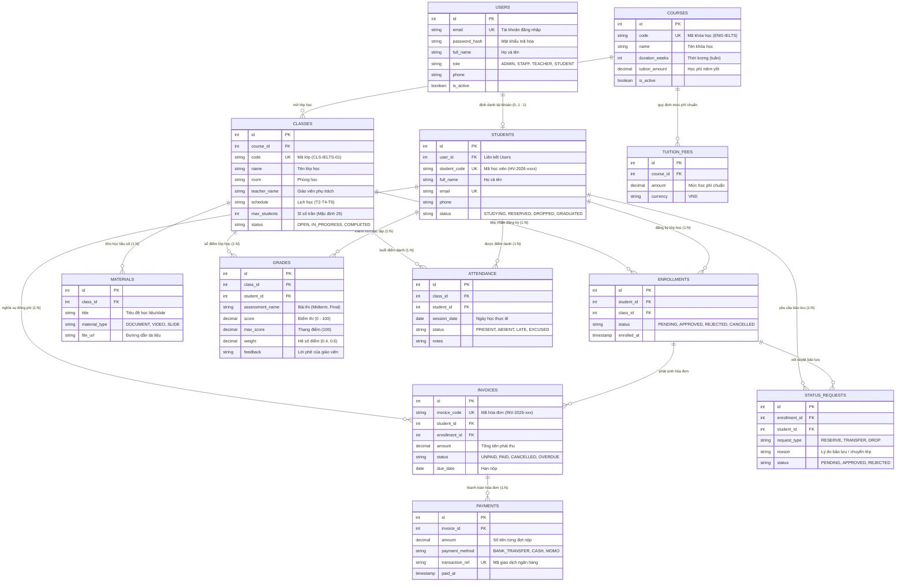

# HƯỚNG DẪN ĐẶC TẢ 4 PHÂN HỆ & CHỐT CƠ SỞ DỮ LIỆU HỆ THỐNG
**HỆ THỐNG QUẢN LÝ TRUNG TÂM ANH NGỮ (ENGLISH CENTER MANAGEMENT SYSTEM)**  
*Tài liệu chuẩn bị cho buổi họp Retro & Chốt Schema toàn nhóm*  
*Ngày cập nhật: 05/11/2026 | Nhánh git: `dev`*

---

## MỤC LỤC TỔNG QUAN
1. [Đối chiếu Hệ thống tham chiếu (Ảnh 1) và Kiến trúc của Đề tài (Ảnh 2)](#1-đối-chiếu-hệ-thống-tham-chiếu-ảnh-1-và-kiến-trúc-của-đề-tài-ảnh-2)
2. [Sơ đồ Quan hệ Thực thể (ERD 12 Bảng Chuẩn)](#2-sơ-đồ-quan-hệ-thực-thể-erd-12-bảng-chuẩn)
3. [Phân định 4 Phân hệ: Bảng quản lý, Chức năng và Giải quyết Khó khăn Chương 1](#3-phân-định-4-phân-hệ-bảng-quản-lý-chức-năng-và-giải-quyết-khó-khăn-chương-1)
   - [Phân hệ 1: Quản lý Đăng ký và Tuyển sinh (Admission & Identity)](#phân-hệ-1-quản-lý-đăng-ký-và-tuyển-sinh-admission--identity)
   - [Phân hệ 2: Quản lý Học viên và Vận hành Lớp học (Student & Operation)](#phân-hệ-2-quản-lý-học-viên-và-vận-hành-lớp-học-student--operation)
   - [Phân hệ 3: Quản lý Đào tạo và Kết quả Học tập (Learning & Assessment)](#phân-hệ-3-quản-lý-đào-tạo-và-kết-quả-học-tập-learning--assessment)
   - [Phân hệ 4: Quản lý Tài chính và Học phí (Finance & Invoicing)](#phân-hệ-4-quản-lý-tài-chính-và-học-phí-finance--invoicing)
4. [Bảng So sánh & Rà soát Cơ sở Dữ liệu với `init-db.sql`](#4-bảng-so-sánh--rà-soát-cơ-sở-dữ-liệu-với-init-dbsql)
   - [Bảng tổng hợp: Đã có sẵn vs Cần cập nhật tối nay vs Mở rộng V2](#bảng-tổng-hợp-đã-có-sẵn-vs-cần-cập-nhật-tối-nay-vs-mở-rộng-v2)
   - [Kịch bản SQL Patch hoàn chỉnh để cập nhật `init-db.sql`](#kịch-bản-sql-patch-hoàn-chỉnh-để-cập-nhật-init-dbsql)
5. [Kế hoạch Điều hành Buổi Họp Retro Tối Nay](#5-kế-hoạch-điều-hành-buổi-họp-retro-tối-nay)

---

## 1. ĐỐI CHIẾU HỆ THỐNG THAM CHIẾU (ẢNH 1) VÀ KIẾN TRÚC CỦA ĐỀ TÀI (ẢNH 2)

> **Mục đích:** Giải trình cho Thầy/Cô và thành viên trong nhóm về mục *"3. Các đề tài/hệ thống liên quan"* trong Báo cáo BTL.

```
+-------------------------------------------------------------+-------------------------------------------------------------+
|               HỆ THỐNG THAM CHIẾU (ẢNH 1 - VERTABELO)       |               KIẾN TRÚC ĐỀ TÀI CỦA CHÚNG TA (ẢNH 2 - 12 BẢNG) |
+-------------------------------------------------------------+-------------------------------------------------------------+
| 1. Mô hình lớp học phụ thuộc vào "Kỳ học" (Cycles).         | 1. Mô hình độc lập theo Khóa học (Courses) và Lớp (Classes).|
|    - Cần bảng trung gian CoursesPerCycle, TeachersPerCourse |    - Giảng viên & Lịch học gắn trực tiếp với Lớp học.       |
|    - Khóa chính phức hợp 3 cột (CourseId, CycleId, ClassNo) |    - Khóa chính đơn nhất (id SERIAL) chuẩn Microservices.   |
|                                                             |                                                             |
| 2. Quản lý thi cử độc lập (Tests, TestScores).              | 2. Quản lý học tập toàn diện (Materials, Grades).           |
|    - Chỉ lưu điểm bài thi thô, thiếu nhận xét chi tiết.     |    - Hỗ trợ kho bài giảng số, trọng số điểm và nhận xét.    |
|                                                             |                                                             |
| 3. KHÔNG CÓ PHÂN HỆ TÀI CHÍNH & HỌC PHÍ.                    | 3. CÓ TRỌN VẸN PHÂN HỆ TÀI CHÍNH (Tuition_fees, Invoices,   |
|    - Điểm yếu chí mạng của mô hình học viện cũ.             |    Payments), gạch nợ tức thì, hóa đơn điện tử chuẩn Bộ TC. |
|                                                             |                                                             |
| 4. Cơ sở dữ liệu nguyên khối (Monolithic Database).         | 4. Chia tách 4 Schemas độc lập (Microservices Ready):       |
|    - Khó chia việc cho 4 nhóm code song song.               |    `admission`, `student`, `learning`, `finance`.           |
+-------------------------------------------------------------+-------------------------------------------------------------+
```

**Kết luận đánh giá:**  
Mô hình hệ thống tham chiếu (Ảnh 1) chỉ phù hợp cho quản lý trường học học kỳ cổ điển (Cycle-based), thiếu hoàn toàn chức năng tài chính và kho học liệu số. Hệ thống của nhóm chúng ta (Ảnh 2) được thiết kế hiện đại, bám sát nghiệp vụ trung tâm ngoại ngữ thực tế, chia 4 phân hệ rõ ràng để các cặp thành viên làm việc độc lập mà không bị giẫm chân lên nhau.

---

## 2. SƠ ĐỒ QUAN HỆ THỰC THỂ (ERD 12 BẢNG CHUẨN)

Sơ đồ dưới đây chuẩn hóa đúng theo bản vẽ 12 bảng phân màu (Ảnh 2), phân thành 4 schemas:



---

## 3. PHÂN ĐỊNH 4 PHÂN HỆ: BẢNG QUẢN LÝ, CHỨC NĂNG VÀ GIẢI QUYẾT KHÓ KHĂN CHƯƠNG 1

### Phân hệ 1: Quản lý Đăng ký và Tuyển sinh (Admission & Identity)
- **Cặp phụ trách:** Hùng & Tâm (Nhóm 1)
- **Thư mục code:** `english_center/services/admission/` (Port 8081)
- **Schema CSDL:** `admission`

#### 1. Ánh xạ Khó khăn thực tế Chương 1 $\rightarrow$ Tính năng giải quyết
| Khó khăn thực tế (Khảo sát Chương 1) | Biểu hiện & Hậu quả | Tính năng hệ thống đảm nhiệm |
|---|---|---|
| **Thông tin phân tán, thiếu công khai** | 70% phản ánh học phí không công khai; 75% gặp thông tin mâu thuẫn giữa Web, Fanpage và tư vấn viên. | **ADM-01: Tập trung hóa dữ liệu**<br>- Hợp nhất danh mục khóa học, lộ trình học, lịch khai giảng và học phí niêm yết chuẩn xác từ 1 nguồn duy nhất. |
| **Quy trình đăng ký thủ công, dễ quá tải** | Xếp lớp thủ công dẫn tới quá tải sĩ số lớp học, phòng học chật chội, xung đột lịch học. | **ADM-02: Số hóa quy trình tuyển sinh**<br>- Đăng ký trực tuyến, quản lý slot giữ chỗ 48h, chặn đăng ký khi lớp đạt sĩ số trần (`max_students`). |
| **Học viên mù mờ về tiến trình hồ sơ** | 60% người đăng ký không biết đơn của mình đã được duyệt hay chưa, phải liên hệ hỏi nhiều lần. | **ADM-03: Minh bạch hóa luồng xử lý**<br>- Kênh tra cứu trạng thái đơn online (`PENDING` $\rightarrow$ `APPROVED` $\rightarrow$ `REJECTED`) theo thời gian thực. |
| **Đăng nhập phân mảnh, thiếu bảo mật** | Dùng chung tài khoản, không phân quyền rõ rệt giữa Quản lý, Nhân viên, Giáo viên và Học viên. | **IAM: Xác thực & Phân quyền tập trung**<br>- Quản lý tài khoản `admission.users`, cấp quyền `role` chuẩn xác (`ADMIN`, `STAFF`, `TEACHER`, `STUDENT`). |

#### 2. Các bảng CSDL mà Phân hệ 1 trực tiếp quản lý:
1. `admission.users`: Danh mục tài khoản đăng nhập toàn hệ thống.
2. `admission.courses`: Danh mục khóa học, mô tả, lộ trình và học phí niêm yết.
3. `admission.classes`: Danh sách các lớp học mở, thời khóa biểu, giáo viên, phòng học, sĩ số tối đa `max_students`.
4. `admission.enrollments`: Đơn đăng ký học, quản lý trạng thái tuyển sinh (`PENDING`, `APPROVED`, `REJECTED`).

---

### Phân hệ 2: Quản lý Học viên và Vận hành Lớp học (Student & Operation)
- **Cặp phụ trách:** Hữu Phong & Trúc Phương (Nhóm 2)
- **Thư mục code:** `english_center/services/student/` (Port 8082)
- **Schema CSDL:** `student`

#### 1. Ánh xạ Khó khăn thực tế Chương 1 $\rightarrow$ Tính năng giải quyết
| Khó khăn thực tế (Khảo sát Chương 1) | Biểu hiện & Hậu quả | Tính năng hệ thống đảm nhiệm |
|---|---|---|
| **Dữ liệu học viên phân mảnh, trùng lặp** | 70% dữ liệu phân mảnh trên sổ sách, file Excel, nhóm Zalo $\rightarrow$ trùng hồ sơ, thất lạc lịch sử học tập. | **STU-01: Quản lý hồ sơ định danh duy nhất**<br>- Cấp mã học viên duy nhất (`student_code` dạng `HV-2026-xxxx`), lưu trữ thông tin cá nhân và lịch sử học tập xuyên suốt. |
| **Giáo vụ quá tải vì điểm danh thủ công** | 85% giáo vụ quá tải do nhận tin nhắn báo vắng thủ công qua Zalo/điện thoại; dễ sót báo vắng cho phụ huynh. | **STU-02: Điểm danh điện tử 1 chạm**<br>- Giáo viên/giáo vụ điểm danh trên giao diện web/app theo buổi; kiểm soát trạng thái: Có mặt, Vắng, Đi trễ, Nghỉ có phép. Chặn điểm danh trùng buổi. |
| **Thủ tục bảo lưu, chuyển lớp rườm rà** | Học viên xin bảo lưu qua chat $\rightarrow$ tính sai số buổi còn lại, lệch sĩ số danh sách lớp thực tế. | **STU-03: Số hóa nghiệp vụ học vụ phức tạp**<br>- Quản lý trạng thái học viên (`STUDYING`, `RESERVED`, `DROPPED`), tạo luồng duyệt bảo lưu minh bạch căn cứ theo số buổi đã điểm danh. |

#### 2. Các bảng CSDL mà Phân hệ 2 trực tiếp quản lý:
1. `student.students`: Hồ sơ định danh học viên, có mã học viên duy nhất `student_code`.
2. `student.attendance`: Bảng ghi nhận điểm danh theo từng buổi học của từng lớp.
3. `student.status_requests` *(Đề xuất mở rộng V2)*: Quản lý đơn xin bảo lưu, chuyển lớp.
> **Lưu ý nghiệp vụ chốt:** Danh sách học viên chính thức của lớp được lấy từ `admission.enrollments WHERE status = 'APPROVED'`. **KHÔNG** tạo thêm bảng `class_members` riêng để tránh dư thừa và lệch dữ liệu.

---

### Phân hệ 3: Quản lý Đào tạo và Kết quả Học tập (Learning & Assessment)
- **Cặp phụ trách:** Nam & Hồng Phong (Nhóm 3)
- **Thư mục code:** `english_center/services/learning/` (Port 8083)
- **Schema CSDL:** `learning`

#### 1. Ánh xạ Khó khăn thực tế Chương 1 $\rightarrow$ Tính năng giải quyết
| Khó khăn thực tế (Khảo sát Chương 1) | Biểu hiện & Hậu quả | Tính năng hệ thống đảm nhiệm |
|---|---|---|
| **Học liệu trôi nổi, phân tán trên Zalo/giấy** | 65% học viên nhận tài liệu qua bản in rời hoặc link Zalo từng buổi, dễ thất lạc, học viên vào sau không tìm lại được. | **LRN-01: Lưu trữ tài liệu tập trung**<br>- Xây dựng kho học liệu số theo từng lớp học; phân loại rõ Slide, Tài liệu đọc, Bài tập, Audio luyện nghe; học viên lớp nào truy cập lớp đó. |
| **Nhập điểm thủ công, thiếu nhận xét** | 40% học viên hiếm khi nhận được nhận xét chi tiết; nhập điểm Excel dễ gõ nhầm thang điểm, khó theo dõi lịch sử. | **LRN-02: Số hóa quy trình đánh giá & Sổ điểm**<br>- Giáo viên nhập điểm các bài kiểm tra (Quiz, Giữa kỳ, Cuối kỳ) có trọng số hệ số (`weight`), kèm lời phê nhận xét chi tiết; chặn nhập âm hoặc vượt thang 100. |
| **Không có báo cáo học lực định kỳ** | 65% học viên & phụ huynh mong muốn có báo cáo định kỳ nhưng trung tâm không đủ nhân lực tổng hợp thủ công. | **LRN-03: Báo cáo đánh giá định kỳ tự động**<br>- View tính điểm trung bình môn có trọng số theo thời gian thực; tự động tính tỷ lệ Đạt/Trượt (ngưỡng 50%) và xuất học bạ cho học viên. |

#### 2. Các bảng CSDL mà Phân hệ 3 trực tiếp quản lý:
1. `learning.materials`: Kho học liệu, bài tập, slide số hóa theo lớp học.
2. `learning.grades`: Bảng lưu điểm bài kiểm tra, hệ số trọng số `weight`, và lời nhận xét của giáo viên.
3. Views báo cáo tích hợp: `learning.v_student_grade_summary` và `learning.v_class_pass_rate`.

---

### Phân hệ 4: Quản lý Tài chính và Học phí (Finance & Invoicing)
- **Cặp phụ trách:** Chi & Phúc (Nhóm 4)
- **Thư mục code:** `english_center/services/finance/` (Port 8084)
- **Schema CSDL:** `finance`

#### 1. Ánh xạ Khó khăn thực tế Chương 1 $\rightarrow$ Tính năng giải quyết
| Khó khăn thực tế (Khảo sát Chương 1) | Biểu hiện & Hậu quả | Tính năng hệ thống đảm nhiệm |
|---|---|---|
| **Thu tiền mặt/chuyển khoản thiếu minh bạch** | Thu tiền tại quầy hoặc tài khoản cá nhân, đối soát thủ công mất 3-5 ngày/tháng, nguy cơ gian lận, thất thoát dòng tiền. | **FIN-01: Thanh toán số & Gạch nợ tự động**<br>- Tích hợp VietQR Dynamic / Mã tham chiếu ngân hàng `transaction_ref`; hệ thống tự động gạch nợ hóa đơn tức thì khi tiền về, chặn thanh toán trùng lặp. |
| **Nợ đọng học phí cao (15-20%)** | Quản lý hạn nợ bằng Excel rời rạc; gọi điện đòi nợ gây phiền toái, phụ huynh quên hạn đóng học phí. | **FIN-02: Tự động hóa quản lý công nợ**<br>- Sinh mã hóa đơn chuẩn `INV-YYYY-xxxx`, tự động theo dõi hạn nộp (`due_date`) và gắn trạng thái nợ (`UNPAID`, `OVERDUE`). |
| **Rủi ro như Apax Leaders & Pháp lý Thuế** | Thu trước học phí dài hạn nhưng không quản trị quỹ hoàn trả; nguy cơ bị phạt do không xuất hóa đơn điện tử theo luật. | **FIN-03: Tuân thủ pháp lý & Chuẩn mực kế toán**<br>- Tự động xuất hóa đơn điện tử tuân thủ **Nghị định 123/2020/NĐ-CP** và **Thông tư 78/2021/TT-BTC**; quản lý biểu phí khóa học minh bạch. |

#### 2. Các bảng CSDL mà Phân hệ 4 trực tiếp quản lý:
1. `finance.tuition_fees`: Danh mục bảng giá, mức học phí chuẩn của các khóa học.
2. `finance.invoices`: Hóa đơn học phí cấp cho học viên theo từng đợt nhập học/lớp học.
3. `finance.payments`: Nhật ký chi tiết các giao dịch thanh toán của hóa đơn (tiền mặt, chuyển khoản, thẻ).

---

## 4. BẢNG SO SÁNH & RÀ SOÁT CƠ SỞ DỮ LIỆU VỚI `init-db.sql`

### Bảng tổng hợp: Đã có sẵn vs Cần cập nhật tối nay vs Mở rộng V2

```
========================================================================================================================
SCHEMA / BẢNG              | ĐÃ CÓ TRONG init-db.sql        | CẦN CẬP NHẬT TỐI NAY (PATCH V1)   | ĐỂ DÀNH CHO V2 (MỞ RỘNG)
========================================================================================================================
[1. ADMISSION]             |                                |                                   |
- admission.users          | Đã có đầy đủ các cột cơ bản    | (Giữ nguyên, hoàn toàn đủ dùng)   | Thêm avatar_url, token bảo mật
- admission.courses        | Đã có code, tuition_amount,... | (Giữ nguyên)                      | prerequisite_course_id
- admission.classes        | Đã có room, max_students,...   | Thêm CHECK (max_students >= 1)    | Khóa ngoại room_id, teacher_id
- admission.enrollments    | Đã có student_id, class_id,... | THÊM UNIQUE(student_id, class_id) | Đếm slot giữ chỗ 48h
- Các bảng thi đầu vào     | Chưa có                        | Không thêm đợt này (giảm tải)     | test_sets, test_questions,...
---------------------------+--------------------------------+-----------------------------------+-----------------------
[2. STUDENT]               |                                |                                   |
- student.students         | Đã có thông tin cá nhân cơ bản | 1. THÊM CỘT student_code UNIQUE   | Lịch sử tương tác
                           |                                | 2. THÊM UNIQUE(email)             |
- student.attendance       | Đã có ngày, trạng thái điểm    | THÊM UNIQUE(class_id, student_id, | Báo vắng tự động qua Zalo
                           | danh cơ bản                    | session_date) chống trùng         |
- student.status_requests  | Chưa có                        | Không tạo bảng mới (dùng status)  | Tách bảng riêng cho bảo lưu
- class_members            | KHÔNG TẠO BẢNG NÀY             | DÙNG ENROLLMENTS LÀM DANH BÁ LỚP  | Không cần thiết
---------------------------+--------------------------------+-----------------------------------+-----------------------
[3. LEARNING]              |                                |                                   |
- learning.materials       | Đã có title, file_url, type... | Bổ sung CHECK file_url khác rỗng  | Lưu dung lượng file_size
- learning.grades          | Đã có score, max_score, note   | 1. THÊM CỘT weight NUMERIC(3,2)   | Điểm chi tiết 4 kỹ năng riêng
                           |                                | 2. THÊM CHECK (0 <= score <= max) |
                           |                                | 3. THÊM UNIQUE(class, student, bài|
- Các Views báo cáo        | Chưa có                        | Tạo v_student_grade_summary       | Biểu đồ thống kê tự động
---------------------------+--------------------------------+-----------------------------------+-----------------------
[4. FINANCE]               |                                |                                   |
- finance.tuition_fees     | Đã có course_id, amount,...    | (Giữ nguyên)                      | Chính sách voucher, học bổng
- finance.invoices         | Đã có invoice_code, amount,... | Thêm trạng thái 'PARTIAL' vào CHECK| Tích hợp cổng VNPT E-Invoice
- finance.payments         | Đã có amount, method, ref...   | 1. THÊM UNIQUE(transaction_ref)   | Webhook VietQR Dynamic
                           |                                | 2. THÊM CHECK (amount > 0)        |
========================================================================================================================
```

---

### Kịch bản SQL Patch hoàn chỉnh để cập nhật `init-db.sql`

Đoạn SQL dưới đây tập hợp toàn bộ các điểm cần bổ sung cho buổi họp tối nay, bảo đảm an toàn dữ liệu và không làm gãy các dữ liệu seed hiện tại:

```sql
-- ============================================================================
-- SQL PATCH CHỐT SCHEMA CUỐI CÙNG (Dành cho buổi họp Retro)
-- File mục tiêu: english_center/scripts/init-db.sql
-- ============================================================================

-- 1. BẢO VỆ PHÂN HỆ ADMISSION
-- Ràng buộc chống 1 học viên đăng ký trùng 1 lớp nhiều lần
ALTER TABLE admission.enrollments 
    DROP CONSTRAINT IF EXISTS uq_admission_enrollment_student_class;
ALTER TABLE admission.enrollments 
    ADD CONSTRAINT uq_admission_enrollment_student_class UNIQUE (student_id, class_id);

-- Ràng buộc sĩ số trần của lớp học phải lớn hơn 0
ALTER TABLE admission.classes 
    DROP CONSTRAINT IF EXISTS chk_admission_classes_max_students;
ALTER TABLE admission.classes 
    ADD CONSTRAINT chk_admission_classes_max_students CHECK (max_students >= 1);


-- 2. BẢO VỆ PHÂN HỆ STUDENT
-- Bổ sung cột mã học viên định danh duy nhất (Yêu cầu nhóm HP & TP)
ALTER TABLE student.students 
    ADD COLUMN IF NOT EXISTS student_code VARCHAR(50);

-- Cập nhật mã học viên tự động cho dữ liệu seed mẫu
UPDATE student.students SET student_code = 'HV-2026-0001' WHERE id = 1 AND student_code IS NULL;
UPDATE student.students SET student_code = 'HV-2026-0002' WHERE id = 2 AND student_code IS NULL;
UPDATE student.students SET student_code = 'HV-2026-0003' WHERE id = 3 AND student_code IS NULL;

-- Đặt ràng buộc NOT NULL và UNIQUE cho student_code
ALTER TABLE student.students 
    ALTER COLUMN student_code SET NOT NULL;
ALTER TABLE student.students 
    DROP CONSTRAINT IF EXISTS uq_student_student_code;
ALTER TABLE student.students 
    ADD CONSTRAINT uq_student_student_code UNIQUE (student_code);

-- Ràng buộc chống điểm danh trùng 2 lần trong cùng 1 ngày cho 1 học viên
ALTER TABLE student.attendance 
    DROP CONSTRAINT IF EXISTS uq_student_attendance_session;
ALTER TABLE student.attendance 
    ADD CONSTRAINT uq_student_attendance_session UNIQUE (class_id, student_id, session_date);


-- 3. BẢO VỆ PHÂN HỆ LEARNING
-- Bổ sung hệ số điểm (weight) phục vụ tính điểm trung bình (Yêu cầu nhóm Nam & Phong)
ALTER TABLE learning.grades 
    ADD COLUMN IF NOT EXISTS weight NUMERIC(3, 2) DEFAULT 1.0;

-- Ràng buộc chống nhập điểm âm hoặc vượt thang điểm tối đa
ALTER TABLE learning.grades 
    DROP CONSTRAINT IF EXISTS chk_learning_grades_score_range;
ALTER TABLE learning.grades 
    ADD CONSTRAINT chk_learning_grades_score_range CHECK (score >= 0 AND score <= max_score);

-- Ràng buộc chống trùng điểm cho cùng một bài đánh giá của học viên
ALTER TABLE learning.grades 
    DROP CONSTRAINT IF EXISTS uq_learning_grades_assessment;
ALTER TABLE learning.grades 
    ADD CONSTRAINT uq_learning_grades_assessment UNIQUE (class_id, student_id, assessment_name);


-- 4. BẢO VỆ PHÂN HỆ FINANCE
-- Ràng buộc chống trùng lặp mã giao dịch ngân hàng (tránh gạch nợ 2 lần)
ALTER TABLE finance.payments 
    DROP CONSTRAINT IF EXISTS uq_finance_payments_transaction_ref;
ALTER TABLE finance.payments 
    ADD CONSTRAINT uq_finance_payments_transaction_ref UNIQUE (transaction_ref);

-- Ràng buộc số tiền thanh toán và hóa đơn phải là số dương
ALTER TABLE finance.invoices 
    DROP CONSTRAINT IF EXISTS chk_finance_invoices_amount;
ALTER TABLE finance.invoices 
    ADD CONSTRAINT chk_finance_invoices_amount CHECK (amount > 0);

ALTER TABLE finance.payments 
    DROP CONSTRAINT IF EXISTS chk_finance_payments_amount;
ALTER TABLE finance.payments 
    ADD CONSTRAINT chk_finance_payments_amount CHECK (amount > 0);
```

---

## 5. KẾ HOẠCH ĐIỀU HÀNH BUỔI HỌP RETRO TỐI NAY

### Mục tiêu buổi họp (Leader truyền đạt rõ ràng):
1. **Thống nhất tư tưởng kiến trúc:**
   - Cả nhóm dùng chung **1 Cơ sở dữ liệu PostgreSQL** nhưng chia 4 Schemas riêng biệt (`admission`, `student`, `learning`, `finance`).
   - Mỗi phân hệ chạy độc lập trên 1 port riêng (`8081`, `8082`, `8083`, `8084`), giao tiếp bằng REST API qua API Gateway.
2. **Chốt cứng 12 Bảng CSDL:**
   - Chiếu sơ đồ ERD (Mục 2) lên màn hình để 4 cặp xác nhận bảng của mình.
   - Thống nhất bổ sung `student_code` (Nhóm 2) và `weight` (Nhóm 3).
   - Thống nhất loại bỏ bảng dư thừa `class_members` (dùng `enrollments` làm danh bạ chính thức).
3. **Phân công công việc ngày mai:**
   - Leader áp dụng SQL Patch vào `english_center/scripts/init-db.sql` và đẩy lên nhánh `dev`.
   - Mỗi nhóm tạo nhánh tính năng riêng từ `dev`:
     * Nhóm 1: `git checkout -b feature/admission-flow`
     * Nhóm 2: `git checkout -b feature/student-attendance`
     * Nhóm 3: `git checkout -b feature/learning-materials-grades`
     * Nhóm 4: `git checkout -b feature/finance-invoicing`
   - Bắt đầu code API và màn hình HTML/JS của phân hệ mình.
