# ĐẶC TẢ YÊU CẦU PHẦN MỀM (SRS)

## Hệ thống Quản lý Trung tâm Ngoại ngữ — English Center Management System

Phiên bản 1.0 — Tháng 11/2026 — Trạng thái: Chốt phạm vi Wave 1

---

## 1. Giới thiệu

### 1.1. Mục đích

Tài liệu này đặc tả đầy đủ yêu cầu chức năng, yêu cầu phi chức năng, ràng buộc kiến trúc và tiêu chí nghiệm thu của hệ thống quản lý trung tâm ngoại ngữ English Center. Đây là căn cứ duy nhất để bốn nhóm phát triển thiết kế, hiện thực, kiểm thử và bàn giao sản phẩm; mọi hành vi của hệ thống khi nghiệm thu phải đối chiếu được về một yêu cầu có mã định danh trong tài liệu này.

### 1.2. Phạm vi

Hệ thống số hóa toàn bộ chuỗi vận hành của một trung tâm ngoại ngữ, từ lúc khách hàng tìm hiểu khóa học đến khi học viên kết thúc khóa hoặc được hoàn phí. Cụ thể, hệ thống đảm nhiệm sáu mảng nghiệp vụ: công khai danh mục khóa học, lớp học và học phí từ một nguồn dữ liệu duy nhất; khảo thí đầu vào ba kỹ năng và khuyến nghị xếp lớp; tuyển sinh trực tuyến với cơ chế giữ chỗ 48 giờ; quản lý hồ sơ học viên, điểm danh và các yêu cầu học vụ (bảo lưu, chuyển lớp, bỏ học); quản lý học liệu số, sổ điểm có trọng số và báo cáo kết quả học tập; quản lý biểu phí, hóa đơn, trả góp, thu ngân tiền mặt và VietQR, ví bảo lưu, hoàn tiền qua ba cấp phê duyệt cùng các báo cáo tài chính.

Những hạng mục sau nằm ngoài phạm vi và không được triển khai trong giai đoạn hiện tại: chatbot tư vấn tích hợp LLM; mô hình AI tự chấm thi hoặc sinh đề; thuật toán tối ưu xếp lịch bằng solver; kết nối cổng thanh toán thật (VNPay, Momo API) — giao dịch ngân hàng chỉ mô phỏng qua webhook nội bộ; dịch vụ SMS/Zalo ZNS trả phí; kế toán tổng hợp chuyên sâu (chi phí vận hành, lương giáo viên); ứng dụng di động native. Sản phẩm chỉ phục vụ nền web responsive.

### 1.3. Đối tượng sử dụng tài liệu

Tài liệu dành cho lập trình viên bốn phân hệ Admission, Student, Learning, Finance; người phụ trách hạ tầng và tích hợp; người viết kiểm thử; và hội đồng nghiệm thu. Mỗi nhóm căn cứ vào mục 4 để hiện thực phân hệ mình, căn cứ vào mục 5 và mục 9 để bảo đảm các ràng buộc liên phân hệ không bị vi phạm.

### 1.4. Thuật ngữ và ký hiệu

| Thuật ngữ        | Ý nghĩa                                                                                                            |
| ------------------ | -------------------------------------------------------------------------------------------------------------------- |
| Enrollment         | Đơn đăng ký học một lớp; thực thể trung tâm của quy trình tuyển sinh                                   |
| Giữ chỗ (hold)   | Khoảng 48 giờ kể từ khi đơn ở trạng thái PENDING, trong đó slot lớp được giữ cho học viên          |
| Slot               | Một suất học trong lớp; tổng slot bị chiếm = số đơn APPROVED + số đơn PENDING còn hạn giữ chỗ       |
| R-ID-1             | Quy ước định danh người học xuyên schema, quy định tại mục 6.1                                           |
| Logical FK         | Cột INTEGER lưu ID của thực thể thuộc service khác, không có ràng buộc REFERENCES vật lý                |
| Schema isolation   | Nguyên tắc mỗi service chỉ truy vấn schema PostgreSQL của riêng mình                                         |
| VietQR động      | Mã QR chuyển khoản sinh theo từng kỳ thanh toán, nhúng mã tham chiếu để gạch nợ tự động              |
| Gạch nợ          | Hành vi ghi nhận tiền về và trừ công nợ hóa đơn tương ứng                                              |
| Ví bảo lưu      | Số dư học phí được giữ lại khi học viên bảo lưu, chỉ dùng cấn trừ học phí, không rút tiền mặt |
| Hoàn tiền 3 cấp | Quy trình STAFF khởi tạo → kế toán xác minh → giám đốc phê duyệt → kế toán giải ngân               |
| INV-xxx-nn         | Mã bất biến hệ thống; điều kiện phải đúng trong mọi hoàn cảnh, được kiểm thử tự động           |
| FR / NFR           | Yêu cầu chức năng / yêu cầu phi chức năng, đánh mã để truy vết                                         |
| Gateway            | Nginx reverse proxy tại cổng 8080, điểm vào duy nhất của trình duyệt                                        |

---

## 2. Mô tả tổng quan

### 2.1. Bối cảnh nghiệp vụ và động cơ xây dựng

Khảo sát thực tế tại các trung tâm ngoại ngữ cho thấy thông tin tuyển sinh bị phân mảnh nghiêm trọng: khoảng 70% người học phản ánh học phí không được công khai nhất quán, 75% gặp thông tin mâu thuẫn giữa website, fanpage và tư vấn viên, và 60% người đăng ký không nắm được tiến trình hồ sơ của mình. Việc xếp lớp thủ công dẫn đến quá tải sĩ số, trùng phòng, trùng giáo viên. Ở khâu vận hành, 85% giáo vụ quá tải vì nhận báo vắng qua tin nhắn rời rạc; 65% học viên nhận học liệu qua bản in hoặc link chat nên dễ thất lạc; 40% hiếm khi nhận được nhận xét điểm số chi tiết. Ở khâu tài chính, thu tiền mặt và chuyển khoản vào tài khoản cá nhân khiến đối soát mất 3–5 ngày mỗi tháng, nợ đọng học phí duy trì ở mức 15–20%, và việc thu trước học phí dài hạn tanpa quỹ hoàn trả được kiểm soát tạo rủi ro pháp lý tương tự các vụ đổ vỡ chuỗi trung tâm lớn.

Hệ thống giải quyết các vấn đề trên bằng cách tập trung hóa dữ liệu danh mục và học phí, số hóa quy trình đăng ký với giới hạn sĩ số được kiểm soát nguyên tử, minh bạch trạng thái hồ sơ theo thời gian thực, đưa điểm danh và sổ điểm lên một nền tảng duy nhất có phân quyền theo lớp, và tự động hóa gạch nợ với cơ chế chống giao dịch trùng lặp cùng quy trình hoàn tiền nhiều cấp có căn cứ số buổi đã học.

### 2.2. Kiến trúc tổng thể

Hệ thống gồm bốn microservice độc lập giao tiếp qua HTTP REST, đặt sau một Nginx API Gateway. Toàn bộ dữ liệu nằm trên một instance PostgreSQL 16, database `english_center`, chia thành bốn schema cô lập `admission`, `student`, `learning`, `finance`; mỗi service chỉ đọc/ghi schema của mình. Frontend là HTML, JavaScript, CSS thuần, dùng chung bộ assets do Gateway phục vụ tại `/shared/*`. Toàn hệ thống khởi chạy bằng một lệnh `docker compose up`.

| Thành phần      | Công nghệ                 | Cổng | Schema sở hữu                  |
| ----------------- | --------------------------- | ----- | -------------------------------- |
| API Gateway       | Nginx                       | 8080  | — (static + routing)            |
| admission-service | Java 21 / Spring Boot 3.3.4 | 8081  | admission (14 bảng)             |
| student-service   | Python 3.10+ / FastAPI      | 8082  | student (3 bảng)                |
| learning-service  | Python 3.10+ / FastAPI      | 8083  | learning (2 bảng, 2 view)       |
| finance-service   | Python 3.11 / FastAPI       | 8084  | finance (9 bảng, 2 view)        |
| Cơ sở dữ liệu | PostgreSQL 16               | 5432  | 4 schema, tổng 28 bảng, 4 view |

*Hình 1 — Sơ đồ triển khai*

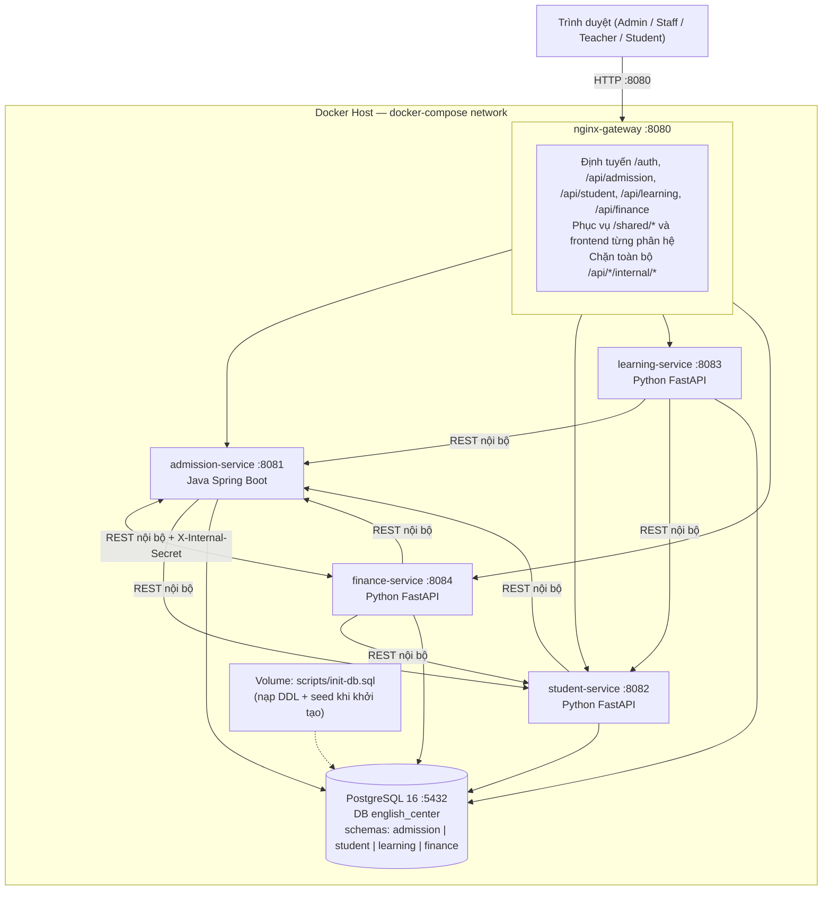

### 2.3. Tác nhân và phân quyền

Hệ thống có bốn vai trò người dùng và một tác nhân hệ thống tự động (bộ lập lịch hết hạn giữ chỗ, webhook ngân hàng mô phỏng).

| Vai trò | Phạm vi quyền                                                                                                                                                                                                                            |
| -------- | ------------------------------------------------------------------------------------------------------------------------------------------------------------------------------------------------------------------------------------------ |
| ADMIN    | Toàn quyền hệ thống; quản trị tài khoản; phê duyệt hoàn tiền cấp 3 (giám đốc); xem toàn bộ BI; duyệt ngoại lệ STAFF_OVERRIDE                                                                                          |
| STAFF    | Quản lý khóa học, lớp, phòng; tiếp nhận và duyệt tuyển sinh; lập hóa đơn, thu tiền mặt; quản lý voucher, biểu phí; duyệt yêu cầu học vụ; khởi tạo và xác minh hoàn tiền (kế toán cấp 1–2), giải ngân |
| TEACHER  | Xem danh sách và điểm danh lớp mình dạy; tải học liệu và nhập/sửa điểm lớp mình phụ trách; không truy cập dữ liệu tài chính                                                                                       |
| STUDENT  | Xem/sửa hồ sơ của chính mình; làm bài khảo thí; đăng ký lớp; xem điểm, học liệu lớp mình học; tra cứu hóa đơn, ví của bản thân; gửi yêu cầu học vụ                                                       |

Mọi kiểm tra quyền sở hữu (học viên chỉ thấy dữ liệu của mình, giáo viên chỉ thao tác lớp mình dạy) là bắt buộc ở tầng API, không chỉ ẩn ở giao diện.

### 2.4. Ràng buộc thiết kế bắt buộc

C-01. Mỗi service chỉ thực hiện SELECT/INSERT/UPDATE/DELETE trên schema của mình; cấm JOIN bảng khác schema và cấm Physical FK chéo schema (INV-SYS-02). Khi cần lưu ID của thực thể thuộc service khác, dùng cột INTEGER không REFERENCES (Logical FK).

C-02. Mọi dữ liệu liên service phải lấy qua HTTP REST. Không message queue, không service discovery, không gRPC trong giai đoạn này.

C-03. API nội bộ đặt dưới prefix `/api/<service>/internal/`, bảo vệ bằng header `X-Internal-Secret` (giá trị từ biến môi trường `INTERNAL_SECRET_KEY` dùng chung), không bao giờ expose qua Gateway. Timeout mặc định 5 giây, retry tối đa 3 lần với exponential backoff; mọi POST nội bộ mang `event_id` duy nhất để bên nhận khử trùng lặp.

C-04. Xác thực người dùng bằng JWT HS256, ký và kiểm tra bằng `JWT_SECRET` chung đọc từ môi trường; mỗi service tự verify token, không gọi lại service xác thực. Không commit file `.env` thật (INV-SEC-03).

C-05. Toàn bộ JSON field và query parameter dùng `snake_case` (INV-SYS-01); response bọc theo cấu trúc chuẩn tại mục 7.2.

C-06. Mỗi service giữ đúng cổng quy ước; trình duyệt chỉ đi qua cổng 8080.

C-07. Frontend không framework; màu sắc, typography, component dùng design tokens trong `shared/css`, không hardcode màu trong CSS phân hệ.

C-08. Bộ kiểm thử bất biến tại `tests/invariants/` là hàng rào nghiệm thu; khi vi phạm, sửa logic service chứ không sửa assertion của test.

### 2.5. Giả định và phụ thuộc

Hệ thống vận hành trong mạng nội bộ tin cậy giữa các container; người dùng truy cập bằng Chrome, Edge hoặc Firefox phiên bản gần nhất trên màn hình desktop là chủ yếu. Giao dịch ngân hàng được mô phỏng bằng webhook có chữ ký nội bộ; khi triển khai thật chỉ cần thay adapter webhook, không đổi mô hình dữ liệu. Chấp nhận eventual consistency giữa các service ở mức demo: khi một service tạm ngừng, các service khác vẫn hiển thị ID tham chiếu và trạng thái đồng bộ FAILED để đối soát lại sau.

---

## 3. Use Case tổng thể

Bốn tác nhân tương tác với hệ thống qua các nhóm chức năng dưới đây. Quan hệ «include» chỉ các bước bắt buộc được tách dùng chung (kiểm tra slot, xác minh lớp phụ trách, sinh hóa đơn); quan hệ «extend» chỉ các nhánh mở rộng tùy điều kiện (gia hạn giữ chỗ, thanh toán muộn, hoàn tiền sau hủy).

*Hình 2 — Sơ đồ use case tổng thể*

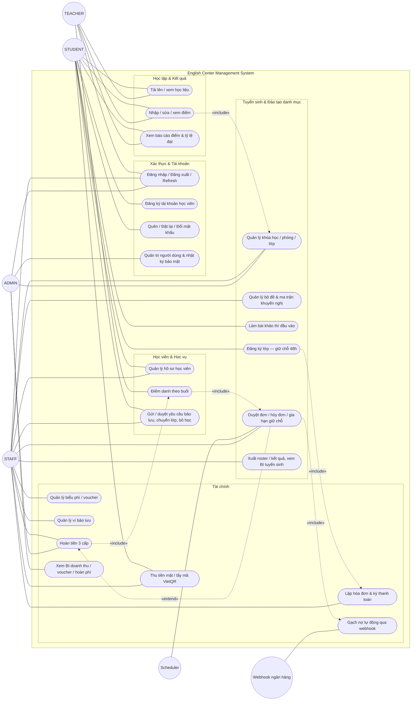

---

## 4. Yêu cầu chức năng

Quy ước đánh mã: `FR-<phân hệ>-<số>`. Mỗi yêu cầu ghi rõ tác nhân, hành vi bắt buộc và quy tắc nghiệp vụ đi kèm; các quy tắc trùng với bất biến hệ thống được dẫn chiếu mã INV tương ứng ở mục 9.

### 4.1. Xác thực và quản trị tài khoản (Admission kiêm IAM)

*Hình 3 — Sơ đồ use case phân hệ xác thực*

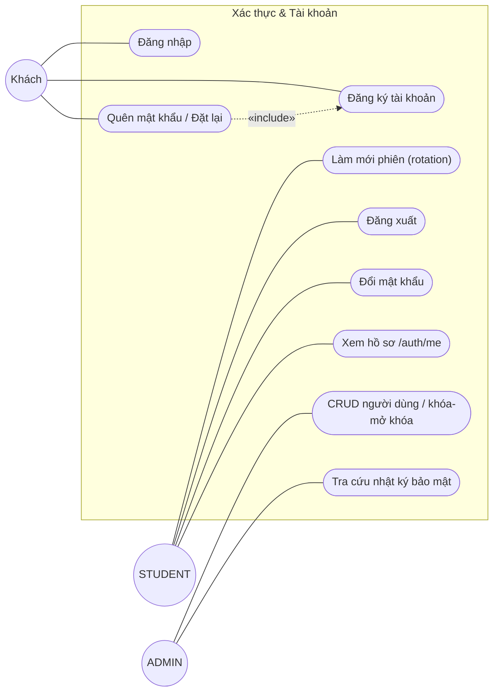

**FR-AUTH-01 — Đăng ký tài khoản học viên.** Khách tự đăng ký qua `POST /auth/register` với email, mật khẩu, họ tên; hệ thống chỉ cho tạo vai trò STUDENT qua kênh này. Email phải duy nhất (trùng trả 409 `AUTH_EMAIL_EXISTS`), mật khẩu băm BCrypt trước khi lưu. Hệ thống ghi nhận thời điểm xác thực email vào `email_verified_at` khi người dùng mở liên kết chứa token ký sẵn; việc gửi thư phụ thuộc cấu hình SMTP của môi trường triển khai. Tài khoản do ADMIN/STAFF tạo tại quầy có cờ `must_change_password = TRUE`.

**FR-AUTH-02 — Đăng nhập.** `POST /auth/login` nhận email và mật khẩu, kiểm tra tài khoản tồn tại, `is_active = TRUE`, mật khẩu khớp; thành công trả cặp access token (JWT HS256, mặc định 24 giờ) và refresh token (mặc định 7 ngày, lưu stateful tại `refresh_tokens`). Payload JWT gồm `sub` (ID người dùng), `email`, `role`, `name`, `iat`, `exp`. Sai thông tin trả 401 `AUTH_INVALID_CREDENTIALS`; tài khoản bị khóa trả 403 `AUTH_ACCOUNT_LOCKED`. Đăng nhập sai 5 lần liên tiếp trong 15 phút (ngưỡng cấu hình được) khóa tài khoản và ghi audit `ACCOUNT_LOCKED`; ADMIN mở khóa qua FR-AUTH-08. Tài khoản có `must_change_password = TRUE` bị chặn mọi API nghiệp vụ cho tới khi đổi mật khẩu.

**FR-AUTH-03 — Làm mới phiên.** `POST /auth/refresh` thực hiện Refresh Token Rotation: refresh token cũ bị thu hồi (`is_revoked = TRUE`) và cặp token mới được cấp trong cùng giao dịch. Phát hiện một refresh token đã thu hồi được sử dụng lại phải thu hồi toàn bộ phiên của người dùng đó và ghi audit. Cột `token` và `token_hash` tự đồng bộ bằng trigger.

**FR-AUTH-04 — Đăng xuất.** `POST /auth/logout` thu hồi refresh token hiện tại, ghi audit `LOGOUT`; access token còn hạn trở nên vô hiệu với các API yêu cầu kiểm tra phiên.

**FR-AUTH-05 — Quên và đặt lại mật khẩu.** `POST /auth/forgot-password` sinh token đặt lại hiệu lực 15 phút, dùng một lần (`is_used`); `POST /auth/reset-password` kiểm tra token còn hạn, chưa dùng, đúng chủ thể rồi cập nhật mật khẩu mới và đánh dấu token đã dùng. Token hết hạn hoặc đã dùng trả 400 `AUTH_RESET_TOKEN_INVALID`.

**FR-AUTH-06 — Đổi mật khẩu.** Người dùng đã đăng nhập đổi mật khẩu qua `POST /auth/change-password` kèm mật khẩu cũ; thành công xóa cờ `must_change_password`, thu hồi các refresh token cũ và ghi audit `PASSWORD_CHANGED`.

**FR-AUTH-07 — Hồ sơ phiên hiện tại.** `GET /auth/me` trả thông tin người dùng suy ra từ JWT, không nhận tham số ID từ client.

**FR-AUTH-08 — Quản trị người dùng.** ADMIN tạo, sửa, phân vai, khóa/mở khóa tài khoản qua nhóm `/users`; STAFF chỉ được tạo tài khoản STUDENT phục vụ tiếp nhận tại quầy. Không cho tự nâng vai trò của chính mình; thao tác khóa/mở khóa ghi audit `ACCOUNT_LOCKED` / `ACCOUNT_UNLOCKED`.

**FR-AUTH-09 — Nhật ký bảo mật.** Mọi sự kiện `LOGIN_SUCCESS`, `LOGIN_FAILED`, `REFRESH_TOKEN`, `LOGOUT`, `PASSWORD_CHANGED`, `ACCOUNT_LOCKED`, `ACCOUNT_UNLOCKED` được ghi vào `auth_audit_logs` kèm IP, user-agent và chi tiết JSONB; ADMIN tra cứu qua `GET /audit-logs` có phân trang và lọc.

**Đặc tả use case cốt lõi — Đăng nhập**

| Mục               | Nội dung                                                                                                                                                                                                                                              |
| ------------------ | ------------------------------------------------------------------------------------------------------------------------------------------------------------------------------------------------------------------------------------------------------ |
| Tác nhân         | Mọi vai trò                                                                                                                                                                                                                                          |
| Tiền điều kiện | Tài khoản tồn tại, chưa bị khóa                                                                                                                                                                                                                 |
| Luồng chính      | (1) Gửi email + mật khẩu. (2) Kiểm tra trạng thái và BCrypt. (3) Sinh access + refresh token, lưu refresh. (4) Ghi audit LOGIN_SUCCESS. (5) Trả token và thông tin vai trò; nếu must_change_password thì kèm cờ buộc đổi mật khẩu |
| Luồng thay thế   | 2a sai mật khẩu → 401, ghi LOGIN_FAILED, tăng bộ đếm khóa; 2b tài khoản khóa → 403; 2c vượt ngưỡng sai → khóa tài khoản                                                                                                            |
| Hậu điều kiện  | Phiên mới tồn tại trong refresh_tokens; nhật ký bảo mật có bản ghi                                                                                                                                                                           |
| Quy tắc           | FR-AUTH-02, INV-SEC-03                                                                                                                                                                                                                                 |

### 4.2. Phân hệ Admission — Tuyển sinh, Khảo thí, Danh mục đào tạo

*Hình 4 — Sơ đồ use case phân hệ Admission*

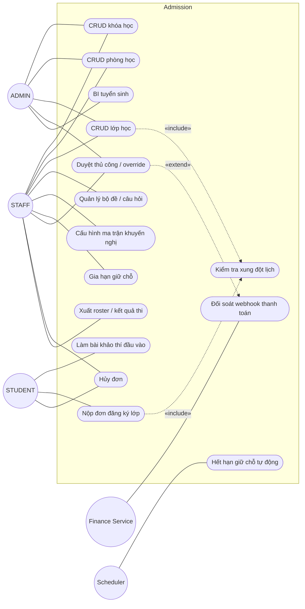

**FR-ADM-01 — Quản lý khóa học.** ADMIN/STAFF tạo, sửa, ngừng kích hoạt khóa học với các thuộc tính: `code` (duy nhất, INV-ADM-02), tên, mô tả, `level` thuộc {Beginner, Intermediate, Advanced}, chuẩn đầu ra, `duration_weeks > 0`, `tuition_amount >= 0`, khóa học tiên quyết tự tham chiếu. Xóa khóa học bị chặn (409) khi đã có lớp mở; khóa học ngừng kích hoạt không cho mở lớp mới nhưng giữ nguyên dữ liệu lịch sử.

**FR-ADM-02 — Quản lý phòng học.** ADMIN/STAFF quản lý phòng với `code` duy nhất, `capacity > 0`, tên cơ sở; xem lịch sử dụng phòng theo lớp. Phòng đang được lớp OPEN/IN_PROGRESS tham chiếu không được xóa.

**FR-ADM-03 — Quản lý lớp học.** ADMIN/STAFF mở lớp theo khóa học, gán phòng, giáo viên (tài khoản vai trò TEACHER), lịch học gồm `day_pattern` thuộc {MON_WED_FRI, TUE_THU_SAT, SAT_SUN, DAILY, CUSTOM}, khung giờ `start_time < end_time`, khoảng ngày `start_date < end_date`, sĩ số `min_students > 0` (mặc định 10) và `max_students >= min_students` (mặc định 25). Trạng thái lớp đi theo OPEN → IN_PROGRESS → COMPLETED, hoặc CANCELLED. Khi hủy một lớp chưa đủ sĩ số tối thiểu, toàn bộ đơn APPROVED của lớp chuyển sang CANCELLED_REFUND_PENDING để Finance xử lý hoàn phí hoặc ví bảo lưu.

**FR-ADM-04 — Kiểm soát xung đột lịch và sức chứa.** Khi tạo hoặc sửa lớp, hệ thống phải từ chối (422) nếu `max_students > capacity` của phòng (INV-FAC-03); nếu trùng phòng, khung giờ giao nhau, `day_pattern` tương thích và khoảng ngày giao nhau với một lớp OPEN/IN_PROGRESS khác (INV-CON-01); hoặc trùng giáo viên theo cùng điều kiện (INV-CON-02). Endpoint `POST /classes/check-conflict` cho phép kiểm tra trước khi lưu.

**FR-ADM-05 — Quản lý bộ đề khảo thí.** ADMIN/STAFF tạo bộ đề (`title`, `duration_minutes > 0`) và câu hỏi trắc nghiệm bốn lựa chọn thuộc một trong ba kỹ năng LISTENING, READING, GRAMMAR; câu LISTENING có `audio_url`, câu READING có `passage_text`. Mỗi câu có `correct_option` và `score_weight > 0`. Trường `correct_option` tuyệt đối không xuất hiện trong bất kỳ response nào dành cho người làm bài.

**FR-ADM-06 — Ma trận khuyến nghị.** ADMIN/STAFF cấu hình các dải điểm (`min_score >= 0`, `max_score > min_score`) ánh xạ sang trình độ đánh giá và khóa học khuyến nghị kèm lời khuyên; các dải của một bộ đề không được chồng lấn.

**FR-ADM-07 — Làm bài khảo thí đầu vào.** Học viên đã đăng nhập bắt đầu lượt làm qua `GET /tests/public/{id}/start`; hệ thống tạo `test_attempts` với `expires_at = started_at + duration_minutes` tính hoàn toàn theo giờ server. Nộp bài qua `POST /tests/public/submit` chỉ được chấp nhận khi attempt còn ở STARTED và chưa hết hạn; nộp trễ chuyển attempt sang EXPIRED và trả 422 `ADM_ATTEMPT_EXPIRED`. Việc chấm điểm thực hiện phía server dựa trên `correct_option` (INV-TST-01), tính điểm ba kỹ năng và tổng điểm, đối chiếu ma trận để trả trình độ cùng khóa học khuyến nghị. Mỗi attempt chỉ có tối đa một submission (`attempt_id` UNIQUE, INV-TST-02); nộp lần hai trả 409.

*Hình 5 — Sơ đồ trạng thái lượt làm bài*

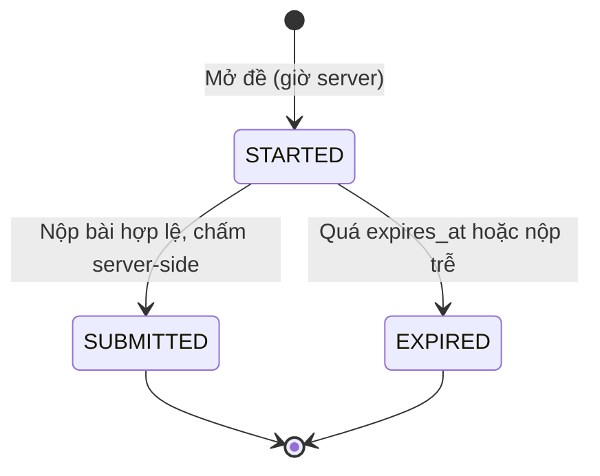

*Hình 6 — Sơ đồ hoạt động khảo thí đầu vào*

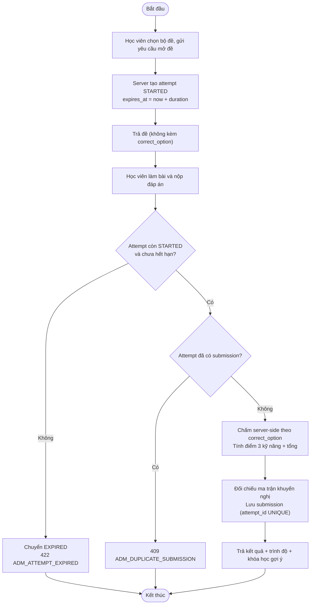

**FR-ADM-08 — Nộp đơn đăng ký và giữ chỗ 48 giờ.** Học viên nộp đơn qua `POST /enrollments` (kênh ONLINE) hoặc STAFF tiếp nhận tại quầy (kênh AT_COUNTER, `source` thuộc {ONLINE, WALK_IN, HOTLINE, FANPAGE, REFERRAL}). Mỗi cặp (student_id, class_id) chỉ tồn tại một đơn (UNIQUE). Trong một giao dịch, hệ thống khóa dòng lớp bằng `SELECT ... FOR UPDATE`, tính slot bị chiếm theo công thức `APPROVED + PENDING còn hạn giữ chỗ` và từ chối tạo đơn nếu lớp đã đầy (INV-ADM-01 và công thức INV-ENR-01; đơn PENDING hết hạn không chiếm slot kể cả khi job chưa chạy). Đơn hợp lệ được tạo ở PENDING với `hold_expires_at = now + 48h`; ngay sau đó Admission gọi Finance sinh hóa đơn tự động (FR-FIN-04, idempotent theo `enrollment_id`) và lưu `invoice_code` nhận được. Response trả thông tin giữ chỗ, hạn thanh toán và mã tham chiếu phục vụ hiển thị QR.

**FR-ADM-09 — Gia hạn giữ chỗ.** STAFF/ADMIN gia hạn một đơn PENDING qua `POST /enrollments/{id}/extend-hold` kèm lý do bắt buộc; hệ thống ghi `hold_extended_by_user_id`, `hold_extension_reason` và cộng thêm tối đa 24 giờ, mỗi đơn được gia hạn tối đa một lần (ngưỡng cấu hình được).

**FR-ADM-10 — Duyệt đơn.** Đơn chuyển sang APPROVED qua một trong ba phương thức ghi tại `approval_method`: ONLINE_PAYMENT (webhook Finance sau thanh toán VietQR), MANUAL_CASH (webhook Finance sau khi STAFF thu tiền mặt), STAFF_OVERRIDE (ngoại lệ do ADMIN thực hiện, bắt buộc có `note` lý do và ghi audit). Mọi路径 duyệt đều phải kiểm tra lại sĩ số nguyên tử như FR-ADM-08; lớp đầy trả 422 `ADM_CLASS_FULL`. Các đơn ở CANCELLED, REJECTED, EXPIRED không được chuyển ngược về APPROVED (INV-ADM-03).

**FR-ADM-11 — Hủy đơn.** Học viên hoặc STAFF hủy đơn PENDING qua `PATCH /enrollments/{id}/cancel`, giải phóng slot ngay lập tức. Đơn APPROVED khi bị hủy (cá nhân xin rút hoặc lớp bị hủy) chuyển sang CANCELLED_REFUND_PENDING và chỉ về CANCELLED sau khi Finance hoàn tất nghĩa vụ tài chính.

**FR-ADM-12 — Hết hạn giữ chỗ tự động.** Job nội bộ chạy mỗi 15 phút chuyển mọi đơn PENDING có `hold_expires_at < now` sang EXPIRED. Việc tính slot không phụ thuộc job này (theo INV-ENR-01).

**FR-ADM-13 — Đối soát webhook thanh toán.** Endpoint `POST /webhooks/payment-success` (bảo vệ bằng X-Internal-Secret) nhận sự kiện gồm `event_id`, `enrollment_id`, `invoice_code`, `amount_paid`, `payment_method`, `paid_at`. `finance_event_id` là UNIQUE (INV-ENR-02): sự kiện trùng trả 200 với kết quả cũ, không xử lý lại. Nếu đơn còn PENDING và lớp còn chỗ, duyệt theo FR-ADM-10 và ghi sổ `processed_finance_events`. Nếu tiền về sau khi đơn đã EXPIRED/CANCELLED, hệ thống tuyệt đối không tự duyệt (INV-ENR-03) mà chỉ ghi sổ đối soát và đánh dấu để STAFF xử lý hoàn tiền hoặc chuyển ví bảo lưu.

**FR-ADM-14 — Đồng bộ hồ sơ học viên.** Sau khi đơn APPROVED, Admission gọi `POST /api/student/internal/students` với `user_id`, họ tên, email, điện thoại, ngày sinh. Trạng thái đồng bộ theo dõi tại `student_sync_status` ∈ {NOT_STARTED, PENDING, SYNCED, FAILED}; gọi thất bại sau 3 lần retry thì giữ FAILED để đối soát và retry thủ công, không chặn trạng thái APPROVED của đơn.

**FR-ADM-15 — Xuất dữ liệu.** STAFF/ADMIN xuất roster lớp (`GET /exports/classes/{id}/roster`) và kết quả khảo thí (`GET /exports/tests/{id}/results`) ở định dạng bảng tải về.

**FR-ADM-16 — BI tuyển sinh.** ADMIN/STAFF xem phễu chuyển đổi đăng ký, doanh thu theo khóa học và mức độ tương tác bảo mật. Số liệu doanh thu phải lấy qua API nội bộ của Finance, không truy vấn chéo schema.

*Hình 7 — Sơ đồ trạng thái đơn đăng ký*

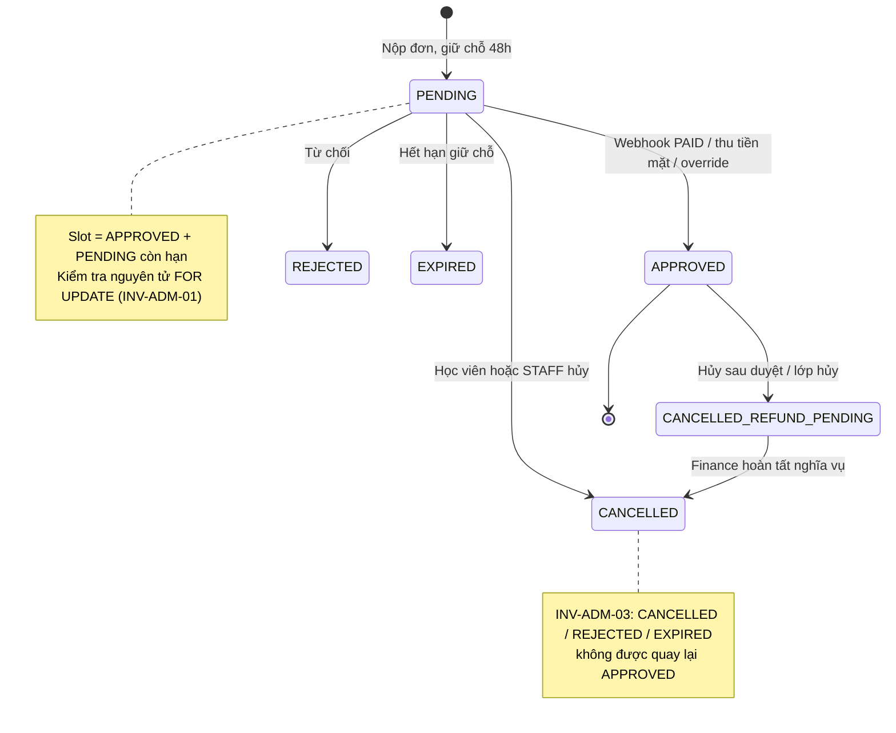

**Đặc tả use case cốt lõi — Nộp đơn đăng ký lớp**

| Mục               | Nội dung                                                                                                                                                                                                                                                                                                                        |
| ------------------ | -------------------------------------------------------------------------------------------------------------------------------------------------------------------------------------------------------------------------------------------------------------------------------------------------------------------------------- |
| Tác nhân         | STUDENT (online), STAFF (tại quầy)                                                                                                                                                                                                                                                                                             |
| Tiền điều kiện | Đã đăng nhập; lớp ở OPEN; chưa tồn tại đơn cho cặp (học viên, lớp)                                                                                                                                                                                                                                               |
| Luồng chính      | (1) Nhận yêu cầu đăng ký. (2) BEGIN; khóa dòng lớp FOR UPDATE. (3) Đếm slot = APPROVED + PENDING còn hạn. (4) Slot < max_students → INSERT đơn PENDING, hold 48h; COMMIT. (5) Gọi Finance auto-generate (idempotent theo enrollment_id). (6) Lưu invoice_code. (7) Trả thông tin giữ chỗ + mã thanh toán |
| Luồng thay thế   | 3a lớp đầy → 422 ADM_CLASS_FULL; 1a trùng đơn → 409 ADM_ALREADY_ENROLLED; 5a Finance không phản hồi sau retry → rollback đơn, trả 502 FIN_UNAVAILABLE, log lỗi                                                                                                                                                   |
| Hậu điều kiện  | Đơn PENDING chiếm một slot đến hạn hold; hóa đơn PENDING tồn tại bên Finance                                                                                                                                                                                                                                        |
| Quy tắc           | INV-ADM-01, INV-ADM-03, INV-ENR-01, C-03                                                                                                                                                                                                                                                                                         |

### 4.3. Phân hệ Student — Hồ sơ, Điểm danh, Học vụ

*Hình 8 — Sơ đồ use case phân hệ Student*

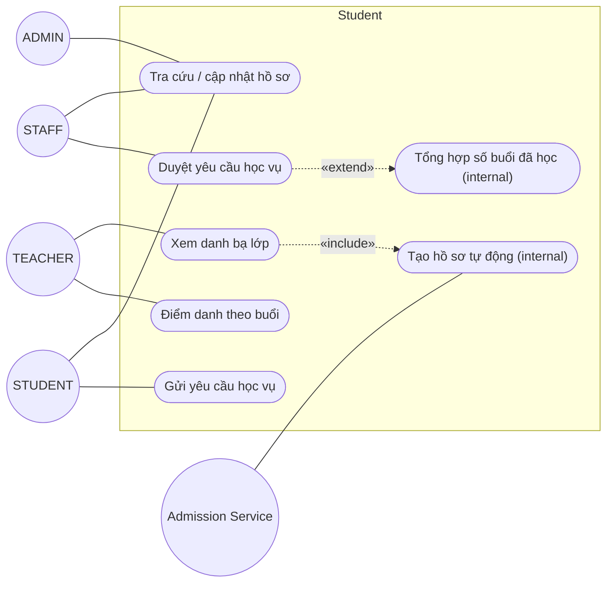

**FR-STU-01 — Tạo hồ sơ tự động.** Endpoint nội bộ `POST /api/student/internal/students` tạo hồ sơ khi Admission báo đơn APPROVED. Mã học viên `student_code` sinh tự động theo định dạng `HV-YYYY-NNNN` từ sequence `student.student_code_seq`, duy nhất (INV-STU-05); email duy nhất (INV-STU-06); trạng thái khởi tạo STUDYING. Cột `user_id` là cầu nối duy nhất về `admission.users` theo R-ID-1. Gọi lại với `user_id` đã tồn tại trả 200 kèm hồ sơ hiện có (idempotent), không tạo bản ghi thứ hai.

**FR-STU-02 — Tra cứu và cập nhật hồ sơ.** ADMIN/STAFF xem danh sách có phân trang, tìm theo tên hoặc mã; xem và sửa mọi hồ sơ. STUDENT chỉ xem/sửa hồ sơ của chính mình (INV-SEC-01): danh tính suy ra từ JWT ánh xạ qua `user_id`, mọi tham số `student_id` do client gửi trái chủ thể phải bị từ chối 403. Các trường được STUDENT tự sửa giới hạn ở thông tin liên hệ và cá nhân (họ tên, điện thoại, ngày sinh, địa chỉ, avatar); `status` và `student_code` chỉ hệ thống hoặc STAFF thay đổi. Trạng thái học viên chỉ nhận một trong bốn giá trị STUDYING, RESERVED, DROPPED, GRADUATED (INV-STU-02).

*Hình 9 — Sơ đồ trạng thái hồ sơ học viên*

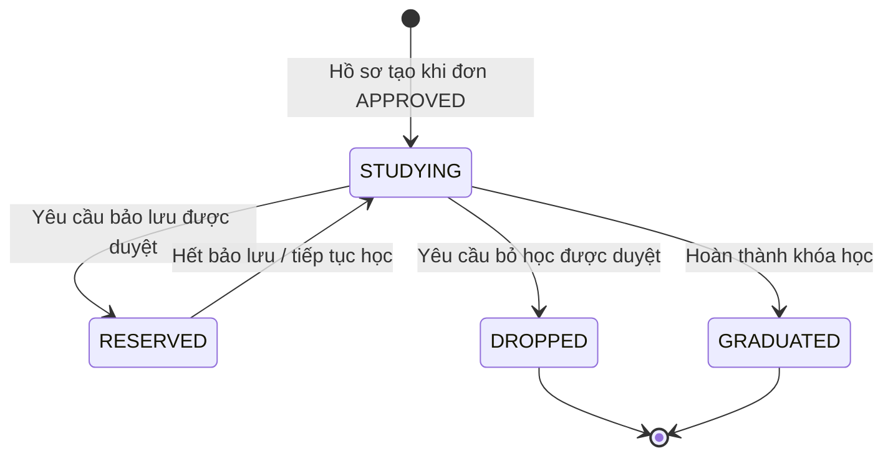

**FR-STU-03 — Danh bạ lớp.** TEACHER/STAFF xem danh sách học viên của lớp qua `GET /classes/{class_id}/members`. Student service không lưu bảng danh bạ; hệ thống tuyệt đối không có bảng `class_members` (INV-STU-03) mà gọi `GET /api/admission/internal/enrollments?class_id=...&status=APPROVED` mỗi lần cần danh sách. TEACHER chỉ xem được lớp mình dạy (đối chiếu `teacher_id` qua Admission).

**FR-STU-04 — Điểm danh.** TEACHER/STAFF ghi điểm danh theo buổi qua `POST /attendance` với `class_id`, `student_id`, `session_date`, `status` ∈ {PRESENT, ABSENT, LATE, EXCUSED}, ghi chú tùy chọn. Học viên được điểm danh phải nằm trong danh bạ APPROVED của lớp; giáo viên phải phụ trách lớp đó. Mỗi (lớp, học viên, ngày) chỉ có một bản ghi (UNIQUE, INV-STU-01); ghi trùng trả 409 `STU_DUPLICATE_ATTENDANCE`, muốn đổi trạng thái phải dùng thao tác cập nhật bản ghi của buổi đó.

**FR-STU-05 — Tổng hợp buổi học.** Endpoint nội bộ `GET /api/student/internal/attendance/summary?student_id=...&class_id=...` trả `attended_sessions` và thông tin buổi học cho Finance xét hoàn tiền. Số buổi được tính tham gia là số bản ghi có trạng thái PRESENT hoặc LATE; EXCUSED và ABSENT không tính.

**FR-STU-06 — Gửi yêu cầu học vụ.** STUDENT gửi `POST /status-requests` loại RESERVE, TRANSFER hoặc DROP kèm lý do bắt buộc và `class_id` liên quan; TRANSFER bắt buộc có `target_class_id`. Yêu cầu ở PENDING chờ duyệt; mỗi học viên không được có hai yêu cầu PENDING cùng loại cho cùng một lớp.

**FR-STU-07 — Duyệt yêu cầu học vụ.** STAFF duyệt hoặc từ chối qua `PUT /status-requests/{id}/approve`, ghi `reviewed_by`, `reviewed_note`, `reviewed_at`. Khi APPROVED: RESERVE chuyển hồ sơ sang RESERVED với thời hạn tối đa 6 tháng (INV-STU-04) và phối hợp Finance ghi nhận ví bảo lưu; TRANSFER yêu cầu Admission hủy đơn lớp cũ và tạo đơn lớp mới theo đúng quy tắc slot; DROP chuyển hồ sơ sang DROPPED và kích hoạt quy trình hoàn tiền nếu đủ điều kiện. Mọi thay đổi trạng thái hồ sơ phải nằm trong bốn giá trị hợp lệ.

*Hình 10 — Sơ đồ trạng thái yêu cầu học vụ*

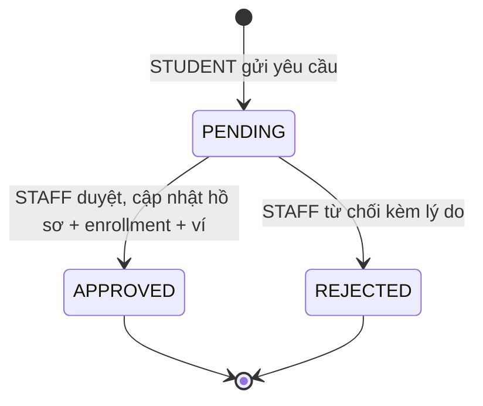

### 4.4. Phân hệ Learning — Học liệu, Sổ điểm, Báo cáo

*Hình 11 — Sơ đồ use case phân hệ Learning*

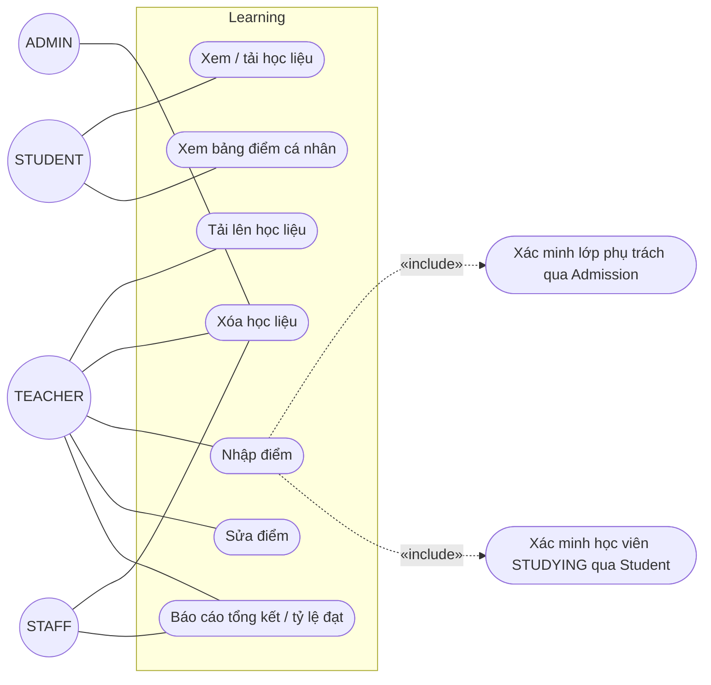

**FR-LRN-01 — Tải lên học liệu.** TEACHER (lớp mình dạy), STAFF, ADMIN tải học liệu qua `POST /materials` dạng multipart gồm file và metadata `class_id`, `title`, `material_type` ∈ {DOCUMENT, VIDEO, EXERCISE, SLIDE}, mô tả. Hệ thống lưu file vào kho nội bộ, ghi `file_url` không rỗng (INV-LRN-04), `original_filename`, `file_size >= 0`, `uploaded_by`. Dung lượng tối đa mặc định 25 MB mỗi file, định dạng cho phép cấu hình được; vượt giới hạn trả 400 `LRN_FILE_TOO_LARGE`. Trước khi ghi, Learning xác minh lớp tồn tại và giáo viên đúng phụ trách qua Admission.

**FR-LRN-02 — Xem học liệu.** Người dùng đã đăng nhập xem danh sách học liệu theo `class_id`. STUDENT chỉ truy cập học liệu của lớp mình có đơn APPROVED (đối chiếu qua API Admission/Student); truy cập lớp khác trả 403 `LRN_FORBIDDEN_CLASS`.

**FR-LRN-03 — Xóa học liệu.** Người tải lên, STAFF hoặc ADMIN xóa học liệu; giáo viên khác không được xóa học liệu không do mình tải.

**FR-LRN-04 — Nhập điểm.** TEACHER/STAFF/ADMIN nhập điểm qua `POST /grades` với `class_id`, `student_id` (theo R-ID-1 là ID hồ sơ bên Student), `assessment_name`, `score`, `max_score` (mặc định 100), `weight` ∈ (0, 1] (NULL hiểu là 1.0), `feedback`. Trước khi ghi, hệ thống thực hiện hai kiểm tra bắt buộc: gọi Admission xác nhận `teacher_id` của lớp trùng `sub` trong JWT (INV-LRN-03, INV-SEC-02 — sai trả 403 `LRN_FORBIDDEN_CLASS`), gọi Student xác nhận hồ sơ tồn tại và đang STUDYING. Ràng buộc dữ liệu: `0 <= score <= max_score` (INV-LRN-01, vi phạm trả 422 `LRN_INVALID_SCORE`); mỗi (lớp, học viên, tên bài đánh giá) chỉ một bản ghi (UNIQUE, INV-LRN-06, trùng trả 409 `LRN_DUPLICATE_ASSESSMENT`).

**FR-LRN-05 — Sửa điểm.** Người đã nhập điểm (hoặc STAFF/ADMIN) sửa qua `PUT /grades/{id}` với toàn bộ kiểm tra quyền và ràng buộc như FR-LRN-04; lịch sử chỉnh sửa phản ánh qua `graded_by`, `graded_at`.

**FR-LRN-06 — Xem điểm.** TEACHER/STAFF/ADMIN xem điểm theo lớp hoặc học viên. STUDENT chỉ xem điểm của chính mình (INV-LRN-02): `student_id` suy ra từ JWT qua cầu nối hồ sơ, tham số trái chủ thể bị từ chối 403.

**FR-LRN-07 — Báo cáo học tập.** Hai view phục vụ báo cáo: `v_student_grade_summary` chuẩn hóa từng đầu điểm về thang phần trăm (`score / max_score * 100`) rồi tính trung bình gia quyền theo `weight`, xếp loại Pass khi `average_percentage >= 50` (INV-LRN-05); `v_class_pass_rate` tổng hợp số học viên, số đạt, số trượt và tỷ lệ phần trăm theo lớp. TEACHER xem báo cáo lớp mình; STAFF/ADMIN xem toàn bộ.

### 4.5. Phân hệ Finance — Biểu phí, Hóa đơn, Thanh toán, Ví, Hoàn tiền

*Hình 12 — Sơ đồ use case phân hệ Finance*

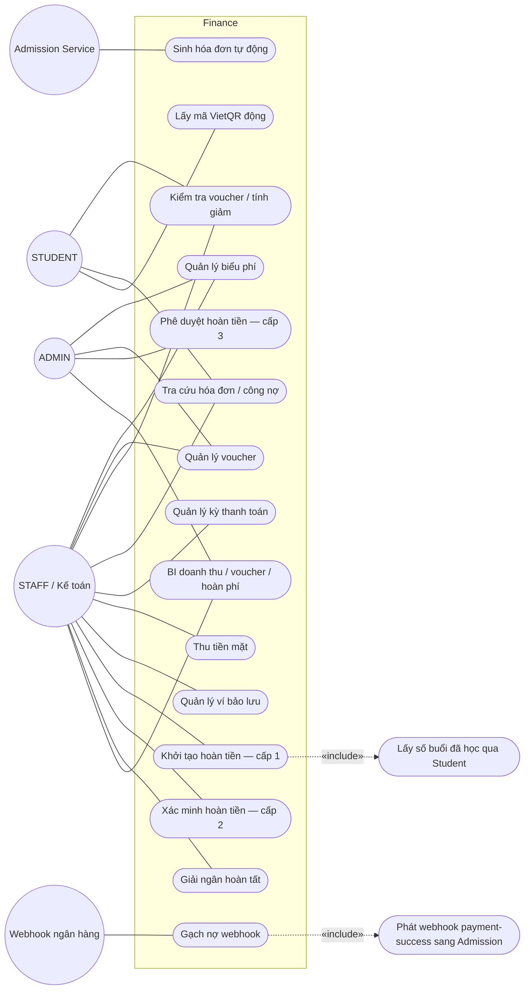

**FR-FIN-01 — Biểu phí đào tạo.** ADMIN/STAFF cấu mức phí chuẩn theo khóa học tại `tuition_fees`: `course_id` duy nhất (Logical FK), `amount >= 0`, `currency` mặc định VND, `discount_pct` tùy chọn, ghi chú. Cột `amount` và `base_amount` tự đồng bộ bằng trigger. Đây là nguồn học phí niêm yết hiển thị thống nhất toàn hệ thống.

**FR-FIN-02 — Quản lý voucher.** ADMIN/STAFF tạo chiến dịch với `code` duy nhất, giảm theo phần trăm (0–100, có trần `max_discount_amount`) hoặc số tiền cố định, giá trị đơn tối thiểu `min_order_value`, giới hạn lượt dùng `max_uses > 0`, thời hạn `valid_from < expires_at`, cờ kích hoạt. Mọi lượt áp dụng phải khóa dòng voucher bằng `SELECT ... FOR UPDATE` trước khi tăng `current_uses`, bảo đảm `current_uses <= max_uses` dưới tải đồng thời (INV-FIN-04).

**FR-FIN-03 — Kiểm tra voucher.** `POST /vouchers/validate` nhận mã và giá trị đơn, trả hiệu lực và số tiền giảm tính được; voucher hết hạn, hết lượt, chưa đạt giá trị tối thiểu trả mã lỗi `FIN_VOUCHER_EXPIRED`, `FIN_VOUCHER_EXHAUSTED`, `FIN_VOUCHER_MIN_ORDER`.

**FR-FIN-04 — Sinh hóa đơn tự động.** `POST /invoices/auto-generate` (nội bộ, Admission gọi) nhận `enrollment_id`, `student_id` (theo R-ID-1 là `admission.users.id`), `course_id`, `voucher_code` tùy chọn. Hệ thống lấy học phí niêm yết qua API nội bộ Admission, áp voucher nếu có, tạo hóa đơn PENDING với mã `invoice_code` duy nhất dạng `INV-YYYYMM-XXXX`, các khoản mục `invoice_items` (TUITION_PACKAGE, RETAKE_FEE, `line_total = quantity * unit_price`) và lịch `installments` (mặc định một kỳ bằng toàn bộ số tiền; trả góp nhiều kỳ theo cấu hình, tổng `amount_due` các kỳ bằng `final_amount`). Cùng một `enrollment_id` chỉ sinh đúng một hóa đơn; gọi lại trả 200 kèm hóa đơn cũ. Các bất biến số học: `final_amount = amount - discount_applied`, `paid_amount <= final_amount`, `remaining_amount` là cột GENERATED.

**FR-FIN-05 — Tra cứu hóa đơn và công nợ.** ADMIN/STAFF xem toàn bộ; STUDENT chỉ xem hóa đơn của chính mình (lọc theo `student_id` từ JWT). Chi tiết hóa đơn trả kèm khoản mục và lịch kỳ. Hóa đơn quá `due_date` chưa thu đủ hiển thị nhãn công nợ OVERDUE phục vụ nhắc nợ. Khi hóa đơn ở PAID hoặc REFUNDED, cấm mọi thay đổi `amount`, `discount_applied`, `final_amount` (INV-FIN-09).

*Hình 13 — Sơ đồ trạng thái hóa đơn*

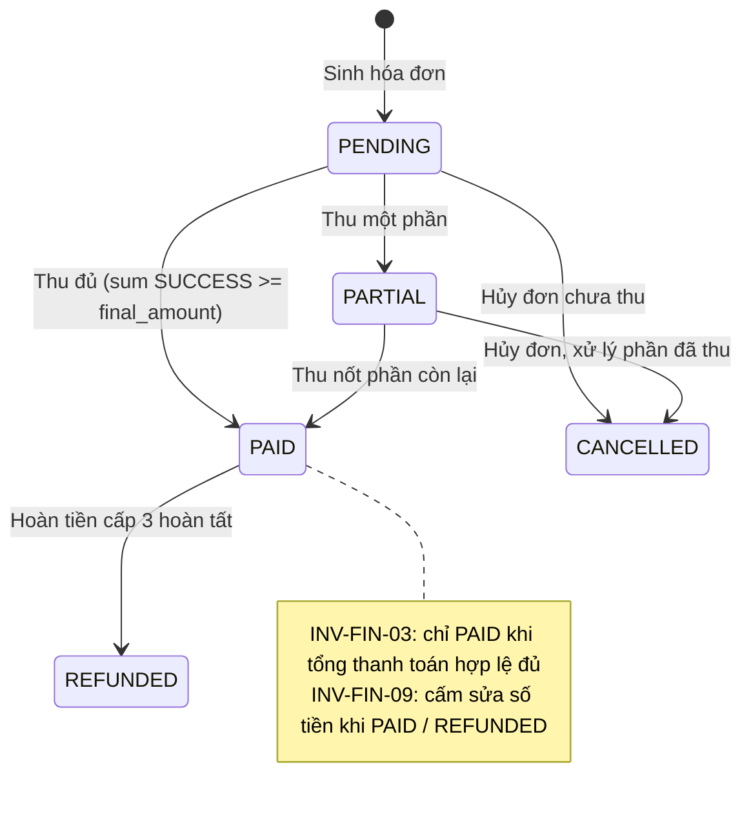

**FR-FIN-06 — Kỳ thanh toán.** Mỗi kỳ có `installment_no >= 1` duy nhất trong hóa đơn, `payment_ref_code` duy nhất toàn hệ thống (nhúng vào nội dung chuyển khoản VietQR), `amount_due > 0`, `due_date`, trạng thái PENDING → PARTIAL → PAID, hoặc OVERDUE khi quá hạn, hoặc CANCELLED khi hủy kỳ.

*Hình 14 — Sơ đồ trạng thái kỳ thanh toán*

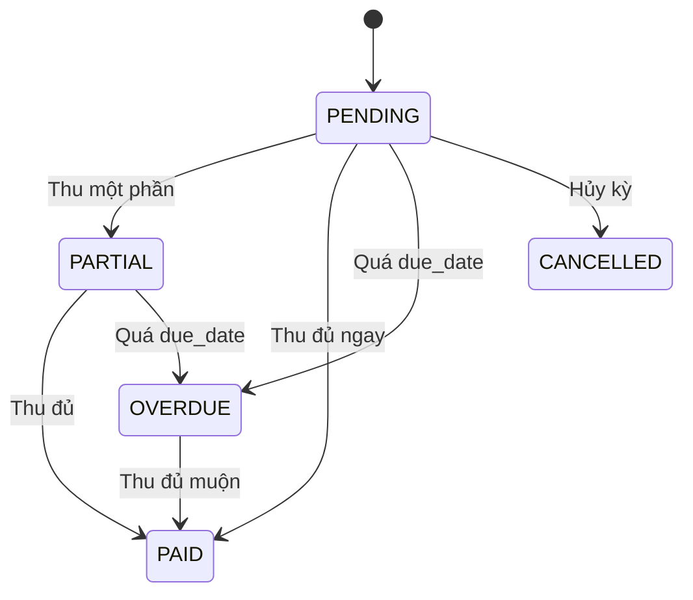

**FR-FIN-07 — Thu tiền mặt.** STAFF ghi nhận phiếu thu qua `POST /payments/cash` với `amount > 0` (INV-FIN-01), hóa đơn/kỳ tương ứng, `received_by_staff_id` bắt buộc. Trong một giao dịch: tạo `payments` (mã `payment_code` duy nhất, trạng thái SUCCESS), cập nhật `amount_paid` của kỳ và `paid_amount` của hóa đơn, chuyển trạng thái theo máy trạng thái; sau đó phát webhook sang Admission theo FR-FIN-09.

**FR-FIN-08 — VietQR động.** STUDENT/STAFF lấy mã QR cho một kỳ qua `GET /invoices/{id}/vietqr`; QR nhúng số tiền và `payment_ref_code` của kỳ để đối soát tự động.

**FR-FIN-09 — Gạch nợ webhook.** `POST /webhooks/vietqr` nhận giao dịch ngân hàng (mô phỏng). Khóa chống trùng là `bank_transaction_id` UNIQUE (INV-FIN-02, hiện thực chi tiết INV-FIN-05): giao dịch trùng trả 200 kèm kết quả cũ, không cộng tiền lần hai. Giao dịch mới được lưu kèm raw `webhook_payload`, đối chiếu `payment_ref_code` để tìm kỳ, ghi phiếu thu VIETQR SUCCESS và cập nhật công nợ trong cùng giao dịch. Khi hóa đơn đạt PAID và có `enrollment_id`, Finance phát `POST /api/admission/webhooks/payment-success` với `event_id` duy nhất dạng `EVT-YYYYMMDD-NNN`; gọi thất bại sau retry thì rollback giao dịch gạch nợ và log để đối soát (C-03). Hóa đơn chỉ được chuyển PAID khi tổng các phiếu thu SUCCESS đạt `final_amount` (INV-FIN-03).

**FR-FIN-10 — Ví bảo lưu.** Mỗi học viên có tối đa một ví (`student_id` UNIQUE, theo R-ID-1). Số dư `balance >= 0`; `is_withdrawable` luôn FALSE — ví không bao giờ rút ra tiền mặt (INV-FIN-06). Khi STAFF duyệt bảo lưu, phần học phí được giữ ghi nhận vào ví bằng giao dịch RESERVATION_CREDIT.

**FR-FIN-11 — Giao dịch ví.** Mọi biến động ví phải có bản ghi `wallet_transactions` loại RESERVATION_CREDIT, TUITION_OFFSET hoặc ADJUSTMENT, `amount > 0`, `reason` bắt buộc, người thực hiện. Chiều giảm số dư nghiệp vụ duy nhất là TUITION_OFFSET (cấn trừ học phí cho hóa đơn mới, tạo phiếu thu phương thức WALLET_OFFSET); ADJUSTMENT chỉ dùng hiệu chỉnh có phê duyệt ADMIN. Cộng tiền và trừ tiền thực hiện nguyên tử với cập nhật số dư.

**FR-FIN-12 — Khởi tạo hoàn tiền (cấp 1).** STAFF tạo yêu cầu qua `POST /refunds` cho hóa đơn đã thu tiền. Hệ thống chụp `paid_amount_snapshot` tại thời điểm tạo, lấy `total_sessions` từ Admission và `attended_sessions` qua API nội bộ Student (FR-STU-05) — Finance không tự truy vấn dữ liệu điểm danh. Điều kiện chấp nhận: `attended_sessions <= max_allowed_sessions` (mặc định 3, INV-FIN-07); vượt ngưỡng trả 422 `FIN_REFUND_SESSIONS_EXCEEDED`. Phần trăm hoàn theo chính sách mặc định cấu hình được: 0 buổi — 100%, 1 buổi — 90%, 2 buổi — 80%, 3 buổi — 70%; `deduction_amount` ghi các khoản khấu trừ khác (giáo trình đã nhận…). Yêu cầu ở PENDING_ACCOUNTANT, kèm thông tin ngân hàng thụ hưởng nếu giải ngân chuyển khoản.

**FR-FIN-13 — Xác minh (cấp 2).** STAFF kế toán xác minh qua `PUT /refunds/{id}/verify`: kiểm tra lại số buổi, số tiền, chứng từ; đạt thì chuyển PENDING_DIRECTOR kèm `verified_by_accountant_id`, `accountant_note`; không đạt chuyển REJECTED kèm lý do.

**FR-FIN-14 — Phê duyệt (cấp 3).** Chỉ ADMIN (giám đốc) phê duyệt qua `PUT /refunds/{id}/approve`, chốt `approved_refund_amount <= requested_refund_amount`; đạt chuyển APPROVED, không đạt chuyển REJECTED. Không tồn tại đường tắt bỏ qua cấp nào (INV-FIN-08); gọi API sai thứ tự trạng thái trả 409 `FIN_REFUND_STATE_CONFLICT`.

**FR-FIN-15 — Giải ngân.** STAFF kế toán ghi nhận hoàn tất qua `PUT /refunds/{id}/complete` sau khi chi tiền thực tế: yêu cầu chuyển COMPLETED, hóa đơn chuyển REFUNDED, đơn đăng ký liên quan (nếu còn hiệu lực) được báo Admission hủy theo nhánh hoàn tiền, hồ sơ học viên cập nhật theo lý do (DROPPED hoặc giữ RESERVED nếu chuyển ví).

*Hình 15 — Sơ đồ trạng thái yêu cầu hoàn tiền*

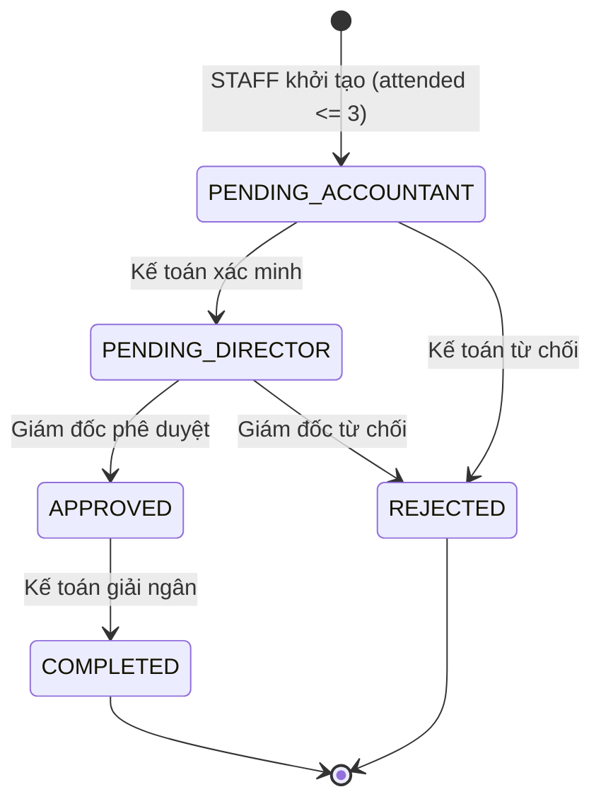

*Hình 16 — Sơ đồ hoạt động hoàn tiền ba cấp*

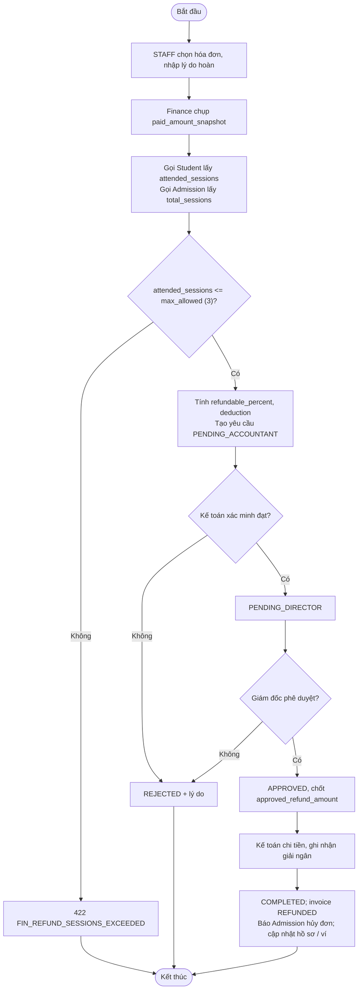

**FR-FIN-16 — BI tài chính.** ADMIN/STAFF xem doanh thu thực thu theo tháng (`vw_bi_cash_revenue_monthly`, chỉ tính phiếu thu SUCCESS, khấu trừ hoàn tiền), hiệu quả chiến dịch voucher (`vw_bi_voucher_campaigns`) và tổng hợp hoàn phí — ví bảo lưu, qua các endpoint `/bi/*`.

---

## 5. Luồng nghiệp vụ liên phân hệ

### 5.1. Đăng ký — sinh hóa đơn — thanh toán — tạo hồ sơ

Đây là luồng xương sống của hệ thống, đi qua cả bốn service. Nguyên tắc nhất quán: Admission giữ quyền quyết định trạng thái đơn; Finance giữ quyền quyết định trạng thái tiền; Student chỉ tạo hồ sơ khi Admission xác nhận đơn đã APPROVED. Mỗi bước gọi chéo đều idempotent để chịu được retry.

*Hình 17 — Sơ đồ hoạt động liên phân hệ của luồng đăng ký*

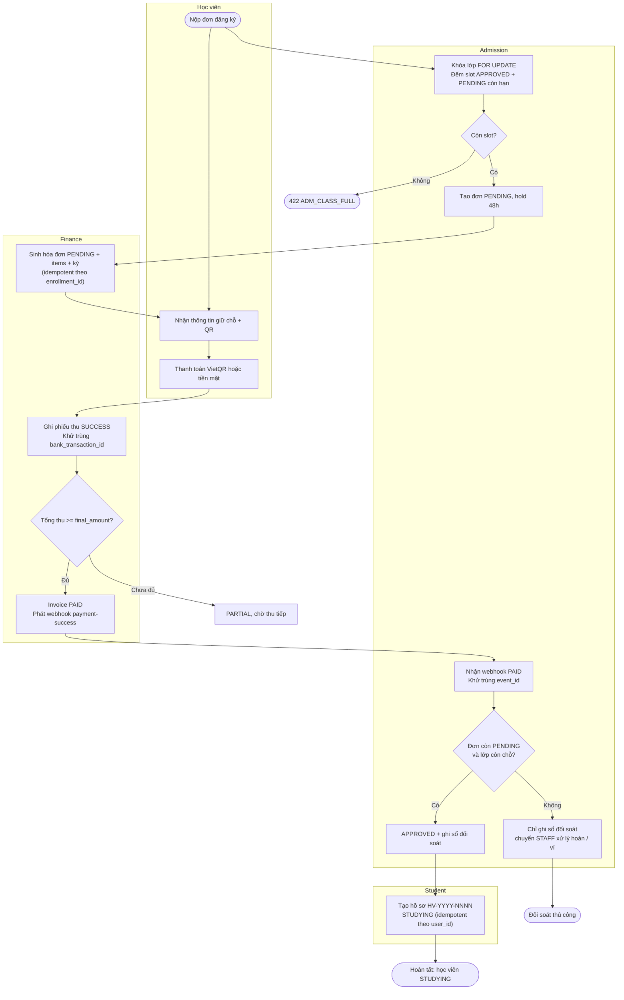

*Hình 18 — Sơ đồ tuần tự luồng đăng ký đến tạo hồ sơ*

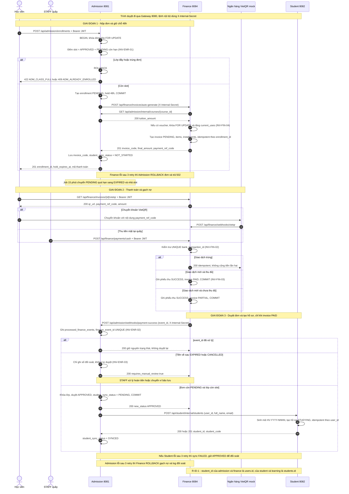

### 5.2. Điểm danh trên danh bạ thời gian thực

Student không lưu danh sách lớp. Mỗi lần giáo viên mở màn hình điểm danh, danh sách được kéo tươi từ Admission theo trạng thái APPROVED, bảo đảm học viên mới duyệt hoặc vừa hủy không bao giờ lệch khỏi danh bạ.

*Hình 19 — Sơ đồ tuần tự điểm danh*

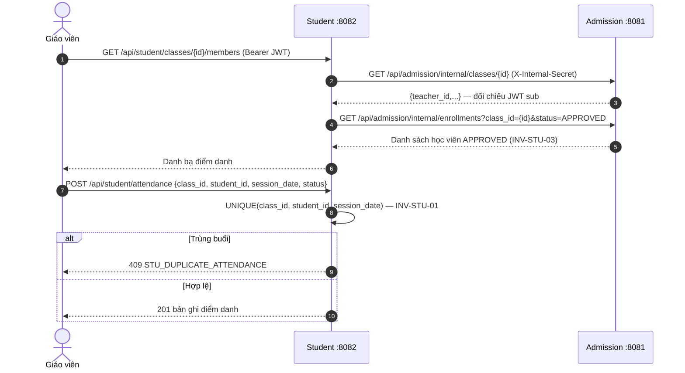

### 5.3. Nhập điểm với xác minh hai chiều

Trước mọi thao tác ghi điểm, Learning xác minh ranh giới giảng dạy với Admission và tính hợp lệ học viên với Student; không tin bất kỳ tham quyền nào từ client.

*Hình 20 — Sơ đồ tuần tự nhập điểm*

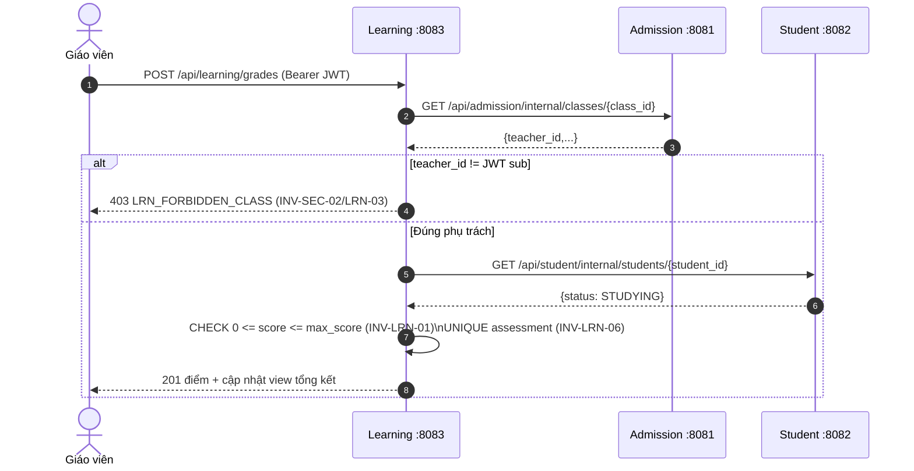

### 5.4. Hoàn tiền dựa trên dữ liệu điểm danh

*Hình 21 — Sơ đồ tuần tự hoàn tiền ba cấp*

```mermaid
sequenceDiagram
    autonumber
    actor NV as STAFF khởi tạo
    actor KT as Kế toán xác minh
    actor GD as ADMIN phê duyệt
    participant FIN as Finance 8084
    participant ADM as Admission 8081
    participant STU as Student 8082

    Note over NV,STU: CẤP 1 - Khởi tạo yêu cầu và thu thập căn cứ
    NV->>FIN: POST /api/finance/refunds + Bearer JWT
    FIN->>FIN: Kiểm tra invoice đã thu tiền, chụp paid_amount_snapshot
    FIN->>STU: GET /api/student/internal/students theo user_id (X-Internal-Secret)
    STU-->>FIN: 200 student_id là students.id, student_code, status
    Note over FIN,STU: R-ID-1 - phải đổi users.id sang students.id trước khi hỏi điểm danh
    FIN->>ADM: GET /api/admission/internal/classes/{class_id}
    ADM-->>FIN: 200 total_sessions, day_pattern, start_date, end_date
    FIN->>STU: GET /api/student/internal/attendance/summary theo student_id và class_id
    STU-->>FIN: 200 attended_sessions, tính PRESENT và LATE
    alt attended_sessions vượt max_allowed_sessions mặc định 3
        FIN-->>NV: 422 FIN_REFUND_SESSIONS_EXCEEDED (INV-FIN-07)
    else Đủ điều kiện
        FIN->>FIN: Tính refundable_percent, deduction_amount, requested_refund_amount
        FIN->>FIN: Tạo refund PENDING_ACCOUNTANT, refund_code UNIQUE
        FIN-->>NV: 201 refund_id, refund_code, status PENDING_ACCOUNTANT
    end

    Note over KT,FIN: CẤP 2 - Kế toán xác minh
    KT->>FIN: PUT /api/finance/refunds/{id}/verify + Bearer JWT
    FIN->>FIN: Kiểm tra đang ở PENDING_ACCOUNTANT (INV-FIN-08)
    alt Sai cấp hoặc đã xử lý
        FIN-->>KT: 409 FIN_REFUND_STATE_CONFLICT
    else Kế toán từ chối
        FIN->>FIN: status REJECTED, ghi accountant_note
        FIN-->>KT: 200 status REJECTED
    else Xác minh đạt
        FIN->>FIN: status PENDING_DIRECTOR, ghi verified_by_accountant_id
        FIN-->>KT: 200 status PENDING_DIRECTOR
    end

    Note over GD,FIN: CẤP 3 - Giám đốc phê duyệt
    GD->>FIN: PUT /api/finance/refunds/{id}/approve + Bearer JWT
    FIN->>FIN: Kiểm tra role ADMIN và đang ở PENDING_DIRECTOR (INV-FIN-08)
    alt Sai vai trò
        FIN-->>GD: 403 AUTH_FORBIDDEN
    else Sai cấp hoặc nhảy cóc trạng thái
        FIN-->>GD: 409 FIN_REFUND_STATE_CONFLICT
    else Từ chối
        FIN->>FIN: status REJECTED, ghi director_note
        FIN-->>GD: 200 status REJECTED
    else Phê duyệt
        FIN->>FIN: approved_refund_amount không vượt requested_refund_amount
        FIN->>FIN: status APPROVED, ghi approved_by_director_id
        FIN-->>GD: 200 status APPROVED
    end

    Note over KT,STU: GIẢI NGÂN - Kế toán ghi nhận chi và lan truyền trạng thái
    KT->>FIN: PUT /api/finance/refunds/{id}/complete + Bearer JWT
    FIN->>FIN: BEGIN, refund COMPLETED, invoice REFUNDED (INV-FIN-09)
    alt Chi tiền mặt hoặc chuyển khoản
        FIN->>FIN: Ghi bút toán chi hoàn, COMMIT
    else Kết chuyển vào ví bảo lưu
        FIN->>FIN: Ghi RESERVATION_CREDIT, tăng balance (INV-FIN-06), COMMIT
    end
    FIN-->>KT: 200 status COMPLETED, invoice_status REFUNDED
    FIN->>ADM: POST /api/admission/internal/enrollments/{id}/cancel-refund (event_id)
    ADM->>ADM: Khử trùng event_id, chuyển CANCELLED_REFUND_PENDING thành CANCELLED
    ADM-->>FIN: 200 new_status CANCELLED
    opt Học viên có yêu cầu DROP hoặc RESERVE kèm theo
        NV->>STU: PUT /api/student/status-requests/{id}/approve + Bearer JWT
        STU->>STU: students.status thành DROPPED hoặc RESERVED (INV-STU-02)
        STU-->>NV: 200 status APPROVED
    end
    Note over FIN,STU: Finance không tự sửa trạng thái học viên, mọi thay đổi qua luồng học vụ của Student
    Note over FIN,ADM: Admission lỗi sau 3 retry thì Finance ROLLBACK và log, chạy lại với cùng event_id
```

### 5.5. Danh mục và quy tắc API nội bộ

| Chiều gọi           | Endpoint                                                          | Mục đích                                |
| --------------------- | ----------------------------------------------------------------- | ------------------------------------------ |
| Admission → Finance  | POST /api/finance/invoices/auto-generate                          | Sinh hóa đơn khi tạo đơn giữ chỗ   |
| Finance → Admission  | POST /api/admission/webhooks/payment-success                      | Báo tiền về, duyệt đơn               |
| Admission → Student  | POST /api/student/internal/students                               | Tạo hồ sơ khi APPROVED                  |
| Admission → Student  | GET /api/student/internal/students?user_id=                       | Kiểm tra hồ sơ tồn tại                |
| Student → Admission  | GET /api/admission/internal/enrollments?class_id=&status=APPROVED | Danh bạ lớp                              |
| Student → Admission  | GET /api/admission/internal/classes/{id}                          | Thông tin lớp, giáo viên               |
| Learning → Admission | GET /api/admission/internal/classes/{id}                          | Xác minh lớp và giáo viên phụ trách |
| Learning → Student   | GET /api/student/internal/students/{id}                           | Xác minh học viên STUDYING              |
| Finance → Student    | GET /api/student/internal/students?user_id=                       | Thông tin học viên cho hóa đơn       |
| Finance → Student    | GET /api/student/internal/attendance/summary                      | Số buổi đã học xét hoàn tiền       |
| Finance → Admission  | GET /api/admission/internal/courses/{id}                          | Học phí niêm yết                       |
| Student → Finance    | GET /api/finance/internal/wallets?student_id=                     | Kiểm tra ví khi bảo lưu                |

Toàn bộ các chiều gọi trên tuân thủ C-03: header `X-Internal-Secret`, timeout 5 giây, retry 3 lần backoff lũy thừa, POST có `event_id` UNIQUE, bên nhận tự khử trùng lặp, bên gọi rollback giao dịch và log khi callee không phản hồi. Gateway phải chặn mọi đường dẫn chứa `/internal/` từ bên ngoài.

---

## 6. Yêu cầu dữ liệu

### 6.1. Quy ước định danh người học R-ID-1

Hệ thống tồn tại hai định danh người học song song và quy tắc phân định phải được mọi nhóm tuân thủ tuyệt đối. Trong schema `admission` và `finance`, cột `student_id` lưu `admission.users.id` — vì đơn đăng ký và hóa đơn được sinh ở giai đoạn PENDING, trước khi hồ sơ học vụ chính thức tồn tại. Trong schema `student` và `learning`, cột `student_id` lưu `student.students.id`. Cầu nối duy nhất giữa hai định danh là cột `student.students.user_id` (Logical FK về `admission.users.id`). Mọi API nội bộ trả dữ liệu người học phải ghi rõ định danh nào đang được dùng; nhầm lẫn hai loại ID là lỗi nghiêm trọng tương đương vi phạm kiến trúc.

### 6.2. Mô hình lớp miền

Sơ đồ lớp dưới đây thể hiện các thực thể nghiệp vụ chính và quan hệ; nét đứt là liên kết logic xuyên schema (chỉ tồn tại ở mức ID, không có ràng buộc vật lý).

*Hình 22 — Sơ đồ lớp miền nghiệp vụ*

```mermaid
classDiagram
    direction LR
    class User { +int id +string email +string password_hash +string role +bool is_active +bool must_change_password }
    class Course { +int id +string code +string level +int duration_weeks +decimal tuition_amount }
    class Room { +int id +string code +int capacity }
    class Class { +int id +string code +string day_pattern +time start_time +time end_time +int min_students +int max_students +string status }
    class Enrollment { +int id +int student_id +string status +timestamptz hold_expires_at +string invoice_code +string student_sync_status }
    class TestSet { +int id +string title +int duration_minutes }
    class TestQuestion { +int id +string skill_type +char correct_option +decimal score_weight }
    class TestAttempt { +int id +string status +timestamptz expires_at }
    class TestSubmission { +int id +decimal total_score +string assessed_level +jsonb answers_detail }
    class Student { +int id +int user_id +string student_code +string email +string status }
    class Attendance { +int id +int class_id +date session_date +string status }
    class StatusRequest { +int id +string request_type +string status }
    class Material { +int id +int class_id +string material_type +string file_url }
    class Grade { +int id +int class_id +int student_id +string assessment_name +decimal score +decimal max_score +decimal weight }
    class TuitionFee { +int id +int course_id +decimal amount +string currency }
    class Voucher { +int id +string code +int discount_percent +int max_uses +int current_uses }
    class Invoice { +int id +string invoice_code +int student_id +decimal amount +decimal final_amount +decimal paid_amount +string status }
    class InvoiceItem { +int id +string item_type +int quantity +decimal unit_price +decimal line_total }
    class Installment { +int id +int installment_no +string payment_ref_code +decimal amount_due +string status }
    class Payment { +int id +string payment_code +string payment_method +decimal amount +string bank_transaction_id }
    class Wallet { +int id +int student_id +decimal balance +bool is_withdrawable }
    class WalletTransaction { +int id +string tx_type +decimal amount +string reason }
    class RefundRequest { +int id +string refund_code +int attended_sessions +int max_allowed_sessions +decimal approved_refund_amount +string status }

    User "1" --> "0..*" Enrollment : nộp
    Course "1" --> "0..*" Class : mở
    Room "1" --> "0..*" Class : chứa
    User "1" --> "0..*" Class : dạy
    Class "1" --> "0..*" Enrollment : nhận
    Course "0..1" --> "0..*" Course : tiên quyết
    TestSet "1" --> "1..*" TestQuestion : gồm
    TestSet "1" --> "0..*" TestAttempt : lượt làm
    TestAttempt "1" --> "0..1" TestSubmission : kết quả
    User "1" --> "0..*" TestAttempt : làm
    Student "1" --> "0..*" Attendance : điểm danh
    Student "1" --> "0..*" StatusRequest : yêu cầu
    Invoice "1" --> "1..*" InvoiceItem : khoản mục
    Invoice "1" --> "0..*" Installment : kỳ
    Invoice "1" --> "0..*" Payment : phiếu thu
    Invoice "1" --> "0..*" RefundRequest : hoàn
    Voucher "0..1" --> "0..*" Invoice : áp dụng
    Wallet "1" --> "0..*" WalletTransaction : lịch sử

    Student ..> User : user_id (R-ID-1)
    Enrollment ..> Invoice : invoice_code / enrollment_id
    Attendance ..> Class : class_id
    StatusRequest ..> Class : class_id / target_class_id
    Material ..> Class : class_id
    Grade ..> Class : class_id
    Grade ..> Student : student_id = students.id
    TuitionFee ..> Course : course_id
    Invoice ..> User : student_id = users.id
    Wallet ..> User : student_id = users.id
    RefundRequest ..> User : student_id = users.id
```

### 6.3. Cấu trúc vật lý theo schema

Tổng kho dữ liệu gồm 28 bảng và 4 view. Các sơ đồ ERD dưới đây liệt kê khóa và các cột ràng buộc trọng yếu của từng bảng; đặc tính đầy đủ (342 cột, 35 trigger, comment 100% cột) được hiện thực trong script khởi tạo `scripts/init-db.sql` — script này là chuẩn duy nhất để dựng database và được nạp tự động khi khởi tạo container PostgreSQL.

*Hình 23 — ERD schema admission (14 bảng)*

```mermaid
erDiagram
    users ||--o{ refresh_tokens : ""
    users ||--o{ password_reset_tokens : ""
    users ||--o{ auth_audit_logs : ""
    users ||--o{ enrollments : ""
    users ||--o{ test_attempts : ""
    courses ||--o{ classes : ""
    rooms ||--o{ classes : ""
    classes ||--o{ enrollments : ""
    courses ||--o{ test_recommendation_rules : ""
    test_sets ||--|{ test_questions : ""
    test_sets ||--o{ test_recommendation_rules : ""
    test_sets ||--o{ test_attempts : ""
    test_attempts ||--o| test_submissions : ""
    enrollments ||--o{ processed_finance_events : ""

    users { int id PK string email UK string password_hash string role bool must_change_password bool is_active timestamptz email_verified_at }
    refresh_tokens { int id PK int user_id FK string token UK timestamptz expires_at bool is_revoked }
    password_reset_tokens { int id PK int user_id FK string token UK timestamptz expires_at bool is_used }
    auth_audit_logs { int id PK int user_id FK string action string ip_address jsonb details }
    rooms { int id PK string code UK int capacity string branch_name bool is_active }
    courses { int id PK string code UK string level int duration_weeks decimal tuition_amount int prerequisite_course_id FK bool is_active }
    classes { int id PK int course_id FK int room_id FK int teacher_id FK string code UK string day_pattern time start_time time end_time date start_date date end_date int min_students int max_students string status }
    enrollments { int id PK int student_id FK int class_id FK string status timestamptz hold_expires_at string invoice_code string enrollment_channel string approval_method string student_sync_status }
    test_sets { int id PK string title int duration_minutes bool is_active }
    test_questions { int id PK int test_set_id FK string skill_type int order_index string question_text char correct_option decimal score_weight }
    test_recommendation_rules { int id PK int test_set_id FK decimal min_score decimal max_score string assessed_level int recommended_course_id FK }
    test_attempts { int id PK int user_id FK int test_set_id FK string status timestamptz started_at timestamptz expires_at }
    test_submissions { int id PK int attempt_id UK int user_id FK int test_set_id FK decimal listening_score decimal reading_score decimal grammar_score decimal total_score jsonb answers_detail }
    processed_finance_events { int id PK int enrollment_id FK string finance_event_id UK timestamptz paid_at }
```

Ràng buộc bổ sung bắt buộc: `enrollments` UNIQUE(student_id, class_id); `classes` CHECK end_time > start_time, end_date > start_date, max_students >= min_students; `test_submissions.attempt_id` UNIQUE.

*Hình 24 — ERD schema student (3 bảng)*

```mermaid
erDiagram
    students ||--o{ attendance : ""
    students ||--o{ status_requests : ""
    students { int id PK int user_id "Logical FK admission.users" string student_code UK string full_name string email UK string phone date date_of_birth string status }
    attendance { int id PK int class_id "Logical FK admission.classes" int student_id FK date session_date string status string notes }
    status_requests { int id PK int student_id FK string request_type string reason int class_id "Logical FK" int target_class_id "Logical FK" string status int reviewed_by "Logical FK admission.users" }
```

Ràng buộc bổ sung: `attendance` UNIQUE(class_id, student_id, session_date); `student_code` sinh từ sequence `student.student_code_seq` theo định dạng HV-YYYY-NNNN.

*Hình 25 — ERD schema learning (2 bảng, 2 view)*

```mermaid
erDiagram
    materials { int id PK int class_id "Logical FK admission.classes" string title string material_type string file_url string original_filename bigint file_size int uploaded_by "Logical FK admission.users" }
    grades { int id PK int class_id "Logical FK admission.classes" int student_id "Logical FK student.students" string assessment_name decimal score decimal max_score decimal weight string feedback int graded_by "Logical FK admission.users" }
    v_student_grade_summary { int student_id int class_id decimal weighted_avg_score decimal average_percentage string result }
    v_class_pass_rate { int class_id int total_students int pass_count int fail_count decimal pass_rate_percentage }
```

Ràng buộc bổ sung: `grades` UNIQUE(class_id, student_id, assessment_name), CHECK 0 <= score <= max_score, CHECK 0 < weight <= 1; `materials` CHECK file_url khác rỗng, file_size >= 0.

*Hình 26 — ERD schema finance (9 bảng, 2 view)*

```mermaid
erDiagram
    vouchers ||--o{ invoices : ""
    invoices ||--|{ invoice_items : ""
    invoices ||--o{ installments : ""
    invoices ||--o{ payments : ""
    installments |o--o{ payments : ""
    student_wallets ||--o{ wallet_transactions : ""
    invoices |o--o{ wallet_transactions : ""
    invoices ||--o{ refund_requests : ""

    tuition_fees { int id PK int course_id UK decimal amount string currency int discount_pct }
    vouchers { int id PK string code UK int discount_percent decimal discount_amount decimal min_order_value decimal max_discount_amount int max_uses int current_uses timestamp valid_from timestamp expires_at bool is_active }
    invoices { int id PK string invoice_code UK int student_id "Logical FK admission.users" int course_id "Logical FK" int enrollment_id "Logical FK" string invoice_type decimal amount int voucher_id FK decimal discount_applied decimal final_amount decimal paid_amount decimal remaining_amount "GENERATED" string status date due_date }
    invoice_items { int id PK int invoice_id FK int course_id "Logical FK" string item_type int quantity decimal unit_price decimal line_total }
    installments { int id PK int invoice_id FK int installment_no string payment_ref_code UK decimal amount_due decimal amount_paid date due_date string status }
    payments { int id PK string payment_code UK int invoice_id FK int installment_id FK string payment_method decimal amount string bank_transaction_id UK jsonb webhook_payload int received_by_staff_id "Logical FK" string status }
    student_wallets { int id PK int student_id UK decimal balance bool is_withdrawable string status }
    wallet_transactions { int id PK int wallet_id FK string tx_type decimal amount int related_invoice_id FK string reason int created_by_staff_id "Logical FK" }
    refund_requests { int id PK string refund_code UK int invoice_id FK int student_id "Logical FK" int class_id "Logical FK" int total_sessions int attended_sessions int max_allowed_sessions decimal paid_amount_snapshot int refundable_percent decimal requested_refund_amount decimal approved_refund_amount string status }
    vw_bi_cash_revenue_monthly { string month decimal cash_revenue }
    vw_bi_voucher_campaigns { string code string campaign_name int uses decimal total_discount }
```

Ràng buộc bổ sung: `invoices` CHECK final_amount = amount - discount_applied, paid_amount <= final_amount; `installments` UNIQUE(invoice_id, installment_no); `vouchers` CHECK current_uses <= max_uses; `refund_requests` CHECK attended_sessions <= max_allowed_sessions; `student_wallets` CHECK balance >= 0 và is_withdrawable = FALSE.

### 6.4. Nguyên tắc toàn vẹn liên schema

Vì không có FK vật lý xuyên schema, tính toàn vẹn tham chiếu được bảo vệ ở tầng ứng dụng: trước khi ghi một Logical FK, service phải xác minh thực thể đích tồn tại qua API nội bộ; khi thực thể nguồn bị hủy, trạng thái được lan truyền bằng webhook có `event_id`. Các cột mã (`invoice_code`, `payment_ref_code`, `student_code`, `finance_event_id`) là khóa đối soát liên service và đều UNIQUE trong phạm vi bảng chứa chúng.

---

## 7. Giao diện ngoài và quy ước API

### 7.1. Định tuyến qua Gateway

| Đường dẫn                                         | Đích                                                  |
| ----------------------------------------------------- | ------------------------------------------------------- |
| /shared/*                                             | Static assets dùng chung                               |
| /auth/*, /api/admission/*                           | admission-service:8081                                  |
| /api/student/* (alias /api/v1/*)                      | student-service:8082                                    |
| /api/learning/*                                       | learning-service:8083                                   |
| /api/finance/*                                        | finance-service:8084                                    |
| /admission/*, /student/*, /learning/*, /finance/* | Frontend từng phân hệ                                |
| /api/*/internal/*                                   | Chặn từ bên ngoài (chỉ gọi trong mạng container) |

URL tài nguyên theo mẫu `/api/{service}/{resource}` với danh từ số nhiều tiếng Anh snake_case, không động từ; nested tối đa hai cấp. Truy vấn danh sách hỗ trợ `page` (từ 1), `size` (mặc định 20, tối đa 100), `sort`, `order` (asc/desc), `search` và các bộ lọc theo trường.

### 7.2. Cấu trúc response chuẩn

Thành công: `{"success": true, "data": {...}, "message": "..."}`. Danh sách phân trang: `data` chứa `items`, `total`, `page`, `size`, `total_pages`. Lỗi: `{"success": false, "error": {"code": "...", "message": "..."}}`. Ngày giờ theo ISO 8601 (UTC hoặc +07:00); ID là số nguyên tăng tự động.

### 7.3. Mã HTTP và tiền tố lỗi

200 cho đọc/cập nhật thành công; 201 cho tạo mới; 204 cho xóa; 400 đầu vào sai; 401 thiếu/hết hạn token; 403 sai quyền hoặc sai chủ thể; 404 không tồn tại; 409 trùng lặp hoặc xung đột trạng thái; 422 vi phạm quy tắc nghiệp vụ (các INV); 500 lỗi hệ thống. Tiền tố mã lỗi theo phân hệ: `AUTH_`, `ADM_`, `STU_`, `LRN_`, `FIN_` (ví dụ AUTH_TOKEN_EXPIRED, ADM_CLASS_FULL, STU_DUPLICATE_ATTENDANCE, LRN_INVALID_SCORE, FIN_INVOICE_PAID).

### 7.4. Danh mục endpoint

**Admission (55 endpoint, tóm tắt theo nhóm):** `/auth/*` (login, refresh, logout, forgot/reset/change-password, me); `/users`, `/users/{id}`, `/users/{id}/status`, `/audit-logs`; `/rooms` CRUD + `/rooms/{id}/schedule`; `/courses` CRUD; `/classes` CRUD + `/classes/{id}/status`, `/classes/{id}/capacity`, `/classes/check-conflict`; `/tests/sets`, `/tests/sets/{id}/questions`, `/tests/questions/{id}`, `/tests/rules`, `/tests/public/{id}/start`, `/tests/public/submit`, `/tests/submissions/{id}`; `/enrollments` (tạo, danh sách, chi tiết, extend-hold, approve-manual, cancel), `/webhooks/payment-success`; `/exports/classes/{id}/roster`, `/exports/tests/{id}/results`; `/bi/funnel`, `/bi/courses-revenue`, `/bi/security-engagement`; nhóm `/internal/*` theo mục 5.5.

**Student:** GET/POST `/students`; GET/PUT `/students/{id}`; GET `/classes/{class_id}/members`; POST `/attendance`; GET `/attendance` (lọc lớp, ngày); POST `/status-requests`; PUT `/status-requests/{id}/approve`; nhóm internal: POST `/students`, GET `/students/{id}`, GET `/students?user_id=`, GET `/attendance/summary`.

**Learning:** GET/POST `/materials`; DELETE `/materials/{id}`; GET/POST `/grades`; PUT `/grades/{id}`; GET báo cáo tổng kết theo học viên và tỷ lệ đạt theo lớp (dựa trên hai view).

**Finance:** POST/GET `/vouchers`; POST `/vouchers/validate`; POST `/invoices/auto-generate`; GET `/invoices`, `/invoices/{id}`; POST `/payments/cash`; GET `/invoices/{id}/vietqr`; POST `/webhooks/vietqr`; GET `/wallets/{student_id}`; POST `/wallets/{student_id}/reserve`; POST `/refunds`; PUT `/refunds/{id}/verify`, `/refunds/{id}/approve`, `/refunds/{id}/complete`; GET `/bi/cash-revenue`, `/bi/voucher-campaigns`, `/bi/refund-summary`; nhóm internal theo mục 5.5.

### 7.5. Giao diện người dùng

Giao diện là admin dashboard desktop-first (tối ưu ≥ 1280px), sidebar trái 240px thu gọn còn 64px dưới 1024px, header 56px, vùng nội dung padding 24px, breadcrumb dưới header; bảng có cuộn ngang dưới 768px. Toàn bộ màu dùng biến CSS trong `shared/css/variables.css` (primary #2563EB, success #16A34A, warning #F59E0B, danger #DC2626, nền #F8FAFC), font Inter, cỡ chữ thân 14px, spacing theo bội số 4px. Component chuẩn gồm button bốn biến thể (primary/secondary/danger/ghost), card, data-table, badge trạng thái, form, modal, toast (`showToast`). Badge trạng thái thống nhất toàn hệ thống: pending/chờ duyệt — warning; approved/paid/active — success; rejected/unpaid/overdue — danger. Mỗi trang nạp đủ bốn file CSS chung và ba file JS chung (`auth.js` quản lý token, `api.js` tự gắn Authorization, `layout.js` tự render sidebar/header); nhóm phát triển chỉ viết phần nội dung. Mỗi phân hệ tuân theo bộ ba trang: danh sách có tìm kiếm–phân trang–nút tạo, form tạo/sửa, trang chi tiết khi cần.

---

## 8. Yêu cầu phi chức năng

**NFR-01 — Bảo mật.** Mật khẩu băm BCrypt; JWT HS256 với secret từ môi trường, không nằm trong mã nguồn hay repository; mọi endpoint nghiệp vụ kiểm tra vai trò và chủ thể ở server; API nội bộ tách biệt bằng secret riêng và không lộ qua Gateway; nhật ký bảo mật ghi đầy đủ sự kiện nhạy cảm; tham số hóa truy vấn chống SQL injection; validate đầu vào ở cả tầng schema lẫn tầng nghiệp vụ.

**NFR-02 — Hiệu năng.** Với quy mô demo (100 người dùng đồng thời, dữ liệu mẫu hàng chục nghìn bản ghi), thời gian phản hồi p95 không quá 500 ms cho API đọc và 1 s cho API ghi; danh sách bắt buộc phân trang; các cột khóa tìm kiếm (`code`, `email`, `invoice_code`, các cặp UNIQUE) có index; khóa bi quan chỉ giữ trong phạm vi giao dịch ngắn (kiểm tra slot, tăng lượt voucher), không khóa chờ gọi HTTP.

**NFR-03 — Tính đúng đắn và chịu lỗi.** Mọi thao tác ghi nhiều bảng trong một service nằm trong giao dịch ACID; mọi webhook và POST nội bộ idempotent; cuộc gọi liên service có timeout 5 s, retry 3 lần backoff lũy thừa, thất bại cuối cùng rollback và log; scheduler giữ chỗ chạy mỗi 15 phút và không ảnh hưởng tính đúng của việc đếm slot; trạng thái đồng bộ hồ sơ FAILED phải có đường retry/đối soát.

**NFR-04 — Vận hành.** Toàn hệ thống dựng bằng một lệnh `docker compose up`; database tự nạp DDL và seed chuẩn; script `verify.sh` chạy kiểm tra sức khỏe và bộ test bất biến; log ra stdout theo định dạng thống nhất; sao lưu bằng pg_dump định kỳ; khôi phục demo trong vòng 5 phút bằng khởi động lại compose.

**NFR-05 — Tương thích.** Chrome, Edge, Firefox bản gần nhất; không phụ thuộc plugin; frontend không framework, không build step bắt buộc.

**NFR-06 — Bảo trì và tổ chức mã.** Monorepo với `services/<tên>/backend` và `frontend` thuộc sở hữu từng nhóm, `shared/` cho assets chung, `gateway/nginx.conf`, `scripts/`, `docs/`, `tests/invariants/`. Nhánh làm việc `feature/<module>` tách từ `dev`, hợp nhất qua PR có review. Java cấu hình Jackson SNAKE_CASE, Python giữ mặc định snake_case để bảo đảm INV-SYS-01 hai chiều.

**NFR-07 — Kiểm thử bất biến.** Sáu file test tại `tests/invariants/` phủ 15 bất biến hệ thống, chạy tự động trong `verify.sh` và là điều kiện chặn hợp nhất mã. Assertion của test là bất khả xâm phạm; vi phạm phải sửa logic service cho tới khi test xanh hoàn toàn.

**NFR-08 — Nhất quán trải nghiệm.** Mọi phân hệ dùng chung design tokens và component; thông báo lỗi hiển thị đúng message từ envelope lỗi; định dạng ngày, tiền tệ (VND, phân tách hàng nghìn) thống nhất toàn hệ thống.

---

## 9. Bất biến hệ thống

Mười lăm bất biến dưới đây là điều kiện đúng trong mọi hoàn cảnh, được kiểm thử tự động và dẫn chiếu trực tiếp từ các yêu cầu chức năng.

| ID         | Tên                           | Nội dung                                                            | Mức | File test                    |
| ---------- | ------------------------------ | -------------------------------------------------------------------- | ---- | ---------------------------- |
| INV-SEC-01 | Cô lập hồ sơ học viên    | Học viên A không xem/sửa hồ sơ học viên B qua API            | P0   | test_security_invariants.py  |
| INV-SEC-02 | Ranh giới điểm giáo viên  | Giáo viên không nhập/sửa điểm lớp không được phân công | P0   | test_security_invariants.py  |
| INV-SEC-03 | Bảo mật bí mật             | Không commit .env thật; JWT secret qua biến môi trường         | P0   | test_security_invariants.py  |
| INV-ADM-01 | Sĩ số trần                  | Không duyệt đơn khi lớp đủ max_students                       | P0   | test_admission_invariants.py |
| INV-ADM-02 | Mã khóa học duy nhất       | Không tồn tại hai khóa học cùng code                           | P0   | test_admission_invariants.py |
| INV-ADM-03 | State machine đăng ký       | CANCELLED/REJECTED không thể chuyển thẳng APPROVED               | P1   | test_admission_invariants.py |
| INV-STU-01 | Điểm danh đơn nhất        | Tối đa một bản ghi điểm danh mỗi học viên/buổi/lớp        | P1   | test_student_invariants.py   |
| INV-STU-02 | Trạng thái học vụ hợp lệ | Chỉ STUDYING, RESERVED, DROPPED, GRADUATED                          | P1   | test_student_invariants.py   |
| INV-LRN-01 | Giới hạn điểm              | 0.0 <= score <= max_score                                            | P0   | test_learning_invariants.py  |
| INV-LRN-02 | Cô lập bảng điểm          | Học viên chỉ xem điểm của chính mình                         | P0   | test_learning_invariants.py  |
| INV-FIN-01 | Số tiền dương              | payment.amount và invoice.amount luôn > 0                          | P0   | test_finance_invariants.py   |
| INV-FIN-02 | Chống thanh toán trùng      | Mã tham chiếu giao dịch không được ghi nhận lần hai         | P0   | test_finance_invariants.py   |
| INV-FIN-03 | Khớp trạng thái hóa đơn  | Chỉ PAID khi tổng thanh toán hợp lệ >= số tiền hóa đơn     | P0   | test_finance_invariants.py   |
| INV-SYS-01 | JSON snake_case                | Toàn bộ payload request/response snake_case                        | P1   | test_system_invariants.py    |
| INV-SYS-02 | Cô lập schema                | Mỗi service chỉ truy cập schema của mình                        | P0   | test_system_invariants.py    |

Các quy tắc mở rộng theo phân hệ, cùng hiệu lực bắt buộc và được phủ bởi kiểm thử tích hợp:

| ID                        | Nội dung                                                                                                                                                        |
| ------------------------- | ---------------------------------------------------------------------------------------------------------------------------------------------------------------- |
| INV-ADM-01+               | Slot = APPROVED + PENDING còn hạn; kiểm tra nguyên tử bằng khóa bi quan dòng lớp                                                                        |
| INV-FAC-03                | max_students của lớp <= capacity của phòng                                                                                                                   |
| INV-CON-01 / 02           | Không trùng phòng / trùng giáo viên với lớp OPEN/IN_PROGRESS khác theo khung giờ, day_pattern, khoảng ngày                                           |
| INV-ENR-01                | Đơn PENDING hết hạn không chiếm slot kể cả khi job chưa chạy                                                                                           |
| INV-ENR-02                | finance_event_id UNIQUE; callback trùng trả 200 với kết quả cũ                                                                                             |
| INV-ENR-03                | Tiền về sau EXPIRED/CANCELLED không tự duyệt; ghi sổ đối soát chuyển STAFF                                                                             |
| INV-TST-01 / 02           | Chấm điểm server-side từ correct_option; mỗi attempt một submission                                                                                        |
| INV-STU-03                | Không có bảng class_members; danh bạ lớp lấy từ Admission qua REST                                                                                        |
| INV-STU-04 / 05 / 06      | Bảo lưu tối đa 6 tháng; student_code UNIQUE tự sinh; email UNIQUE                                                                                          |
| INV-LRN-03 / 04 / 05 / 06 | Giáo viên chỉ nhập điểm lớp mình (xác minh qua Admission); file_url không rỗng; Pass khi average_percentage >= 50; UNIQUE(class, student, assessment) |
| INV-FIN-04                | Khóa bi quan dòng voucher trước khi tăng current_uses                                                                                                       |
| INV-FIN-05                | Hiện thực cụ thể của INV-FIN-02 trên cột bank_transaction_id UNIQUE                                                                                       |
| INV-FIN-06                | is_withdrawable luôn FALSE; ví chỉ giảm qua TUITION_OFFSET                                                                                                   |
| INV-FIN-07                | Hoàn tiền chỉ khi attended_sessions <= max_allowed_sessions (mặc định 3)                                                                                   |
| INV-FIN-08                | Hoàn tiền đi đủ ba cấp, không nhảy cóc trạng thái                                                                                                     |
| INV-FIN-09                | Hóa đơn PAID/REFUNDED bất biến về amount, discount_applied, final_amount                                                                                   |

Mã INV-FIN-09 được dùng cho quy tắc bất biến số tiền sau thanh toán để phân biệt rạch ròi với INV-FIN-01 (số tiền dương) của bộ 15 bất biến gốc; toàn bộ mã từ 04 trở đi là tầng mở rộng, không thay thế ngữ nghĩa của bộ gốc.

---

## 10. Truy vết và tiêu chí nghiệm thu

### 10.1. Ma trận truy vết vấn đề — yêu cầu — bất biến

| Vấn đề thực tế                                    | Yêu cầu giải quyết          | Bất biến bảo vệ                   |
| ------------------------------------------------------ | ------------------------------- | ------------------------------------- |
| Học phí thiếu công khai, thông tin mâu thuẫn    | FR-ADM-01, FR-FIN-01, FR-FIN-04 | INV-ADM-02, INV-FIN-09                |
| Xếp lớp thủ công gây quá tải, trùng lịch      | FR-ADM-03, FR-ADM-04, FR-ADM-08 | INV-ADM-01, INV-FAC-03, INV-CON-01/02 |
| Người đăng ký mù mờ tiến trình hồ sơ        | FR-ADM-08→14, FR-STU-01        | INV-ADM-03, INV-ENR-01/02/03          |
| Giáo vụ quá tải vì báo vắng rời rạc           | FR-STU-03, FR-STU-04            | INV-STU-01, INV-STU-03                |
| Học liệu trôi nổi, thất lạc                      | FR-LRN-01, FR-LRN-02            | INV-LRN-04, INV-SEC-02                |
| Điểm thiếu nhận xét, nhập sai thang              | FR-LRN-04→07                   | INV-LRN-01/02/05/06                   |
| Đối soát tiền mặt/chuyển khoản chậm, gian lận | FR-FIN-07→09                   | INV-FIN-01/02/03/05                   |
| Nợ đọng 15–20%, quên hạn đóng phí             | FR-FIN-05, FR-FIN-06, FR-FIN-08 | INV-FIN-03                            |
| Rủi ro quỹ hoàn trả, khiếu nại hoàn phí        | FR-FIN-10→15                   | INV-FIN-06/07/08/09                   |

### 10.2. Kịch bản nghiệm thu đầu-cuối

Hệ thống được nghiệm thu khi toàn bộ kịch bản sau đạt, đồng thời `verify.sh` và sáu file test bất biến xanh hoàn toàn trên database dựng mới từ `scripts/init-db.sql`.

1. Học viên đăng ký lớp còn chỗ nhận giữ chỗ 48 giờ và mã QR; thanh toán mô phỏng làm hóa đơn PAID, đơn APPROVED, hồ sơ HV-YYYY-NNNN xuất hiện bên Student với trạng thái SYNCED — toàn chuỗi không thao tác thủ công.
2. Phát lại nguyên vẹn webhook thanh toán lần hai: không sinh phiếu thu thứ hai, không duyệt lại đơn, response 200 idempotent.
3. Đơn hết hạn 48 giờ chuyển EXPIRED và nhả slot; tiền về sau đó chỉ vào sổ đối soát, không tự duyệt, STAFF xử lý hoàn/ví theo quy trình.
4. Hai yêu cầu đăng ký đồng thời vào lớp còn một slot: đúng một đơn được nhận, đơn kia nhận 422 ADM_CLASS_FULL; duyệt manual vào lớp đầy cũng bị chặn.
5. Giáo viên A nhập điểm cho lớp của giáo viên B bị từ chối 403; điểm âm hoặc vượt thang bị từ chối 422; nhập trùng tên bài đánh giá bị từ chối 409; học viên A truy vấn điểm học viên B bị từ chối 403.
6. Điểm danh trùng buổi trả 409; danh bạ lớp luôn khớp chính xác tập đơn APPROVED tại thời điểm truy vấn, không tồn tại bảng danh bạ cục bộ.
7. Yêu cầu hoàn tiền cho học viên đã học 4 buổi bị chặn 422; yêu cầu hợp lệ đi đủ ba cấp mới COMPLETED, mọi lệnh nhảy cấp trả 409; hóa đơn kết thúc ở REFUNDED và không thể sửa số tiền.
8. Ví bảo lưu không tồn tại đường rút tiền mặt; mọi giảm số dư đều là TUITION_OFFSET có phiếu thu WALLET_OFFSET tương ứng.
9. Quét toàn bộ payload API xác nhận snake_case; quét mã nguồn và DDL xác nhận không có truy vấn chéo schema, không Physical FK chéo schema, không endpoint internal lộ qua Gateway, không secret trong repository.
