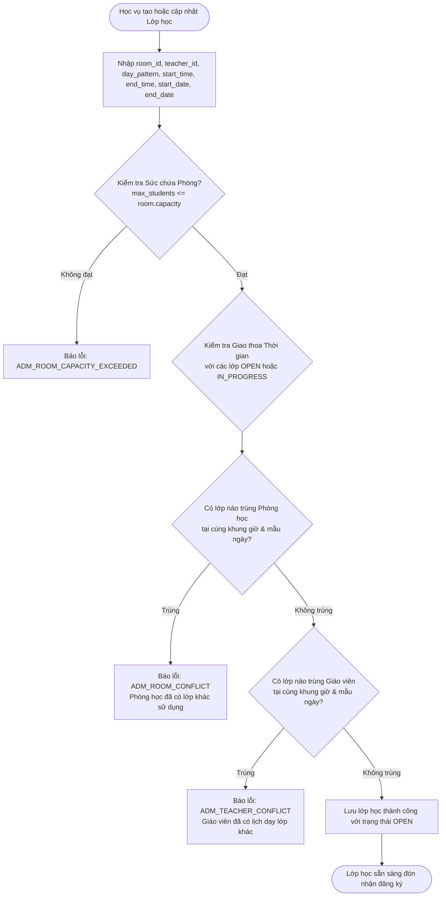
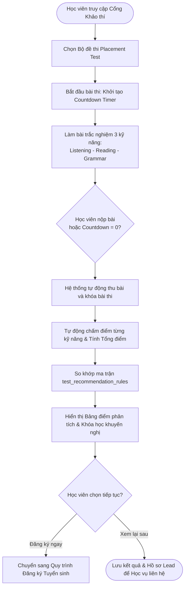
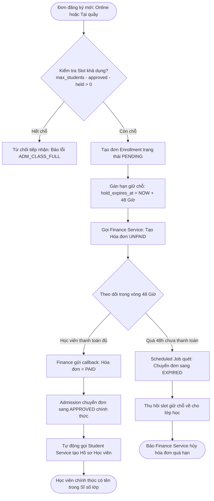
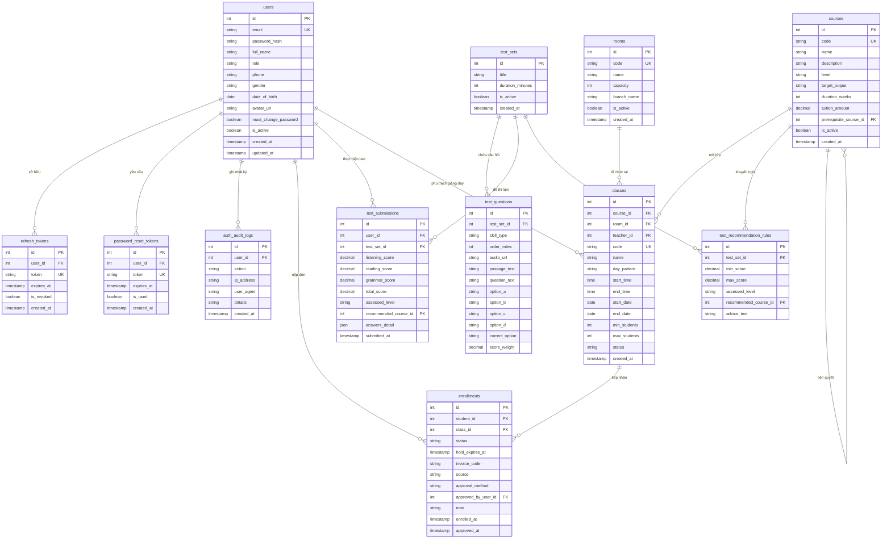
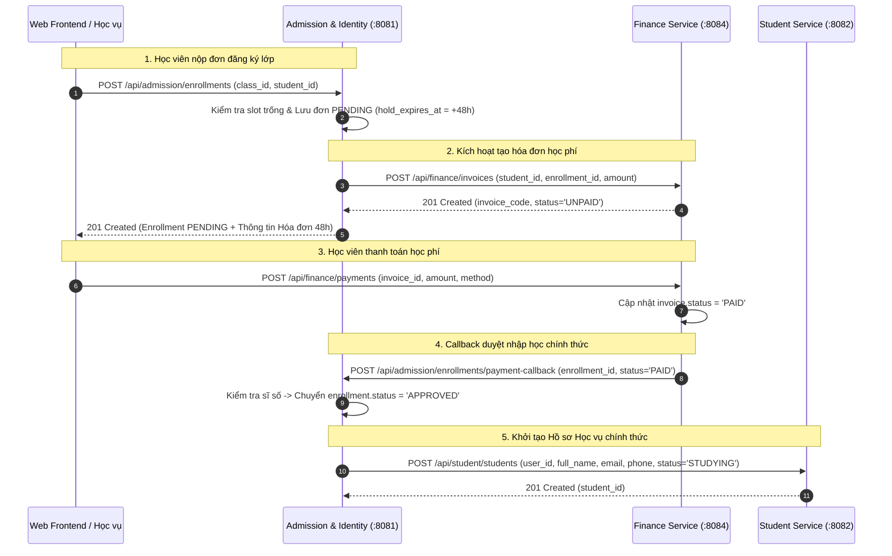

# ĐẶC TẢ PHÂN TÍCH NGHIỆP VỤ & BÁO CÁO THÔNG MINH (MASTER BA/BI SPECIFICATION)
## PHÂN HỆ ĐỊNH DANH, TUYỂN SINH & ĐÀO TẠO (ADMISSION & IDENTITY SERVICE)

> **Dự án**: Hệ thống Quản lý Trung tâm Anh ngữ  
> **Chịu trách nhiệm module**: Admission & Identity Service (Java 21 Spring Boot 3.3.4, Spring Security, JPA, PostgreSQL 16)  
> **Kiến trúc tích hợp**: Centralized Identity & Access Management (IAM) + Master Academic Catalog + Admissions Engine  
> **Phiên bản tài liệu**: 3.5 (Master Unified Specification - Hợp nhất toàn diện BA & Kỹ thuật)  
> **Ngày phê duyệt**: 2026-10-28  

---

## MỤC LỤC
1. [Tổng quan Phân hệ & Kiến trúc Tích hợp (Architecture & Vision)](#1-tổng-quan-phân-hệ--kiến-trúc-tích-hợp-architecture--vision)
   - 1.1. Mục tiêu Nghiệp vụ (Business Objectives)
   - 1.2. Ranh giới Trách nhiệm & Non-Goals (Scope Boundaries & Explicit Non-Goals)
   - 1.3. Mô hình Kiến trúc Phân tầng & Tương tác Dịch vụ (High-Level Architecture)
2. [Tác nhân Hệ thống & Ma trận Phân quyền Chi tiết (Actors & RBAC Matrix)](#2-tác-nhân-hệ-thống--ma-trận-phân-quyền-chi-tiết-actors--rbac-matrix)
   - 2.1. Danh mục Tác nhân & Vai trò (Personas & Roles)
   - 2.2. Ma trận Phân quyền Chức năng Chi tiết (5-Role RBAC Matrix)
3. [Quy trình Nghiệp vụ Cốt lõi (Core Business Workflows - BA)](#3-quy-trình-nghiệp-vụ-cốt-lõi-core-business-workflows---ba)
   - 3.1. Quy trình Xác thực & Cấp phát Token Kép (Dual-Token JWT Strategy)
   - 3.2. Quy trình Quản lý Cơ sở vật chất & Phòng học (Facility & Room Management)
   - 3.3. Quy trình Tạo Lớp học & Thuật toán Chống Xung đột Lịch (Class Conflict Prevention Flow)
   - 3.4. Quy trình Khảo thí Đầu vào Trực tuyến (Online Placement Test Flow)
   - 3.5. Quy trình Đăng ký Nhập học & Giữ chỗ 48h (Enrollment & 48-Hour Slot Holding)
   - 3.6. Quy trình Hủy Lớp Thiếu Sĩ số & Bảo vệ Học viên (Class Cancellation & Student Safeguard)
   - 3.7. Vòng đời Trạng thái Đơn Đăng ký (Enrollment State Machine)
4. [Danh mục Yêu cầu Tính năng Kỹ thuật (Functional Requirements - FR)](#4-danh-mục-yêu-cầu-tính-năng-kỹ-thuật-functional-requirements---fr)
   - Nhóm 1: Quản trị Định danh & Phiên làm việc (FR-IAM)
   - Nhóm 2: Cơ sở vật chất, Phòng học & Ca học (FR-FAC)
   - Nhóm 3: Khóa học, Lớp học & Chống Xung đột Lịch (FR-ACA)
   - Nhóm 4: Khảo thí Đầu vào Chuyên sâu (FR-TST)
   - Nhóm 5: Tuyển sinh, Giữ chỗ 48h & Xét duyệt Nhập học (FR-ENR)
   - Nhóm 6: Xuất Dữ liệu & Báo cáo Vận hành (FR-OPS)
5. [Mô hình & Đặc tả Cơ sở Dữ liệu Chi tiết (Database Schema DDL & Data Dictionary)](#5-mô-hình--đặc-tả-cơ-sở-dữ-liệu-chi-tiết-database-schema-ddl--data-dictionary)
   - 5.1. Sơ đồ Thực thể Quan hệ Nghiệp vụ (Mermaid ERD)
   - 5.2. Toàn văn Kịch bản Khởi tạo Bảng (Database DDL Script PostgreSQL 16)
   - 5.3. Quy tắc Ràng buộc & Toàn vẹn Dữ liệu (Constraints & Indexes)
6. [Hợp đồng API Chi tiết cho Đội ngũ Kỹ thuật (REST API Specifications)](#6-hợp-đồng-api-chi-tiết-cho-đội-ngũ-kỹ-thuật-rest-api-specifications)
   - 6.1. Nhóm Xác thực & Quản trị Tài khoản (`/auth/*`, `/api/admission/users/*`, `/api/admission/audit-logs`)
   - 6.2. Nhóm Phòng học, Khóa học & Lớp học (`/api/admission/rooms`, `/api/admission/courses`, `/api/admission/classes`)
   - 6.3. Nhóm Khảo thí Đầu vào (Placement Test Engine)
   - 6.4. Nhóm Tuyển sinh & Giữ chỗ 48h (Enrollment Management)
   - 6.5. Nhóm Báo cáo BI Dashboard (`/api/admission/analytics/*`)
7. [Hệ thống Chỉ số Báo cáo Thông minh (Business Intelligence - BI & KPIs)](#7-hệ-thống-chỉ-số-báo-cáo-thông-minh-business-intelligence---bi--kpis)
   - 7.1. Bảng Thông số Đo lường Chiến lược (BI KPIs Definitions & Benchmarks)
   - 7.2. BI-01: Báo cáo Phễu Chuyển đổi Tuyển sinh (Admissions Conversion Funnel)
   - 7.3. BI-02: Báo cáo Xếp hạng Khóa học & Doanh thu Tiềm năng (Course Performance & Pipeline Revenue)
   - 7.4. BI-03: Báo cáo Sức khỏe Vận hành & An toàn Tài khoản (User Engagement & Security)
8. [Quy tắc Bất biến & Kế hoạch Kiểm thử (Invariants & Testing Strategy)](#8-quy-tắc-bất-biến--kế-hoạch-kiểm-thử-invariants--testing-strategy)
9. [Ma trận Ranh giới & Tích hợp Liên Service (Inter-Service Contracts & Handoffs)](#9-ma-trận-ranh-giới--tích-hợp-liên-service-inter-service-contracts--handoffs)
   - 9.1. Biểu đồ Tuần tự Tương tác Đa dịch vụ (Mermaid Sequence Diagram)
   - 9.2. Hợp đồng & Xử lý Ngoại lệ Giao tiếp Liên Service (Failure Resilience & Idempotency)
   - 9.3. Ma trận Ranh giới Trách nhiệm & Handoffs

---

## 1. Tổng quan Phân hệ & Kiến trúc Tích hợp (Architecture & Vision)

### 1.1. Mục tiêu Nghiệp vụ (Business Objectives)
Phân hệ **Admission & Identity Service** đóng vai trò là **"Hạt nhân Khởi tạo & Xương sống Dữ liệu (Genesis & Core Backbone)"** của hệ thống, chịu trách nhiệm cho hai khối nghiệp vụ sống còn:
1. **Dịch vụ Định danh Tập trung (Identity & Access Management - IAM)**: Quản lý vòng đời tài khoản toàn hệ thống, cấp phát token JWT kép (Access + Refresh Token), xử lý quên mật khẩu qua Email, và lưu vết kiểm toán bảo mật (`auth_audit_logs`).
2. **Quản trị Học thuật & Tuyển sinh Toàn diện (Master Academic & Admissions Intake)**:
   - **Tối ưu hóa Phễu tuyển sinh (Admissions Conversion)**: Tiếp nhận học viên đa kênh (Online & Tại quầy), phân loại chính xác trình độ đầu vào qua hệ thống khảo thí tự động, từ đó gợi ý đúng lộ trình học tập.
   - **Bảo toàn Tính toàn vẹn Sĩ số (Zero Over-enrollment)**: Áp dụng cơ chế **Giữ chỗ có thời hạn (48h Slot Holding)** kết hợp xác thực thanh toán thời gian thực từ Finance Service, đảm bảo không bao giờ duyệt vượt quá sĩ số tối đa (`max_students`).
   - **Ngăn ngừa Xung đột Lịch học (Conflict Prevention)**: Tự động cảnh báo và ngăn chặn trùng lặp Giáo viên và Phòng học trong cùng khung giờ.
   - **Cung cấp Dữ liệu Điều hành (BI Intelligence)**: Phân tích phễu chuyển đổi tuyển sinh, xếp hạng khóa học sinh lời, và theo dõi mức độ tương tác người dùng.

### 1.2. Ranh giới Trách nhiệm & Non-Goals (Scope Boundaries & Explicit Non-Goals)
- **THUỘC PHẠM VI (IN-SCOPE)**:
  - Quản trị toàn bộ danh mục Người dùng (Users), Phân quyền RBAC, Đăng nhập JWT kép, Quên mật khẩu, và Audit Logs.
  - Quản lý danh mục Cơ sở vật chất, Phòng học (Rooms) và Ca học tiêu chuẩn.
  - Quản lý danh mục Khóa học (Courses) và Lớp học (Classes).
  - Thuật toán kiểm tra và ngăn chặn xung đột Phòng học & Giáo viên.
  - Khảo thí trực tuyến đầu vào 3 kỹ năng (Placement Test Engine) với đồng hồ đếm ngược và quy tắc đề xuất khóa học tự động.
  - Đăng ký nhập học trực tuyến và tiếp nhận đơn tại quầy bởi Học vụ.
  - Quản lý giữ chỗ tạm thời (48h Hold Slot), tự động giải phóng slot quá hạn, và xét duyệt đơn nhập học chính thức.
  - Dashboard BI: Phễu chuyển đổi tuyển sinh, Xếp hạng khóa học / Doanh thu dự kiến, và Sức khỏe tài khoản người dùng.
- **NGOẠI PHẠM VI (EXPLICIT NON-GOALS)**:
  - *Chuyển lớp, đổi ca, bảo lưu kết quả, điểm danh*: Bàn giao hoàn toàn cho **Student Service** xử lý sau khi đơn đã `APPROVED`.
  - *Thu tiền học phí, in phiếu thu, hoàn tiền, cổng thanh toán VNPAY/MoMo*: Bàn giao cho **Finance Service** xử lý.
  - *Kho tài liệu bài giảng, Slide, Sổ điểm đánh giá quá trình*: Thuộc thẩm quyền của **Learning Service**.

### 1.3. Mô hình Kiến trúc Phân tầng & Tương tác Dịch vụ (High-Level Architecture)

```
                    ┌────────────────────────────────────────────────────────┐
                    │               Nginx API Gateway (Port 8080)            │
                    └───────────────────────────┬────────────────────────────┘
                                                │
                                    ┌───────────▼──────────┐
                                    │  ADMISSION & AUTH    │
                                    │  Spring Boot (:8081) │
                                    └─────┬───────────┬────┘
                                          │           │
                 ┌────────────────────────┘           └─────────────────────────┐
                 │ REST Sync on APPROVED                                        │ REST: Create Invoice
                 ▼                                                              ▼
     ┌───────────────────────┐                                      ┌───────────────────────┐
     │    STUDENT SERVICE    │                                      │    FINANCE SERVICE    │
     │    FastAPI (:8082)    │                                      │    FastAPI (:8084)    │
     │  (Profiles, Sổ ĐD)    │                                      │  (Invoices, Payments) │
     └───────────────────────┘                                      └───────────────────────┘
```

---

## 2. Tác nhân Hệ thống & Ma trận Phân quyền Chi tiết (Actors & RBAC Matrix)

### 2.1. Danh mục Tác nhân & Vai trò (Personas & Roles)

| Tác nhân (Actor / Role) | Vai trò & Trách nhiệm chính | Hành động tiêu biểu trong Admission & Identity |
|---|---|---|
| **Vãng lai / Học viên Tiềm năng (`GUEST`)** | Người quan tâm muốn tìm hiểu khóa học hoặc kiểm tra trình độ. | - Xem danh mục khóa học & lớp học đang mở.<br>- Làm bài Placement Test Online có bấm giờ.<br>- Đăng ký tài khoản hoặc nộp đơn quan tâm. |
| **Học viên (`STUDENT`)** | Học viên có tài khoản cá nhân trong hệ thống. | - Tự nộp đơn đăng ký lớp học online (Self-Enrollment).<br>- Xem kết quả bài test và khóa học khuyến nghị.<br>- Theo dõi hạn giữ chỗ 48h và trạng thái đơn nộp. |
| **Giáo viên (`TEACHER`)** | Giảng viên phụ trách các lớp học. | - Nhận tài khoản được Admin cấp, đổi mật khẩu lần đầu.<br>- Tra cứu lịch dạy của các lớp mình phụ trách. |
| **Nhân viên Học vụ (`STAFF`)** | Vận hành tuyển sinh, xếp lịch, hỗ trợ học viên. | - Tiếp nhận đơn đăng ký trực tiếp tại quầy.<br>- Mở lớp học mới, gán phòng học, gán giáo viên.<br>- Gia hạn giữ chỗ (extend-hold) hoặc duyệt thu tiền mặt tại quầy.<br>- Xuất danh sách học viên lớp ra file Excel/CSV. |
| **Quản trị viên (`ADMIN`)** | Ban Giám đốc & Quản trị hệ thống cấp cao. | - Quản lý tài khoản nhân sự (tạo/khóa Staff, Teacher).<br>- Cấu hình phòng học, ban hành khóa học và ngân hàng đề thi.<br>- Xem toàn bộ Dashboard BI điều hành và Audit Logs bảo mật. |

### 2.2. Ma trận Phân quyền Chức năng Chi tiết (5-Role RBAC Matrix)

| Nhóm chức năng | Hành động cụ thể | GUEST | STUDENT | TEACHER | STAFF | ADMIN |
|---|---|:---:|:---:|:---:|:---:|:---:|
| **Identity & Auth** | Đăng nhập (`POST /auth/login`) | ✅ | ✅ | ✅ | ✅ | ✅ |
| | Làm mới Token (`POST /auth/refresh`) | ❌ | ✅ | ✅ | ✅ | ✅ |
| | Đăng xuất (`POST /auth/logout`) | ❌ | ✅ | ✅ | ✅ | ✅ |
| | Quên mật khẩu (`POST /auth/forgot-password`) | ✅ | ✅ | ✅ | ✅ | ✅ |
| | Đặt lại mật khẩu qua token (`POST /auth/reset-password`) | ✅ | ✅ | ✅ | ✅ | ✅ |
| | Xem hồ sơ cá nhân (`GET /auth/me`) | ❌ | ✅ | ✅ | ✅ | ✅ |
| | Đổi mật khẩu chủ động (`POST /auth/change-password`) | ❌ | ✅ | ✅ | ✅ | ✅ |
| | Quản lý Người dùng (CRUD Staff/Teacher, Khóa tài khoản) | ❌ | ❌ | ❌ | ❌ | ✅ |
| | Xem Nhật ký Kiểm toán Đăng nhập (`auth_audit_logs`) | ❌ | ❌ | ❌ | ❌ | ✅ |
| **Phòng học & Ca học** | Xem danh mục Phòng học | ❌ | ❌ | ❌ | ✅ | ✅ |
| | CRUD Danh mục Phòng học (`/api/admission/rooms`) | ❌ | ❌ | ❌ | ❌ | ✅ |
| **Khóa học & Lộ trình** | Xem danh mục Khóa học & Lớp học đang mở | ✅ | ✅ | ✅ | ✅ | ✅ |
| | CRUD Khóa học (`/api/admission/courses`) | ❌ | ❌ | ❌ | ✅ | ✅ |
| **Lớp học & Xung đột** | Mở lớp mới, chỉnh sửa lớp (`/api/admission/classes`) | ❌ | ❌ | ❌ | ✅ | ✅ |
| | Hủy lớp thiếu sĩ số (`PUT .../cancel`) | ❌ | ❌ | ❌ | ✅ | ✅ |
| | Xuất danh sách học viên của lớp ra Excel/CSV | ❌ | ❌ | ❌ | ✅ | ✅ |
| **Khảo thí Đầu vào** | Làm bài Placement Test Online có bấm giờ | ✅ | ✅ | ❌ | ❌ | ❌ |
| | Xem Bảng điểm chi tiết & Khóa học khuyến nghị cá nhân | ✅ | ✅ | ❌ | ❌ | ❌ |
| | Quản lý Ngân hàng đề thi & Ma trận quy đổi điểm | ❌ | ❌ | ❌ | ✅ | ✅ |
| | Xuất kết quả khảo thí ra Excel/CSV | ❌ | ❌ | ❌ | ✅ | ✅ |
| **Tuyển sinh & Đăng ký** | Tự nộp đơn Đăng ký Lớp học (Online Self-Enrollment) | ❌ | ✅ | ❌ | ❌ | ❌ |
| | Tiếp nhận đơn Đăng ký tại quầy (Staff-Assisted) | ❌ | ❌ | ❌ | ✅ | ✅ |
| | Gia hạn thời gian giữ chỗ (`PUT .../extend-hold`) | ❌ | ❌ | ❌ | ✅ | ✅ |
| | Duyệt nhập học trực tiếp tiền mặt (`PUT .../approve-manual`) | ❌ | ❌ | ❌ | ✅ | ✅ |
| **Báo cáo BI** | Dashboard Phễu Tuyển sinh & Doanh thu tiềm năng | ❌ | ❌ | ❌ | ✅ | ✅ |
| | Báo cáo Sức khỏe Người dùng (DAU/MAU, Failed Logins) | ❌ | ❌ | ❌ | ❌ | ✅ |

---

## 3. Quy trình Nghiệp vụ Cốt lõi (Core Business Workflows - BA)

### 3.1. Quy trình Xác thực & Cấp phát Token Kép (Dual-Token JWT Strategy)
1. **Đăng nhập**: Người dùng gửi Email và Mật khẩu tới `POST /auth/login`.
2. **Kiểm tra**:
   - Nếu `user.is_active == false`: Trả về HTTP 403 Forbidden (`AUTH_ACCOUNT_LOCKED`).
   - Nếu sai mật khẩu: Ghi log `LOGIN_FAILED`, trả về HTTP 401 Unauthorized (`AUTH_INVALID_CREDENTIALS`).
3. **Phát hành Token**:
   - **Access Token (Thời hạn 15 phút)**: Chứa claims (`sub`: userId, `email`, `role`, `name`, `exp`). Sử dụng để xác thực các cuộc gọi API.
   - **Refresh Token (Thời hạn 7 ngày)**: Chuỗi UUID ngẫu nhiên mã hóa được lưu trữ trong bảng `admission.refresh_tokens`.
4. **Cơ chế Refresh Token Rotation**:
   - Khi Access Token hết hạn, Client gọi `POST /auth/refresh` kèm Refresh Token hiện tại.
   - Nếu token hợp lệ và `is_revoked == false`: Hệ thống đánh dấu thu hồi token cũ, cấp Access Token mới đồng thời cấp một Refresh Token mới.
5. **Đăng xuất & Thu hồi**:
   - Gọi `POST /auth/logout` sẽ lập tức đánh dấu `is_revoked = true` cho Refresh Token đó trong cơ sở dữ liệu.
6. **Lưu vết Kiểm toán**: Mọi sự kiện đăng nhập, đăng xuất, đổi mật khẩu đều ghi nhận vào `admission.auth_audit_logs`.

### 3.2. Quy trình Quản lý Cơ sở vật chất & Phòng học (Facility & Room Management)
- Admin quản lý danh mục phòng học (`admission.rooms`) gồm: Mã phòng (`code` unique), Tên phòng, Sức chứa trần (`capacity`), Cơ sở (`branch_name`).
- Khi mở lớp, hệ thống ràng buộc: Sĩ số tối đa của lớp không được phép vượt quá sức chứa vật lý của phòng học:  
  $$\text{class.max\_students} \le \text{room.capacity}$$

### 3.3. Quy trình Tạo Lớp học & Thuật toán Chống Xung đột Lịch (Class Conflict Prevention Flow)



#### Chi tiết Thuật toán So khớp Thời gian (Time Overlap Condition):
Hai lớp học bị coi là xung đột thời gian nếu thỏa mãn đồng thời 3 điều kiện:
1. **Giao thoa Khoảng ngày**: $(\text{start\_date}_1 \le \text{end\_date}_2) \land (\text{end\_date}_1 \ge \text{start\_date}_2)$.
2. **Trùng khớp Mẫu ngày trong tuần**: `day_pattern` có ít nhất 1 ngày học trùng nhau (Ví dụ: `MON_WED_FRI` trùng với `MON_WED_FRI` hoặc `DAILY`).
3. **Giao thoa Khung giờ học**: $(\text{start\_time}_1 < \text{end\_time}_2) \land (\text{end\_time}_1 > \text{start\_time}_2)$.

---

### 3.4. Quy trình Khảo thí Đầu vào Trực tuyến (Online Placement Test Flow)



- **Phần 1: Listening**: Phát audio từ `audio_url`, học viên nghe và chọn đáp án A/B/C/D.
- **Phần 2: Reading**: Hiển thị đoạn văn đọc hiểu (`passage_text`), trả lời câu hỏi trắc nghiệm liên quan.
- **Phần 3: Grammar & Vocabulary**: Kiểm tra ngữ pháp và từ vựng qua câu hỏi độc lập.
- **Tự động đề xuất**: Hệ thống đối chiếu `total_score` với khoảng `[min_score, max_score]` trong `test_recommendation_rules` để trả về `recommended_course_id`.

---

### 3.5. Quy trình Đăng ký Nhập học & Giữ chỗ 48h (Enrollment & 48-Hour Slot Holding)



#### Các Ngoại lệ Vận hành Được phép (Staff Overrides):
1. **Gia hạn giữ chỗ (`extend-hold`)**: Học vụ có thể gia hạn thêm 24h hoặc 48h cho đơn `PENDING` nếu học viên có lý do chính đáng (chờ lương, lỗi chuyển khoản).
2. **Duyệt thu tiền mặt tại quầy (`approve-manual`)**: Học viên đóng tiền mặt trực tiếp tại trung tâm, Học vụ bấm duyệt ngay $\rightarrow$ Đơn chuyển sang `APPROVED`, hệ thống tự gửi lệnh sang Finance ghi nhận hóa đơn `PAID` bằng phương thức `CASH`.

---

### 3.6. Quy trình Hủy Lớp Thiếu Sĩ số & Bảo vệ Học viên (Class Cancellation & Student Safeguard)
1. Mỗi lớp học có chỉ số `min_students` (mặc định 10 học viên).
2. Trước ngày khai giảng (`start_date`), nếu số lượng học viên `APPROVED` không đạt ngưỡng tối thiểu, Nhân viên Học vụ có quyền thực hiện Hủy lớp (`PUT /api/admission/classes/{id}/cancel`).
3. Khi lớp chuyển sang trạng thái `CANCELLED`:
   - Toàn bộ đơn `PENDING` chưa thanh toán lập tức chuyển sang `CANCELLED`.
   - Các đơn đã đóng tiền `APPROVED` được chuyển sang trạng thái chờ giải quyết (`CANCELLED_REFUND_PENDING`).
   - Hệ thống tự động tạo cảnh báo sang **Finance Service** để thực hiện hoàn tiền hoặc bảo lưu tiền học phí sang lớp khác cho học viên.

---

### 3.7. Vòng đời Trạng thái Đơn Đăng ký (Enrollment State Machine)

```
        ┌────────────────────────────────────────────────────────┐
        │                                                        │ Quá hạn 48h
        │                                                        ▼ (Scheduled Job)
  [Nộp đơn mới] ──(Còn slot)──> [ PENDING ] ──────────────> [ EXPIRED ]
                                     │
                 ┌───────────────────┼───────────────────┐
                 │ Thanh toán PAID   │ Học viên rút đơn  │ Học vụ từ chối
                 ▼                   ▼                   ▼
           [ APPROVED ]        [ CANCELLED ]       [ REJECTED ]
                 │
                 │ (Lớp bị hủy do thiếu sĩ số)
                 ▼
    [ CANCELLED_REFUND_PENDING ]
```

- `PENDING`: Đã đăng ký thành công, giữ 1 slot của lớp học trong 48 giờ chờ đóng phí.
- `APPROVED`: Đã đóng học phí đầy đủ hoặc được duyệt thủ công; chính thức nằm trong sĩ số lớp.
- `EXPIRED`: Quá hạn 48 giờ mà không thanh toán; slot bị thu hồi tự động.
- `CANCELLED`: Đơn bị hủy do học viên chủ động rút đơn hoặc lớp học bị hủy.
- `REJECTED`: Đơn bị từ chối do không đạt yêu cầu đặc thù hoặc gian lận hồ sơ.
- `CANCELLED_REFUND_PENDING`: Đơn đã đóng tiền nhưng lớp bị hủy trước khai giảng, chờ hoàn phí hoặc chuyển lớp.

---

## 4. Danh mục Yêu cầu Tính năng Kỹ thuật (Functional Requirements - FR)

### Nhóm 1: Quản trị Định danh & Phiên làm việc (FR-IAM)
- **FR-IAM-01 (Tự động sinh tài khoản Student)**: Khi học viên làm bài Placement Test hoặc nộp đơn online lần đầu, hệ thống tự động tạo bản ghi `admission.users` với `role='STUDENT'` nếu email chưa tồn tại.
- **FR-IAM-02 (Quản lý Nhân sự)**: Cho phép `ADMIN` tạo tài khoản nhân sự (`role` là `STAFF` hoặc `TEACHER`), yêu cầu nhập: Email, Họ tên, Số điện thoại, Giới tính, Ngày sinh.
- **FR-IAM-03 (Xác thực JWT Kép)**: Cấp phát cặp token: Access Token (15 phút, stateless) và Refresh Token (7 ngày, stateful lưu trong bảng `refresh_tokens`).
- **FR-IAM-04 (Refresh Token Rotation)**: Khi gọi API làm mới token, hệ thống hủy Refresh Token hiện tại (`is_revoked = true`) và cấp phát một cặp Access/Refresh Token hoàn toàn mới.
- **FR-IAM-05 (Khóa / Mở khóa Tài khoản)**: Cho phép Quản trị viên kích hoạt hoặc khóa tài khoản người dùng (`is_active = false/true`). Tài khoản bị khóa lập tức bị chặn mọi thao tác gọi API.
- **FR-IAM-06 (Quên mật khẩu qua Email)**: Sinh mã token đặt lại mật khẩu ngẫu nhiên có thời hạn 15 phút lưu trong `password_reset_tokens`, gửi liên kết kích hoạt qua email để người dùng thiết lập mật khẩu mới.
- **FR-IAM-07 (Nhật ký Kiểm toán Bảo mật)**: Tự động ghi nhật ký bảo mật vào `admission.auth_audit_logs` đối với các sự kiện: `LOGIN_SUCCESS`, `LOGIN_FAILED`, `REFRESH_TOKEN`, `LOGOUT`, `PASSWORD_CHANGED`, `ACCOUNT_LOCKED`.

### Nhóm 2: Cơ sở vật chất, Phòng học & Ca học (FR-FAC)
- **FR-FAC-01 (Quản lý Danh mục Phòng học)**: CRUD thông tin phòng học gồm: Mã phòng (`code` unique), Tên phòng, Sức chứa tối đa (`capacity >= 1`), Chi nhánh cơ sở (`branch_name`), Trạng thái hoạt động (`is_active`).
- **FR-FAC-02 (Cấu hình Ca học Tiêu chuẩn)**: Hỗ trợ các khung giờ học chuẩn (`start_time`, `end_time`) và các mẫu ngày học trong tuần (`day_pattern`: `MON_WED_FRI`, `TUE_THU_SAT`, `SAT_SUN`, `DAILY`).
- **FR-FAC-03 (Ràng buộc Sức chứa Phòng)**: Bắt buộc kiểm tra `class.max_students <= room.capacity`. Nếu vượt quá, trả lỗi `ADM_ROOM_CAPACITY_EXCEEDED`.

### Nhóm 3: Khóa học, Lớp học & Chống Xung đột Lịch (FR-ACA)
- **FR-ACA-01 (Quản lý Khóa học & Lộ trình)**: CRUD Khóa học chuẩn: Mã khóa (`code` unique), Tên khóa, Trình độ (`level`: *Beginner, Intermediate, Advanced*), Thời lượng (`duration_weeks`), Học phí tiêu chuẩn (`tuition_amount`), Khóa học tiên quyết (`prerequisite_course_id`).
- **FR-ACA-02 (Quản lý Lớp học)**: Mở lớp học gán Khóa học, Phòng học (`room_id`), Giáo viên (`teacher_id`), Ca học & Mẫu ngày, Ngày khai giảng (`start_date`), Ngày bế giảng (`end_date`), Sĩ số tối thiểu (`min_students`), Sĩ số trần (`max_students`).
- **FR-ACA-03 (Công cụ Chống Xung đột Lịch - Conflict Engine)**: Tự động phát hiện và chặn lưu lớp nếu xảy ra:
  - Trùng phòng học với lớp khác đang mở trong cùng khung giờ: `ADM_ROOM_CONFLICT`.
  - Trùng lịch dạy của giáo viên với lớp khác trong cùng khung giờ: `ADM_TEACHER_CONFLICT`.
- **FR-ACA-04 (Vòng đời Lớp học)**: Quản lý trạng thái lớp: `OPEN` $\rightarrow$ `IN_PROGRESS` $\rightarrow$ `COMPLETED`, hoặc `CANCELLED` (Hủy lớp thiếu sĩ số).
- **FR-ACA-05 (Tính toán Slot Khả dụng)**: Cung cấp API tính toán số chỗ còn lại theo thời gian thực:  
  $$\text{Available Slots} = \text{max\_students} - \text{Approved Count} - \text{Active Held Count}$$

### Nhóm 4: Khảo thí Đầu vào Chuyên sâu (FR-TST)
- **FR-TST-01 (Quản lý Ngân hàng Đề thi)**: Quản lý các Bộ đề thi (`test_sets`) kèm cấu hình thời gian làm bài đếm ngược (`duration_minutes`, mặc định 45 phút).
- **FR-TST-02 (Ngân hàng Câu hỏi 3 Kỹ năng)**: Quản lý câu hỏi trắc nghiệm bóc tách thành 3 phần:
  - *Listening*: Tích hợp file nghe qua `audio_url`.
  - *Reading*: Tích hợp đoạn văn đọc hiểu qua `passage_text`.
  - *Grammar & Vocabulary*: Câu hỏi ngữ pháp trắc nghiệm 4 lựa chọn (A/B/C/D) kèm đáp án đúng và trọng số điểm (`score_weight`).
- **FR-TST-03 (Giao diện Khảo thí Countdown)**: Giao diện thi trực tuyến hiển thị đồng hồ đếm ngược; tự động khóa và nộp bài khi hết giờ.
- **FR-TST-04 (Chấm điểm Tự động & Bóc tách Kỹ năng)**: Tự động chấm điểm ngay khi nộp bài, tách bạch: `listening_score`, `reading_score`, `grammar_score` và tính `total_score`.
- **FR-TST-05 (Đề xuất Khóa học Tự động)**: Đối chiếu `total_score` với bảng `test_recommendation_rules` để trả về khóa học phù hợp nhất kèm nút đăng ký lớp.

### Nhóm 5: Tuyển sinh, Giữ chỗ 48h & Xét duyệt Nhập học (FR-ENR)
- **FR-ENR-01 (Đăng ký Tuyển sinh Đa kênh)**: Hỗ trợ học viên tự đăng ký trực tuyến hoặc Nhân viên học vụ tạo đơn trực tiếp tại quầy.
- **FR-ENR-02 (Bảo vệ Sĩ số Trần - Invariant Guard)**: Chặn tiếp nhận đơn nếu lớp học không còn slot trống khả dụng (`ADM_CLASS_FULL`).
- **FR-ENR-03 (Cấp Slot Giữ chỗ 48h)**: Đơn tạo mới có trạng thái `PENDING` và được gán `hold_expires_at = NOW() + 48 HOURS`.
- **FR-ENR-04 (Tự động Thu hồi Slot Quá hạn)**: Scheduled Job định kỳ quét và chuyển đơn `PENDING` quá hạn sang `EXPIRED`, giải phóng slot cho học viên khác.
- **FR-ENR-05 (Gia hạn Giữ chỗ Học vụ)**: Nhân viên học vụ có quyền gia hạn thêm thời gian giữ chỗ (`extend-hold`) theo yêu cầu chính đáng.
- **FR-ENR-06 (Xét duyệt Nhập học Tự động)**: Chuyển đơn sang `APPROVED` khi nhận xác nhận thanh toán thành công (`invoice_status == PAID`) từ **Finance Service**.
- **FR-ENR-07 (Duyệt Tiền mặt Tại quầy)**: Nhân viên học vụ có quyền duyệt đơn trực tiếp khi học viên nộp tiền mặt tại trung tâm (`approve-manual`).
- **FR-ENR-08 (Đồng bộ Hồ sơ Học vụ)**: Tự động gọi API sang **Student Service** để tạo hồ sơ học viên ngay khi đơn chuyển sang `APPROVED`.

### Nhóm 6: Xuất Dữ liệu & Báo cáo Vận hành (FR-OPS)
- **FR-OPS-01 (Xuất Danh sách Lớp)**: Cho phép xuất danh sách học viên đăng ký của một lớp học ra file Excel (.xlsx) hoặc CSV chuẩn.
- **FR-OPS-02 (Xuất Kết quả Khảo thí)**: Cho phép xuất bảng điểm khảo thí đầu vào của học viên theo bộ đề ra file Excel/CSV.

---

## 5. Mô hình & Đặc tả Cơ sở Dữ liệu Chi tiết (Database Schema DDL & Data Dictionary)

### 5.1. Sơ đồ Thực thể Quan hệ Nghiệp vụ (Mermaid ERD)



---

### 5.2. Toàn văn Kịch bản Khởi tạo Bảng (Database DDL Script PostgreSQL 16)

```sql
-- ============================================================================
-- ADMISSION & IDENTITY SERVICE SCHEMA DDL (PostgreSQL 16)
-- ============================================================================

-- 1. Khởi tạo Schema Độc lập
CREATE SCHEMA IF NOT EXISTS admission;

-- 2. Bảng Người dùng & Phân quyền Tập trung (Users & RBAC)
CREATE TABLE admission.users (
    id SERIAL PRIMARY KEY,
    email VARCHAR(255) UNIQUE NOT NULL,
    password_hash VARCHAR(255) NOT NULL,
    full_name VARCHAR(255) NOT NULL,
    role VARCHAR(50) NOT NULL CHECK (role IN ('ADMIN', 'STAFF', 'TEACHER', 'STUDENT')),
    phone VARCHAR(50),
    gender VARCHAR(20) CHECK (gender IN ('MALE', 'FEMALE', 'OTHER')),
    date_of_birth DATE,
    avatar_url TEXT,
    must_change_password BOOLEAN DEFAULT FALSE,
    is_active BOOLEAN DEFAULT TRUE,
    created_at TIMESTAMPTZ DEFAULT CURRENT_TIMESTAMP,
    updated_at TIMESTAMPTZ DEFAULT CURRENT_TIMESTAMP
);

-- 3. Bảng Refresh Token (Chiến lược JWT Kép Stateful)
CREATE TABLE admission.refresh_tokens (
    id SERIAL PRIMARY KEY,
    user_id INTEGER NOT NULL REFERENCES admission.users(id) ON DELETE CASCADE,
    token VARCHAR(255) UNIQUE NOT NULL,
    expires_at TIMESTAMPTZ NOT NULL,
    is_revoked BOOLEAN DEFAULT FALSE,
    created_at TIMESTAMPTZ DEFAULT CURRENT_TIMESTAMP
);

-- 4. Bảng Đặt lại Mật khẩu qua Email
CREATE TABLE admission.password_reset_tokens (
    id SERIAL PRIMARY KEY,
    user_id INTEGER NOT NULL REFERENCES admission.users(id) ON DELETE CASCADE,
    token VARCHAR(255) UNIQUE NOT NULL,
    expires_at TIMESTAMPTZ NOT NULL,
    is_used BOOLEAN DEFAULT FALSE,
    created_at TIMESTAMPTZ DEFAULT CURRENT_TIMESTAMP
);

-- 5. Bảng Nhật ký Kiểm toán Đăng nhập & Bảo mật (Audit Log)
CREATE TABLE admission.auth_audit_logs (
    id SERIAL PRIMARY KEY,
    user_id INTEGER REFERENCES admission.users(id) ON DELETE SET NULL,
    action VARCHAR(50) NOT NULL CHECK (action IN ('LOGIN_SUCCESS', 'LOGIN_FAILED', 'REFRESH_TOKEN', 'LOGOUT', 'PASSWORD_CHANGED', 'ACCOUNT_LOCKED')),
    ip_address VARCHAR(50),
    user_agent TEXT,
    details TEXT,
    created_at TIMESTAMPTZ DEFAULT CURRENT_TIMESTAMP
);

-- 6. Bảng Danh mục Phòng học (Rooms)
CREATE TABLE admission.rooms (
    id SERIAL PRIMARY KEY,
    code VARCHAR(50) UNIQUE NOT NULL,
    name VARCHAR(100) NOT NULL,
    capacity INTEGER NOT NULL CHECK (capacity > 0),
    branch_name VARCHAR(100) DEFAULT 'Cơ sở chính',
    is_active BOOLEAN DEFAULT TRUE,
    created_at TIMESTAMPTZ DEFAULT CURRENT_TIMESTAMP
);

-- 7. Bảng Khóa học & Lộ trình Đào tạo (Courses)
CREATE TABLE admission.courses (
    id SERIAL PRIMARY KEY,
    code VARCHAR(50) UNIQUE NOT NULL,
    name VARCHAR(255) NOT NULL,
    description TEXT,
    level VARCHAR(50) NOT NULL CHECK (level IN ('Beginner', 'Intermediate', 'Advanced')),
    target_output VARCHAR(100), -- Chuẩn đầu ra (e.g. 'IELTS 6.5+', 'TOEIC 700+')
    duration_weeks INTEGER NOT NULL CHECK (duration_weeks > 0),
    tuition_amount NUMERIC(12, 2) NOT NULL CHECK (tuition_amount >= 0),
    prerequisite_course_id INTEGER REFERENCES admission.courses(id) ON DELETE SET NULL,
    is_active BOOLEAN DEFAULT TRUE,
    created_at TIMESTAMPTZ DEFAULT CURRENT_TIMESTAMP
);

-- 8. Bảng Lớp học & Thời khóa biểu (Classes)
CREATE TABLE admission.classes (
    id SERIAL PRIMARY KEY,
    course_id INTEGER NOT NULL REFERENCES admission.courses(id) ON DELETE RESTRICT,
    room_id INTEGER REFERENCES admission.rooms(id) ON DELETE RESTRICT,
    teacher_id INTEGER REFERENCES admission.users(id) ON DELETE RESTRICT,
    code VARCHAR(50) UNIQUE NOT NULL,
    name VARCHAR(255) NOT NULL,
    day_pattern VARCHAR(50) NOT NULL CHECK (day_pattern IN ('MON_WED_FRI', 'TUE_THU_SAT', 'SAT_SUN', 'DAILY', 'CUSTOM')),
    start_time TIME NOT NULL,
    end_time TIME NOT NULL,
    start_date DATE NOT NULL,
    end_date DATE NOT NULL,
    min_students INTEGER DEFAULT 10 CHECK (min_students > 0),
    max_students INTEGER DEFAULT 25 CHECK (max_students >= min_students),
    status VARCHAR(50) DEFAULT 'OPEN' CHECK (status IN ('OPEN', 'IN_PROGRESS', 'COMPLETED', 'CANCELLED')),
    created_at TIMESTAMPTZ DEFAULT CURRENT_TIMESTAMP
);

-- 9. Bảng Tuyển sinh & Giữ chỗ 48h (Enrollments)
CREATE TABLE admission.enrollments (
    id SERIAL PRIMARY KEY,
    student_id INTEGER NOT NULL REFERENCES admission.users(id) ON DELETE RESTRICT,
    class_id INTEGER NOT NULL REFERENCES admission.classes(id) ON DELETE RESTRICT,
    status VARCHAR(50) DEFAULT 'PENDING' CHECK (status IN ('PENDING', 'APPROVED', 'REJECTED', 'EXPIRED', 'CANCELLED', 'CANCELLED_REFUND_PENDING')),
    hold_expires_at TIMESTAMPTZ,
    invoice_code VARCHAR(50), -- Liên kết tham chiếu chéo sang finance.invoices(invoice_code)
    source VARCHAR(50) DEFAULT 'ONLINE' CHECK (source IN ('ONLINE', 'WALK_IN', 'HOTLINE', 'FANPAGE', 'REFERRAL')),
    approval_method VARCHAR(50) CHECK (approval_method IN ('ONLINE_PAYMENT', 'MANUAL_CASH', 'STAFF_OVERRIDE')),
    approved_by_user_id INTEGER REFERENCES admission.users(id),
    note TEXT, -- Ghi chú học vụ hoặc lý do từ chối/hủy
    enrolled_at TIMESTAMPTZ DEFAULT CURRENT_TIMESTAMP,
    approved_at TIMESTAMPTZ
);

-- 10. Bảng Đề thi Khảo thí Đầu vào (Test Sets)
CREATE TABLE admission.test_sets (
    id SERIAL PRIMARY KEY,
    title VARCHAR(255) NOT NULL,
    duration_minutes INTEGER NOT NULL DEFAULT 45 CHECK (duration_minutes > 0),
    is_active BOOLEAN DEFAULT TRUE,
    created_at TIMESTAMPTZ DEFAULT CURRENT_TIMESTAMP
);

-- 11. Bảng Câu hỏi Khảo thí 3 Kỹ năng (Test Questions)
CREATE TABLE admission.test_questions (
    id SERIAL PRIMARY KEY,
    test_set_id INTEGER NOT NULL REFERENCES admission.test_sets(id) ON DELETE CASCADE,
    skill_type VARCHAR(50) NOT NULL CHECK (skill_type IN ('LISTENING', 'READING', 'GRAMMAR')),
    order_index INTEGER NOT NULL DEFAULT 1,
    audio_url TEXT,
    passage_text TEXT,
    question_text TEXT NOT NULL,
    option_a TEXT NOT NULL,
    option_b TEXT NOT NULL,
    option_c TEXT NOT NULL,
    option_d TEXT NOT NULL,
    correct_option CHAR(1) NOT NULL CHECK (correct_option IN ('A', 'B', 'C', 'D')),
    score_weight NUMERIC(4, 2) DEFAULT 1.0 CHECK (score_weight > 0)
);

-- 12. Bảng Ma trận Quy đổi Điểm sang Khóa học Đề xuất (Recommendation Rules)
CREATE TABLE admission.test_recommendation_rules (
    id SERIAL PRIMARY KEY,
    test_set_id INTEGER NOT NULL REFERENCES admission.test_sets(id) ON DELETE CASCADE,
    min_score NUMERIC(5, 2) NOT NULL,
    max_score NUMERIC(5, 2) NOT NULL,
    assessed_level VARCHAR(50) NOT NULL,
    recommended_course_id INTEGER NOT NULL REFERENCES admission.courses(id) ON DELETE CASCADE,
    advice_text TEXT
);

-- 13. Bảng Kết quả Làm bài Test Đầu vào (Test Submissions)
CREATE TABLE admission.test_submissions (
    id SERIAL PRIMARY KEY,
    user_id INTEGER NOT NULL REFERENCES admission.users(id) ON DELETE CASCADE,
    test_set_id INTEGER NOT NULL REFERENCES admission.test_sets(id) ON DELETE RESTRICT,
    listening_score NUMERIC(5, 2) DEFAULT 0.0,
    reading_score NUMERIC(5, 2) DEFAULT 0.0,
    grammar_score NUMERIC(5, 2) DEFAULT 0.0,
    total_score NUMERIC(5, 2) NOT NULL,
    assessed_level VARCHAR(50),
    recommended_course_id INTEGER REFERENCES admission.courses(id),
    answers_detail JSONB,
    submitted_at TIMESTAMPTZ DEFAULT CURRENT_TIMESTAMP
);

-- 14. Chỉ mục Hiệu năng & Ràng buộc Tối ưu (Indexes)
CREATE INDEX idx_classes_schedule ON admission.classes (room_id, teacher_id, day_pattern, start_date, end_date);
CREATE INDEX idx_enrollments_status_hold ON admission.enrollments (class_id, status, hold_expires_at);
CREATE INDEX idx_audit_user_created ON admission.auth_audit_logs (user_id, created_at);
CREATE INDEX idx_test_questions_set_skill ON admission.test_questions (test_set_id, skill_type);
```

### 5.3. Quy tắc Ràng buộc & Toàn vẹn Dữ liệu (Constraints & Indexes)
1. **Khóa Ngoại Bảo vệ Sĩ số**: `classes` tham chiếu `courses` với `ON DELETE RESTRICT` để không xóa mất khóa học khi đang có lớp mở.
2. **Xóa Thác ghềnh An toàn**: `refresh_tokens` và `password_reset_tokens` sử dụng `ON DELETE CASCADE` theo `users`.
3. **Audit Log Toàn vẹn**: `auth_audit_logs` sử dụng `ON DELETE SET NULL` để lưu lại vết bảo mật kể cả khi người dùng bị xóa.
4. **JSONB Answers Detail**: Lưu trữ chi tiết toàn bộ đáp án người dùng chọn trong kỳ thi khảo thí để hỗ trợ tra cứu phúc khảo khi cần.

---

## 6. Hợp đồng API Chi tiết cho Đội ngũ Kỹ thuật (REST API Specifications)

Toàn bộ Payload Request, Response JSON, và Query Parameters tuân thủ nghiêm ngặt quy ước **`snake_case`**.

### 6.1. Nhóm Xác thực & Quản trị Tài khoản (`/auth/*`, `/api/admission/users/*`, `/api/admission/audit-logs`)

| Method | Endpoint | Quyền | Mục đích Nghiệp vụ | Request Body / Query Params | Response Thành công (HTTP 200/201) |
|---|---|---|---|---|---|
| `POST` | `/auth/login` | Public | Đăng nhập hệ thống & cấp JWT kép | `{"email": "...", "password": "..."}` | `{"success": true, "data": {"access_token": "...", "refresh_token": "...", "user": {...}}}` |
| `POST` | `/auth/refresh` | Public | Refresh Token Rotation | `{"refresh_token": "..."}` | `{"success": true, "data": {"access_token": "...", "refresh_token": "..."}}` |
| `POST` | `/auth/logout` | Authed | Hủy Refresh Token | `{"refresh_token": "..."}` | `{"success": true, "message": "Đăng xuất thành công"}` |
| `POST` | `/auth/forgot-password` | Public | Gửi liên kết đặt lại mật khẩu | `{"email": "..."}` | `{"success": true, "message": "Liên kết đã gửi qua email"}` |
| `POST` | `/auth/reset-password` | Public | Đặt lại mật khẩu mới qua token | `{"token": "...", "new_password": "..."}` | `{"success": true, "message": "Đổi mật khẩu thành công"}` |
| `GET` | `/auth/me` | Authed | Xem hồ sơ cá nhân của phiên hiện tại | Header `Authorization: Bearer <token>` | `{"success": true, "data": {"id": 1, "email": "...", "role": "...", "full_name": "..."}}` |
| `POST` | `/auth/change-password` | Authed | Đổi mật khẩu chủ động | `{"old_password": "...", "new_password": "..."}` | `{"success": true, "message": "Đổi mật khẩu thành công"}` |
| `GET` | `/api/admission/users` | ADMIN | Tìm kiếm & phân trang người dùng | `?role=TEACHER&is_active=true&page=1&size=20` | `{"success": true, "data": [...], "pagination": {...}}` |
| `POST` | `/api/admission/users` | ADMIN | Tạo tài khoản Staff/Teacher | `{"email": "...", "full_name": "...", "role": "TEACHER", "phone": "..."}` | `{"success": true, "data": {"id": 10, ...}}` (Status 201) |
| `PUT` | `/api/admission/users/{id}/toggle-status` | ADMIN | Khóa / Mở khóa tài khoản | Không có body | `{"success": true, "message": "Cập nhật trạng thái thành công"}` |
| `GET` | `/api/admission/audit-logs` | ADMIN | Xem nhật ký kiểm toán bảo mật | `?action=LOGIN_FAILED&page=1&size=50` | `{"success": true, "data": [...]}` |

---

### 6.2. Nhóm Phòng học, Khóa học & Lớp học (`/api/admission/rooms`, `/api/admission/courses`, `/api/admission/classes`)

| Method | Endpoint | Quyền | Mục đích Nghiệp vụ | Request Body / Query Params | Ghi chú & Mã lỗi Nghiệp vụ |
|---|---|---|---|---|---|
| `GET` | `/api/admission/rooms` | STAFF, ADMIN | Lấy danh mục phòng học | Không | Danh sách phòng học và sức chứa |
| `POST` | `/api/admission/rooms` | ADMIN | Thêm phòng học mới | `{"code": "P201", "name": "Phòng 201", "capacity": 25}` | Unique `code`, lỗi `ADM_DUPLICATE_CODE` |
| `GET` | `/api/admission/courses` | Public | Danh sách khóa học đang mở | `?level=Intermediate` | Lọc theo cấp độ đào tạo |
| `POST` | `/api/admission/courses` | STAFF, ADMIN | Tạo khóa học mới | `{"code": "ENG-IELTS-7", "name": "...", "tuition_amount": 7500000, ...}` | Unique `code`, lỗi `ADM_DUPLICATE_CODE` |
| `GET` | `/api/admission/classes` | Public | Danh sách lớp học kèm sĩ số slot | `?course_id=1&status=OPEN` | Trả về `available_slots` thời gian thực |
| `POST` | `/api/admission/classes` | STAFF, ADMIN | Mở lớp học mới (Kiểm tra xung đột) | `{"course_id": 1, "room_id": 2, "teacher_id": 3, "day_pattern": "MON_WED_FRI", "start_time": "18:00", ...}` | Bắt lỗi `ADM_ROOM_CONFLICT`, `ADM_TEACHER_CONFLICT`, `ADM_ROOM_CAPACITY_EXCEEDED` |
| `PUT` | `/api/admission/classes/{id}/cancel` | STAFF, ADMIN | Hủy lớp học do thiếu sĩ số | `{"reason": "Không đủ sĩ số mở lớp"}` | Chuyển lớp sang `CANCELLED`, hủy đơn `PENDING`, chuyển đơn `APPROVED` sang hoàn phí |
| `GET` | `/api/admission/classes/{id}/export` | STAFF, ADMIN | Xuất danh sách học viên của lớp | `?format=xlsx` hoặc `?format=csv` | Trả về stream file tải xuống |

---

### 6.3. Nhóm Khảo thí Đầu vào (Placement Test Engine)

| Method | Endpoint | Quyền | Mục đích Nghiệp vụ | Request Body / Query Params | Response Thành công |
|---|---|---|---|---|---|
| `GET` | `/api/admission/placement-tests` | Public | Danh sách bài thi khảo thí đầu vào | Không | Danh sách các bộ đề (`test_sets`) |
| `GET` | `/api/admission/placement-tests/{id}` | Public/STUDENT | Lấy đề thi làm bài (ẩn đáp án đúng) | Không | Trả về câu hỏi 3 kỹ năng (không có trường `correct_option`) |
| `POST` | `/api/admission/placement-tests/{id}/submit` | Public/STUDENT | Nộp bài làm khảo thí đầu vào | `{"user_id": 12, "answers": [{"question_id": 1, "chosen_option": "A"}, ...]}` | `{"success": true, "data": {"total_score": 85.0, "listening_score": 28.0, "reading_score": 30.0, "grammar_score": 27.0, "recommended_course": {...}}}` |
| `GET` | `/api/admission/placement-tests/export` | STAFF, ADMIN | Xuất danh sách kết quả test ra Excel | `?test_set_id=1&format=xlsx` | Stream file Excel (.xlsx) |

---

### 6.4. Nhóm Tuyển sinh & Giữ chỗ 48h (Enrollment Management)

| Method | Endpoint | Quyền | Mục đích Nghiệp vụ | Request Body | Ghi chú & Mã lỗi Nghiệp vụ |
|---|---|---|---|---|---|
| `POST` | `/api/admission/enrollments` | STUDENT, STAFF | Đăng ký lớp học (Tạo slot giữ chỗ 48h) | `{"class_id": 5, "student_id": 12}` | Kiểm tra slot: Nếu hết $\rightarrow$ HTTP 400 `ADM_CLASS_FULL`. Gán `hold_expires_at = NOW + 48h` |
| `GET` | `/api/admission/enrollments` | STAFF, ADMIN | Danh sách đơn đăng ký tuyển sinh | `?status=PENDING&class_id=5` | Hỗ trợ phân trang và lọc theo trạng thái |
| `PUT` | `/api/admission/enrollments/{id}/extend-hold` | STAFF, ADMIN | Gia hạn thời gian giữ chỗ | `{"extra_hours": 24, "reason": "Chờ chuyển khoản"}` | Cập nhật `hold_expires_at` mới |
| `PUT` | `/api/admission/enrollments/{id}/approve-manual` | STAFF, ADMIN | Duyệt trực tiếp thu tiền mặt tại quầy | `{"cash_amount": 6500000, "note": "Đã thu tại quầy"}` | Kiểm tra sĩ số, chuyển `APPROVED`, báo Finance và sync Student Profile |
| `POST` | `/api/admission/enrollments/payment-callback` | Internal (FINANCE) | Nhận xác nhận đóng tiền từ Finance | `{"enrollment_id": 105, "status": "PAID", "transaction_ref": "..."}` | Tự động chuyển `APPROVED` và sync sang Student Service |

---

### 6.5. Nhóm Báo cáo BI Dashboard (`/api/admission/analytics/*`)

| Method | Endpoint | Quyền | Mục đích Nghiệp vụ | Query Params | Response Data |
|---|---|---|---|---|---|
| `GET` | `/api/admission/analytics/funnel` | STAFF, ADMIN | Dữ liệu 4 tầng phễu tuyển sinh | `?from_date=2026-10-01&to_date=2026-10-31` | `{"total_tests": 120, "completed_tests": 90, "total_pending": 45, "total_approved": 32, "rates": {...}}` |
| `GET` | `/api/admission/analytics/courses-ranking` | STAFF, ADMIN | Top khóa học theo lượng đăng ký & doanh thu | `?limit=5` | `{"top_courses": [{"course_code": "IELTS-7", "enrolled_count": 28, "pipeline_revenue": 15000000, "realized_revenue": 85000000}]}` |
| `GET` | `/api/admission/analytics/user-activity` | ADMIN | Thống kê DAU/MAU và đăng nhập | `?days=30` | `{"dau_trend": [...], "failed_logins_count": 14}` |

---

## 7. Hệ thống Chỉ số Báo cáo Thông minh (Business Intelligence - BI & KPIs)

### 7.1. Bảng Thông số Đo lường Chiến lược (BI KPIs Definitions & Benchmarks)

| Mã chỉ số | Tên chỉ số | Ý nghĩa Nghiệp vụ | Công thức Tính toán | Ngưỡng Kỳ vọng (Benchmark) |
|---|---|---|---|---|
| **BI-FUN-01** | **Test Completion Rate** | Tỷ lệ người bắt đầu làm bài thi hoàn thành nộp bài | $\frac{\text{Số bài nộp}}{\text{Số lượt bắt đầu làm}} \times 100\%$ | $\ge 70\%$ |
| **BI-FUN-02** | **Test-to-Enrollment Rate** | Tỷ lệ học viên sau khi test tiến hành đăng ký lớp | $\frac{\text{Số đơn PENDING phát sinh}}{\text{Số bài test hoàn thành}} \times 100\%$ | $\ge 40\%$ |
| **BI-FUN-03** | **Paid Conversion Rate** | Tỷ lệ chuyển đổi đơn thành học viên chính thức | $\frac{\text{Tổng đơn APPROVED}}{\text{Tổng đơn PENDING}} \times 100\%$ | $\ge 65\%$ |
| **BI-FUN-04** | **Expired Hold Rate** | Tỷ lệ đơn giữ chỗ bị hủy do quá 48h không nộp tiền | $\frac{\text{Tổng đơn EXPIRED}}{\text{Tổng đơn PENDING}} \times 100\%$ | $\le 25\%$ |
| **BI-REV-01** | **Pipeline Potential Revenue** | Doanh thu tiềm năng đang nằm trong giỏ giữ chỗ 48h | $\sum (\text{Đơn PENDING còn hạn} \times \text{Học phí lớp})$ | Giám sát biến động hàng ngày |
| **BI-REV-02** | **Realized Admission Revenue** | Doanh thu tuyển sinh thực tế đã thu vào trong kỳ | $\sum (\text{Đơn APPROVED} \times \text{Học phí lớp})$ | Theo dõi tăng trưởng tháng/quý |
| **BI-OCC-01** | **Average Class Occupancy** | Tỷ lệ lấp đầy sĩ số trung bình của các lớp đã mở | $\frac{\sum \text{Sĩ số APPROVED}}{\sum \text{max\_students của lớp OPEN/IN\_PROGRESS}} \times 100\%$ | $\ge 80\%$ |
| **BI-USR-01** | **Daily / Monthly Active Users** | Mức độ gắn kết của người dùng (DAU/MAU) | Số lượng distinct `user_id` có `LOGIN_SUCCESS` trong ngày/tháng | Tăng trưởng ổn định |
| **BI-SEC-01** | **Failed Login Rate** | Cảnh báo tấn công dò quét mật khẩu và an toàn tài khoản | $\frac{\text{Số lượt LOGIN\_FAILED trong 24h}}{\text{Tổng lượt thử đăng nhập}} \times 100\%$ | $\le 5\%$ |

---

### 7.2. BI-01: Báo cáo Phễu Chuyển đổi Tuyển sinh (Admissions Conversion Funnel)

Theo dõi dòng chuyển dịch học viên xuyên suốt 4 giai đoạn cốt lõi:

$$\text{Stage 1: Đăng ký Test} \longrightarrow \text{Stage 2: Hoàn thành Test} \longrightarrow \text{Stage 3: Nộp đơn Đăng ký Lớp (Giữ chỗ 48h)} \longrightarrow \text{Stage 4: Đã đóng phí (Nhập học chính thức)}$$

- **Mục đích**: Nhận diện điểm rơi rớt (Drop-off points) của khách hàng tiềm năng.
- **Hành động điều hành**: Nếu Drop-off giữa Stage 3 và Stage 4 cao (Expired Hold Rate $> 25\%$), đội ngũ tuyển sinh cần gọi điện chăm sóc ngay trong 24h đầu sau khi đăng ký, hoặc xem xét lại chính sách học phí / ưu đãi đóng sớm.

---

### 7.3. BI-02: Báo cáo Xếp hạng Khóa học & Doanh thu Tiềm năng (Course Performance & Pipeline Revenue)

Đánh giá sức hút thương mại của các sản phẩm đào tạo để định hướng mở thêm hoặc thu hẹp lớp học:
1. **Top Courses by Volume**: Xếp hạng các khóa học có lượng đăng ký tuyển sinh cao nhất theo tuần/tháng/quý.
2. **Pipeline Potential Revenue (Doanh thu Tiềm năng)**:
   $$\text{Pipeline Revenue} = \sum (\text{Số đơn PENDING trong hạn 48h} \times \text{Học phí khóa tương ứng})$$
3. **Realized Admission Revenue (Doanh thu Thực thu)**:
   $$\text{Realized Revenue} = \sum (\text{Số đơn APPROVED} \times \text{Học phí khóa tương ứng})$$
4. **Class Fill Rate by Category**: So sánh tỷ lệ lấp đầy sĩ số giữa các nhóm khóa học (*IELTS vs TOEIC vs Giao tiếp*).

---

### 7.4. BI-03: Báo cáo Sức khỏe Vận hành & An toàn Tài khoản (User Engagement & Security)
- Giám sát số lượng người dùng tích cực hàng ngày (DAU) theo từng vai trò (`STUDENT`, `TEACHER`, `STAFF`).
- Phát hiện bất thường từ bảng `auth_audit_logs`: Báo động khi một tài khoản có trên 5 lần `LOGIN_FAILED` liên tiếp trong 10 phút để tự động khóa tạm thời.

---

## 8. Quy tắc Bất biến & Kế hoạch Kiểm thử (Invariants & Testing Strategy)

Đội ngũ kỹ thuật phải duy trì và kiểm chứng toàn bộ các quy tắc bất biến sau tại `tests/invariants/`:

| Invariant ID | Quy tắc Bất biến Cốt lõi | Kịch bản Kiểm thử Tự động Bắt buộc | Mức độ |
|---|---|---|:---:|
| **INV-ADM-01** | **Không bao giờ duyệt vượt quá `max_students`** | Giả lập lớp có `max_students = 20`. Tạo 20 đơn `APPROVED`. Cố tình gọi API duyệt đơn thứ 21 $\rightarrow$ Bắt buộc trả về HTTP 400 Bad Request kèm mã lỗi `ADM_CLASS_FULL`. | **P0** |
| **INV-ADM-02** | **Mã Khóa học và Mã Lớp học là duy nhất** | Tạo 2 khóa học có cùng `code = 'ENG-IELTS-01'` $\rightarrow$ Cơ sở dữ liệu và API bắt buộc ném lỗi `IntegrityError` / `ADM_DUPLICATE_CODE`. | **P0** |
| **INV-ADM-03** | **Phát hiện Xung đột Lịch Phòng học** | Tạo lớp A học Phòng 201 vào T2-T4-T6 (18:00 - 19:30). Tạo lớp B cùng Phòng 201 vào T2-T4-T6 (18:30 - 20:00) trong cùng thời gian $\rightarrow$ Bắt buộc chặn và trả lỗi `ADM_ROOM_CONFLICT`. | **P0** |
| **INV-ADM-04** | **Phát hiện Xung đột Lịch Giáo viên** | Gán Giáo viên X dạy lớp A vào T3-T5-T7 (19:30 - 21:00). Gán tiếp Giáo viên X dạy lớp B vào T3-T5-T7 (19:30 - 21:00) $\rightarrow$ Bắt buộc chặn và trả lỗi `ADM_TEACHER_CONFLICT`. | **P0** |
| **INV-ADM-05** | **Thu hồi Slot sau 48 Giờ** | Tạo đơn `PENDING` có `hold_expires_at` ở quá khứ. Chạy Job quét $\rightarrow$ Đơn chuyển sang `EXPIRED`, slot trống của lớp tăng trở lại. | **P1** |
| **INV-SEC-01** | **Cô lập Quyền xem Người dùng** | Học viên A dùng Token của mình gọi API xem chi tiết User của Học viên B $\rightarrow$ Bắt buộc trả về HTTP 403 Forbidden. | **P0** |
| **INV-SEC-02** | **Tài khoản bị Khóa không thể truy cập** | Cập nhật `is_active = false` cho User X $\rightarrow$ Thao tác gọi API với token cũ hoặc refresh token bắt buộc bị chặn với HTTP 403. | **P0** |

---

## 9. Ma trận Ranh giới & Tích hợp Liên Service (Inter-Service Contracts & Handoffs)

### 9.1. Biểu đồ Tuần tự Tương tác Đa dịch vụ (Mermaid Sequence Diagram)



---

### 9.2. Hợp đồng & Xử lý Ngoại lệ Giao tiếp Liên Service (Failure Resilience & Idempotency)

| Kịch bản Tích hợp | Nguồn phát | Điểm tiếp nhận | Giao thức & Payload mẫu | Xử lý Ngoại lệ Mạng & Idempotency |
|---|---|---|---|---|
| **Tạo Hóa đơn học phí** | Admission | Finance Service | `POST http://finance-service:8084/api/finance/invoices`<br>`{"student_id": 10, "enrollment_id": 105, "amount": 6500000, "due_date": "..."}` | Retry 3 lần với Exponential Backoff. Nếu lỗi kéo dài, giữ đơn `PENDING` và ghi cảnh báo để học vụ tạo lại hóa đơn thủ công. |
| **Xác nhận thanh toán** | Finance | Admission Service | `POST http://admission-service:8081/api/admission/enrollments/payment-callback`<br>`{"enrollment_id": 105, "status": "PAID", "transaction_ref": "TX123"}` | **Idempotent callback**: Nếu gọi lại nhiều lần với cùng `transaction_ref` thì không cộng dồn hay cập nhật trùng lặp. |
| **Đồng bộ Hồ sơ Học viên** | Admission | Student Service | `POST http://student-service:8082/api/student/students`<br>`{"user_id": 10, "full_name": "...", "email": "...", "phone": "...", "status": "STUDYING"}` | Nếu Student Service chưa phản hồi, Admission vẫn lưu `APPROVED` và đẩy message vào hàng đợi retry đồng bộ hồ sơ học vụ. |

---

### 9.3. Ma trận Ranh giới Trách nhiệm & Handoffs

| Tình huống Nghiệp vụ Thực tế | Phân hệ Chịu trách nhiệm | Cách thức phối hợp liên Service |
|---|---|---|
| **Sinh hóa đơn thu học phí** | **Finance Service** | Khi đơn tạo `PENDING`, Admission gọi REST API sang `POST /api/finance/invoices` kèm mã học viên, lớp và số tiền. |
| **Xác nhận đóng tiền thành công** | **Admission Service** | Finance gửi thông báo `invoice_status = PAID`, Admission nhận tín hiệu để chuyển đơn sang `APPROVED`. |
| **Học viên muốn đổi sang lớp khác (trước/sau khai giảng)** | **Student Service** | Sau khi đã `APPROVED`, toàn bộ nghiệp vụ đổi lớp, chuyển ca học thuộc thẩm quyền của Student Service. |
| **Học viên xin bảo lưu học phí** | **Student & Finance** | Student Service duyệt lý do bảo lưu; Finance Service ghi nhận credit/công nợ bảo lưu cho học viên. |
| **Đồng bộ danh sách lớp vào sổ điểm danh** | **Student Service** | Student Service đọc danh sách học viên `APPROVED` từ Admission để khởi tạo sổ điểm danh cho giảng viên. |
