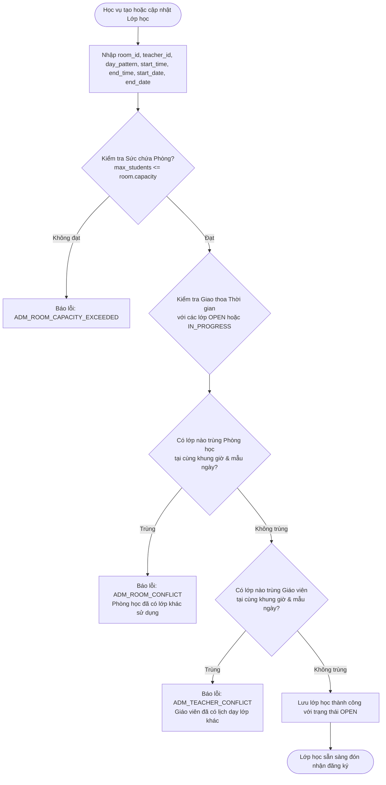
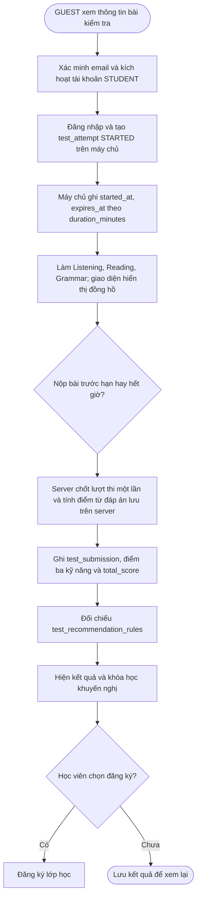
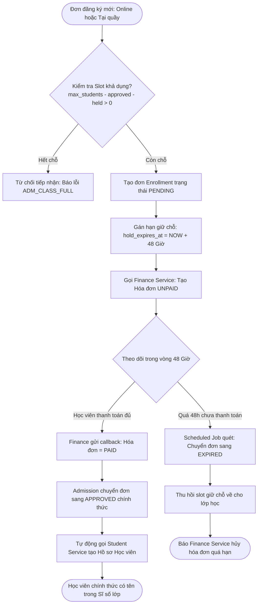
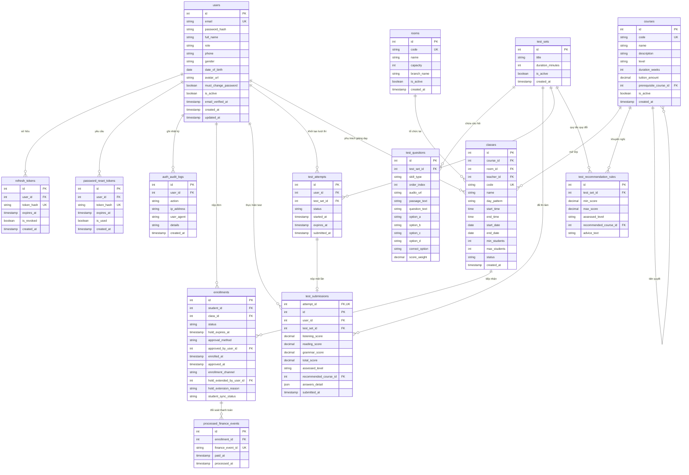

# ĐẶC TẢ PHÂN TÍCH NGHIỆP VỤ & BÁO CÁO THÔNG MINH (MASTER BA/BI SPECIFICATION)
## PHÂN HỆ ĐỊNH DANH, TUYỂN SINH & ĐÀO TẠO (ADMISSION & IDENTITY SERVICE)

> **Dự án**: Hệ thống Quản lý Trung tâm Anh ngữ  
> **Chịu trách nhiệm module**: Admission & Identity Service (Java 21 Spring Boot 3.3.4, Spring Security, JPA, PostgreSQL 16)  
> **Kiến trúc tích hợp**: Centralized Identity & Access Management (IAM) + Master Academic Catalog + Admissions Engine  
> **Phiên bản tài liệu**: **3.6 — BẢN HỢP NHẤT ĐỀ XUẤT** (chỉnh trực tiếp từ v3.5, giữ nguyên cấu trúc và 30 mã FR)  
> **Ngày cập nhật**: 2026-10-28  
> **Trạng thái**: **DỰ THẢO — chờ Tâm, Trang và các phân hệ liên quan duyệt**. Các đoạn gắn nhãn **[ĐỀ XUẤT v3.6]** và DDL/API có điều chỉnh **chưa được xác nhận với repo thực tế** (`docs/spec.md`, `scripts/init-db.sql`). Không chạy SQL của tài liệu lên CSDL đang hoạt động nếu chưa review migration.  

---

## MỤC LỤC
1. [Tổng quan Phân hệ & Kiến trúc Tích hợp (Architecture & Vision)](#1-tổng-quan-phân-hệ--kiến-trúc-tích-hợp-architecture--vision)
   - 1.1. Mục tiêu Nghiệp vụ (Business Objectives)
   - 1.2. Ranh giới Trách nhiệm & Non-Goals (Scope Boundaries & Explicit Non-Goals)
   - 1.3. Mô hình Kiến trúc Phân tầng & Tương tác Dịch vụ (High-Level Architecture)
2. [Tác nhân Hệ thống & Ma trận Phân quyền Chi tiết (Actors & RBAC Matrix)](#2-tác-nhân-hệ-thống--ma-trận-phân-quyền-chi-tiết-actors--rbac-matrix)
   - 2.1. Danh mục Tác nhân & Vai trò (Personas & Roles)
   - 2.2. Ma trận Phân quyền Chức năng Chi tiết (5-Role RBAC Matrix)
3. [Quy trình Nghiệp vụ Cốt lõi (Core Business Workflows - BA)](#3-quy-trình-nghiệp-vụ-cốt-lõi-core-business-workflows---ba)
   - 3.1. Quy trình Xác thực & Cấp phát Token Kép (Dual-Token JWT Strategy)
   - 3.2. Quy trình Quản lý Cơ sở vật chất & Phòng học (Facility & Room Management)
   - 3.3. Quy trình Tạo Lớp học & Thuật toán Chống Xung đột Lịch (Class Conflict Prevention Flow)
   - 3.4. Quy trình Khảo thí Đầu vào Trực tuyến (Online Placement Test Flow)
   - 3.5. Quy trình Đăng ký Nhập học & Giữ chỗ 48h (Enrollment & 48-Hour Slot Holding)
   - 3.6. Quy trình Hủy Lớp Thiếu Sĩ số & Bảo vệ Học viên (Class Cancellation & Student Safeguard)
   - 3.7. Vòng đời Trạng thái Đơn Đăng ký (Enrollment State Machine)
4. [Danh mục Yêu cầu Tính năng Kỹ thuật (Functional Requirements - FR)](#4-danh-mục-yêu-cầu-tính-năng-kỹ-thuật-functional-requirements---fr)
   - Nhóm 1: Quản trị Định danh & Phiên làm việc (FR-IAM)
   - Nhóm 2: Cơ sở vật chất, Phòng học & Ca học (FR-FAC)
   - Nhóm 3: Khóa học, Lớp học & Chống Xung đột Lịch (FR-ACA)
   - Nhóm 4: Khảo thí Đầu vào Chuyên sâu (FR-TST)
   - Nhóm 5: Tuyển sinh, Giữ chỗ 48h & Xét duyệt Nhập học (FR-ENR)
   - Nhóm 6: Xuất Dữ liệu & Báo cáo Vận hành (FR-OPS)
5. [Mô hình & Đặc tả Cơ sở Dữ liệu Chi tiết (Database Schema DDL & Data Dictionary)](#5-mô-hình--đặc-tả-cơ-sở-dữ-liệu-chi-tiết-database-schema-ddl--data-dictionary)
   - 5.1. Sơ đồ Thực thể Quan hệ Nghiệp vụ (Mermaid ERD)
   - 5.2. Toàn văn Kịch bản Khởi tạo Bảng (Database DDL Script PostgreSQL 16)
   - 5.3. Quy tắc Ràng buộc & Toàn vẹn Dữ liệu (Constraints & Indexes)
6. [Hợp đồng API Chi tiết cho Đội ngũ Kỹ thuật (REST API Specifications)](#6-hợp-đồng-api-chi-tiết-cho-đội-ngũ-kỹ-thuật-rest-api-specifications)
   - 6.1. Nhóm Xác thực & Quản trị Tài khoản (`/auth/*`, `/api/admission/users/*`, `/api/admission/audit-logs`)
   - 6.2. Nhóm Phòng học, Khóa học & Lớp học (`/api/admission/rooms`, `/api/admission/courses`, `/api/admission/classes`)
   - 6.3. Nhóm Khảo thí Đầu vào (Placement Test Engine)
   - 6.4. Nhóm Tuyển sinh & Giữ chỗ 48h (Enrollment Management)
   - 6.5. Nhóm Báo cáo BI Dashboard (`/api/admission/analytics/*`)
7. [Hệ thống Chỉ số Báo cáo Thông minh (Business Intelligence - BI & KPIs)](#7-hệ-thống-chỉ-số-báo-cáo-thông-minh-business-intelligence---bi--kpis)
   - 7.1. Bảng Thông số Đo lường Chiến lược (BI KPIs Definitions & Benchmarks)
   - 7.2. BI-01: Báo cáo Phễu Chuyển đổi Tuyển sinh (Admissions Conversion Funnel)
   - 7.3. BI-02: Báo cáo Xếp hạng Khóa học & Doanh thu Tiềm năng (Course Performance & Pipeline Revenue)
   - 7.4. BI-03: Báo cáo Sức khỏe Vận hành & An toàn Tài khoản (User Engagement & Security)
8. [Quy tắc Bất biến & Kế hoạch Kiểm thử (Invariants & Testing Strategy)](#8-quy-tắc-bất-biến--kế-hoạch-kiểm-thử-invariants--testing-strategy)
9. [Ma trận Ranh giới & Tích hợp Liên Service (Inter-Service Contracts & Handoffs)](#9-ma-trận-ranh-giới--tích-hợp-liên-service-inter-service-contracts--handoffs)
   - 9.1. Biểu đồ Tuần tự Tương tác Đa dịch vụ (Mermaid Sequence Diagram)
   - 9.2. Hợp đồng & Xử lý Ngoại lệ Giao tiếp Liên Service (Failure Resilience & Idempotency)
   - 9.3. Ma trận Ranh giới Trách nhiệm & Handoffs
10. [Quyết định cần thống nhất trước khi viết Technical Docs](#10-quyết-định-cần-thống-nhất-trước-khi-viết-technical-docs)
11. [Ghi chú thay đổi phiên bản 3.6](#11-ghi-chú-thay-đổi-phiên-bản-36)

---

## 1. Tổng quan Phân hệ & Kiến trúc Tích hợp (Architecture & Vision)

### 1.1. Mục tiêu Nghiệp vụ (Business Objectives)
Phân hệ **Admission & Identity Service** đóng vai trò là **"Hạt nhân Khởi tạo & Xương sống Dữ liệu (Genesis & Core Backbone)"** của hệ thống, chịu trách nhiệm cho hai khối nghiệp vụ sống còn:
1. **Dịch vụ Định danh Tập trung (Identity & Access Management - IAM)**: Quản lý vòng đời tài khoản toàn hệ thống, cấp phát token JWT kép (Access + Refresh Token), xử lý quên mật khẩu qua Email, và lưu vết kiểm toán bảo mật (`auth_audit_logs`).
2. **Quản trị Học thuật & Tuyển sinh Toàn diện (Master Academic & Admissions Intake)**:
   - **Tối ưu hóa Phễu tuyển sinh (Admissions Conversion)**: Tiếp nhận học viên đa kênh (Online & Tại quầy), phân loại chính xác trình độ đầu vào qua hệ thống khảo thí tự động, từ đó gợi ý đúng lộ trình học tập.
   - **Bảo toàn Tính toàn vẹn Sĩ số (Zero Over-enrollment)**: Áp dụng cơ chế **Giữ chỗ có thời hạn (48h Slot Holding)** kết hợp xác thực thanh toán thời gian thực từ Finance Service, đảm bảo không bao giờ duyệt vượt quá sĩ số tối đa (`max_students`).
   - **Ngăn ngừa Xung đột Lịch học (Conflict Prevention)**: Tự động cảnh báo và ngăn chặn trùng lặp Giáo viên và Phòng học trong cùng khung giờ.
   - **Cung cấp Dữ liệu Điều hành (BI Intelligence)**: Phân tích phễu chuyển đổi tuyển sinh, sức hút của khóa học, giá trị đang chờ thanh toán (ước tính) và thống kê đăng nhập. **Không coi học phí niêm yết × số đơn được duyệt là tiền thực thu**; số liệu tiền đã thu phải lấy từ Finance Service.

### 1.2. Ranh giới Trách nhiệm & Non-Goals (Scope Boundaries & Explicit Non-Goals)
- **THUỘC PHẠM VI (IN-SCOPE)**:
  - Quản trị toàn bộ danh mục Người dùng (Users), Phân quyền RBAC, Đăng nhập JWT kép, Quên mật khẩu, và Audit Logs.
  - Quản lý danh mục Cơ sở vật chất, Phòng học (Rooms) và Ca học tiêu chuẩn.
  - Quản lý danh mục Khóa học (Courses) và Lớp học (Classes).
  - Thuật toán kiểm tra và ngăn chặn xung đột Phòng học & Giáo viên.
  - Khảo thí trực tuyến đầu vào 3 kỹ năng (Placement Test Engine) với đồng hồ đếm ngược và quy tắc đề xuất khóa học tự động.
  - Đăng ký nhập học trực tuyến và tiếp nhận đơn tại quầy bởi Học vụ.
  - Quản lý giữ chỗ tạm thời (48h Hold Slot), tự động giải phóng slot quá hạn, và xét duyệt đơn nhập học chính thức.
  - Dashboard BI: Phễu chuyển đổi tuyển sinh, Xếp hạng khóa học / Doanh thu dự kiến, và Sức khỏe tài khoản người dùng.
- **NGOẠI PHẠM VI (EXPLICIT NON-GOALS)**:
  - *Chuyển lớp, đổi ca, bảo lưu kết quả, điểm danh*: Bàn giao hoàn toàn cho **Student Service** xử lý sau khi đơn đã `APPROVED`.
  - *Thu tiền học phí, xác nhận thu tiền mặt, in phiếu thu, hoàn tiền, cổng thanh toán VNPAY/MoMo*: **Finance Service** là nguồn xác thực trạng thái thu tiền; Admission chỉ xử lý trạng thái đăng ký sau khi nhận xác nhận đáng tin cậy.
- **[ĐỀ XUẤT v3.6 — quy ước danh tính]** `GUEST` là người chưa xác thực, **không phải role lưu trong `admission.users`**. `admission.users.id` là **ID tài khoản**; `student.students.id` là **ID hồ sơ học vụ** ở Student Service. Vì `enrollments.student_id` hiện liên kết `admission.users(id)`, **chưa tự ý đổi tên/xóa khóa này**; khi trao đổi liên phân hệ, dùng tên trường `user_id` để biểu thị ID tài khoản và `student_profile_id` cho ID Student Service trả về.
  - *Kho tài liệu bài giảng, Slide, Sổ điểm đánh giá quá trình*: Thuộc thẩm quyền của **Learning Service**.

### 1.3. Mô hình Kiến trúc Phân tầng & Tương tác Dịch vụ (High-Level Architecture)

```
                    ┌────────────────────────────────────────────────────────┐
                    │               Nginx API Gateway (Port 8080)            │
                    └───────────────────────────┬────────────────────────────┘
                                                │
                                    ┌───────────▼──────────┐
                                    │  ADMISSION & AUTH    │
                                    │  Spring Boot (:8081) │
                                    └─────┬───────────┬────┘
                                          │           │
                 ┌────────────────────────┘           └─────────────────────────┐
                 │ REST Sync on APPROVED                                        │ REST: Create Invoice
                 ▼                                                              ▼
     ┌───────────────────────┐                                      ┌───────────────────────┐
     │    STUDENT SERVICE    │                                      │    FINANCE SERVICE    │
     │    FastAPI (:8082)    │                                      │    FastAPI (:8084)    │
     │  (Profiles, Sổ ĐD)    │                                      │  (Invoices, Payments) │
     └───────────────────────┘                                      └───────────────────────┘
```

---

## 2. Tác nhân Hệ thống & Ma trận Phân quyền Chi tiết (Actors & RBAC Matrix)

### 2.1. Danh mục Tác nhân & Vai trò (Personas & Roles)

| Tác nhân (Actor / Role) | Vai trò & Trách nhiệm chính | Hành động tiêu biểu trong Admission & Identity |
|---|---|---|
| **Vãng lai / Học viên Tiềm năng (`GUEST`)** | Người chưa xác thực, không có role trong CSDL. | - Xem danh mục khóa học, lớp học và thông tin bài thi mẫu.<br>- Bắt đầu quy trình đăng ký/xác minh email; **cần tài khoản đã xác minh trước khi bắt đầu lượt thi chính thức có lưu kết quả** (đề xuất, chờ nhóm chốt). |
| **Học viên (`STUDENT`)** | Học viên có tài khoản cá nhân trong hệ thống. | - Tự nộp đơn đăng ký lớp học online (Self-Enrollment).<br>- Xem kết quả bài test và khóa học khuyến nghị.<br>- Theo dõi hạn giữ chỗ 48h và trạng thái đơn nộp. |
| **Giáo viên (`TEACHER`)** | Giảng viên phụ trách các lớp học. | - Nhận tài khoản được Admin cấp, đổi mật khẩu lần đầu.<br>- Tra cứu lịch dạy của các lớp mình phụ trách. |
| **Nhân viên Học vụ (`STAFF`)** | Vận hành tuyển sinh, xếp lịch, hỗ trợ học viên. | - Tiếp nhận đơn đăng ký trực tiếp tại quầy.<br>- Mở lớp học mới, gán phòng học, gán giáo viên.<br>- Gia hạn giữ chỗ (extend-hold) hoặc gửi yêu cầu Finance xác nhận khoản thu tiền mặt tại quầy.<br>- Xuất danh sách học viên lớp ra file Excel/CSV. |
| **Quản trị viên (`ADMIN`)** | Ban Giám đốc & Quản trị hệ thống cấp cao. | - Quản lý tài khoản nhân sự (tạo/khóa Staff, Teacher).<br>- Cấu hình phòng học, ban hành khóa học và ngân hàng đề thi.<br>- Xem toàn bộ Dashboard BI điều hành và Audit Logs bảo mật. |

### 2.2. Ma trận Phân quyền Chức năng Chi tiết (5-Role RBAC Matrix)

| Nhóm chức năng | Hành động cụ thể | GUEST | STUDENT | TEACHER | STAFF | ADMIN |
|---|---|:---:|:---:|:---:|:---:|:---:|
| **Identity & Auth** | Đăng nhập (`POST /auth/login`) | ✅ | ✅ | ✅ | ✅ | ✅ |
| | Làm mới Token (`POST /auth/refresh`) | ❌ | ✅ | ✅ | ✅ | ✅ |
| | Đăng xuất (`POST /auth/logout`) | ❌ | ✅ | ✅ | ✅ | ✅ |
| | Quên mật khẩu (`POST /auth/forgot-password`) | ✅ | ✅ | ✅ | ✅ | ✅ |
| | Đặt lại mật khẩu qua token (`POST /auth/reset-password`) | ✅ | ✅ | ✅ | ✅ | ✅ |
| | Xem hồ sơ cá nhân (`GET /auth/me`) | ❌ | ✅ | ✅ | ✅ | ✅ |
| | Đổi mật khẩu chủ động (`POST /auth/change-password`) | ❌ | ✅ | ✅ | ✅ | ✅ |
| | Quản lý Người dùng (CRUD Staff/Teacher, Khóa tài khoản) | ❌ | ❌ | ❌ | ❌ | ✅ |
| | Xem Nhật ký Kiểm toán Đăng nhập (`auth_audit_logs`) | ❌ | ❌ | ❌ | ❌ | ✅ |
| **Phòng học & Ca học** | Xem danh mục Phòng học | ❌ | ❌ | ❌ | ✅ | ✅ |
| | CRUD Danh mục Phòng học (`/api/admission/rooms`) | ❌ | ❌ | ❌ | ❌ | ✅ |
| **Khóa học & Lộ trình** | Xem danh mục Khóa học & Lớp học đang mở | ✅ | ✅ | ✅ | ✅ | ✅ |
| | CRUD Khóa học (`/api/admission/courses`) | ❌ | ❌ | ❌ | ✅ | ✅ |
| **Lớp học & Xung đột** | Mở lớp mới, chỉnh sửa lớp (`/api/admission/classes`) | ❌ | ❌ | ❌ | ✅ | ✅ |
| | Hủy lớp thiếu sĩ số (`PUT .../cancel`) | ❌ | ❌ | ❌ | ✅ | ✅ |
| | Xuất danh sách học viên của lớp ra Excel/CSV | ❌ | ❌ | ❌ | ✅ | ✅ |
| **Khảo thí Đầu vào** | Làm bài Placement Test **chính thức** có lưu kết quả (đề xuất xác minh email trước) | ❌ | ✅ | ❌ | ❌ | ❌ |
| | Xem Bảng điểm chi tiết & Khóa học khuyến nghị cá nhân | ❌ | ✅ | ❌ | ❌ | ❌ |
| | Quản lý Ngân hàng đề thi & Ma trận quy đổi điểm | ❌ | ❌ | ❌ | ✅ | ✅ |
| | Xuất kết quả khảo thí ra Excel/CSV | ❌ | ❌ | ❌ | ✅ | ✅ |
| **Tuyển sinh & Đăng ký** | Tự nộp đơn Đăng ký Lớp học (Online Self-Enrollment) | ❌ | ✅ | ❌ | ❌ | ❌ |
| | Tiếp nhận đơn Đăng ký tại quầy (Staff-Assisted) | ❌ | ❌ | ❌ | ✅ | ✅ |
| | Gia hạn thời gian giữ chỗ (`PUT .../extend-hold`) | ❌ | ❌ | ❌ | ✅ | ✅ |
| | Gửi yêu cầu xác nhận thu tiền mặt (`PUT .../approve-manual`), Finance xác nhận rồi mới duyệt | ❌ | ❌ | ❌ | ✅ | ✅ |
| **Báo cáo BI** | Dashboard Phễu Tuyển sinh & Doanh thu tiềm năng | ❌ | ❌ | ❌ | ✅ | ✅ |
| | Báo cáo đăng nhập theo ngày/tháng (Logged-in DAU/MAU), Failed Logins | ❌ | ❌ | ❌ | ❌ | ✅ |

---

## 3. Quy trình Nghiệp vụ Cốt lõi (Core Business Workflows - BA)

### 3.1. Quy trình Xác thực & Cấp phát Token Kép (Dual-Token JWT Strategy)
1. **Đăng nhập**: Người dùng gửi Email và Mật khẩu tới `POST /auth/login`.
2. **Kiểm tra**:
   - Nếu `user.is_active == false`: Trả về HTTP 403 Forbidden (`AUTH_ACCOUNT_LOCKED`).
   - Nếu sai mật khẩu: Ghi log `LOGIN_FAILED`, trả về HTTP 401 Unauthorized (`AUTH_INVALID_CREDENTIALS`).
3. **Phát hành Token**:
   - **Access Token (Thời hạn 15 phút)**: Chứa claims (`sub`: userId, `email`, `role`, `name`, `exp`). Mọi API được bảo vệ phải kiểm tra quyền theo role; **để đáp ứng yêu cầu khóa tài khoản ngay**, cần kiểm tra trạng thái hiện hành `is_active` (hoặc cơ chế thu hồi/token version tương đương) tại mỗi yêu cầu, không chỉ kiểm tra chữ ký JWT.
   - **Refresh Token (Thời hạn 7 ngày)**: Token ngẫu nhiên đủ mạnh được gửi cho client; **chỉ lưu hash của token** trong `admission.refresh_tokens`, phục vụ tra cứu, thu hồi và chống dùng lại.
4. **Cơ chế Refresh Token Rotation**:
   - Khi Access Token hết hạn, Client gọi `POST /auth/refresh` kèm Refresh Token hiện tại.
   - Nếu token hợp lệ và `is_revoked == false`: **thu hồi token cũ và tạo cặp token mới trong thao tác nguyên tử**. Token refresh dùng lại phải bị từ chối. **[ĐỀ XUẤT v3.6]** Lưu *hash* token trong CSDL; không ghi token nguyên văn vào audit log.
5. **Đăng xuất & Thu hồi**:
   - Gọi `POST /auth/logout` sẽ lập tức đánh dấu `is_revoked = true` cho Refresh Token đó trong cơ sở dữ liệu.
6. **Lưu vết Kiểm toán**: Mọi sự kiện đăng nhập, đăng xuất, đổi mật khẩu đều ghi nhận vào `admission.auth_audit_logs`.

### 3.2. Quy trình Quản lý Cơ sở vật chất & Phòng học (Facility & Room Management)
- Admin quản lý danh mục phòng học (`admission.rooms`) gồm: Mã phòng (`code` unique), Tên phòng, Sức chứa trần (`capacity`), Cơ sở (`branch_name`).
- Khi mở lớp, hệ thống ràng buộc: Sĩ số tối đa của lớp không được phép vượt quá sức chứa vật lý của phòng học:  
  $$\text{class.max\_students} \le \text{room.capacity}$$

### 3.3. Quy trình Tạo Lớp học & Thuật toán Chống Xung đột Lịch (Class Conflict Prevention Flow)



#### Chi tiết Thuật toán So khớp Thời gian (Time Overlap Condition):
Hai lớp học bị coi là xung đột thời gian nếu thỏa mãn đồng thời 3 điều kiện:
1. **Giao thoa Khoảng ngày**: $(\text{start\_date}_1 \le \text{end\_date}_2) \land (\text{end\_date}_1 \ge \text{start\_date}_2)$.
2. **Trùng khớp Mẫu ngày trong tuần**: `day_pattern` có ít nhất 1 ngày học trùng nhau (Ví dụ: `MON_WED_FRI` trùng với `MON_WED_FRI` hoặc `DAILY`).
3. **Giao thoa Khung giờ học**: $(\text{start\_time}_1 < \text{end\_time}_2) \land (\text{end\_time}_1 > \text{start\_time}_2)$.

---

### 3.4. Quy trình Khảo thí Đầu vào Trực tuyến (Online Placement Test Flow)

**[ĐỀ XUẤT v3.6 — thống nhất với FR-IAM-01 và database]**: GUEST được xem thông tin bài thi và đăng ký; để làm **bài thi chính thức có lưu điểm**, người dùng phải xác minh email, thiết lập tài khoản `STUDENT` và được xác thực trước khi tạo `test_attempts`. Không nhận `user_id` do trình duyệt tự gửi là căn cứ sở hữu bài thi.



- **Listening**: Phát audio từ `audio_url`, học viên chọn A/B/C/D.
- **Reading**: Hiển thị đoạn đọc `passage_text` cùng câu hỏi.
- **Grammar & Vocabulary**: Trắc nghiệm câu hỏi độc lập; đáp án đúng **không** được trả về khi phát đề.
- **Server-side timeout**: `expires_at` là thời hạn do máy chủ quyết định; trình duyệt hết giờ sẽ yêu cầu nộp, nhưng máy chủ vẫn phải tự chặn nộp sai hạn hoặc tự chốt attempt theo cơ chế đã chốt. Nộp lại cùng lượt thi không được chấm hai lần.
- **Tự động đề xuất**: Đối chiếu `total_score` với khoảng `[min_score, max_score]` trong `test_recommendation_rules`; kiểm tra các khoảng không chồng lấn và có chính sách khi không khớp.
- **Nguồn BI**: Bắt đầu thi từ `test_attempts.started_at`; hoàn tất thi từ `test_attempts.status = 'SUBMITTED'`, không suy đoán từ riêng bảng kết quả `test_submissions`.

---

### 3.5. Quy trình Đăng ký Nhập học & Giữ chỗ 48h (Enrollment & 48-Hour Slot Holding)



**[ĐỀ XUẤT v3.6 — quy tắc bắt buộc khi giữ chỗ]**
1. `Active Held Count` chỉ đếm đơn `PENDING` với `hold_expires_at > NOW()`; đơn quá hạn **không chiếm chỗ dù Job chưa kịp cập nhật `EXPIRED`**.
2. Khi tạo đơn/gia hạn/duyệt đơn, Admission kiểm tra `APPROVED + Active Held <= max_students` **trong transaction có khóa đồng bộ theo lớp hoặc phương án tương đương**. Nếu chỉ đếm rồi insert riêng lẻ sẽ có nguy cơ nhận hai người vào một chỗ.
3. Mỗi tài khoản chỉ được có tối đa **một đơn giữ chỗ hiệu lực trên cùng một lớp** (đề xuất). Chưa mặc định cấm đăng ký nhiều lớp khác nhau.
4. Chỉ Finance được ghi nhận thanh toán thật. Callback phải được **xác thực và chống xử lý trùng**; Admission không tự đánh dấu hóa đơn `PAID`.
5. **Thanh toán trước hạn nhưng callback đến sau hạn**: xử lý theo thời điểm giao dịch đáng tin cậy do Finance cung cấp. **Chờ nhóm chốt chính sách** khi slot đã cấp cho người khác: không tự duyệt vượt sĩ số; đưa vào đối soát, chuyển lớp hoặc hoàn tiền nếu cần.
6. Nếu đồng bộ Student lỗi sau khi duyệt, giữ đơn `APPROVED` và **theo dõi trạng thái đồng bộ để retry**; một đơn chỉ tạo tối đa một hồ sơ Student.

#### Các Ngoại lệ Vận hành Được phép (Staff Overrides):
1. **Gia hạn giữ chỗ (`extend-hold`)**: Học vụ có thể gia hạn thêm 24h hoặc 48h cho đơn `PENDING` nếu học viên có lý do chính đáng (chờ lương, lỗi chuyển khoản).
2. **Xử lý tiền mặt tại quầy (`approve-manual`) — [ĐỀ XUẤT v3.6]**: STAFF ghi yêu cầu xác nhận đã nhận tiền mặt; **Finance kiểm tra và ghi nhận giao dịch CASH**, sau đó phát xác nhận `PAID`. Admission chỉ chuyển sang `APPROVED` khi đã nhận xác nhận Finance hợp lệ. Tên API giữ lại để tương thích tài liệu, nhưng **không được hiểu là cho phép STAFF tự đánh dấu hóa đơn PAID**.

---

### 3.6. Quy trình Hủy Lớp Thiếu Sĩ số & Bảo vệ Học viên (Class Cancellation & Student Safeguard)
1. Mỗi lớp học có chỉ số `min_students` (mặc định 10 học viên).
2. Trước ngày khai giảng (`start_date`), nếu số lượng học viên `APPROVED` không đạt ngưỡng tối thiểu, Nhân viên Học vụ có quyền thực hiện Hủy lớp (`PUT /api/admission/classes/{id}/cancel`).
3. Khi lớp chuyển sang trạng thái `CANCELLED`:
   - Toàn bộ đơn `PENDING` chưa thanh toán lập tức chuyển sang `CANCELLED`.
   - Các đơn đã đóng tiền `APPROVED` được chuyển sang trạng thái chờ giải quyết (`CANCELLED_REFUND_PENDING`).
   - Hệ thống tự động tạo cảnh báo sang **Finance Service** để thực hiện hoàn tiền hoặc bảo lưu tiền học phí sang lớp khác cho học viên. **Admission không tự ghi trạng thái đã hoàn tiền**; chỉ cập nhật trạng thái kết thúc sau khi Finance xác nhận. Các bước phải chống xử lý lặp khi gọi API lại.

---

### 3.7. Vòng đời Trạng thái Đơn Đăng ký (Enrollment State Machine)

```
        ┌────────────────────────────────────────────────────────┐
        │                                                        │ Quá hạn 48h
        │                                                        ▼ (Scheduled Job)
  [Nộp đơn mới] ──(Còn slot)──> [ PENDING ] ──────────────> [ EXPIRED ]
                                     │
                 ┌───────────────────┼───────────────────┐
                 │ Thanh toán PAID   │ Học viên rút đơn  │ Học vụ từ chối
                 ▼                   ▼                   ▼
           [ APPROVED ]        [ CANCELLED ]       [ REJECTED ]
                 │
                 │ (Lớp bị hủy do thiếu sĩ số)
                 ▼
    [ CANCELLED_REFUND_PENDING ]
```

- `PENDING`: Đã đăng ký thành công, giữ 1 slot khi `hold_expires_at > NOW()`; nếu hết hạn thì không tính slot giữ chỗ kể cả trước khi Job đổi trạng thái.
- `APPROVED`: Finance đã xác nhận thanh toán theo chính sách hoặc phê duyệt ngoại lệ được hai service thống nhất; chính thức nằm trong sĩ số lớp.
- `EXPIRED`: Quá hạn 48 giờ mà không thanh toán; slot bị thu hồi tự động.
- `CANCELLED`: Đơn bị hủy do học viên chủ động rút đơn hoặc lớp học bị hủy.
- `REJECTED`: Đơn bị từ chối do không đạt yêu cầu đặc thù hoặc gian lận hồ sơ.
- `CANCELLED_REFUND_PENDING`: Đơn đã đóng tiền nhưng lớp bị hủy trước khai giảng, chờ Finance xử lý hoàn phí/chuyển khoản sang lớp khác.
- **[ĐỀ XUẤT v3.6]** Sự kiện `PAID` đến sau khi đơn đã `EXPIRED`, `CANCELLED` hoặc `REJECTED` **không tự đổi sang `APPROVED`**. Ghi nhận ca ngoại lệ để đối soát với Finance và học vụ theo chính sách được duyệt.

---

## 4. Danh mục Yêu cầu Tính năng Kỹ thuật (Functional Requirements - FR)

### Nhóm 1: Quản trị Định danh & Phiên làm việc (FR-IAM)
- **FR-IAM-01 (Tự động sinh tài khoản Student)**: Khi người học bắt đầu đăng ký Placement Test hoặc nộp đơn lần đầu, hệ thống kiểm tra email; **đề xuất xác minh email và thiết lập mật khẩu an toàn trước khi tạo/kích hoạt** tài khoản `admission.users` với `role='STUDENT'`. Không tạo hai tài khoản cho cùng email, không dùng mật khẩu mặc định. Cần chốt với Tâm luồng xác minh.
- **FR-IAM-02 (Quản lý Nhân sự)**: Cho phép `ADMIN` tạo tài khoản nhân sự (`role` là `STAFF` hoặc `TEACHER`), yêu cầu nhập: Email, Họ tên, Số điện thoại, Giới tính, Ngày sinh.
- **FR-IAM-03 (Xác thực JWT Kép)**: Cấp phát cặp token: Access Token (15 phút, stateless) và Refresh Token (7 ngày, stateful lưu trong bảng `refresh_tokens`).
- **FR-IAM-04 (Refresh Token Rotation)**: Khi gọi API làm mới token, hệ thống thu hồi refresh token cũ và cấp cặp token mới **một cách nguyên tử**; token đã dùng lại bị từ chối; CSDL ưu tiên lưu hash token thay vì token gốc.
- **FR-IAM-05 (Khóa / Mở khóa Tài khoản)**: ADMIN kích hoạt/khóa tài khoản (`is_active = false/true`). Để khóa **có hiệu lực ngay cả với access token đã cấp**, API/Gateway phải kiểm tra trạng thái hiện thời hoặc token version/thu hồi phiên tương đương.
- **FR-IAM-06 (Quên mật khẩu qua Email)**: Sinh mã token đặt lại mật khẩu ngẫu nhiên có thời hạn 15 phút lưu trong `password_reset_tokens`, gửi liên kết kích hoạt qua email để người dùng thiết lập mật khẩu mới.
- **FR-IAM-07 (Nhật ký Kiểm toán Bảo mật)**: Tự động ghi nhật ký bảo mật vào `admission.auth_audit_logs` đối với các sự kiện: `LOGIN_SUCCESS`, `LOGIN_FAILED`, `REFRESH_TOKEN`, `LOGOUT`, `PASSWORD_CHANGED`, `ACCOUNT_LOCKED`.

### Nhóm 2: Cơ sở vật chất, Phòng học & Ca học (FR-FAC)
- **FR-FAC-01 (Quản lý Danh mục Phòng học)**: CRUD thông tin phòng học gồm: Mã phòng (`code` unique), Tên phòng, Sức chứa tối đa (`capacity >= 1`), Chi nhánh cơ sở (`branch_name`), Trạng thái hoạt động (`is_active`).
- **FR-FAC-02 (Cấu hình Ca học Tiêu chuẩn)**: Hỗ trợ khung giờ `start_time < end_time` và các mẫu ngày (`MON_WED_FRI`, `TUE_THU_SAT`, `SAT_SUN`, `DAILY`). **Đề xuất V2 dùng danh sách preset cố định**; nếu thật sự cần CRUD ca chuẩn thì bổ sung bảng `class_shifts` sau khi nhóm duyệt.
- **FR-FAC-03 (Ràng buộc Sức chứa Phòng)**: Bắt buộc kiểm tra `class.max_students <= room.capacity`. Nếu vượt quá, trả lỗi `ADM_ROOM_CAPACITY_EXCEEDED`.

### Nhóm 3: Khóa học, Lớp học & Chống Xung đột Lịch (FR-ACA)
- **FR-ACA-01 (Quản lý Khóa học & Lộ trình)**: CRUD Khóa học chuẩn: Mã khóa (`code` unique), Tên khóa, Trình độ (`level`: *Beginner, Intermediate, Advanced*), Thời lượng (`duration_weeks`), Học phí tiêu chuẩn (`tuition_amount`), Khóa học tiên quyết (`prerequisite_course_id`).
- **FR-ACA-02 (Quản lý Lớp học)**: Mở lớp học gán Khóa học, Phòng học (`room_id`), Giáo viên (`teacher_id`), Ca học & Mẫu ngày, Ngày khai giảng (`start_date`), Ngày bế giảng (`end_date`), Sĩ số tối thiểu (`min_students`), Sĩ số trần (`max_students`).
- **FR-ACA-03 (Công cụ Chống Xung đột Lịch - Conflict Engine)**: Tự động phát hiện và chặn lưu lớp nếu xảy ra:
  - Trùng phòng học với lớp khác đang mở trong cùng khung giờ: `ADM_ROOM_CONFLICT`.
  - Trùng lịch dạy của giáo viên với lớp khác trong cùng khung giờ: `ADM_TEACHER_CONFLICT`.
- **FR-ACA-04 (Vòng đời Lớp học)**: Quản lý trạng thái lớp: `OPEN` $\rightarrow$ `IN_PROGRESS` $\rightarrow$ `COMPLETED`, hoặc `CANCELLED` (Hủy lớp thiếu sĩ số).
- **FR-ACA-05 (Tính toán Slot Khả dụng)**: Cung cấp API tính toán số chỗ còn lại theo thời gian thực:  
  $$\text{Available Slots} = \text{max\_students} - \text{Approved Count} - \text{Active Held Count}$$

### Nhóm 4: Khảo thí Đầu vào Chuyên sâu (FR-TST)
- **FR-TST-01 (Quản lý Ngân hàng Đề thi)**: Quản lý các Bộ đề thi (`test_sets`) kèm cấu hình thời gian làm bài đếm ngược (`duration_minutes`, mặc định 45 phút).
- **FR-TST-02 (Ngân hàng Câu hỏi 3 Kỹ năng)**: Quản lý câu hỏi trắc nghiệm bóc tách thành 3 phần:
  - *Listening*: Tích hợp file nghe qua `audio_url`.
  - *Reading*: Tích hợp đoạn văn đọc hiểu qua `passage_text`.
  - *Grammar & Vocabulary*: Câu hỏi ngữ pháp trắc nghiệm 4 lựa chọn (A/B/C/D) kèm đáp án đúng và trọng số điểm (`score_weight`).
- **FR-TST-03 (Giao diện Khảo thí Countdown)**: Giao diện hiển thị đồng hồ đếm ngược từ `test_attempts.expires_at` **do server quyết định**, không tin thời gian từ client; không nhận bài quá hạn/đã chấm lại.
- **FR-TST-04 (Chấm điểm Tự động & Bóc tách Kỹ năng)**: Chấm đáp án trên server một lần cho mỗi attempt; tách `listening_score`, `reading_score`, `grammar_score`, tính `total_score` từ các điểm thành phần, không nhận điểm tự khai từ client.
- **FR-TST-05 (Đề xuất Khóa học Tự động)**: Đối chiếu `total_score` với bảng `test_recommendation_rules` để trả về khóa học phù hợp nhất kèm nút đăng ký lớp.

### Nhóm 5: Tuyển sinh, Giữ chỗ 48h & Xét duyệt Nhập học (FR-ENR)
- **FR-ENR-01 (Đăng ký Tuyển sinh Đa kênh)**: Hỗ trợ học viên tự đăng ký trực tuyến hoặc Nhân viên học vụ tạo đơn trực tiếp tại quầy.
- **FR-ENR-02 (Bảo vệ Sĩ số Trần - Invariant Guard)**: Chặn khi lớp hết slot (`ADM_CLASS_FULL`), **kể cả 2 yêu cầu đăng ký đồng thời**; kiểm tra và giữ chỗ phải nguyên tử theo lớp.
- **FR-ENR-03 (Cấp Slot Giữ chỗ 48h)**: Đơn mới `PENDING`, `hold_expires_at = NOW() + 48 HOURS` theo giờ server; học viên xem được trạng thái/hạn; chỉ 1 hold hiệu lực cùng người–lớp.
- **FR-ENR-04 (Tự động Thu hồi Slot Quá hạn)**: Scheduled Job đổi `PENDING` đã hết hạn sang `EXPIRED`; **slot hết hiệu lực ngay theo thời gian server**, không chờ job.
- **FR-ENR-05 (Gia hạn Giữ chỗ Học vụ)**: STAFF/ADMIN được gia hạn khi đơn còn `PENDING` và còn hiệu lực; lưu người gia hạn, lý do, hạn mới; không gia hạn đơn `EXPIRED`/`APPROVED`.
- **FR-ENR-06 (Xét duyệt Nhập học Tự động)**: Chỉ chuyển `APPROVED` khi nhận **xác nhận Finance đáng tin cậy** (`invoice_status == PAID`), kiểm tra trạng thái/hạn/slot, chống callback lặp; thanh toán đến muộn xử lý ngoại lệ theo chính sách nhóm chốt.
- **FR-ENR-07 (Duyệt Tiền mặt Tại quầy)**: STAFF gửi yêu cầu xác nhận thu tiền mặt (`approve-manual`); **Finance xác nhận và ghi nhận CASH**, Admission mới tự động duyệt theo cùng quy tắc FR-ENR-06.
- **FR-ENR-08 (Đồng bộ Hồ sơ Học vụ)**: Khi `APPROVED`, gửi yêu cầu tạo hồ sơ tới Student Service bằng `user_id`; có retry/idempotency và theo dõi đồng bộ, không tạo hai hồ sơ khi gọi lặp.

### Nhóm 6: Xuất Dữ liệu & Báo cáo Vận hành (FR-OPS)
- **FR-OPS-01 (Xuất Danh sách Lớp)**: Cho phép xuất danh sách học viên đăng ký của một lớp học ra file Excel (.xlsx) hoặc CSV chuẩn.
- **FR-OPS-02 (Xuất Kết quả Khảo thí)**: Cho phép xuất bảng điểm khảo thí đầu vào của học viên theo bộ đề ra file Excel/CSV.

### 4.1. Mức ưu tiên phát triển & tiêu chí nghiệm thu (đề xuất v3.6)

- **P0:** Cốt lõi để luồng chạy chính xác; **P1:** quan trọng sau luồng lõi; **P2:** mở rộng. Đây là **ưu tiên đề xuất**, nhóm có thể điều chỉnh theo tiến độ.

| Nhóm FR | P0 đề xuất | P1 đề xuất | Điểm nghiệm thu tiêu biểu |
|---|---|---|---|
| IAM | IAM-01, IAM-03, IAM-05 | IAM-02, IAM-04, IAM-06, IAM-07 | Không trùng email; khóa tài khoản đang có token vẫn từ chối API |
| FAC | FAC-03 | FAC-01, FAC-02 | Sĩ số lớp không được vượt sức chứa phòng |
| ACA | ACA-01, ACA-02, ACA-03, ACA-05 | ACA-04 | Chống trùng phòng/giáo viên; không vượt số chỗ khi đăng ký đồng thời |
| TST | — | TST-01 đến TST-05 | Server quản lý hạn thi, người sở hữu bài, điểm không sửa từ client |
| ENR | ENR-01, ENR-02, ENR-03, ENR-04, ENR-06, ENR-08 | ENR-05, ENR-07 | 48h hold; callback PAID chống lặp; Student đồng bộ không tạo trùng |
| OPS | — | OPS-01, OPS-02 | Xuất file đúng quyền và lớp/bộ đề; không lộ dữ liệu ngoài phạm vi |

**Điều kiện tối thiểu cho V2:** luồng `khóa/lớp → đơn PENDING → hold 48h → Finance PAID → APPROVED → tạo hồ sơ Student` chạy được qua các service; các đề xuất P1 có thể làm sau khi luồng này ổn định. BI nâng cao không phải điều kiện để tạo đơn đúng.

---

## 5. Mô hình & Đặc tả Cơ sở Dữ liệu Chi tiết (Database Schema DDL & Data Dictionary)

### 5.1. Sơ đồ Thực thể Quan hệ Nghiệp vụ (Mermaid ERD)

> **[ĐỀ XUẤT v3.6]** ERD và DDL bên dưới là **bản thiết kế mục tiêu để thảo luận**, không phải mô tả chắc chắn CSDL đã có trong `scripts/init-db.sql`. Bổ sung `test_attempts`, `processed_finance_events` cùng các cột phục vụ xác minh email, giới hạn giữ chỗ, chống lặp và đồng bộ; **cần migration được duyệt** trước khi áp dụng. Không thay đổi tên khóa liên kết dùng chung.



---

### 5.2. Toàn văn Kịch bản Khởi tạo Bảng (Database DDL Script PostgreSQL 16)

```sql
-- ============================================================================
-- ADMISSION & IDENTITY SERVICE SCHEMA DDL (PostgreSQL 16)
-- ============================================================================

-- 1. Khởi tạo Schema Độc lập
CREATE SCHEMA IF NOT EXISTS admission;

-- 2. Bảng Người dùng & Phân quyền Tập trung (Users & RBAC)
CREATE TABLE admission.users (
    id SERIAL PRIMARY KEY,
    email VARCHAR(255) UNIQUE NOT NULL,
    password_hash VARCHAR(255) NOT NULL,
    full_name VARCHAR(255) NOT NULL,
    role VARCHAR(50) NOT NULL CHECK (role IN ('ADMIN', 'STAFF', 'TEACHER', 'STUDENT')),
    phone VARCHAR(50),
    gender VARCHAR(20) CHECK (gender IN ('MALE', 'FEMALE', 'OTHER')),
    date_of_birth DATE,
    avatar_url TEXT,
    must_change_password BOOLEAN DEFAULT FALSE,
    is_active BOOLEAN DEFAULT TRUE,
    email_verified_at TIMESTAMPTZ,
    created_at TIMESTAMPTZ DEFAULT CURRENT_TIMESTAMP,
    updated_at TIMESTAMPTZ DEFAULT CURRENT_TIMESTAMP
);

-- 3. Bảng Refresh Token (Chiến lược JWT Kép Stateful)
CREATE TABLE admission.refresh_tokens (
    id SERIAL PRIMARY KEY,
    user_id INTEGER NOT NULL REFERENCES admission.users(id) ON DELETE CASCADE,
    token_hash VARCHAR(255) UNIQUE NOT NULL,
    expires_at TIMESTAMPTZ NOT NULL,
    is_revoked BOOLEAN DEFAULT FALSE,
    created_at TIMESTAMPTZ DEFAULT CURRENT_TIMESTAMP
);

-- 4. Bảng Đặt lại Mật khẩu qua Email
CREATE TABLE admission.password_reset_tokens (
    id SERIAL PRIMARY KEY,
    user_id INTEGER NOT NULL REFERENCES admission.users(id) ON DELETE CASCADE,
    token_hash VARCHAR(255) UNIQUE NOT NULL,
    expires_at TIMESTAMPTZ NOT NULL,
    is_used BOOLEAN DEFAULT FALSE,
    created_at TIMESTAMPTZ DEFAULT CURRENT_TIMESTAMP
);

-- 5. Bảng Nhật ký Kiểm toán Đăng nhập & Bảo mật (Audit Log)
CREATE TABLE admission.auth_audit_logs (
    id SERIAL PRIMARY KEY,
    user_id INTEGER REFERENCES admission.users(id) ON DELETE SET NULL,
    action VARCHAR(50) NOT NULL CHECK (action IN ('LOGIN_SUCCESS', 'LOGIN_FAILED', 'REFRESH_TOKEN', 'LOGOUT', 'PASSWORD_CHANGED', 'ACCOUNT_LOCKED')),
    ip_address VARCHAR(50),
    user_agent TEXT,
    details TEXT,
    created_at TIMESTAMPTZ DEFAULT CURRENT_TIMESTAMP
);

-- 6. Bảng Danh mục Phòng học (Rooms)
CREATE TABLE admission.rooms (
    id SERIAL PRIMARY KEY,
    code VARCHAR(50) UNIQUE NOT NULL,
    name VARCHAR(100) NOT NULL,
    capacity INTEGER NOT NULL CHECK (capacity > 0),
    branch_name VARCHAR(100) DEFAULT 'Cơ sở chính',
    is_active BOOLEAN DEFAULT TRUE,
    created_at TIMESTAMPTZ DEFAULT CURRENT_TIMESTAMP
);

-- 7. Bảng Khóa học & Lộ trình Đào tạo (Courses)
CREATE TABLE admission.courses (
    id SERIAL PRIMARY KEY,
    code VARCHAR(50) UNIQUE NOT NULL,
    name VARCHAR(255) NOT NULL,
    description TEXT,
    level VARCHAR(50) NOT NULL CHECK (level IN ('Beginner', 'Intermediate', 'Advanced')),
    duration_weeks INTEGER NOT NULL CHECK (duration_weeks > 0),
    tuition_amount NUMERIC(12, 2) NOT NULL CHECK (tuition_amount >= 0),
    prerequisite_course_id INTEGER REFERENCES admission.courses(id) ON DELETE SET NULL,
    is_active BOOLEAN DEFAULT TRUE,
    created_at TIMESTAMPTZ DEFAULT CURRENT_TIMESTAMP
);

-- 8. Bảng Lớp học & Thời khóa biểu (Classes)
CREATE TABLE admission.classes (
    id SERIAL PRIMARY KEY,
    course_id INTEGER NOT NULL REFERENCES admission.courses(id) ON DELETE RESTRICT,
    room_id INTEGER REFERENCES admission.rooms(id) ON DELETE RESTRICT,
    teacher_id INTEGER REFERENCES admission.users(id) ON DELETE RESTRICT,
    code VARCHAR(50) UNIQUE NOT NULL,
    name VARCHAR(255) NOT NULL,
    day_pattern VARCHAR(50) NOT NULL CHECK (day_pattern IN ('MON_WED_FRI', 'TUE_THU_SAT', 'SAT_SUN', 'DAILY')),
    start_time TIME NOT NULL,
    end_time TIME NOT NULL,
    start_date DATE NOT NULL,
    end_date DATE NOT NULL,
    min_students INTEGER DEFAULT 10 CHECK (min_students > 0),
    max_students INTEGER DEFAULT 25 CHECK (max_students >= min_students),
    status VARCHAR(50) DEFAULT 'OPEN' CHECK (status IN ('OPEN', 'IN_PROGRESS', 'COMPLETED', 'CANCELLED')),
    created_at TIMESTAMPTZ DEFAULT CURRENT_TIMESTAMP
);

-- 9. Bảng Tuyển sinh & Giữ chỗ 48h (Enrollments)
CREATE TABLE admission.enrollments (
    id SERIAL PRIMARY KEY,
    student_id INTEGER NOT NULL REFERENCES admission.users(id) ON DELETE RESTRICT,
    class_id INTEGER NOT NULL REFERENCES admission.classes(id) ON DELETE RESTRICT,
    status VARCHAR(50) DEFAULT 'PENDING' CHECK (status IN ('PENDING', 'APPROVED', 'REJECTED', 'EXPIRED', 'CANCELLED', 'CANCELLED_REFUND_PENDING')),
    hold_expires_at TIMESTAMPTZ,
    approval_method VARCHAR(50) CHECK (approval_method IN ('ONLINE_PAYMENT', 'MANUAL_CASH', 'STAFF_OVERRIDE')),
    approved_by_user_id INTEGER REFERENCES admission.users(id),
    enrollment_channel VARCHAR(20) NOT NULL DEFAULT 'ONLINE' CHECK (enrollment_channel IN ('ONLINE','AT_COUNTER')),
    hold_extended_by_user_id INTEGER REFERENCES admission.users(id),
    hold_extension_reason TEXT,
    student_sync_status VARCHAR(20) DEFAULT 'NOT_STARTED'
        CHECK (student_sync_status IN ('NOT_STARTED','PENDING','SYNCED','FAILED')),
    enrolled_at TIMESTAMPTZ DEFAULT CURRENT_TIMESTAMP,
    approved_at TIMESTAMPTZ
);

-- Đối soát callback Finance: cùng một sự kiện không được xử lý hai lần
-- Nguồn sự thật số tiền và trạng thái hóa đơn vẫn nằm ở Finance Service.
CREATE TABLE admission.processed_finance_events (
    id SERIAL PRIMARY KEY,
    enrollment_id INTEGER NOT NULL REFERENCES admission.enrollments(id) ON DELETE RESTRICT,
    finance_event_id VARCHAR(255) NOT NULL UNIQUE,
    paid_at TIMESTAMPTZ NOT NULL,
    processed_at TIMESTAMPTZ DEFAULT CURRENT_TIMESTAMP
);

-- 10. Bảng Đề thi Khảo thí Đầu vào (Test Sets)
CREATE TABLE admission.test_sets (
    id SERIAL PRIMARY KEY,
    title VARCHAR(255) NOT NULL,
    duration_minutes INTEGER NOT NULL DEFAULT 45 CHECK (duration_minutes > 0),
    is_active BOOLEAN DEFAULT TRUE,
    created_at TIMESTAMPTZ DEFAULT CURRENT_TIMESTAMP
);

-- 11. Bảng Câu hỏi Khảo thí 3 Kỹ năng (Test Questions)
CREATE TABLE admission.test_questions (
    id SERIAL PRIMARY KEY,
    test_set_id INTEGER NOT NULL REFERENCES admission.test_sets(id) ON DELETE CASCADE,
    skill_type VARCHAR(50) NOT NULL CHECK (skill_type IN ('LISTENING', 'READING', 'GRAMMAR')),
    order_index INTEGER NOT NULL DEFAULT 1,
    audio_url TEXT,
    passage_text TEXT,
    question_text TEXT NOT NULL,
    option_a TEXT NOT NULL,
    option_b TEXT NOT NULL,
    option_c TEXT NOT NULL,
    option_d TEXT NOT NULL,
    correct_option CHAR(1) NOT NULL CHECK (correct_option IN ('A', 'B', 'C', 'D')),
    score_weight NUMERIC(4, 2) DEFAULT 1.0 CHECK (score_weight > 0)
);

-- 12. Bảng Ma trận Quy đổi Điểm sang Khóa học Đề xuất (Recommendation Rules)
CREATE TABLE admission.test_recommendation_rules (
    id SERIAL PRIMARY KEY,
    test_set_id INTEGER NOT NULL REFERENCES admission.test_sets(id) ON DELETE CASCADE,
    min_score NUMERIC(5, 2) NOT NULL,
    max_score NUMERIC(5, 2) NOT NULL,
    assessed_level VARCHAR(50) NOT NULL,
    recommended_course_id INTEGER NOT NULL REFERENCES admission.courses(id) ON DELETE CASCADE,
    advice_text TEXT
);

-- 13A. Lượt làm bài thi để theo dõi bắt đầu, hết giờ, nộp bài và KPI
CREATE TABLE admission.test_attempts (
    id SERIAL PRIMARY KEY,
    user_id INTEGER NOT NULL REFERENCES admission.users(id) ON DELETE RESTRICT,
    test_set_id INTEGER NOT NULL REFERENCES admission.test_sets(id) ON DELETE RESTRICT,
    status VARCHAR(20) NOT NULL DEFAULT 'STARTED'
        CHECK (status IN ('STARTED','SUBMITTED','EXPIRED')),
    started_at TIMESTAMPTZ NOT NULL DEFAULT CURRENT_TIMESTAMP,
    expires_at TIMESTAMPTZ NOT NULL,
    submitted_at TIMESTAMPTZ,
    CHECK (expires_at > started_at)
);

-- 13B. Bảng Kết quả Làm bài Test Đầu vào (Test Submissions)
CREATE TABLE admission.test_submissions (
    id SERIAL PRIMARY KEY,
    attempt_id INTEGER UNIQUE NOT NULL REFERENCES admission.test_attempts(id) ON DELETE RESTRICT,
    user_id INTEGER NOT NULL REFERENCES admission.users(id) ON DELETE CASCADE,
    test_set_id INTEGER NOT NULL REFERENCES admission.test_sets(id) ON DELETE RESTRICT,
    -- user_id và test_set_id phải trùng với test_attempts của attempt_id; server lấy từ attempt, không từ body.
    listening_score NUMERIC(5, 2) DEFAULT 0.0,
    reading_score NUMERIC(5, 2) DEFAULT 0.0,
    grammar_score NUMERIC(5, 2) DEFAULT 0.0,
    total_score NUMERIC(5, 2) NOT NULL,
    assessed_level VARCHAR(50),
    recommended_course_id INTEGER REFERENCES admission.courses(id),
    answers_detail JSONB,
    submitted_at TIMESTAMPTZ DEFAULT CURRENT_TIMESTAMP
);

-- 14. Chỉ mục Hiệu năng & Ràng buộc Tối ưu (Indexes)
CREATE INDEX idx_classes_schedule ON admission.classes (room_id, teacher_id, day_pattern, start_date, end_date);
CREATE INDEX idx_enrollments_status_hold ON admission.enrollments (class_id, status, hold_expires_at);
CREATE INDEX idx_audit_user_created ON admission.auth_audit_logs (user_id, created_at);
CREATE INDEX idx_test_questions_set_skill ON admission.test_questions (test_set_id, skill_type);
CREATE INDEX idx_test_attempts_started ON admission.test_attempts (started_at, status);
CREATE INDEX idx_test_attempts_user ON admission.test_attempts (user_id, test_set_id);
CREATE INDEX idx_enrollments_created_channel ON admission.enrollments (enrolled_at, enrollment_channel);
```

### 5.3. Quy tắc Ràng buộc & Toàn vẹn Dữ liệu (Constraints & Indexes)
1. **Khóa Ngoại Bảo vệ Sĩ số**: `classes` tham chiếu `courses` với `ON DELETE RESTRICT` để không xóa mất khóa học khi đang có lớp mở.
2. **Xóa Thác ghềnh An toàn**: `refresh_tokens` và `password_reset_tokens` sử dụng `ON DELETE CASCADE` theo `users`.
3. **Audit Log Toàn vẹn**: `auth_audit_logs` sử dụng `ON DELETE SET NULL` để lưu lại vết bảo mật kể cả khi người dùng bị xóa.
4. **JSONB Answers Detail**: Lưu chi tiết đáp án làm bài để hỗ trợ phúc khảo nhưng giới hạn truy cập theo người sở hữu.
5. **Đăng ký không vượt sĩ số**: DDL đơn lẻ **không bảo đảm** bất biến `APPROVED + Active Held <= max_students`; API phải khóa bản ghi lớp (hoặc cơ chế transaction tương đương) khi nhận/gia hạn/duyệt đơn.
6. **Vòng đời tài khoản/đề thi**: xác minh email trước khi cho thi chính thức; `test_attempts` ghi thời gian server, `test_submissions.attempt_id UNIQUE` ngăn chấm trùng; kết quả điểm do server tính.
7. **Đối soát thanh toán**: `processed_finance_events.finance_event_id UNIQUE`; Finance có thẩm quyền xác nhận thanh toán; callback được xác thực, có thể retry mà không phê duyệt trùng.
8. **Các ràng buộc cần bổ sung khi triển khai**: `classes.start_date <= end_date`, `classes.start_time < end_time`, `test_recommendation_rules.min_score <= max_score`; chặn chu kỳ khóa tiên quyết; ngăn đơn giữ chỗ hiệu lực trùng người–lớp ở tầng transaction.
9. **Cần kiểm tra migration**: Giữ `student_id` hiện hữu nhưng chú thích đó là FK đến `admission.users.id` theo bản gốc; API liên service dùng `user_id` cho định danh, tránh nhầm với ID hồ sơ học vụ. Việc đổi kiểu/tên cột chỉ được thực hiện sau khi các nhóm duyệt.

---

## 6. Hợp đồng API Chi tiết cho Đội ngũ Kỹ thuật (REST API Specifications)

Toàn bộ Payload Request, Response JSON, và Query Parameters tuân thủ nghiêm ngặt quy ước **`snake_case`**.

### 6.1. Nhóm Xác thực & Quản trị Tài khoản (`/auth/*`, `/api/admission/users/*`, `/api/admission/audit-logs`)

| Method | Endpoint | Quyền | Mục đích Nghiệp vụ | Request Body / Query Params | Response Thành công (HTTP 200/201) |
|---|---|---|---|---|---|
| `POST` | `/auth/register-student/start` | Public | **[ĐỀ XUẤT v3.6]** Bắt đầu xác minh email của học viên mới | `{"email": "...", "full_name": "..."}` | Gửi mã/link xác minh; không công khai email đã đăng ký hay chưa |
| `POST` | `/auth/register-student/activate` | Public | **[ĐỀ XUẤT v3.6]** Kích hoạt tài khoản lần đầu | `{"verification_token": "...", "password": "..."}` | Tạo/kích hoạt user role STUDENT, `email_verified_at`; tránh tạo trùng |
| `POST` | `/auth/login` | Public | Đăng nhập hệ thống & cấp JWT kép | `{"email": "...", "password": "..."}` | `{"success": true, "data": {"access_token": "...", "refresh_token": "...", "user": {...}}}` |
| `POST` | `/auth/refresh` | Public | Refresh Token Rotation | `{"refresh_token": "..."}` | `{"success": true, "data": {"access_token": "...", "refresh_token": "..."}}` |
| `POST` | `/auth/logout` | Authed | Hủy Refresh Token | `{"refresh_token": "..."}` | `{"success": true, "message": "Đăng xuất thành công"}` |
| `POST` | `/auth/forgot-password` | Public | Gửi liên kết đặt lại mật khẩu | `{"email": "..."}` | `{"success": true, "message": "Liên kết đã gửi qua email"}` |
| `POST` | `/auth/reset-password` | Public | Đặt lại mật khẩu mới qua token | `{"token": "...", "new_password": "..."}` | `{"success": true, "message": "Đổi mật khẩu thành công"}` |
| `GET` | `/auth/me` | Authed | Xem hồ sơ cá nhân của phiên hiện tại | Header `Authorization: Bearer <token>` | `{"success": true, "data": {"id": 1, "email": "...", "role": "...", "full_name": "..."}}` |
| `POST` | `/auth/change-password` | Authed | Đổi mật khẩu chủ động | `{"old_password": "...", "new_password": "..."}` | `{"success": true, "message": "Đổi mật khẩu thành công"}` |
| `GET` | `/api/admission/users` | ADMIN | Tìm kiếm & phân trang người dùng | `?role=TEACHER&is_active=true&page=1&size=20` | `{"success": true, "data": [...], "pagination": {...}}` |
| `POST` | `/api/admission/users` | ADMIN | Tạo tài khoản Staff/Teacher | `{"email": "...", "full_name": "...", "role": "TEACHER", "phone": "...", "gender": "...", "date_of_birth": "..."}` | 201; xác thực email duy nhất và cơ chế thiết lập mật khẩu ban đầu |
| `PUT` | `/api/admission/users/{id}/toggle-status` | ADMIN | Khóa / Mở khóa tài khoản | Không có body | `{"success": true, "message": "Cập nhật trạng thái thành công"}` |
| `GET` | `/api/admission/audit-logs` | ADMIN | Xem nhật ký kiểm toán bảo mật | `?action=LOGIN_FAILED&page=1&size=50` | `{"success": true, "data": [...]}` |

---

### 6.2. Nhóm Phòng học, Khóa học & Lớp học (`/api/admission/rooms`, `/api/admission/courses`, `/api/admission/classes`)

| Method | Endpoint | Quyền | Mục đích Nghiệp vụ | Request Body / Query Params | Ghi chú & Mã lỗi Nghiệp vụ |
|---|---|---|---|---|---|
| `GET` | `/api/admission/rooms` | STAFF, ADMIN | Lấy danh mục phòng học | Không | Danh sách phòng học và sức chứa |
| `POST` | `/api/admission/rooms` | ADMIN | Thêm phòng học mới | `{"code": "P201", "name": "Phòng 201", "capacity": 25}` | Unique `code`, lỗi `ADM_DUPLICATE_CODE` |
| `GET` | `/api/admission/courses` | Public | Danh sách khóa học đang mở | `?level=Intermediate` | Lọc theo cấp độ đào tạo |
| `POST` | `/api/admission/courses` | STAFF, ADMIN | Tạo khóa học mới | `{"code": "ENG-IELTS-7", "name": "...", "tuition_amount": 7500000, ...}` | Unique `code`, lỗi `ADM_DUPLICATE_CODE` |
| `GET` | `/api/admission/classes` | Public | Danh sách lớp học kèm sĩ số slot | `?course_id=1&status=OPEN` | Trả về `available_slots` thời gian thực |
| `POST` | `/api/admission/classes` | STAFF, ADMIN | Mở lớp học mới (Kiểm tra xung đột) | `{"course_id": 1, "room_id": 2, "teacher_id": 3, "day_pattern": "MON_WED_FRI", "start_time": "18:00", ...}` | Bắt lỗi `ADM_ROOM_CONFLICT`, `ADM_TEACHER_CONFLICT`, `ADM_ROOM_CAPACITY_EXCEEDED` |
| `PUT` | `/api/admission/classes/{id}/cancel` | STAFF, ADMIN | Hủy lớp học do thiếu sĩ số | `{"reason": "Không đủ sĩ số mở lớp"}` | Chuyển lớp sang `CANCELLED`, hủy đơn `PENDING`, chuyển đơn `APPROVED` sang hoàn phí |
| `GET` | `/api/admission/classes/{id}/export` | STAFF, ADMIN | Xuất danh sách học viên của lớp | `?format=xlsx` hoặc `?format=csv` | Trả về stream file tải xuống |

---

### 6.3. Nhóm Khảo thí Đầu vào (Placement Test Engine)

| Method | Endpoint | Quyền | Mục đích Nghiệp vụ | Request Body / Query Params | Response Thành công |
|---|---|---|---|---|---|
| `GET` | `/api/admission/placement-tests` | Public | Danh sách bài thi khảo thí đầu vào | Không | Danh sách các bộ đề (`test_sets`) |
| `GET` | `/api/admission/placement-tests/{id}` | STUDENT | Lấy đề thi chính thức (ẩn đáp án đúng) | Auth token, kiểm tra quyền sở hữu attempt | Câu hỏi 3 kỹ năng, tuyệt đối không có `correct_option`; GUEST chỉ xem mô tả đề |
| `POST` | `/api/admission/placement-tests/{id}/start` | STUDENT | Tạo lượt thi và bắt đầu countdown server | Auth token; `user_id` lấy từ token | Trả `attempt_id`, `started_at`, `expires_at`; chỉ một lượt thi hợp lệ theo chính sách |
| `POST` | `/api/admission/placement-tests/{id}/submit` | STUDENT | Nộp bài thi theo attempt đã tạo | `{"attempt_id": 9, "answers": [{"question_id": 1, "chosen_option": "A"}, ...]}` | Kiểm tra owner/deadline/status trên server, tính điểm một lần; trả ba điểm kỹ năng và khóa khuyến nghị |
| `GET` | `/api/admission/placement-tests/export` | STAFF, ADMIN | Xuất danh sách kết quả test ra Excel | `?test_set_id=1&format=xlsx` | Stream file Excel (.xlsx) |

---

### 6.4. Nhóm Tuyển sinh & Giữ chỗ 48h (Enrollment Management)

| Method | Endpoint | Quyền | Mục đích Nghiệp vụ | Request Body | Ghi chú & Mã lỗi Nghiệp vụ |
|---|---|---|---|---|---|
| `POST` | `/api/admission/enrollments` | STUDENT, STAFF | Đăng ký lớp học (giữ chỗ 48h) | STUDENT: `{"class_id": 5}`; STAFF: `{"class_id": 5, "user_id": 12, "enrollment_channel": "AT_COUNTER"}` | STUDENT lấy user_id từ token; STAFF kiểm tra quyền/tài khoản; transaction chống quá sĩ số, gán hạn server +48h |
| `GET` | `/api/admission/enrollments` | STAFF, ADMIN | Danh sách đơn đăng ký tuyển sinh | `?status=PENDING&class_id=5` | Hỗ trợ phân trang và lọc theo trạng thái |
| `GET` | `/api/admission/enrollments/my` | STUDENT | Xem trạng thái đăng ký của mình | Auth token | Chỉ trả các đơn thuộc tài khoản đã xác thực, kèm hạn giữ chỗ |
| `PUT` | `/api/admission/enrollments/{id}/extend-hold` | STAFF, ADMIN | Gia hạn thời gian giữ chỗ | `{"extra_hours": 24, "reason": "Chờ chuyển khoản"}` | Cập nhật `hold_expires_at` mới |
| `PUT` | `/api/admission/enrollments/{id}/approve-manual` | STAFF, ADMIN | Yêu cầu Finance xác thực khoản tiền mặt (giữ tên endpoint cũ) | `{"cash_amount": 6500000, "note": "Tiền mặt tại quầy"}` | Không tự đổi PAID/APPROVED; Finance xác nhận hợp lệ trước khi Admission duyệt |
| `POST` | `/api/admission/enrollments/payment-callback` | Internal (FINANCE) | Xác nhận thu tiền đáng tin cậy | `{"enrollment_id": 105, "status": "PAID", "finance_event_id": "...", "paid_at": "2026-10-28T10:00:00Z"}` | Xác thực service, idempotent theo finance_event_id, đối soát thời gian/hạn/slot; không duyệt vượt sĩ số |

---

### 6.5. Nhóm Báo cáo BI Dashboard (`/api/admission/analytics/*`)

| Method | Endpoint | Quyền | Mục đích Nghiệp vụ | Query Params | Response Data |
|---|---|---|---|---|---|
| `GET` | `/api/admission/analytics/funnel` | STAFF, ADMIN | Dữ liệu 4 tầng phễu tuyển sinh | `?from_date=2026-10-01&to_date=2026-10-31` | `{"total_tests": 120, "completed_tests": 90, "total_pending": 45, "total_approved": 32, "rates": {...}}` |
| `GET` | `/api/admission/analytics/courses-ranking` | STAFF, ADMIN | Top khóa học theo lượng đăng ký & doanh thu | `?limit=5` | `{"top_courses": [{"course_code": "IELTS-7", "enrolled_count": 28, "pipeline_revenue": 15000000, "realized_revenue": 85000000}]}` |
| `GET` | `/api/admission/analytics/user-activity` | ADMIN | Thống kê **người có đăng nhập** theo ngày/tháng và số login thất bại | `?days=30` | `{"logged_in_dau_trend": [...], "logged_in_mau": 100, "failed_logins_count": 14}`; nếu đo Active Users thực cần event riêng |

---

## 7. Hệ thống Chỉ số Báo cáo Thông minh (Business Intelligence - BI & KPIs)

### 7.1. Bảng Thông số Đo lường Chiến lược (BI KPIs Definitions & Benchmarks)

**[ĐỀ XUẤT v3.6 — quy tắc thống kê chung]**
- **Cohort** là tập đơn hoặc lượt thi có **ngày bắt đầu/tạo mới trong kỳ lọc**, ví dụ 01–31/10; đo outcome trên đúng tập này tại thời điểm chốt `as_of`, **không lấy số PENDING còn tồn tại hiện nay làm mẫu số**.
- Phân biệt **người duy nhất**, **lượt thi**, **đơn đăng ký**, **lớp**. Khi mẫu số = 0, hiển thị `N/A`.
- Ghi rõ thời điểm truy vấn và múi giờ hiển thị `Asia/Ho_Chi_Minh`. Tách kênh ONLINE/AT_COUNTER, nhánh có test/không test.
- Các benchmark 70%, 40%, 65%, 25%, 80% và 5% được **giữ như mục tiêu đề xuất từ v3.5**, **không phải kết quả khảo sát thực tế hay chuẩn ngành đã kiểm chứng**.

| Mã chỉ số | Tên chỉ số | Công thức đúng (đề xuất) và nguồn dữ liệu | Benchmark đề xuất |
|---|---|---|---|
| **BI-FUN-01** | **Test Completion Rate** | `Số lượt thi SUBMITTED / Số lượt thi STARTED` của cùng cohort `test_attempts.started_at`; không thể tính từ riêng `test_submissions` | ≥ 70% |
| **BI-FUN-02** | **Test-to-Enrollment Rate** | `Số user duy nhất hoàn thành test và có ≥1 đơn trong 14 ngày / Số user duy nhất hoàn thành test trong cohort` (14 ngày là **đề xuất chờ duyệt**) | ≥ 40% |
| **BI-FUN-03** | **Paid Conversion Rate** | `Số đơn trong cohort đã APPROVED tại as_of / Tổng đơn tạo mới trong cohort`; thống nhất kỳ quan sát để đơn chưa đủ 48h không gây hiểu nhầm | ≥ 65% |
| **BI-FUN-04** | **Expired Hold Rate** | `Số đơn trong cohort EXPIRED tại as_of / Tổng đơn tạo mới trong cohort` | ≤ 25% |
| **BI-REV-01** | **Pipeline Potential Value** | `Tổng số tiền còn chờ thanh toán của các đơn PENDING còn hạn`, theo hóa đơn Finance (ước tính, không phải tiền đã thu) | Theo dõi hàng ngày |
| **BI-REV-02** | **Actual Cash Collected (Finance)** | `Tổng tiền Finance xác nhận đã thu trong kỳ − khoản hoàn thực tế trong kỳ`, áp dụng quy tắc phân bổ theo tuyển sinh đã thống nhất; **không** dùng APPROVED × giá niêm yết | Theo dõi tháng/quý |
| **BI-OCC-01** | **Average Class Occupancy** | `Tổng APPROVED / Tổng max_students` của cùng tập lớp OPEN/IN_PROGRESS; tỷ lệ lấp đầy có trọng số theo số chỗ | ≥ 80% |
| **BI-USR-01** | **Logged-in DAU/MAU** | Hai chỉ số riêng: `distinct user_id có LOGIN_SUCCESS` trong ngày/tháng từ audit log; đây là **người có đăng nhập**, không phải mọi hoạt động | Theo dõi xu hướng |
| **BI-SEC-01** | **Failed Login Rate** | `LOGIN_FAILED / (LOGIN_SUCCESS + LOGIN_FAILED)` trong cùng khoảng thời gian | ≤ 5% |

**Ví dụ kiểm tra mẫu số:** 10 đơn phát sinh trong kỳ gồm 6 APPROVED, 2 EXPIRED, 2 còn PENDING ⇒ Paid Conversion **60%**, Expired Hold **20%**; không tính `6/2 = 300%`.

---

### 7.2. BI-01: Báo cáo Phễu Chuyển đổi Tuyển sinh (Admissions Conversion Funnel)

Theo dõi dòng chuyển dịch học viên xuyên suốt 4 giai đoạn cốt lõi:

$$\text{Stage 1: Bắt đầu lượt thi} \longrightarrow \text{Stage 2: Hoàn thành Test} \longrightarrow \text{Stage 3: Nộp đơn Đăng ký Lớp (Giữ chỗ 48h)} \longrightarrow \text{Stage 4: Đã đóng phí (Nhập học chính thức)}$$

- **Mục đích**: Nhận diện điểm rơi rớt (Drop-off points) của khách hàng tiềm năng. **[ĐỀ XUẤT v3.6]** Phễu có test chỉ bao gồm user của cohort đã bắt đầu thi; tính tiếp các bước bằng **người duy nhất** có hoạt động theo thứ tự, cùng cửa sổ theo dõi. Người đăng ký tại quầy hoặc trực tiếp không thi phải có **nhánh riêng**, không đem chia cho số người làm test.
- **Hành động điều hành**: Nếu Drop-off giữa Stage 3 và Stage 4 cao (Expired Hold Rate $> 25\%$), đội ngũ tuyển sinh cần gọi điện chăm sóc ngay trong 24h đầu sau khi đăng ký, hoặc xem xét lại chính sách học phí / ưu đãi đóng sớm.

---

### 7.3. BI-02: Báo cáo Xếp hạng Khóa học & Doanh thu Tiềm năng (Course Performance & Pipeline Revenue)

Đánh giá sức hút thương mại của các sản phẩm đào tạo để định hướng mở thêm hoặc thu hẹp lớp học:
1. **Top Courses by Volume**: Xếp hạng các khóa học có lượng đăng ký tuyển sinh cao nhất theo tuần/tháng/quý.
2. **Pipeline Potential Revenue (Doanh thu Tiềm năng)**:
   $$\text{Pipeline Revenue} = \sum (\text{Số đơn PENDING trong hạn 48h} \times \text{Học phí khóa tương ứng})$$
3. **Realized Admission Revenue (Doanh thu Thực thu)**:
   $$\text{Actual Cash Collected} = \sum (\text{Tiền Finance xác nhận đã thu}) - \sum (\text{Tiền hoàn thực tế})$$
   Chỉ số này do Finance cung cấp; dữ liệu Admission không đủ để suy ra tiền đã thu.
4. **Class Fill Rate by Category**: So sánh tỷ lệ lấp đầy sĩ số giữa các nhóm khóa học (*IELTS vs TOEIC vs Giao tiếp*).

---

### 7.4. BI-03: Báo cáo Sức khỏe Vận hành & An toàn Tài khoản (User Engagement & Security)
- Giám sát số **tài khoản có LOGIN_SUCCESS** theo ngày/tháng (Logged-in DAU/MAU) và theo vai trò (`STUDENT`, `TEACHER`, `STAFF`); nếu muốn DAU/MAU theo hoạt động thật, **cần thiết kế event hoạt động**, không suy ra từ login.
- Phát hiện bất thường từ bảng `auth_audit_logs`: Báo động khi một tài khoản có trên 5 lần `LOGIN_FAILED` liên tiếp trong 10 phút để tự động khóa tạm thời.

---

## 8. Quy tắc Bất biến & Kế hoạch Kiểm thử (Invariants & Testing Strategy)

Đội ngũ kỹ thuật phải duy trì và kiểm chứng toàn bộ các quy tắc bất biến sau tại `tests/invariants/`:

| Invariant ID | Quy tắc Bất biến Cốt lõi | Kịch bản Kiểm thử Tự động Bắt buộc | Mức độ |
|---|---|---|:---:|
| **INV-ADM-01** | **Không bao giờ duyệt vượt quá `max_students`** | Giả lập lớp có `max_students = 20`. Tạo 20 đơn `APPROVED`. Cố tình gọi API duyệt đơn thứ 21 $\rightarrow$ Bắt buộc trả về HTTP 400 Bad Request kèm mã lỗi `ADM_CLASS_FULL`. | **P0** |
| **INV-ADM-02** | **Mã Khóa học và Mã Lớp học là duy nhất** | Tạo 2 khóa học có cùng `code = 'ENG-IELTS-01'` $\rightarrow$ Cơ sở dữ liệu và API bắt buộc ném lỗi `IntegrityError` / `ADM_DUPLICATE_CODE`. | **P0** |
| **INV-ADM-03** | **Phát hiện Xung đột Lịch Phòng học** | Tạo lớp A học Phòng 201 vào T2-T4-T6 (18:00 - 19:30). Tạo lớp B cùng Phòng 201 vào T2-T4-T6 (18:30 - 20:00) trong cùng thời gian $\rightarrow$ Bắt buộc chặn và trả lỗi `ADM_ROOM_CONFLICT`. | **P0** |
| **INV-ADM-04** | **Phát hiện Xung đột Lịch Giáo viên** | Gán Giáo viên X dạy lớp A vào T3-T5-T7 (19:30 - 21:00). Gán tiếp Giáo viên X dạy lớp B vào T3-T5-T7 (19:30 - 21:00) $\rightarrow$ Bắt buộc chặn và trả lỗi `ADM_TEACHER_CONFLICT`. | **P0** |
| **INV-ADM-05** | **Thu hồi Slot sau 48 Giờ** | Tạo đơn `PENDING` có `hold_expires_at` ở quá khứ. Chạy Job quét $\rightarrow$ Đơn chuyển sang `EXPIRED`, slot trống của lớp tăng trở lại. | **P1** |
| **INV-SEC-01** | **Cô lập Quyền xem Người dùng** | Học viên A dùng Token của mình gọi API xem chi tiết User của Học viên B $\rightarrow$ Bắt buộc trả về HTTP 403 Forbidden. | **P0** |
| **INV-SEC-02** | **Tài khoản bị Khóa không thể truy cập** | Cập nhật `is_active = false` cho User X $\rightarrow$ Thao tác gọi API với token cũ hoặc refresh token bắt buộc bị chặn với HTTP 403. | **P0** |

### 8.1. Kịch bản nghiệm thu bổ sung (Given / When / Then — v3.6)

| ID | Kịch bản và kết quả mong đợi | Mức |
|---|---|---|
| AT-01 | Lớp 20 chỗ có 19 APPROVED và 1 PENDING còn hạn; thêm đơn mới → `ADM_CLASS_FULL`, không tạo hold. | P0 |
| AT-02 | Lớp còn một chỗ; hai request đến cùng lúc → tối đa một hold được tạo. | P0 |
| AT-03 | PENDING hết hạn nhưng job chưa chạy → không chiếm slot, request mới được xét đúng. | P0 |
| AT-04 | Finance xác nhận đã thanh toán đúng hạn, callback đến muộn → không duyệt quá sĩ số; đối soát theo chính sách nhóm chốt. | P0 |
| AT-05 | Finance gửi lại cùng `finance_event_id` ba lần → không duyệt trùng, không tạo hồ sơ Student trùng. | P0 |
| AT-06 | STUDENT A gửi `user_id` của B trong body nộp bài/đăng ký → API không chấp nhận giả mạo. | P0 |
| AT-07 | Token chưa hết hạn nhưng admin khóa tài khoản → API được bảo vệ từ chối ngay. | P0 |
| AT-08 | Tạo lớp có trùng phòng/giáo viên trong thời gian giao nhau → chặn với mã lỗi tương ứng. | P0 |
| AT-09 | Attempt đã nộp, submit lại hoặc gửi `total_score` tự sửa → không đổi kết quả. | P1 |
| AT-10 | Cohort 10 đơn có 6 APPROVED, 2 EXPIRED, 2 PENDING → KPI phải là 60% và 20%. | P0 |
| AT-11 | Giảm giá/hoàn tiền phát sinh → cash collected lấy dữ liệu Finance, không lấy học phí niêm yết. | P0 |
| AT-12 | Hủy lớp có học viên đã đóng tiền → Admission chờ Finance hoàn tiền, không tự ghi 'đã hoàn'. | P1 |

---

## 9. Ma trận Ranh giới & Tích hợp Liên Service (Inter-Service Contracts & Handoffs)

### 9.1. Biểu đồ Tuần tự Tương tác Đa dịch vụ (Mermaid Sequence Diagram)

```mermaid
sequenceDiagram
    autonumber
    participant Client as Web Frontend / Học vụ
    participant Admission as Admission & Identity (:8081)
    participant Finance as Finance Service (:8084)
    participant Student as Student Service (:8082)

    Note over Client, Admission: 1. Học viên nộp đơn đăng ký lớp
    Client->>Admission: POST /api/admission/enrollments (class_id; user_id lấy từ token)
    Admission->>Admission: Transaction theo lớp: kiểm tra APPROVED + hold còn hạn, lưu PENDING +48h
    
    Note over Admission, Finance: 2. Kích hoạt tạo hóa đơn học phí
    Admission->>Finance: POST /api/finance/invoices (user_id, enrollment_id, amount)
    Finance-->>Admission: 201 Created (invoice_code, status='UNPAID')
    Admission-->>Client: 201 Created (Enrollment PENDING + Thông tin Hóa đơn 48h)

    Note over Client, Finance: 3. Học viên thanh toán học phí
    Client->>Finance: POST /api/finance/payments (invoice_id, amount, method)
    Finance->>Finance: Cập nhật invoice.status = 'PAID'
    
    Note over Finance, Admission: 4. Callback duyệt nhập học chính thức
    Finance->>Admission: payment-callback (enrollment_id, PAID, finance_event_id, paid_at)
    Admission->>Admission: Xác minh callback + idempotency + đối chiếu hạn/slot -> APPROVED
    
    Note over Admission, Student: 5. Khởi tạo Hồ sơ Học vụ chính thức
    Admission->>Student: POST /api/student/students (user_id, full_name,...; idempotency key)
    Student-->>Admission: 201 Created (student_profile_id; lưu trạng thái SYNCED)
```

---

### 9.2. Hợp đồng & Xử lý Ngoại lệ Giao tiếp Liên Service (Failure Resilience & Idempotency)

| Kịch bản Tích hợp | Nguồn phát | Điểm tiếp nhận | Giao thức & Payload mẫu | Xử lý Ngoại lệ Mạng & Idempotency |
|---|---|---|---|---|
| **Tạo Hóa đơn học phí** | Admission | Finance Service | `POST http://finance-service:8084/api/finance/invoices`<br>`{"user_id": 10, "enrollment_id": 105, "amount": 6500000, "due_date": "..."}` | API Finance phải thống nhất khóa ID; retry 3 lần có idempotency key để **không sinh nhiều hóa đơn**; lỗi kéo dài → cảnh báo và đối soát, không tự tạo invoice trùng. |
| **Xác nhận thanh toán** | Finance | Admission Service | `POST http://admission-service:8081/api/admission/enrollments/payment-callback`<br>`{"enrollment_id": 105, "status": "PAID", "finance_event_id": "EV123", "paid_at": "..."}` | Callback nội bộ phải xác thực; xử lý một lần theo `finance_event_id`, đối soát khoản thu và thời hạn; retry không tạo duplicate. |
| **Đồng bộ Hồ sơ Học viên** | Admission | Student Service | `POST http://student-service:8082/api/student/students`<br>`{"user_id": 10, "full_name": "...", "email": "...", "phone": "...", "status": "STUDYING"}` | Dùng idempotency key theo enrollment/user; nếu lỗi, giữ APPROVED + `student_sync_status=FAILED/PENDING`, retry; Student trả ID hồ sơ riêng. |

---

### 9.3. Ma trận Ranh giới Trách nhiệm & Handoffs

| Tình huống Nghiệp vụ Thực tế | Phân hệ Chịu trách nhiệm | Cách thức phối hợp liên Service |
|---|---|---|
| **Sinh hóa đơn thu học phí** | **Finance Service** | Khi đơn tạo `PENDING`, Admission gọi REST API sang `POST /api/finance/invoices` kèm mã học viên, lớp và số tiền. |
| **Xác nhận đóng tiền thành công** | **Finance xác thực tiền; Admission xét duyệt đơn** | Finance gửi trạng thái PAID và thời gian giao dịch tin cậy; Admission kiểm tra điều kiện, chống callback lặp rồi mới APPROVED. |
| **Học viên muốn đổi sang lớp khác (trước/sau khai giảng)** | **Student Service** | Sau khi đã `APPROVED`, toàn bộ nghiệp vụ đổi lớp, chuyển ca học thuộc thẩm quyền của Student Service. |
| **Học viên xin bảo lưu học phí** | **Student & Finance** | Student Service duyệt lý do bảo lưu; Finance Service ghi nhận credit/công nợ bảo lưu cho học viên. |
| **Đồng bộ danh sách lớp vào sổ điểm danh** | **Student Service** | Student Service đọc danh sách học viên `APPROVED` từ Admission để khởi tạo sổ điểm danh cho giảng viên. |

---

## 10. Quyết định cần thống nhất trước khi viết Technical Docs

> Những nội dung sau **chưa phải quyết định đã duyệt**. Trong bản v3.6, một số giả định mặc định đã được dùng để làm rõ luồng; Tâm/Trang và phân hệ liên quan cần xác nhận hoặc sửa trước khi triển khai.

| Mã | Vấn đề cần chốt | Phương án đề xuất trong v3.6 | Bên xác nhận |
|---|---|---|---|
| DEC-01 | GUEST có được thi chính thức mà không có tài khoản không? | Xem thông tin công khai; xác minh email + kích hoạt STUDENT trước attempt được lưu. | Admission, Trang |
| DEC-02 | ID trong Admission vs Student mang nghĩa gì? | Giữ `enrollments.student_id` theo FK gốc đến `admission.users.id`; liên service gọi đó là `user_id`; hồ sơ Student trả `student_profile_id`. | Admission, Student |
| DEC-03 | Thanh toán trong hạn nhưng callback đến muộn hoặc lớp hết chỗ? | Căn cứ thời gian Finance xác nhận, không tự duyệt vượt sức chứa; đưa vào đối soát/hoàn tiền nếu xung đột. | Admission, Finance |
| DEC-04 | Tiền mặt tại quầy được ai ghi nhận là đã thu? | STAFF gửi yêu cầu; Finance xác nhận CASH; Admission mới duyệt. | Admission, Finance |
| DEC-05 | Ca học có quản lý thành danh mục riêng không? | Tạm dùng preset; thêm `class_shifts` khi thật sự cần CRUD ca. | Admission |
| DEC-06 | Giữ nhiều chỗ/đơn cùng lớp được không? | Một hold hiệu lực cho mỗi user–class; chính sách nhiều lớp tùy nhóm. | Admission |
| DEC-07 | Cửa sổ Test → Enrollment là bao lâu? | 14 ngày, đo bằng người duy nhất, cohort người hoàn tất test. | Admission, Trang |
| DEC-08 | Doanh thu trong BI có nghĩa là gì? | Hiển thị tiền thu thực tế từ Finance và giá trị chờ thu; không gọi học phí niêm yết là thực thu. | Admission, Finance |
| DEC-09 | Khóa tài khoản lập tức với JWT bằng cách nào? | Check `is_active`/version ở mỗi API hoặc cơ chế tương đương đã thống nhất toàn hệ thống. | IAM, mọi service |
| DEC-10 | Có được dùng DDL v3.6 chạy trực tiếp trên dự án hiện tại không? | Không: phải diff với `scripts/init-db.sql`, viết migration, review liên service và test. | Tâm, Trang, 4 nhóm |

### Điều kiện sẵn sàng chuyển sang tài liệu kỹ thuật

- [ ] Duyệt các quyết định **DEC-01–DEC-10** và đóng băng phạm vi P0/P1.
- [ ] So sánh `docs/spec.md` và `scripts/init-db.sql` **đang có trong repo** với các mục 4–6 tài liệu này.
- [ ] Đồng ý ý nghĩa `student_id`/`user_id`/`student_profile_id`, giao thức và quyền truy cập.
- [ ] Thống nhất transaction giữ slot, xác thực Finance callback, chính sách callback muộn và chống lặp sync Student.
- [ ] Thống nhất attempt/test timeout và công thức KPI; xác nhận nguồn thống kê Finance.
- [ ] Tâm mới viết migration/DDL chính thức, OpenAPI, luồng lỗi, bảo mật, test case tự động dựa trên nghiệp vụ đã chốt.

---

## 11. Ghi chú thay đổi phiên bản 3.6

- **Giữ cấu trúc gốc:** đủ 9 phần chính và **30 mã FR**; không tự đổi tên các khóa liên kết chung.
- **Chỉnh trực tiếp:** đối tượng và quyền, luồng Placement Test, giữ chỗ 48 giờ, thanh toán tiền mặt, vòng đời đơn, mô tả tính năng, SQL thiết kế mục tiêu, API, KPI, kiểm thử và tích hợp liên service.
- **Bổ sung:** phân biệt user ID và student profile ID; attempts để đo số lượt bắt đầu thi; cột/event chống lặp; tính conversion theo cohort; doanh thu tiền thật theo Finance; 12 kịch bản nghiệm thu và 10 vấn đề cần ra quyết định.
- **Giới hạn xác minh:** chưa có repo thực tế để đối chiếu **`docs/spec.md`, `scripts/init-db.sql`**; không coi DDL/API đề xuất là đã triển khai hay đã được nhóm phê duyệt.
