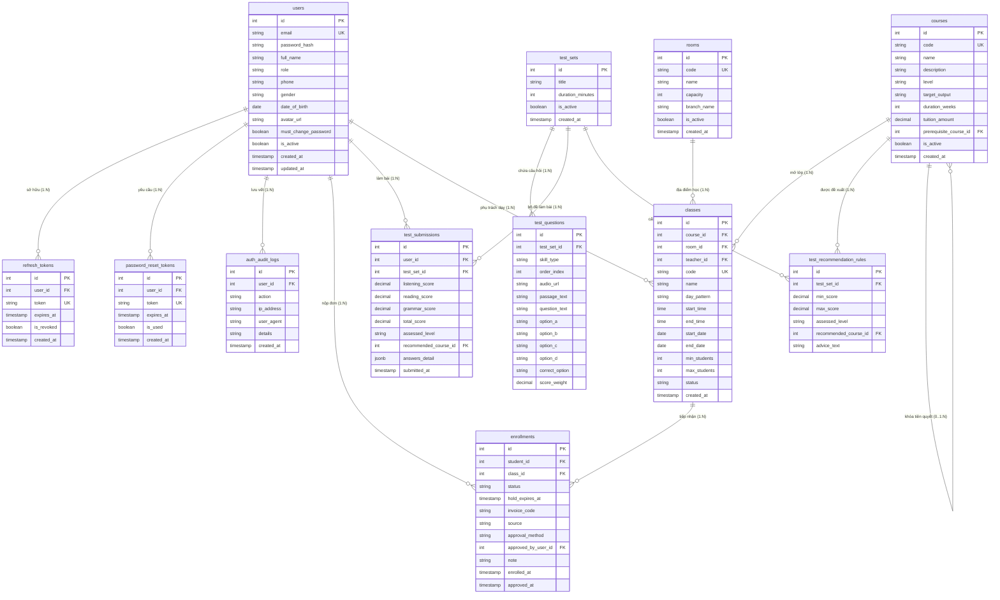

# ĐẶC TẢ CHI TIẾT CƠ SỞ DỮ LIỆU & TỪ ĐIỂN DỮ LIỆU (DATABASE SCHEMA SPECIFICATION)
## SCHEMA: `admission` (POSTGRESQL 16)

> **Dự án**: Hệ thống Quản lý Trung tâm Anh ngữ  
> **Dịch vụ phụ trách**: Admission & Identity Service (Port 8081)  
> **Hệ quản trị CSDL**: PostgreSQL 16 (Port 5432)  
> **Schema độc lập**: `admission`  
> **Phiên bản tài liệu**: 2.0 (Comprehensive Data Dictionary & Production DDL)  
> **Ngày phê duyệt**: 2026-10-28  

---

## MỤC LỤC
1. [Triết lý Thiết kế & Nguyên tắc Ranh giới (Database Design Philosophy)](#1-triết-lý-thiết-kế--nguyên-tắc-ranh-giới-database-design-philosophy)
2. [Sơ đồ Thực thể Quan hệ (Entity Relationship Diagram - Mermaid ERD)](#2-sơ-đồ-thực-thể-quan-hệ-entity-relationship-diagram---mermaid-erd)
3. [Từ điển Dữ liệu Chi tiết 12 Bảng (Comprehensive Data Dictionary)](#3-từ-điển-dữ-liệu-chi-tiết-12-bảng-comprehensive-data-dictionary)
   - 3.1. `admission.users` (Tài khoản người dùng & Phân quyền tập trung)
   - 3.2. `admission.refresh_tokens` (Quản lý JWT Refresh Token xoay vòng)
   - 3.3. `admission.password_reset_tokens` (Mã đặt lại mật khẩu qua Email)
   - 3.4. `admission.auth_audit_logs` (Nhật ký kiểm toán bảo mật & Đăng nhập)
   - 3.5. `admission.rooms` (Danh mục Phòng học & Sức chứa)
   - 3.6. `admission.courses` (Danh mục Khóa học & Lộ trình đào tạo)
   - 3.7. `admission.classes` (Lớp học, Lịch học & Kiểm soát sĩ số)
   - 3.8. `admission.enrollments` (Đơn tuyển sinh, Giữ chỗ 48h & Xét duyệt)
   - 3.9. `admission.test_sets` (Bộ đề thi khảo thí đầu vào)
   - 3.10. `admission.test_questions` (Ngân hàng câu hỏi trắc nghiệm 3 kỹ năng)
   - 3.11. `admission.test_recommendation_rules` (Ma trận quy đổi điểm sang khóa học)
   - 3.12. `admission.test_submissions` (Kết quả thi & Bài làm chi tiết JSONB)
4. [Máy trạng thái & Quy tắc Chuyển đổi (State Machines & Transition Matrix)](#4-máy-trạng-thái--quy-tắc-chuyển-đổi-state-machines--transition-matrix)
5. [Toàn văn Kịch bản DDL PostgreSQL 16 Chuẩn Production (DDL Script)](#5-toàn-văn-kịch-bản-ddl-postgresql-16-chuẩn-production-ddl-script)
6. [Bộ Dữ liệu Seed Khởi tạo Mẫu (Initial Seed Data)](#6-bộ-dữ-liệu-seed-khởi-tạo-mẫu-initial-seed-data)
7. [Chiến lược Mở rộng, Sao lưu & Tách Database (Database Ops & Scalability)](#7-chiến-lược-mở-rộng-sao-lưu--tách-database-database-ops--scalability)

---

## 1. Triết lý Thiết kế & Nguyên tắc Ranh giới (Database Design Philosophy)

### 1.1. Mô hình Schema-per-Service
Trong kiến trúc Polyglot Monorepo, database PostgreSQL 16 chứa 4 schema logic độc lập: `admission`, `student`, `learning`, `finance`. Toàn bộ 12 bảng trong tài liệu này thuộc **quyền sở hữu duy nhất** của `admission-service`.

### 1.2. Ranh giới Bất biến (Zero Cross-Schema Physical Foreign Keys)
- **Không tạo Foreign Key vật lý chéo schema**: Bảng `admission.enrollments` lưu `student_id INTEGER` dưới dạng **Khóa logic (Logical Key)**, tuyệt đối không khai báo `REFERENCES student.students(id)`.
- **Lý do kiến trúc**: Đảm bảo tính lỏng (Loose Coupling). Khi cần di dời `admission` sang một cụm server DB độc lập trong tương lai, hệ thống không bị lỗi ràng buộc khóa ngoại (Constraint Violation).
- **Tính toàn vẹn**: Được kiểm soát bởi tầng ứng dụng (Application Layer), cơ chế bắt tay REST API và bộ kiểm thử `tests/invariants/`.

### 1.3. Chuẩn hóa Định dạng Dữ liệu
- **Quy ước đặt tên**: 100% chữ thường, ngăn cách bằng dấu gạch dưới (`snake_case`). Tên bảng ở dạng số nhiều (`courses`, `classes`, `users`).
- **Thời gian**: Bắt buộc dùng `TIMESTAMPTZ` (Timestamp with Time Zone, chuẩn UTC).
- **Tiền tệ & Điểm số**: Dùng `NUMERIC(12, 2)` cho học phí (tránh sai số làm tròn của `FLOAT`) và `NUMERIC(5, 2)` cho điểm thi.

---

## 2. Sơ đồ Thực thể Quan hệ (Entity Relationship Diagram - Mermaid ERD)



---

## 3. Từ điển Dữ liệu Chi tiết 12 Bảng (Comprehensive Data Dictionary)

---

### 3.1. Bảng `admission.users`
- **Mục đích nghiệp vụ**: Lưu trữ thông tin tài khoản người dùng tập trung cho toàn bộ 4 vai trò của trung tâm (`ADMIN`, `STAFF`, `TEACHER`, `STUDENT`).

| Tên cột | Kiểu dữ liệu | Nullable | Mặc định | Ràng buộc | Diễn giải & Giá trị hợp lệ |
|---|---|:---:|---|---|---|
| `id` | `SERIAL` | NO | Auto-gen | **PK** | Mã định danh người dùng duy nhất toàn hệ thống. |
| `email` | `VARCHAR(255)` | NO | | **UK** | Email đăng nhập, định dạng chuẩn RFC 5322. |
| `password_hash` | `VARCHAR(255)` | NO | | | Mật khẩu đã được mã hóa bằng thuật toán BCrypt (độ phức tạp 12). |
| `full_name` | `VARCHAR(255)` | NO | | | Họ và tên đầy đủ của người dùng. |
| `role` | `VARCHAR(50)` | NO | | **CHECK** | Vai trò hệ thống: `ADMIN`, `STAFF`, `TEACHER`, `STUDENT`. |
| `phone` | `VARCHAR(50)` | YES | NULL | | Số điện thoại liên hệ chính thức. |
| `gender` | `VARCHAR(20)` | YES | NULL | **CHECK** | Giới tính: `MALE`, `FEMALE`, `OTHER`. |
| `date_of_birth` | `DATE` | YES | NULL | | Ngày tháng năm sinh của người dùng. |
| `avatar_url` | `TEXT` | YES | NULL | | Đường dẫn ảnh đại diện (URL tĩnh hoặc CDN). |
| `must_change_password`| `BOOLEAN` | NO | `FALSE` | | Bắt buộc đổi mật khẩu ở lần đăng nhập kế tiếp (khi Admin tạo tài khoản). |
| `is_active` | `BOOLEAN` | NO | `TRUE` | | Cờ trạng thái: `TRUE` (Hoạt động), `FALSE` (Bị khóa tài khoản). |
| `created_at` | `TIMESTAMPTZ` | NO | `CURRENT_TIMESTAMP` | | Thời điểm tạo tài khoản. |
| `updated_at` | `TIMESTAMPTZ` | NO | `CURRENT_TIMESTAMP` | | Thời điểm cập nhật hồ sơ gần nhất. |

- **Chỉ mục (Indexes)**:
  - `users_pkey`: B-Tree trên `(id)` (Primary Key).
  - `users_email_key`: Unique B-Tree trên `(email)`.
  - `idx_users_role_active`: B-Tree trên `(role, is_active)` hỗ trợ lọc nhanh danh sách nhân sự.

---

### 3.2. Bảng `admission.refresh_tokens`
- **Mục đích nghiệp vụ**: Quản lý vòng đời Refresh Token theo chiến lược JWT kép, hỗ trợ thu hồi và chống tấn công Token Replay.

| Tên cột | Kiểu dữ liệu | Nullable | Mặc định | Ràng buộc | Diễn giải |
|---|---|:---:|---|---|---|
| `id` | `SERIAL` | NO | Auto-gen | **PK** | Khóa chính bản ghi token. |
| `user_id` | `INTEGER` | NO | | **FK** | Tham chiếu `admission.users(id)` ON DELETE CASCADE. |
| `token` | `VARCHAR(255)` | NO | | **UK** | Chuỗi Refresh Token ngẫu nhiên (UUID v4 mã hóa). |
| `expires_at` | `TIMESTAMPTZ` | NO | | | Thời điểm hết hạn của token (mặc định 7 ngày kể từ lúc cấp). |
| `is_revoked` | `BOOLEAN` | NO | `FALSE` | | `TRUE` nếu token đã bị hủy (khi logout hoặc bị xoay vòng). |
| `created_at` | `TIMESTAMPTZ` | NO | `CURRENT_TIMESTAMP` | | Thời điểm phát hành token. |

- **Chỉ mục**:
  - `idx_refresh_tokens_token`: Unique B-Tree trên `(token)` phục vụ xác thực tức thì.
  - `idx_refresh_tokens_user`: B-Tree trên `(user_id)` phục vụ thu hồi hàng loạt khi đổi mật khẩu.

---

### 3.3. Bảng `admission.password_reset_tokens`
- **Mục đích nghiệp vụ**: Lưu trữ mã token 1 lần (One-Time Token) phục vụ quy trình quên mật khẩu qua email.

| Tên cột | Kiểu dữ liệu | Nullable | Mặc định | Ràng buộc | Diễn giải |
|---|---|:---:|---|---|---|
| `id` | `SERIAL` | NO | Auto-gen | **PK** | Khóa chính bản ghi. |
| `user_id` | `INTEGER` | NO | | **FK** | Tham chiếu `admission.users(id)` ON DELETE CASCADE. |
| `token` | `VARCHAR(255)` | NO | | **UK** | Token đặt lại mật khẩu ngẫu nhiên (SHA-256 hex). |
| `expires_at` | `TIMESTAMPTZ` | NO | | | Hạn sử dụng token (15 phút kể từ lúc gửi yêu cầu). |
| `is_used` | `BOOLEAN` | NO | `FALSE` | | `TRUE` nếu đã được sử dụng đổi mật khẩu thành công. |
| `created_at` | `TIMESTAMPTZ` | NO | `CURRENT_TIMESTAMP` | | Thời điểm tạo yêu cầu. |

---

### 3.4. Bảng `admission.auth_audit_logs`
- **Mục đích nghiệp vụ**: Lưu vết toàn bộ hoạt động đăng nhập, đổi mật khẩu và vi phạm bảo mật phục vụ kiểm toán và điều tra sự cố.

| Tên cột | Kiểu dữ liệu | Nullable | Mặc định | Ràng buộc | Diễn giải |
|---|---|:---:|---|---|---|
| `id` | `SERIAL` | NO | Auto-gen | **PK** | Khóa chính dòng log. |
| `user_id` | `INTEGER` | YES | NULL | **FK** | Tham chiếu `admission.users(id)` ON DELETE SET NULL. |
| `action` | `VARCHAR(50)` | NO | | **CHECK** | `LOGIN_SUCCESS`, `LOGIN_FAILED`, `REFRESH_TOKEN`, `LOGOUT`, `PASSWORD_CHANGED`, `ACCOUNT_LOCKED`. |
| `ip_address` | `VARCHAR(50)` | YES | NULL | | Địa chỉ IP của client (IPv4/IPv6). |
| `user_agent` | `TEXT` | YES | NULL | | Thông tin trình duyệt và thiết bị của người dùng. |
| `details` | `TEXT` | YES | NULL | | Chi tiết sự kiện (ví dụ: "Sai mật khẩu lần 3"). |
| `created_at` | `TIMESTAMPTZ` | NO | `CURRENT_TIMESTAMP` | | Thời điểm xảy ra sự kiện. |

- **Chỉ mục**: `idx_audit_user_created` trên `(user_id, created_at)` phục vụ dashboard bảo mật.

---

### 3.5. Bảng `admission.rooms`
- **Mục đích nghiệp vụ**: Quản lý danh mục phòng học, sức chứa vật lý tối đa tại các cơ sở đào tạo.

| Tên cột | Kiểu dữ liệu | Nullable | Mặc định | Ràng buộc | Diễn giải |
|---|---|:---:|---|---|---|
| `id` | `SERIAL` | NO | Auto-gen | **PK** | Khóa chính phòng học. |
| `code` | `VARCHAR(50)` | NO | | **UK** | Mã phòng học duy nhất (ví dụ: `P101`, `LAB-02`). |
| `name` | `VARCHAR(100)` | NO | | | Tên phòng học hiển thị (ví dụ: `Phòng Hội thảo 101`). |
| `capacity` | `INTEGER` | NO | | **CHECK** | Sức chứa tối đa của phòng (`capacity > 0`). |
| `branch_name` | `VARCHAR(100)` | NO | `'Cơ sở chính'`| | Tên chi nhánh / cơ sở đặt phòng học. |
| `is_active` | `BOOLEAN` | NO | `TRUE` | | Cờ trạng thái: `TRUE` (Đang sử dụng), `FALSE` (Bảo trì). |
| `created_at` | `TIMESTAMPTZ` | NO | `CURRENT_TIMESTAMP` | | Ngày tạo phòng học. |

---

### 3.6. Bảng `admission.courses`
- **Mục đích nghiệp vụ**: Định nghĩa danh mục khóa học, chuẩn đầu ra, học phí và lộ trình đào tạo tiên quyết.

| Tên cột | Kiểu dữ liệu | Nullable | Mặc định | Ràng buộc | Diễn giải |
|---|---|:---:|---|---|---|
| `id` | `SERIAL` | NO | Auto-gen | **PK** | Khóa chính khóa học. |
| `code` | `VARCHAR(50)` | NO | | **UK** | Mã khóa học duy nhất toàn hệ thống (`INV-ADM-02`). |
| `name` | `VARCHAR(255)` | NO | | | Tên khóa học đầy đủ (ví dụ: `IELTS Intensive 6.5+`). |
| `description` | `TEXT` | YES | NULL | | Mô tả chi tiết nội dung chương trình đào tạo. |
| `level` | `VARCHAR(50)` | NO | | **CHECK** | Trình độ: `Beginner`, `Intermediate`, `Advanced`. |
| `target_output`| `VARCHAR(100)` | YES | NULL | | Chuẩn đầu ra cam kết (ví dụ: `IELTS 6.5+`, `B2 CEFR`). |
| `duration_weeks`| `INTEGER` | NO | `12` | **CHECK** | Thời lượng đào tạo tính theo tuần (`duration_weeks > 0`). |
| `tuition_amount`| `NUMERIC(12, 2)`| NO | `0.00` | **CHECK** | Học phí niêm yết chuẩn (`tuition_amount >= 0`). |
| `prerequisite_course_id` | `INTEGER` | YES | NULL | **FK** | Khóa học tiên quyết trỏ về `courses(id)` ON DELETE SET NULL. |
| `is_active` | `BOOLEAN` | NO | `TRUE` | | `TRUE` (Cho phép mở lớp), `FALSE` (Ngừng tuyển sinh). |
| `created_at` | `TIMESTAMPTZ` | NO | `CURRENT_TIMESTAMP` | | Ngày tạo khóa học. |

---

### 3.7. Bảng `admission.classes`
- **Mục đích nghiệp vụ**: Quản lý các lớp học được mở, phân công phòng, giáo viên, lịch học và kiểm soát sĩ số trần (`max_students`).

| Tên cột | Kiểu dữ liệu | Nullable | Mặc định | Ràng buộc | Diễn giải |
|---|---|:---:|---|---|---|
| `id` | `SERIAL` | NO | Auto-gen | **PK** | Khóa chính lớp học. |
| `course_id` | `INTEGER` | NO | | **FK** | Khóa học thuộc về trỏ sang `courses(id)` ON DELETE RESTRICT. |
| `room_id` | `INTEGER` | YES | NULL | **FK** | Phòng học trỏ sang `rooms(id)` ON DELETE RESTRICT. |
| `teacher_id` | `INTEGER` | YES | NULL | **FK** | Giáo viên phụ trách trỏ sang `users(id)` ON DELETE RESTRICT. |
| `code` | `VARCHAR(50)` | NO | | **UK** | Mã lớp học duy nhất (ví dụ: `CLS-IELTS-01`). |
| `name` | `VARCHAR(255)` | NO | | | Tên lớp học hiển thị. |
| `day_pattern` | `VARCHAR(50)` | NO | | **CHECK** | Lịch thứ: `MON_WED_FRI`, `TUE_THU_SAT`, `SAT_SUN`, `DAILY`, `CUSTOM`. |
| `start_time` | `TIME` | NO | | | Khung giờ bắt đầu học (ví dụ: `18:00:00`). |
| `end_time` | `TIME` | NO | | | Khung giờ kết thúc học (ví dụ: `19:30:00`). |
| `start_date` | `DATE` | NO | | | Ngày khai giảng khóa học. |
| `end_date` | `DATE` | NO | | | Ngày bế giảng dự kiến. |
| `min_students` | `INTEGER` | NO | `10` | **CHECK** | Sĩ số tối thiểu để đủ điều kiện mở lớp (`min_students > 0`). |
| `max_students` | `INTEGER` | NO | `25` | **CHECK** | Sĩ số tối đa tuyệt đối không được vượt quá (`max_students >= min_students`). |
| `status` | `VARCHAR(50)` | NO | `'OPEN'` | **CHECK** | `OPEN` (Tuyển sinh), `IN_PROGRESS` (Đang học), `COMPLETED` (Bế giảng), `CANCELLED` (Hủy). |
| `created_at` | `TIMESTAMPTZ` | NO | `CURRENT_TIMESTAMP` | | Ngày tạo lớp học. |

- **Chỉ mục**: `idx_classes_schedule` trên `(room_id, teacher_id, day_pattern, start_date, end_date)` phục vụ thuật toán Conflict Engine.

---

### 3.8. Bảng `admission.enrollments`
- **Mục đích nghiệp vụ**: Quản lý đơn đăng ký nhập học, hạn giữ chỗ 48h (`hold_expires_at`) và trạng thái xét duyệt chính thức.

| Tên cột | Kiểu dữ liệu | Nullable | Mặc định | Ràng buộc | Diễn giải |
|---|---|:---:|---|---|---|
| `id` | `SERIAL` | NO | Auto-gen | **PK** | Khóa chính đơn đăng ký. |
| `student_id` | `INTEGER` | NO | | **FK** | Học viên đăng ký trỏ sang `users(id)` ON DELETE RESTRICT. |
| `class_id` | `INTEGER` | NO | | **FK** | Lớp học đăng ký trỏ sang `classes(id)` ON DELETE RESTRICT. |
| `status` | `VARCHAR(50)` | NO | `'PENDING'`| **CHECK** | `PENDING`, `APPROVED`, `REJECTED`, `EXPIRED`, `CANCELLED`, `CANCELLED_REFUND_PENDING`. |
| `hold_expires_at` | `TIMESTAMPTZ` | YES | NULL | | Thời điểm hết hạn giữ slot (mặc định tạo đơn + 48h). |
| `invoice_code` | `VARCHAR(50)` | YES | NULL | | Mã hóa đơn tham chiếu chéo sang `finance.invoices(invoice_code)`. |
| `source` | `VARCHAR(50)` | NO | `'ONLINE'`| **CHECK** | Kênh nguồn: `ONLINE`, `WALK_IN`, `HOTLINE`, `FANPAGE`, `REFERRAL`. |
| `approval_method`| `VARCHAR(50)` | YES | NULL | **CHECK** | Phương thức duyệt: `ONLINE_PAYMENT`, `MANUAL_CASH`, `STAFF_OVERRIDE`. |
| `approved_by_user_id`| `INTEGER` | YES | NULL | **FK** | Nhân viên học vụ duyệt trỏ sang `users(id)`. |
| `note` | `TEXT` | YES | NULL | | Ghi chú học vụ hoặc lý do từ chối/hủy đơn. |
| `enrolled_at` | `TIMESTAMPTZ` | NO | `CURRENT_TIMESTAMP` | | Ngày nộp đơn đăng ký. |
| `approved_at` | `TIMESTAMPTZ` | YES | NULL | | Ngày chính thức được duyệt vào sĩ số lớp. |

- **Chỉ mục**: `idx_enrollments_status_hold` trên `(class_id, status, hold_expires_at)` phục vụ đếm slot và Job quét quá hạn.

---

### 3.9. Bảng `admission.test_sets`
- **Mục đích nghiệp vụ**: Quản lý các bộ đề thi khảo thí phân loại trình độ đầu vào trực tuyến.

| Tên cột | Kiểu dữ liệu | Nullable | Mặc định | Ràng buộc | Diễn giải |
|---|---|:---:|---|---|---|
| `id` | `SERIAL` | NO | Auto-gen | **PK** | Khóa chính bộ đề thi. |
| `title` | `VARCHAR(255)` | NO | | | Tên bộ đề (ví dụ: `Đề Khảo thí Tiếng Anh Tổng Quát 2026`). |
| `duration_minutes` | `INTEGER` | NO | `45` | **CHECK** | Thời gian làm bài đếm ngược tính theo phút (`duration_minutes > 0`). |
| `is_active` | `BOOLEAN` | NO | `TRUE` | | Cờ trạng thái cho phép thí sinh làm bài thi. |
| `created_at` | `TIMESTAMPTZ` | NO | `CURRENT_TIMESTAMP` | | Ngày tạo bộ đề. |

---

### 3.10. Bảng `admission.test_questions`
- **Mục đích nghiệp vụ**: Lưu trữ câu hỏi trắc nghiệm chia thành 3 phần kỹ năng (*Listening, Reading, Grammar*).

| Tên cột | Kiểu dữ liệu | Nullable | Mặc định | Ràng buộc | Diễn giải |
|---|---|:---:|---|---|---|
| `id` | `SERIAL` | NO | Auto-gen | **PK** | Khóa chính câu hỏi. |
| `test_set_id` | `INTEGER` | NO | | **FK** | Thuộc bộ đề thi nào trỏ sang `test_sets(id)` ON DELETE CASCADE. |
| `skill_type` | `VARCHAR(50)` | NO | | **CHECK** | Kỹ năng: `LISTENING`, `READING`, `GRAMMAR`. |
| `order_index` | `INTEGER` | NO | `1` | | Số thứ tự hiển thị câu hỏi trong đề thi. |
| `audio_url` | `TEXT` | YES | NULL | | Đường dẫn file âm thanh MP3 (chỉ dùng cho `LISTENING`). |
| `passage_text` | `TEXT` | YES | NULL | | Đoạn văn đọc hiểu (chỉ dùng cho `READING`). |
| `question_text`| `TEXT` | NO | | | Nội dung câu hỏi trắc nghiệm. |
| `option_a` | `TEXT` | NO | | | Lựa chọn A. |
| `option_b` | `TEXT` | NO | | | Lựa chọn B. |
| `option_c` | `TEXT` | NO | | | Lựa chọn C. |
| `option_d` | `TEXT` | NO | | | Lựa chọn D. |
| `correct_option`| `CHAR(1)` | NO | | **CHECK** | Đáp án đúng: `A`, `B`, `C`, `D` (Ẩn với client khi thi). |
| `score_weight` | `NUMERIC(4, 2)`| NO | `1.00` | **CHECK** | Trọng số điểm của câu hỏi (`score_weight > 0`). |

- **Chỉ mục**: `idx_test_questions_set_skill` trên `(test_set_id, skill_type, order_index)`.

---

### 3.11. Bảng `admission.test_recommendation_rules`
- **Mục đích nghiệp vụ**: Bảng quy đổi ma trận ngưỡng điểm sang khóa học phù hợp được khuyến nghị tự động.

| Tên cột | Kiểu dữ liệu | Nullable | Mặc định | Ràng buộc | Diễn giải |
|---|---|:---:|---|---|---|
| `id` | `SERIAL` | NO | Auto-gen | **PK** | Khóa chính quy tắc. |
| `test_set_id` | `INTEGER` | NO | | **FK** | Áp dụng cho bộ đề trỏ sang `test_sets(id)` ON DELETE CASCADE. |
| `min_score` | `NUMERIC(5, 2)`| NO | | | Ngưỡng điểm tối thiểu của khoảng (`min_score >= 0`). |
| `max_score` | `NUMERIC(5, 2)`| NO | | | Ngưỡng điểm tối đa của khoảng (`max_score >= min_score`). |
| `assessed_level`| `VARCHAR(50)` | NO | | | Đánh giá trình độ tương ứng (ví dụ: `A2`, `B1`, `IELTS 5.0`). |
| `recommended_course_id`| `INTEGER`| NO | | **FK** | Khóa học khuyến nghị trỏ sang `courses(id)` ON DELETE CASCADE. |
| `advice_text` | `TEXT` | YES | NULL | | Lời khuyên định hướng học tập chi tiết gửi cho thí sinh. |

---

### 3.12. Bảng `admission.test_submissions`
- **Mục đích nghiệp vụ**: Lưu trữ kết quả khảo thí, điểm chi tiết từng kỹ năng và bản lưu toàn bộ câu trả lời dạng JSONB.

| Tên cột | Kiểu dữ liệu | Nullable | Mặc định | Ràng buộc | Diễn giải |
|---|---|:---:|---|---|---|
| `id` | `SERIAL` | NO | Auto-gen | **PK** | Khóa chính kết quả bài thi. |
| `user_id` | `INTEGER` | NO | | **FK** | Thí sinh trỏ sang `users(id)` ON DELETE CASCADE. |
| `test_set_id` | `INTEGER` | NO | | **FK** | Bộ đề thi đã làm trỏ sang `test_sets(id)` ON DELETE RESTRICT. |
| `listening_score`| `NUMERIC(5, 2)`| NO | `0.00` | | Tổng điểm phần Listening đạt được. |
| `reading_score` | `NUMERIC(5, 2)`| NO | `0.00` | | Tổng điểm phần Reading đạt được. |
| `grammar_score` | `NUMERIC(5, 2)`| NO | `0.00` | | Tổng điểm phần Grammar đạt được. |
| `total_score` | `NUMERIC(5, 2)`| NO | | | Tổng điểm chung kết của bài thi. |
| `assessed_level`| `VARCHAR(50)` | YES | NULL | | Trình độ đạt được sau quy đổi. |
| `recommended_course_id`| `INTEGER`| YES | NULL | **FK** | Khóa học được hệ thống đề xuất trỏ sang `courses(id)`. |
| `answers_detail`| `JSONB` | YES | NULL | | Chi tiết toàn bộ đáp án thí sinh đã chọn phục vụ phúc khảo. |
| `submitted_at` | `TIMESTAMPTZ` | NO | `CURRENT_TIMESTAMP` | | Thời điểm nộp bài thi. |

---

## 4. Máy trạng thái & Quy tắc Chuyển đổi (State Machines & Transition Matrix)

### 4.1. Máy Trạng thái Đơn Đăng ký (`admission.enrollments.status`)

| Trạng thái Hiện tại | Trạng thái Mục tiêu Hợp lệ | Tác nhân / Sự kiện Kích hoạt | Hành vi Hệ thống |
|---|---|---|---|
| `(Khởi tạo)` | `PENDING` | Học viên hoặc Học vụ tạo đơn | Kiểm tra `available_slots > 0`, gán `hold_expires_at = NOW + 48h`, sinh hóa đơn UNPAID bên Finance. |
| `PENDING` | `APPROVED` | Finance báo callback `PAID` hoặc Học vụ duyệt tiền mặt (`approve-manual`) | Khóa bi quan kiểm tra sĩ số, chốt vị trí trong lớp, tự động gọi Student Service tạo hồ sơ học viên. |
| `PENDING` | `EXPIRED` | Scheduled Job quét quá 48h | Tự động giải phóng slot về cho lớp, gửi lệnh hủy hóa đơn quá hạn bên Finance. |
| `PENDING` | `CANCELLED` | Học viên chủ động hủy đơn trước khi thanh toán | Hủy giữ chỗ, giải phóng slot. |
| `PENDING` | `REJECTED` | Học vụ từ chối tiếp nhận (không hợp lệ) | Ghi lý do từ chối vào `note`, giải phóng slot. |
| `APPROVED` | `CANCELLED_REFUND_PENDING` | Lớp học bị hủy do thiếu sĩ số (`min_students`) | Gửi thông báo hoàn phí hoặc bảo lưu cọc sang Finance Service. |
| `CANCELLED` | `APPROVED` | **BỊ CẤM TUYỆT ĐỐI (`INV-ADM-03`)** | Ném lỗi `ADM_INVALID_STATE_TRANSITION`. Đơn đã hủy bắt buộc phải tạo đơn mới. |

---

## 5. Toàn văn Kịch bản DDL PostgreSQL 16 Chuẩn Production (DDL Script)

```sql
-- ============================================================================
-- DDL SCRIPT: ADMISSION & IDENTITY SERVICE (PostgreSQL 16)
-- ============================================================================

-- 1. Khởi tạo Schema
CREATE SCHEMA IF NOT EXISTS admission;

-- 2. Bảng Người dùng & Phân quyền
CREATE TABLE admission.users (
    id SERIAL PRIMARY KEY,
    email VARCHAR(255) UNIQUE NOT NULL,
    password_hash VARCHAR(255) NOT NULL,
    full_name VARCHAR(255) NOT NULL,
    role VARCHAR(50) NOT NULL CHECK (role IN ('ADMIN', 'STAFF', 'TEACHER', 'STUDENT')),
    phone VARCHAR(50),
    gender VARCHAR(20) CHECK (gender IN ('MALE', 'FEMALE', 'OTHER')),
    date_of_birth DATE,
    avatar_url TEXT,
    must_change_password BOOLEAN DEFAULT FALSE,
    is_active BOOLEAN DEFAULT TRUE,
    created_at TIMESTAMPTZ DEFAULT CURRENT_TIMESTAMP,
    updated_at TIMESTAMPTZ DEFAULT CURRENT_TIMESTAMP
);

-- 3. Bảng Refresh Token
CREATE TABLE admission.refresh_tokens (
    id SERIAL PRIMARY KEY,
    user_id INTEGER NOT NULL REFERENCES admission.users(id) ON DELETE CASCADE,
    token VARCHAR(255) UNIQUE NOT NULL,
    expires_at TIMESTAMPTZ NOT NULL,
    is_revoked BOOLEAN DEFAULT FALSE,
    created_at TIMESTAMPTZ DEFAULT CURRENT_TIMESTAMP
);

-- 4. Bảng Đặt lại Mật khẩu qua Email
CREATE TABLE admission.password_reset_tokens (
    id SERIAL PRIMARY KEY,
    user_id INTEGER NOT NULL REFERENCES admission.users(id) ON DELETE CASCADE,
    token VARCHAR(255) UNIQUE NOT NULL,
    expires_at TIMESTAMPTZ NOT NULL,
    is_used BOOLEAN DEFAULT FALSE,
    created_at TIMESTAMPTZ DEFAULT CURRENT_TIMESTAMP
);

-- 5. Bảng Nhật ký Kiểm toán Đăng nhập & Bảo mật
CREATE TABLE admission.auth_audit_logs (
    id SERIAL PRIMARY KEY,
    user_id INTEGER REFERENCES admission.users(id) ON DELETE SET NULL,
    action VARCHAR(50) NOT NULL CHECK (action IN ('LOGIN_SUCCESS', 'LOGIN_FAILED', 'REFRESH_TOKEN', 'LOGOUT', 'PASSWORD_CHANGED', 'ACCOUNT_LOCKED')),
    ip_address VARCHAR(50),
    user_agent TEXT,
    details TEXT,
    created_at TIMESTAMPTZ DEFAULT CURRENT_TIMESTAMP
);

-- 6. Bảng Danh mục Phòng học
CREATE TABLE admission.rooms (
    id SERIAL PRIMARY KEY,
    code VARCHAR(50) UNIQUE NOT NULL,
    name VARCHAR(100) NOT NULL,
    capacity INTEGER NOT NULL CHECK (capacity > 0),
    branch_name VARCHAR(100) DEFAULT 'Cơ sở chính',
    is_active BOOLEAN DEFAULT TRUE,
    created_at TIMESTAMPTZ DEFAULT CURRENT_TIMESTAMP
);

-- 7. Bảng Khóa học & Lộ trình Đào tạo
CREATE TABLE admission.courses (
    id SERIAL PRIMARY KEY,
    code VARCHAR(50) UNIQUE NOT NULL,
    name VARCHAR(255) NOT NULL,
    description TEXT,
    level VARCHAR(50) NOT NULL CHECK (level IN ('Beginner', 'Intermediate', 'Advanced')),
    target_output VARCHAR(100),
    duration_weeks INTEGER NOT NULL CHECK (duration_weeks > 0),
    tuition_amount NUMERIC(12, 2) NOT NULL CHECK (tuition_amount >= 0),
    prerequisite_course_id INTEGER REFERENCES admission.courses(id) ON DELETE SET NULL,
    is_active BOOLEAN DEFAULT TRUE,
    created_at TIMESTAMPTZ DEFAULT CURRENT_TIMESTAMP
);

-- 8. Bảng Lớp học & Thời khóa biểu
CREATE TABLE admission.classes (
    id SERIAL PRIMARY KEY,
    course_id INTEGER NOT NULL REFERENCES admission.courses(id) ON DELETE RESTRICT,
    room_id INTEGER REFERENCES admission.rooms(id) ON DELETE RESTRICT,
    teacher_id INTEGER REFERENCES admission.users(id) ON DELETE RESTRICT,
    code VARCHAR(50) UNIQUE NOT NULL,
    name VARCHAR(255) NOT NULL,
    day_pattern VARCHAR(50) NOT NULL CHECK (day_pattern IN ('MON_WED_FRI', 'TUE_THU_SAT', 'SAT_SUN', 'DAILY', 'CUSTOM')),
    start_time TIME NOT NULL,
    end_time TIME NOT NULL,
    start_date DATE NOT NULL,
    end_date DATE NOT NULL,
    min_students INTEGER DEFAULT 10 CHECK (min_students > 0),
    max_students INTEGER DEFAULT 25 CHECK (max_students >= min_students),
    status VARCHAR(50) DEFAULT 'OPEN' CHECK (status IN ('OPEN', 'IN_PROGRESS', 'COMPLETED', 'CANCELLED')),
    created_at TIMESTAMPTZ DEFAULT CURRENT_TIMESTAMP
);

-- 9. Bảng Tuyển sinh & Giữ chỗ 48h
CREATE TABLE admission.enrollments (
    id SERIAL PRIMARY KEY,
    student_id INTEGER NOT NULL REFERENCES admission.users(id) ON DELETE RESTRICT,
    class_id INTEGER NOT NULL REFERENCES admission.classes(id) ON DELETE RESTRICT,
    status VARCHAR(50) DEFAULT 'PENDING' CHECK (status IN ('PENDING', 'APPROVED', 'REJECTED', 'EXPIRED', 'CANCELLED', 'CANCELLED_REFUND_PENDING')),
    hold_expires_at TIMESTAMPTZ,
    invoice_code VARCHAR(50),
    source VARCHAR(50) DEFAULT 'ONLINE' CHECK (source IN ('ONLINE', 'WALK_IN', 'HOTLINE', 'FANPAGE', 'REFERRAL')),
    approval_method VARCHAR(50) CHECK (approval_method IN ('ONLINE_PAYMENT', 'MANUAL_CASH', 'STAFF_OVERRIDE')),
    approved_by_user_id INTEGER REFERENCES admission.users(id),
    note TEXT,
    enrolled_at TIMESTAMPTZ DEFAULT CURRENT_TIMESTAMP,
    approved_at TIMESTAMPTZ
);

-- 10. Bảng Đề thi Khảo thí Đầu vào
CREATE TABLE admission.test_sets (
    id SERIAL PRIMARY KEY,
    title VARCHAR(255) NOT NULL,
    duration_minutes INTEGER NOT NULL DEFAULT 45 CHECK (duration_minutes > 0),
    is_active BOOLEAN DEFAULT TRUE,
    created_at TIMESTAMPTZ DEFAULT CURRENT_TIMESTAMP
);

-- 11. Bảng Câu hỏi Khảo thí 3 Kỹ năng
CREATE TABLE admission.test_questions (
    id SERIAL PRIMARY KEY,
    test_set_id INTEGER NOT NULL REFERENCES admission.test_sets(id) ON DELETE CASCADE,
    skill_type VARCHAR(50) NOT NULL CHECK (skill_type IN ('LISTENING', 'READING', 'GRAMMAR')),
    order_index INTEGER NOT NULL DEFAULT 1,
    audio_url TEXT,
    passage_text TEXT,
    question_text TEXT NOT NULL,
    option_a TEXT NOT NULL,
    option_b TEXT NOT NULL,
    option_c TEXT NOT NULL,
    option_d TEXT NOT NULL,
    correct_option CHAR(1) NOT NULL CHECK (correct_option IN ('A', 'B', 'C', 'D')),
    score_weight NUMERIC(4, 2) DEFAULT 1.0 CHECK (score_weight > 0)
);

-- 12. Bảng Ma trận Quy đổi Điểm sang Khóa học Khuyến nghị
CREATE TABLE admission.test_recommendation_rules (
    id SERIAL PRIMARY KEY,
    test_set_id INTEGER NOT NULL REFERENCES admission.test_sets(id) ON DELETE CASCADE,
    min_score NUMERIC(5, 2) NOT NULL,
    max_score NUMERIC(5, 2) NOT NULL,
    assessed_level VARCHAR(50) NOT NULL,
    recommended_course_id INTEGER NOT NULL REFERENCES admission.courses(id) ON DELETE CASCADE,
    advice_text TEXT
);

-- 13. Bảng Kết quả Làm bài Test Đầu vào
CREATE TABLE admission.test_submissions (
    id SERIAL PRIMARY KEY,
    user_id INTEGER NOT NULL REFERENCES admission.users(id) ON DELETE CASCADE,
    test_set_id INTEGER NOT NULL REFERENCES admission.test_sets(id) ON DELETE RESTRICT,
    listening_score NUMERIC(5, 2) DEFAULT 0.0,
    reading_score NUMERIC(5, 2) DEFAULT 0.0,
    grammar_score NUMERIC(5, 2) DEFAULT 0.0,
    total_score NUMERIC(5, 2) NOT NULL,
    assessed_level VARCHAR(50),
    recommended_course_id INTEGER REFERENCES admission.courses(id),
    answers_detail JSONB,
    submitted_at TIMESTAMPTZ DEFAULT CURRENT_TIMESTAMP
);

-- 14. Chỉ mục Tối ưu Hiệu năng (Indexes)
CREATE INDEX idx_classes_schedule ON admission.classes (room_id, teacher_id, day_pattern, start_date, end_date);
CREATE INDEX idx_enrollments_status_hold ON admission.enrollments (class_id, status, hold_expires_at);
CREATE INDEX idx_audit_user_created ON admission.auth_audit_logs (user_id, created_at);
CREATE INDEX idx_test_questions_set_skill ON admission.test_questions (test_set_id, skill_type, order_index);
```

---

## 6. Bộ Dữ liệu Seed Khởi tạo Mẫu (Initial Seed Data)

```sql
-- 1. Người dùng mẫu các vai trò (Mật khẩu băm chuẩn hoặc demo: '123456')
INSERT INTO admission.users (email, password_hash, full_name, role, phone)
VALUES 
    ('admin@english.edu.vn', '$2a$12$K8yXvL3C3.w3bA/1P1Z5m.qj7PZp1R5cT0kL1V4uQ1z0X0Y0Z0W0a', 'Quản Trị Viên', 'ADMIN', '0901234567'),
    ('staff@english.edu.vn', '$2a$12$K8yXvL3C3.w3bA/1P1Z5m.qj7PZp1R5cT0kL1V4uQ1z0X0Y0Z0W0a', 'Nguyễn Thị Học Vụ', 'STAFF', '0902345678'),
    ('teacher@english.edu.vn', '$2a$12$K8yXvL3C3.w3bA/1P1Z5m.qj7PZp1R5cT0kL1V4uQ1z0X0Y0Z0W0a', 'Thầy John Smith', 'TEACHER', '0903456789'),
    ('student@english.edu.vn', '$2a$12$K8yXvL3C3.w3bA/1P1Z5m.qj7PZp1R5cT0kL1V4uQ1z0X0Y0Z0W0a', 'Trần Văn Nam', 'STUDENT', '0904567890')
ON CONFLICT (email) DO NOTHING;

-- 2. Phòng học mẫu
INSERT INTO admission.rooms (code, name, capacity, branch_name)
VALUES
    ('P101', 'Phòng 101 - Cơ sở 1', 25, 'Cơ sở chính Cầu Giấy'),
    ('P201', 'Phòng 201 - Cơ sở 1', 20, 'Cơ sở chính Cầu Giấy'),
    ('P302', 'Phòng 302 - Cơ sở 1', 18, 'Cơ sở chính Cầu Giấy')
ON CONFLICT (code) DO NOTHING;

-- 3. Khóa học mẫu
INSERT INTO admission.courses (code, name, description, level, target_output, duration_weeks, tuition_amount)
VALUES 
    ('ENG-IELTS-FOUND', 'IELTS Foundation 4.5 - 5.5', 'Xây dựng nền tảng ngữ pháp, từ vựng và 4 kỹ năng cơ bản.', 'Intermediate', 'IELTS 5.0 - 5.5', 12, 6500000),
    ('ENG-IELTS-INT', 'IELTS Intensive 6.5+', 'Luyện đề chuyên sâu và chiến thuật làm bài thi thật.', 'Advanced', 'IELTS 6.5 - 7.5', 14, 8500000),
    ('ENG-TOEIC-600', 'TOEIC Cấp Tốc 600+', 'Ôn thi TOEIC nghe đọc cấp tốc chuẩn format ETS.', 'Intermediate', 'TOEIC 600 - 700', 8, 4200000),
    ('ENG-COMM-BAS', 'Tiếng Anh Giao Tiếp Phản Xạ', 'Rèn luyện phát âm chuẩn IPA và tự tin giao tiếp hàng ngày.', 'Beginner', 'A2 - B1 CEFR', 10, 3800000)
ON CONFLICT (code) DO NOTHING;

-- 4. Lớp học mẫu
INSERT INTO admission.classes (course_id, room_id, teacher_id, code, name, day_pattern, start_time, end_time, start_date, end_date, max_students, status)
VALUES 
    (1, 2, 3, 'CLS-IELTS-01', 'IELTS Foundation K28', 'MON_WED_FRI', '18:00:00', '19:30:00', '2026-11-01', '2027-01-25', 20, 'OPEN'),
    (2, 3, 3, 'CLS-IELTS-02', 'IELTS Intensive K15', 'TUE_THU_SAT', '19:30:00', '21:00:00', '2026-11-05', '2027-02-15', 18, 'OPEN')
ON CONFLICT (code) DO NOTHING;

-- 5. Bộ đề thi khảo thí & Câu hỏi mẫu
INSERT INTO admission.test_sets (id, title, duration_minutes)
VALUES (1, 'Bài Khảo thí Trình độ Đầu vào Tổng quát', 45)
ON CONFLICT (id) DO NOTHING;

INSERT INTO admission.test_questions (test_set_id, skill_type, order_index, question_text, option_a, option_b, option_c, option_d, correct_option, score_weight)
VALUES
    (1, 'GRAMMAR', 1, 'She ______ to the English center every Monday.', 'go', 'goes', 'went', 'going', 'B', 1.0),
    (1, 'GRAMMAR', 2, 'If I ______ enough money, I would take the IELTS Intensive course.', 'have', 'had', 'will have', 'having', 'B', 1.0)
ON CONFLICT DO NOTHING;

-- 6. Ma trận khuyến nghị khóa học
INSERT INTO admission.test_recommendation_rules (test_set_id, min_score, max_score, assessed_level, recommended_course_id, advice_text)
VALUES
    (1, 0.0, 49.9, 'Beginner', 4, 'Bạn nên bắt đầu với khóa Tiếng Anh Giao Tiếp Phản Xạ để lấy lại căn bản phát âm và ngữ pháp.'),
    (1, 50.0, 74.9, 'Intermediate', 1, 'Trình độ hiện tại phù hợp với khóa IELTS Foundation 4.5 - 5.5 để bắt đầu luyện kỹ năng thi.'),
    (1, 75.0, 100.0, 'Advanced', 2, 'Bạn có nền tảng rất vững! Hãy đăng ký ngay khóa IELTS Intensive 6.5+ để bứt phá band điểm.')
ON CONFLICT DO NOTHING;
```

---

## 7. Chiến lược Mở rộng, Sao lưu & Tách Database (Database Ops & Scalability)

### 7.1. Độc lập Hoàn toàn (Zero-Coupling Verification)
Vì không có bất kỳ Foreign Key vật lý nào trỏ sang các schema `student`, `learning`, `finance`, bạn có thể xuất toàn bộ schema `admission` thành một file SQL độc lập chỉ bằng một dòng lệnh:
```bash
pg_dump -U postgres -d english_center -n admission -F p -f admission_schema_backup.sql
```
File này có thể mang sang một PostgreSQL server hoàn toàn mới (ví dụ Amazon RDS riêng biệt) và chạy lệnh `psql` để phục hồi 100% dữ liệu mà **không hề báo lỗi thiếu bảng hay khóa ngoại**.

### 7.2. Chính sách Lưu trữ Dữ liệu Lớn (Data Retention & Archiving)
- **Bảng `auth_audit_logs`**: Sau 1 năm vận hành, dữ liệu log có thể đạt hàng triệu dòng. Khuyến nghị áp dụng tính năng **Table Partitioning theo tháng (`PARTITION BY RANGE (created_at)`)** của PostgreSQL 16 để duy trì tốc độ truy vấn cao.
- **Bảng `enrollments`**: Các đơn ở trạng thái `EXPIRED` hoặc `CANCELLED` quá 6 tháng có thể được di chuyển sang bảng lưu trữ lạnh `admission.archived_enrollments` để tối ưu kích thước bảng chính.
