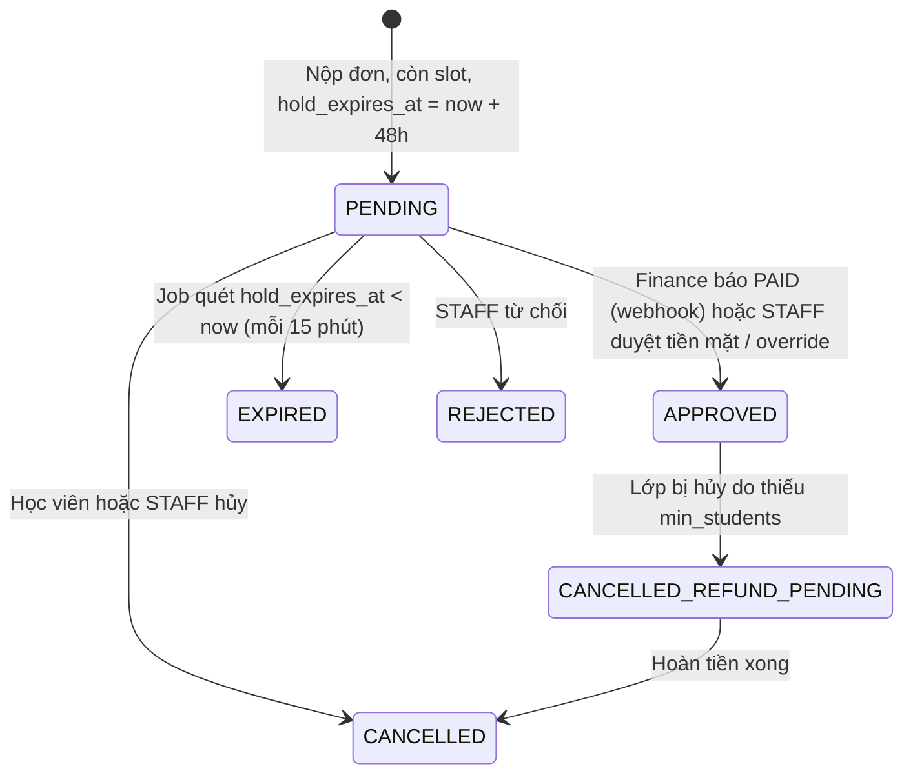
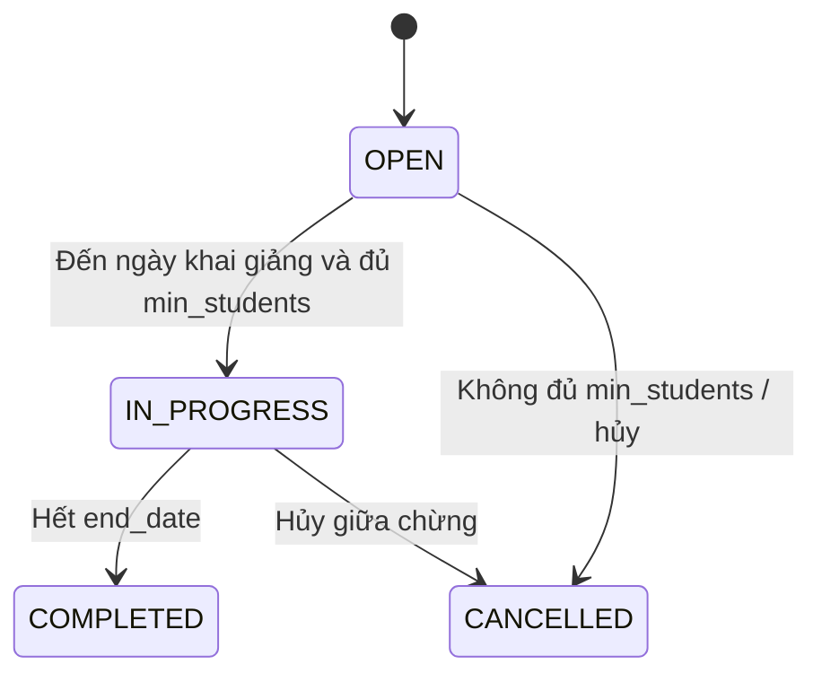
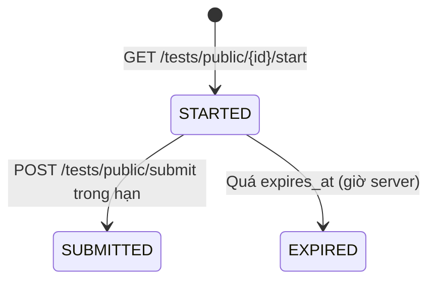

# ĐẶC TẢ CƠ SỞ DỮ LIỆU CHÍNH THỨC: SCHEMA `admission`

> **Dịch vụ:** `admission-service` (port 8081) | **Công nghệ:** Java 21, Spring Boot 3.3.4, Spring Security, JPA | **Phụ trách:** Nhóm 1 (Hùng, Tâm)  
> **Phiên bản:** Final 1.0 (bản tổng hợp cuối của Leader) | **CSDL:** PostgreSQL 16, schema `admission`  
> **Tài liệu liên quan:** [`docs/MASTER_DB_AND_API_RULES.md`](../../../docs/MASTER_DB_AND_API_RULES.md) (quy tắc API liên service), [`docs/invariants.md`](../../../docs/invariants.md) (bất biến hệ thống).

## Mục lục

1. Phạm vi & ranh giới dữ liệu
2. Danh mục thực thể
3. Sơ đồ ERD
4. Liên kết logic liên service
5. Từ điển dữ liệu chi tiết
6. View báo cáo
7. Máy trạng thái
8. Quy tắc bất biến
9. Quy tắc API liên service
10. Ghi chú triển khai & quyết định thiết kế

---

## 1. Phạm vi & ranh giới dữ liệu

Admission là **nguồn định danh duy nhất (IAM)** của toàn hệ thống đồng thời quản lý danh mục đào tạo
(phòng, khóa, lớp), khảo thí đầu vào và tuyển sinh có giữ chỗ 48 giờ. Các schema khác chỉ lưu `users.id`, `classes.id`,
`courses.id`, `enrollments.id` dưới dạng khóa logic.

### Quy tắc chung (áp dụng cho mọi module)

| Mã | Quy tắc |
|---|---|
| R-ISO-1 (INV-SYS-02) | Service chỉ truy cập schema của chính mình. Cấm JOIN và cấm FK vật lý sang schema khác. |
| R-ID-1 | Quy ước định danh người học: ở `admission` và `finance`, `student_id` = `admission.users.id`. Ở `student` và `learning`, `student_id` = `student.students.id`. Cầu nối là `student.students.user_id`. |
| R-API-1 (INV-SYS-01) | JSON và query param dùng `snake_case`; phản hồi `{success, data, message}` hoặc `{success, error:{code, message}}`. |
| R-API-2 | Mã lỗi có tiền tố theo module: `AUTH_`, `ADM_`, `STU_`, `LRN_`, `FIN_`. |
| R-AUTH-1 | Mọi API (trừ Public) dùng `Authorization: Bearer <JWT>`; JWT ký bằng `JWT_SECRET` lấy từ biến môi trường (INV-SEC-03). |
| R-INT-1 | API nội bộ (`/internal/...`, webhook) bắt buộc header `X-Internal-Secret`, không công bố qua Gateway. |
| R-INT-2 | Gọi liên service: timeout 5 giây, retry tối đa 3 lần (backoff lũy thừa); mọi POST nội bộ phải idempotent (có `event_id` hoặc khóa tự nhiên). |
| R-TIME-1 | Thời điểm dùng `TIMESTAMPTZ` (UTC) ở admission/student/learning; finance dùng `TIMESTAMP` theo spec nhóm Finance; ngày dùng `DATE`. |
| R-MONEY-1 | Tiền tệ dùng `NUMERIC/DECIMAL`, không dùng FLOAT. |

## 2. Danh mục thực thể

| STT | Đối tượng | Loại | Số cột | Chức năng |
|--:|---|---|--:|---|
| 1 | `admission.users` | Bảng | 14 | Tài khoản đăng nhập tập trung của cả hệ thống (ADMIN, STAFF, TEACHER, STUDENT). Là nguồn định danh duy nhất (IAM). |
| 2 | `admission.refresh_tokens` | Bảng | 8 | Phiên đăng nhập: Refresh Token lưu stateful để xoay vòng (rotation) và thu hồi khi đăng xuất. |
| 3 | `admission.password_reset_tokens` | Bảng | 8 | Mã đặt lại mật khẩu dùng một lần, gửi qua email, hiệu lực 15 phút. |
| 4 | `admission.auth_audit_logs` | Bảng | 9 | Nhật ký kiểm toán bảo mật: đăng nhập, làm mới token, đổi mật khẩu, khóa/mở khóa tài khoản. Phục vụ cảnh báo brute-force. |
| 5 | `admission.rooms` | Bảng | 8 | Danh mục phòng học và sức chứa; dùng để kiểm tra xung đột lịch và sĩ số khi mở lớp. |
| 6 | `admission.courses` | Bảng | 12 | Danh mục khóa học, học phí, thời lượng và lộ trình tiên quyết. |
| 7 | `admission.classes` | Bảng | 19 | Lớp học cụ thể: khóa, phòng, giáo viên, lịch học, sĩ số và trạng thái. |
| 8 | `admission.enrollments` | Bảng | 20 | Đơn đăng ký tuyển sinh: giữ chỗ 48h, duyệt tự động qua Finance hoặc duyệt tay, đồng bộ sang Student. |
| 9 | `admission.test_sets` | Bảng | 9 | Bộ đề khảo thí trình độ đầu vào. |
| 10 | `admission.test_questions` | Bảng | 16 | Câu hỏi trắc nghiệm 4 đáp án thuộc 3 kỹ năng. Đáp án đúng không bao giờ trả về API public. |
| 11 | `admission.test_recommendation_rules` | Bảng | 10 | Ma trận quy đổi điểm test sang trình độ và khóa học khuyến nghị. |
| 12 | `admission.test_attempts` | Bảng | 9 | Lượt làm bài theo giờ server (v3.6): chống nộp quá hạn và chấm lại cùng một lượt. |
| 13 | `admission.test_submissions` | Bảng | 18 | Kết quả bài khảo thí đã chấm, kèm bài làm chi tiết. |
| 14 | `admission.processed_finance_events` | Bảng | 7 | Sổ đối soát callback từ Finance (v3.6): đảm bảo idempotency và ghi nhận thanh toán đến muộn. |

## 3. Sơ đồ ERD (quan hệ trong schema)

```mermaid
erDiagram
    users ||--o{ refresh_tokens : "user_id"
    users ||--o{ password_reset_tokens : "user_id"
    users ||--o{ auth_audit_logs : "user_id"
    courses ||--o{ courses : "prerequisite_course_id"
    courses ||--o{ classes : "course_id"
    rooms ||--o{ classes : "room_id"
    users ||--o{ classes : "teacher_id"
    users ||--o{ enrollments : "approved_by_user_id"
    classes ||--o{ enrollments : "class_id"
    users ||--o{ enrollments : "hold_extended_by_user_id"
    users ||--o{ enrollments : "student_id"
    test_sets ||--o{ test_questions : "test_set_id"
    courses ||--o{ test_recommendation_rules : "recommended_course_id"
    test_sets ||--o{ test_recommendation_rules : "test_set_id"
    test_sets ||--o{ test_attempts : "test_set_id"
    users ||--o{ test_attempts : "user_id"
    test_attempts ||--o{ test_submissions : "attempt_id"
    courses ||--o{ test_submissions : "recommended_course_id"
    test_sets ||--o{ test_submissions : "test_set_id"
    users ||--o{ test_submissions : "user_id"
    enrollments ||--o{ processed_finance_events : "enrollment_id"
    users {
        integer id PK
        character_varying email UK
        character_varying password_hash
        character_varying full_name
        character_varying role
        character_varying phone
        character_varying gender
        date date_of_birth
        text avatar_url
        boolean must_change_password
        boolean is_active
        timestamp_with_time_zone email_verified_at
        timestamp_with_time_zone created_at
        timestamp_with_time_zone updated_at
    }
    refresh_tokens {
        integer id PK
        integer user_id
        character_varying token UK
        character_varying token_hash UK
        timestamp_with_time_zone expires_at
        boolean is_revoked
        timestamp_with_time_zone created_at
        timestamp_with_time_zone updated_at
    }
    password_reset_tokens {
        integer id PK
        integer user_id
        character_varying token UK
        character_varying token_hash UK
        timestamp_with_time_zone expires_at
        boolean is_used
        timestamp_with_time_zone created_at
        timestamp_with_time_zone updated_at
    }
    auth_audit_logs {
        integer id PK
        integer user_id
        character_varying email
        character_varying action
        character_varying ip_address
        text user_agent
        text details
        timestamp_with_time_zone created_at
        timestamp_with_time_zone updated_at
    }
    rooms {
        integer id PK
        character_varying code UK
        character_varying name
        integer capacity
        character_varying branch_name
        boolean is_active
        timestamp_with_time_zone created_at
        timestamp_with_time_zone updated_at
    }
    courses {
        integer id PK
        character_varying code UK
        character_varying name
        text description
        character_varying level
        character_varying target_output
        integer duration_weeks
        numeric tuition_amount
        integer prerequisite_course_id
        boolean is_active
        timestamp_with_time_zone created_at
        timestamp_with_time_zone updated_at
    }
    classes {
        integer id PK
        integer course_id
        integer room_id
        integer teacher_id
        character_varying code UK
        character_varying name
        character_varying day_pattern
        time_without_time_zone start_time
        time_without_time_zone end_time
        date start_date
        date end_date
        integer min_students
        integer max_students
        character_varying status
        character_varying room
        character_varying teacher_name
        character_varying schedule
        timestamp_with_time_zone created_at
        timestamp_with_time_zone updated_at
    }
    enrollments {
        integer id PK
        integer student_id
        integer class_id
        character_varying status
        timestamp_with_time_zone hold_expires_at
        character_varying invoice_code
        character_varying source
        character_varying approval_method
        integer approved_by_user_id
        text note
        text notes
        timestamp_with_time_zone enrolled_at
        timestamp_with_time_zone approved_at
        character_varying enrollment_channel
        integer hold_extended_by_user_id
        text hold_extension_reason
        character_varying student_sync_status
        boolean is_synced_to_student
        timestamp_with_time_zone created_at
        timestamp_with_time_zone updated_at
    }
    test_sets {
        integer id PK
        character_varying code UK
        character_varying title
        text description
        integer duration_minutes
        numeric total_max_score
        boolean is_active
        timestamp_with_time_zone created_at
        timestamp_with_time_zone updated_at
    }
    test_questions {
        integer id PK
        integer test_set_id
        character_varying skill_type
        integer order_index
        integer display_order
        text audio_url
        text passage_text
        text question_text
        text option_a
        text option_b
        text option_c
        text option_d
        character correct_option
        numeric score_weight
        timestamp_with_time_zone created_at
        timestamp_with_time_zone updated_at
    }
    test_recommendation_rules {
        integer id PK
        integer test_set_id
        numeric min_score
        numeric max_score
        character_varying assessed_level
        integer recommended_course_id
        text advice_text
        text advice_note
        timestamp_with_time_zone created_at
        timestamp_with_time_zone updated_at
    }
    test_attempts {
        integer id PK
        integer user_id
        integer test_set_id
        character_varying status
        timestamp_with_time_zone started_at
        timestamp_with_time_zone expires_at
        timestamp_with_time_zone submitted_at
        timestamp_with_time_zone created_at
        timestamp_with_time_zone updated_at
    }
    test_submissions {
        integer id PK
        integer attempt_id UK
        integer user_id
        integer test_set_id
        character_varying full_name
        character_varying email
        character_varying phone
        numeric listening_score
        numeric reading_score
        numeric grammar_score
        numeric total_score
        character_varying assessed_level
        integer recommended_course_id
        jsonb answers_detail
        timestamp_with_time_zone started_at
        timestamp_with_time_zone submitted_at
        timestamp_with_time_zone created_at
        timestamp_with_time_zone updated_at
    }
    processed_finance_events {
        integer id PK
        integer enrollment_id
        character_varying finance_event_id UK
        timestamp_with_time_zone paid_at
        timestamp_with_time_zone processed_at
        timestamp_with_time_zone created_at
        timestamp_with_time_zone updated_at
    }
```

Quan hệ sang schema khác là **liên kết logic** (mục 4), không vẽ trong ERD vì không có khóa ngoại vật lý.

## 4. Liên kết logic liên service

**Schema này trỏ ra ngoài (chỉ lưu INTEGER, không REFERENCES):**

| Cột | Trỏ tới | Ý nghĩa |
|---|---|---|
| `admission.enrollments.invoice_code` | `finance.invoices.invoice_code` | Mã hóa đơn Finance cấp (tham chiếu theo mã) |

**Schema khác trỏ vào đây:**

| Cột nguồn | Trỏ tới | Ý nghĩa |
|---|---|---|
| `student.students.user_id` | `admission.users.id` | Cầu nối hồ sơ học viên và tài khoản đăng nhập |
| `student.attendance.class_id` | `admission.classes.id` | Lớp được điểm danh |
| `student.status_requests.class_id` | `admission.classes.id` | Lớp đang học |
| `student.status_requests.target_class_id` | `admission.classes.id` | Lớp muốn chuyển đến |
| `student.status_requests.reviewed_by` | `admission.users.id` | Nhân viên duyệt |
| `learning.materials.class_id` | `admission.classes.id` | Lớp sở hữu học liệu |
| `learning.materials.uploaded_by` | `admission.users.id` | Giáo viên upload |
| `learning.grades.class_id` | `admission.classes.id` | Lớp chấm điểm |
| `learning.grades.graded_by` | `admission.users.id` | Giáo viên chấm |
| `finance.tuition_fees.course_id` | `admission.courses.id` | Khóa học áp dụng biểu phí chuẩn (FIN-01) |
| `finance.invoices.student_id` | `admission.users.id` | Người học (R-ID-1: dùng users.id) |
| `finance.invoices.course_id` | `admission.courses.id` | Khóa học thu phí |
| `finance.invoices.enrollment_id` | `admission.enrollments.id` | Đơn đăng ký phát sinh hóa đơn |
| `finance.invoice_items.course_id` | `admission.courses.id` | Khóa học của khoản mục |
| `finance.payments.received_by_staff_id` | `admission.users.id` | Nhân viên thu tiền |
| `finance.student_wallets.student_id` | `admission.users.id` | Chủ ví (R-ID-1) |
| `finance.wallet_transactions.created_by_staff_id` | `admission.users.id` | Nhân viên thao tác ví |
| `finance.refund_requests.student_id` | `admission.users.id` | Học viên được hoàn (R-ID-1) |
| `finance.refund_requests.class_id` | `admission.classes.id` | Lớp liên quan |
| `finance.refund_requests.requested_by_staff_id` | `admission.users.id` | Nhân viên tạo yêu cầu (cấp 1) |
| `finance.refund_requests.verified_by_accountant_id` | `admission.users.id` | Kế toán xác minh (cấp 2) |
| `finance.refund_requests.approved_by_director_id` | `admission.users.id` | Giám đốc duyệt (cấp 3) |

Toàn vẹn tham chiếu của các liên kết này do **tầng ứng dụng** bảo đảm (kiểm tra bằng REST trước khi ghi). Khi xóa dữ liệu gốc, dùng xóa mềm (`is_active`, `status`) thay vì xóa cứng.

## 5. Từ điển dữ liệu chi tiết

#### `admission.users`

Tài khoản đăng nhập tập trung của cả hệ thống (ADMIN, STAFF, TEACHER, STUDENT). Là nguồn định danh duy nhất (IAM).

Số dòng seed: **7**

| # | Cột | Kiểu dữ liệu | Null | Mặc định | Ràng buộc | Diễn giải |
|--:|---|---|:--:|---|---|---|
| 1 | `id` | integer | NO | `auto (SERIAL)` | `PK` | Khóa chính; cũng là user_id dùng trong JWT (claim sub). |
| 2 | `email` | character varying(255) | NO |  | `UNIQUE` | Email đăng nhập, duy nhất toàn hệ thống. |
| 3 | `password_hash` | character varying(255) | NO |  |  | Mật khẩu đã băm BCrypt; tuyệt đối không lưu plaintext. |
| 4 | `full_name` | character varying(255) | NO |  |  | Họ tên hiển thị. |
| 5 | `role` | character varying(50) | NO |  | `CHECK (((role)::text = ANY ((ARRAY['ADMIN'::character varying, 'STAFF'::character varying, 'TEACHER'::character varying, 'STUDENT'::character varying])::text[])))` | Vai trò RBAC: ADMIN \| STAFF \| TEACHER \| STUDENT. |
| 6 | `phone` | character varying(50) | YES |  |  | Số điện thoại liên hệ. |
| 7 | `gender` | character varying(20) | YES |  | `CHECK (((gender)::text = ANY ((ARRAY['MALE'::character varying, 'FEMALE'::character varying, 'OTHER'::character varying])::text[])))` | Giới tính: MALE \| FEMALE \| OTHER. |
| 8 | `date_of_birth` | date | YES |  |  | Ngày sinh. |
| 9 | `avatar_url` | text | YES |  |  | Đường dẫn ảnh đại diện. |
| 10 | `must_change_password` | boolean | NO | `false` |  | TRUE khi tài khoản do ADMIN tạo hộ; bắt buộc đổi mật khẩu ở lần đăng nhập đầu. |
| 11 | `is_active` | boolean | NO | `true` |  | FALSE = tài khoản bị khóa, không đăng nhập được. |
| 12 | `email_verified_at` | timestamp with time zone | YES |  |  | Thời điểm xác thực email khi tự đăng ký học viên (v3.6); NULL = chưa xác thực. |
| 13 | `created_at` | timestamp with time zone | NO | `CURRENT_TIMESTAMP` |  | Thời điểm tạo. |
| 14 | `updated_at` | timestamp with time zone | NO | `CURRENT_TIMESTAMP` |  | Thời điểm cập nhật gần nhất (tự động cập nhật qua trigger set_updated_at). |

**Index:**

- `idx_users_email`: `CREATE INDEX idx_users_email ON admission.users USING btree (email)`
- `idx_users_role_active`: `CREATE INDEX idx_users_role_active ON admission.users USING btree (role, is_active)`
- `users_email_key`: `CREATE UNIQUE INDEX users_email_key ON admission.users USING btree (email)`
- `users_pkey`: `CREATE UNIQUE INDEX users_pkey ON admission.users USING btree (id)`

**Trigger:**

- `trg_users_updated_at`: `CREATE TRIGGER trg_users_updated_at BEFORE UPDATE ON admission.users FOR EACH ROW EXECUTE FUNCTION set_updated_at()`

#### `admission.refresh_tokens`

Phiên đăng nhập: Refresh Token lưu stateful để xoay vòng (rotation) và thu hồi khi đăng xuất.

Số dòng seed: **0**

| # | Cột | Kiểu dữ liệu | Null | Mặc định | Ràng buộc | Diễn giải |
|--:|---|---|:--:|---|---|---|
| 1 | `id` | integer | NO | `auto (SERIAL)` | `PK` | Khóa chính. |
| 2 | `user_id` | integer | NO |  | `FK REFERENCES admission.users(id) ON DELETE CASCADE` | Chủ sở hữu token (FK users, xóa user thì xóa token). |
| 3 | `token` | character varying(512) | NO |  | `UNIQUE` | Giá trị token hoặc hash của token, duy nhất. |
| 4 | `token_hash` | character varying(512) | YES |  | `UNIQUE` | Bản băm SHA-256 của token (tương thích TASK-ADM-01/13; đồng bộ tự động 2 chiều với cột token). |
| 5 | `expires_at` | timestamp with time zone | NO |  |  | Hạn dùng của token. |
| 6 | `is_revoked` | boolean | NO | `false` |  | TRUE khi đã đăng xuất hoặc đã bị xoay vòng; không được dùng lại. |
| 7 | `created_at` | timestamp with time zone | NO | `CURRENT_TIMESTAMP` |  | Thời điểm cấp. |
| 8 | `updated_at` | timestamp with time zone | NO | `CURRENT_TIMESTAMP` |  | Thời điểm cập nhật gần nhất. |

**Index:**

- `idx_refresh_token`: `CREATE INDEX idx_refresh_token ON admission.refresh_tokens USING btree (token) WHERE (is_revoked = false)`
- `idx_refresh_tokens_user`: `CREATE INDEX idx_refresh_tokens_user ON admission.refresh_tokens USING btree (user_id)`
- `refresh_tokens_pkey`: `CREATE UNIQUE INDEX refresh_tokens_pkey ON admission.refresh_tokens USING btree (id)`
- `refresh_tokens_token_hash_key`: `CREATE UNIQUE INDEX refresh_tokens_token_hash_key ON admission.refresh_tokens USING btree (token_hash)`
- `refresh_tokens_token_key`: `CREATE UNIQUE INDEX refresh_tokens_token_key ON admission.refresh_tokens USING btree (token)`

**Trigger:**

- `trg_refresh_tokens_sync`: `CREATE TRIGGER trg_refresh_tokens_sync BEFORE INSERT OR UPDATE ON admission.refresh_tokens FOR EACH ROW EXECUTE FUNCTION admission.sync_token_and_hash()`
- `trg_refresh_tokens_updated_at`: `CREATE TRIGGER trg_refresh_tokens_updated_at BEFORE UPDATE ON admission.refresh_tokens FOR EACH ROW EXECUTE FUNCTION set_updated_at()`

#### `admission.password_reset_tokens`

Mã đặt lại mật khẩu dùng một lần, gửi qua email, hiệu lực 15 phút.

Số dòng seed: **0**

| # | Cột | Kiểu dữ liệu | Null | Mặc định | Ràng buộc | Diễn giải |
|--:|---|---|:--:|---|---|---|
| 1 | `id` | integer | NO | `auto (SERIAL)` | `PK` | Khóa chính. |
| 2 | `user_id` | integer | NO |  | `FK REFERENCES admission.users(id) ON DELETE CASCADE` | Tài khoản yêu cầu đặt lại mật khẩu. |
| 3 | `token` | character varying(512) | NO |  | `UNIQUE` | Mã đặt lại hoặc hash của mã, duy nhất. |
| 4 | `token_hash` | character varying(512) | YES |  | `UNIQUE` | Bản băm SHA-256 của mã đặt lại (tương thích TASK-ADM-01/13; đồng bộ tự động 2 chiều với cột token). |
| 5 | `expires_at` | timestamp with time zone | NO |  |  | Hạn dùng (thường created_at + 15 phút). |
| 6 | `is_used` | boolean | NO | `false` |  | TRUE khi đã dùng; không được dùng lại. |
| 7 | `created_at` | timestamp with time zone | NO | `CURRENT_TIMESTAMP` |  | Thời điểm tạo mã. |
| 8 | `updated_at` | timestamp with time zone | NO | `CURRENT_TIMESTAMP` |  | Thời điểm cập nhật gần nhất. |

**Index:**

- `idx_reset_token`: `CREATE INDEX idx_reset_token ON admission.password_reset_tokens USING btree (token) WHERE (is_used = false)`
- `password_reset_tokens_pkey`: `CREATE UNIQUE INDEX password_reset_tokens_pkey ON admission.password_reset_tokens USING btree (id)`
- `password_reset_tokens_token_hash_key`: `CREATE UNIQUE INDEX password_reset_tokens_token_hash_key ON admission.password_reset_tokens USING btree (token_hash)`
- `password_reset_tokens_token_key`: `CREATE UNIQUE INDEX password_reset_tokens_token_key ON admission.password_reset_tokens USING btree (token)`

**Trigger:**

- `trg_password_reset_tokens_updated_at`: `CREATE TRIGGER trg_password_reset_tokens_updated_at BEFORE UPDATE ON admission.password_reset_tokens FOR EACH ROW EXECUTE FUNCTION set_updated_at()`
- `trg_reset_tokens_sync`: `CREATE TRIGGER trg_reset_tokens_sync BEFORE INSERT OR UPDATE ON admission.password_reset_tokens FOR EACH ROW EXECUTE FUNCTION admission.sync_token_and_hash()`

#### `admission.auth_audit_logs`

Nhật ký kiểm toán bảo mật: đăng nhập, làm mới token, đổi mật khẩu, khóa/mở khóa tài khoản. Phục vụ cảnh báo brute-force.

Số dòng seed: **0**

| # | Cột | Kiểu dữ liệu | Null | Mặc định | Ràng buộc | Diễn giải |
|--:|---|---|:--:|---|---|---|
| 1 | `id` | integer | NO | `auto (SERIAL)` | `PK` | Khóa chính. |
| 2 | `user_id` | integer | YES |  | `FK REFERENCES admission.users(id) ON DELETE SET NULL` | Tài khoản liên quan; NULL nếu đăng nhập sai email không tồn tại hoặc user đã bị xóa. |
| 3 | `email` | character varying(255) | YES |  |  | Email thực hiện sự kiện (lưu lại cả khi user_id = NULL để chống brute-force theo email, TASK-ADM-12). |
| 4 | `action` | character varying(50) | NO |  | `CHECK (((action)::text = ANY ((ARRAY['LOGIN_SUCCESS'::character varying, 'LOGIN_FAILED'::character varying, 'REFRESH_TOKEN'::character varying, 'LOGOUT'::character varying, 'PASSWORD_CHANGED'::character varying, 'ACCOUNT_LOCKED'::character varying, 'ACCOUNT_UNLOCKED'::character varying])::text[])))` | Sự kiện: LOGIN_SUCCESS \| LOGIN_FAILED \| REFRESH_TOKEN \| LOGOUT \| PASSWORD_CHANGED \| ACCOUNT_LOCKED \| ACCOUNT_UNLOCKED. |
| 5 | `ip_address` | character varying(45) | YES |  |  | IP nguồn (hỗ trợ IPv6, tối đa 45 ký tự). |
| 6 | `user_agent` | text | YES |  |  | User-Agent của client. |
| 7 | `details` | text | YES |  |  | Chi tiết bổ sung dạng text/JSON string. |
| 8 | `created_at` | timestamp with time zone | NO | `CURRENT_TIMESTAMP` |  | Thời điểm xảy ra sự kiện. |
| 9 | `updated_at` | timestamp with time zone | NO | `CURRENT_TIMESTAMP` |  | Thời điểm cập nhật bản ghi. |

**Index:**

- `auth_audit_logs_pkey`: `CREATE UNIQUE INDEX auth_audit_logs_pkey ON admission.auth_audit_logs USING btree (id)`
- `idx_audit_action`: `CREATE INDEX idx_audit_action ON admission.auth_audit_logs USING btree (action, created_at DESC)`
- `idx_audit_user_created`: `CREATE INDEX idx_audit_user_created ON admission.auth_audit_logs USING btree (user_id, created_at DESC)`

**Trigger:**

- `trg_auth_audit_logs_updated_at`: `CREATE TRIGGER trg_auth_audit_logs_updated_at BEFORE UPDATE ON admission.auth_audit_logs FOR EACH ROW EXECUTE FUNCTION set_updated_at()`

#### `admission.rooms`

Danh mục phòng học và sức chứa; dùng để kiểm tra xung đột lịch và sĩ số khi mở lớp.

Số dòng seed: **4**

| # | Cột | Kiểu dữ liệu | Null | Mặc định | Ràng buộc | Diễn giải |
|--:|---|---|:--:|---|---|---|
| 1 | `id` | integer | NO | `auto (SERIAL)` | `PK` | Khóa chính. |
| 2 | `code` | character varying(50) | NO |  | `UNIQUE` | Mã phòng duy nhất (vd P101). |
| 3 | `name` | character varying(100) | NO |  |  | Tên phòng hiển thị. |
| 4 | `capacity` | integer | NO |  | `CHECK ((capacity > 0))` | Sức chứa tối đa (> 0). Ràng buộc nghiệp vụ: classes.max_students <= capacity (INV-FAC-03). |
| 5 | `branch_name` | character varying(100) | YES | `'Cơ sở chính'` |  | Tên cơ sở/chi nhánh. |
| 6 | `is_active` | boolean | NO | `true` |  | FALSE = tạm ngưng sử dụng, không xếp lớp mới. |
| 7 | `created_at` | timestamp with time zone | NO | `CURRENT_TIMESTAMP` |  | Thời điểm tạo. |
| 8 | `updated_at` | timestamp with time zone | NO | `CURRENT_TIMESTAMP` |  | Thời điểm cập nhật gần nhất. |

**Index:**

- `rooms_code_key`: `CREATE UNIQUE INDEX rooms_code_key ON admission.rooms USING btree (code)`
- `rooms_pkey`: `CREATE UNIQUE INDEX rooms_pkey ON admission.rooms USING btree (id)`

**Trigger:**

- `trg_rooms_updated_at`: `CREATE TRIGGER trg_rooms_updated_at BEFORE UPDATE ON admission.rooms FOR EACH ROW EXECUTE FUNCTION set_updated_at()`

#### `admission.courses`

Danh mục khóa học, học phí, thời lượng và lộ trình tiên quyết.

Số dòng seed: **4**

| # | Cột | Kiểu dữ liệu | Null | Mặc định | Ràng buộc | Diễn giải |
|--:|---|---|:--:|---|---|---|
| 1 | `id` | integer | NO | `auto (SERIAL)` | `PK` | Khóa chính; được tham chiếu logic bởi finance.invoices.course_id và finance.tuition_fees.course_id. |
| 2 | `code` | character varying(50) | NO |  | `UNIQUE` | Mã khóa học duy nhất (INV-ADM-02). |
| 3 | `name` | character varying(255) | NO |  |  | Tên khóa học. |
| 4 | `description` | text | YES |  |  | Mô tả nội dung khóa học. |
| 5 | `level` | character varying(50) | NO |  | `CHECK ((upper((level)::text) = ANY (ARRAY['BEGINNER'::text, 'INTERMEDIATE'::text, 'ADVANCED'::text])))` | Trình độ: Beginner \| Intermediate \| Advanced (không phân biệt hoa thường). |
| 6 | `target_output` | character varying(100) | YES |  |  | Đầu ra cam kết (vd IELTS 5.0 - 5.5). |
| 7 | `duration_weeks` | integer | NO |  | `CHECK ((duration_weeks > 0))` | Thời lượng (tuần), > 0. |
| 8 | `tuition_amount` | numeric(12,2) | NO | `0` | `CHECK ((tuition_amount >= (0)::numeric))` | Học phí niêm yết (VND), >= 0; Finance lấy làm amount của hóa đơn. |
| 9 | `prerequisite_course_id` | integer | YES |  | `FK REFERENCES admission.courses(id) ON DELETE SET NULL` | Khóa tiên quyết (tự tham chiếu); NULL nếu không yêu cầu. |
| 10 | `is_active` | boolean | NO | `true` |  | FALSE = ngừng tuyển sinh (xóa mềm). |
| 11 | `created_at` | timestamp with time zone | NO | `CURRENT_TIMESTAMP` |  | Thời điểm tạo. |
| 12 | `updated_at` | timestamp with time zone | NO | `CURRENT_TIMESTAMP` |  | Thời điểm cập nhật gần nhất. |

**Index:**

- `courses_code_key`: `CREATE UNIQUE INDEX courses_code_key ON admission.courses USING btree (code)`
- `courses_pkey`: `CREATE UNIQUE INDEX courses_pkey ON admission.courses USING btree (id)`

**Trigger:**

- `trg_courses_updated_at`: `CREATE TRIGGER trg_courses_updated_at BEFORE UPDATE ON admission.courses FOR EACH ROW EXECUTE FUNCTION set_updated_at()`

#### `admission.classes`

Lớp học cụ thể: khóa, phòng, giáo viên, lịch học, sĩ số và trạng thái.

Số dòng seed: **3**

| # | Cột | Kiểu dữ liệu | Null | Mặc định | Ràng buộc | Diễn giải |
|--:|---|---|:--:|---|---|---|
| 1 | `id` | integer | NO | `auto (SERIAL)` | `PK` | Khóa chính; được tham chiếu logic bởi student.attendance, learning.materials, learning.grades, finance.refund_requests. |
| 2 | `course_id` | integer | NO |  | `FK REFERENCES admission.courses(id) ON DELETE RESTRICT` | Khóa học của lớp (RESTRICT khi xóa). |
| 3 | `room_id` | integer | YES |  | `FK REFERENCES admission.rooms(id) ON DELETE RESTRICT` | Phòng học; NULL nếu chưa xếp phòng. |
| 4 | `teacher_id` | integer | YES |  | `FK REFERENCES admission.users(id) ON DELETE RESTRICT` | Giáo viên phụ trách = users.id với role TEACHER; NULL nếu chưa phân công. |
| 5 | `code` | character varying(50) | NO |  | `UNIQUE` | Mã lớp duy nhất (vd CLS-IELTS-01). |
| 6 | `name` | character varying(255) | NO |  |  | Tên lớp. |
| 7 | `day_pattern` | character varying(50) | NO |  | `CHECK (((day_pattern)::text = ANY ((ARRAY['MON_WED_FRI'::character varying, 'TUE_THU_SAT'::character varying, 'SAT_SUN'::character varying, 'DAILY'::character varying, 'CUSTOM'::character varying])::text[])))` | Mẫu ngày học: MON_WED_FRI \| TUE_THU_SAT \| SAT_SUN \| DAILY \| CUSTOM. |
| 8 | `start_time` | time without time zone | NO |  | `CHECK nhiều cột: chk_class_time` | Giờ bắt đầu mỗi buổi. |
| 9 | `end_time` | time without time zone | NO |  | `CHECK nhiều cột: chk_class_time` | Giờ kết thúc mỗi buổi (> start_time). |
| 10 | `start_date` | date | NO |  | `CHECK nhiều cột: chk_class_dates` | Ngày khai giảng. |
| 11 | `end_date` | date | NO |  | `CHECK nhiều cột: chk_class_dates` | Ngày kết thúc (> start_date). |
| 12 | `min_students` | integer | YES | `10` | `CHECK nhiều cột: chk_class_capacity` `CHECK ((min_students > 0))` | Sĩ số tối thiểu để mở lớp; thiếu sẽ hủy lớp. |
| 13 | `max_students` | integer | YES | `25` | `CHECK nhiều cột: chk_class_capacity` | Sĩ số tối đa (>= min_students); chặn duyệt khi đủ (INV-ADM-01). |
| 14 | `status` | character varying(50) | NO | `'OPEN'` | `CHECK (((status)::text = ANY ((ARRAY['OPEN'::character varying, 'IN_PROGRESS'::character varying, 'COMPLETED'::character varying, 'CANCELLED'::character varying])::text[])))` | OPEN \| IN_PROGRESS \| COMPLETED \| CANCELLED. |
| 15 | `room` | character varying(100) | YES |  |  | Snapshot mã/tên phòng học (cột tương thích contract.md & skeleton). |
| 16 | `teacher_name` | character varying(255) | YES |  |  | Snapshot họ tên giáo viên phụ trách (cột tương thích contract.md & skeleton). |
| 17 | `schedule` | character varying(255) | YES |  |  | Snapshot chuỗi lịch học hiển thị nhanh (cột tương thích contract.md). |
| 18 | `created_at` | timestamp with time zone | NO | `CURRENT_TIMESTAMP` |  | Thời điểm tạo. |
| 19 | `updated_at` | timestamp with time zone | NO | `CURRENT_TIMESTAMP` |  | Thời điểm cập nhật gần nhất. |

**Ràng buộc cấp bảng (nhiều cột):**

| Tên | Loại | Định nghĩa |
|---|---|---|
| `chk_class_capacity` | CHECK | `CHECK ((max_students >= min_students))` |
| `chk_class_dates` | CHECK | `CHECK ((end_date > start_date))` |
| `chk_class_time` | CHECK | `CHECK ((end_time > start_time))` |

**Index:**

- `classes_code_key`: `CREATE UNIQUE INDEX classes_code_key ON admission.classes USING btree (code)`
- `classes_pkey`: `CREATE UNIQUE INDEX classes_pkey ON admission.classes USING btree (id)`
- `idx_classes_schedule`: `CREATE INDEX idx_classes_schedule ON admission.classes USING btree (room_id, teacher_id, day_pattern, start_date, end_date)`
- `idx_classes_status`: `CREATE INDEX idx_classes_status ON admission.classes USING btree (status, course_id)`

**Trigger:**

- `trg_classes_updated_at`: `CREATE TRIGGER trg_classes_updated_at BEFORE UPDATE ON admission.classes FOR EACH ROW EXECUTE FUNCTION set_updated_at()`

#### `admission.enrollments`

Đơn đăng ký tuyển sinh: giữ chỗ 48h, duyệt tự động qua Finance hoặc duyệt tay, đồng bộ sang Student.

Số dòng seed: **3**

| # | Cột | Kiểu dữ liệu | Null | Mặc định | Ràng buộc | Diễn giải |
|--:|---|---|:--:|---|---|---|
| 1 | `id` | integer | NO | `auto (SERIAL)` | `PK` | Khóa chính; Finance lưu làm enrollment_id (logical FK). |
| 2 | `student_id` | integer | NO |  | `FK REFERENCES admission.users(id) ON DELETE RESTRICT` `UNIQUE(student_id, class_id)` | Người đăng ký = users.id (role STUDENT). KHÔNG phải student.students.id vì hồ sơ học viên chỉ được tạo sau khi duyệt (quy ước R-ID-1). |
| 3 | `class_id` | integer | NO |  | `FK REFERENCES admission.classes(id) ON DELETE RESTRICT` `UNIQUE(student_id, class_id)` | Lớp đăng ký. |
| 4 | `status` | character varying(50) | NO | `'PENDING'` | `CHECK (((status)::text = ANY ((ARRAY['PENDING'::character varying, 'APPROVED'::character varying, 'REJECTED'::character varying, 'EXPIRED'::character varying, 'CANCELLED'::character varying, 'CANCELLED_REFUND_PENDING'::character varying])::text[])))` | PENDING \| APPROVED \| REJECTED \| EXPIRED \| CANCELLED \| CANCELLED_REFUND_PENDING. CANCELLED/REJECTED không được chuyển sang APPROVED (INV-ADM-03). |
| 5 | `hold_expires_at` | timestamp with time zone | YES |  |  | Hạn giữ chỗ (enrolled_at + 48h); chỉ PENDING còn hạn mới chiếm slot (INV-ENR-01). |
| 6 | `invoice_code` | character varying(50) | YES |  |  | Mã hóa đơn do Finance cấp (logical FK sang finance.invoices.invoice_code). |
| 7 | `source` | character varying(50) | YES | `'ONLINE'` | `CHECK (((source)::text = ANY ((ARRAY['ONLINE'::character varying, 'WALK_IN'::character varying, 'HOTLINE'::character varying, 'FANPAGE'::character varying, 'REFERRAL'::character varying])::text[])))` | Nguồn: ONLINE \| WALK_IN \| HOTLINE \| FANPAGE \| REFERRAL. |
| 8 | `approval_method` | character varying(50) | YES |  | `CHECK (((approval_method)::text = ANY ((ARRAY['ONLINE_PAYMENT'::character varying, 'MANUAL_CASH'::character varying, 'STAFF_OVERRIDE'::character varying])::text[])))` | Cách duyệt: ONLINE_PAYMENT \| MANUAL_CASH \| STAFF_OVERRIDE; NULL khi chưa duyệt. |
| 9 | `approved_by_user_id` | integer | YES |  | `FK REFERENCES admission.users(id) ON DELETE SET NULL` | Nhân viên duyệt tay (users.id); NULL nếu duyệt tự động. |
| 10 | `note` | text | YES |  |  | Ghi chú nghiệp vụ. |
| 11 | `notes` | text | YES |  |  | Alias tương thích TASK-ADM-44 (đồng bộ tự động 2 chiều với note). |
| 12 | `enrolled_at` | timestamp with time zone | NO | `CURRENT_TIMESTAMP` |  | Thời điểm nộp đơn. |
| 13 | `approved_at` | timestamp with time zone | YES |  |  | Thời điểm duyệt. |
| 14 | `enrollment_channel` | character varying(20) | NO | `'ONLINE'` | `CHECK (((enrollment_channel)::text = ANY ((ARRAY['ONLINE'::character varying, 'AT_COUNTER'::character varying])::text[])))` | Kênh nộp đơn: ONLINE \| AT_COUNTER (v3.6, phục vụ BI). |
| 15 | `hold_extended_by_user_id` | integer | YES |  | `FK REFERENCES admission.users(id) ON DELETE SET NULL` | Nhân viên gia hạn giữ chỗ (v3.6). |
| 16 | `hold_extension_reason` | text | YES |  |  | Lý do gia hạn giữ chỗ (v3.6). |
| 17 | `student_sync_status` | character varying(20) | NO | `'NOT_STARTED'` | `CHECK (((student_sync_status)::text = ANY ((ARRAY['NOT_STARTED'::character varying, 'PENDING'::character varying, 'SYNCED'::character varying, 'FAILED'::character varying])::text[])))` | Trạng thái đồng bộ tạo hồ sơ sang Student Service: NOT_STARTED \| PENDING \| SYNCED \| FAILED (v3.6). |
| 18 | `is_synced_to_student` | boolean | NO | `false` |  | Cờ boolean tương thích TASK-ADM-47 (TRUE khi student_sync_status = SYNCED). |
| 19 | `created_at` | timestamp with time zone | NO | `CURRENT_TIMESTAMP` |  | Thời điểm tạo bản ghi. |
| 20 | `updated_at` | timestamp with time zone | NO | `CURRENT_TIMESTAMP` |  | Thời điểm cập nhật gần nhất. |

**Ràng buộc cấp bảng (nhiều cột):**

| Tên | Loại | Định nghĩa |
|---|---|---|
| `enrollments_student_id_class_id_key` | UNIQUE | `UNIQUE (student_id, class_id)` |

**Index:**

- `enrollments_pkey`: `CREATE UNIQUE INDEX enrollments_pkey ON admission.enrollments USING btree (id)`
- `enrollments_student_id_class_id_key`: `CREATE UNIQUE INDEX enrollments_student_id_class_id_key ON admission.enrollments USING btree (student_id, class_id)`
- `idx_enrollments_class_status`: `CREATE INDEX idx_enrollments_class_status ON admission.enrollments USING btree (class_id, status)`
- `idx_enrollments_created_channel`: `CREATE INDEX idx_enrollments_created_channel ON admission.enrollments USING btree (enrolled_at, enrollment_channel)`
- `idx_enrollments_pending_hold`: `CREATE INDEX idx_enrollments_pending_hold ON admission.enrollments USING btree (hold_expires_at) WHERE ((status)::text = 'PENDING'::text)`
- `idx_enrollments_status_hold`: `CREATE INDEX idx_enrollments_status_hold ON admission.enrollments USING btree (class_id, status, hold_expires_at)`
- `idx_enrollments_student`: `CREATE INDEX idx_enrollments_student ON admission.enrollments USING btree (student_id)`

**Trigger:**

- `trg_enrollments_compat`: `CREATE TRIGGER trg_enrollments_compat BEFORE INSERT OR UPDATE ON admission.enrollments FOR EACH ROW EXECUTE FUNCTION admission.sync_enrollment_compat()`
- `trg_enrollments_updated_at`: `CREATE TRIGGER trg_enrollments_updated_at BEFORE UPDATE ON admission.enrollments FOR EACH ROW EXECUTE FUNCTION set_updated_at()`

#### `admission.test_sets`

Bộ đề khảo thí trình độ đầu vào.

Số dòng seed: **1**

| # | Cột | Kiểu dữ liệu | Null | Mặc định | Ràng buộc | Diễn giải |
|--:|---|---|:--:|---|---|---|
| 1 | `id` | integer | NO | `auto (SERIAL)` | `PK` | Khóa chính. |
| 2 | `code` | character varying(50) | YES |  | `UNIQUE` | Mã bộ đề duy nhất (vd PLACEMENT-GEN-01, tương thích TASK-ADM-30 / API_CATALOG). |
| 3 | `title` | character varying(255) | NO |  |  | Tiêu đề bộ đề. |
| 4 | `description` | text | YES |  |  | Mô tả chi tiết bộ đề khảo thí. |
| 5 | `duration_minutes` | integer | NO | `45` | `CHECK ((duration_minutes > 0))` | Thời gian làm bài (phút), > 0. |
| 6 | `total_max_score` | numeric(5,2) | NO | `100.0` | `CHECK ((total_max_score > (0)::numeric))` | Tổng điểm tối đa của bộ đề (mặc định 100.0). |
| 7 | `is_active` | boolean | NO | `true` |  | Chỉ bộ đề active mới được phát cho thí sinh. |
| 8 | `created_at` | timestamp with time zone | NO | `CURRENT_TIMESTAMP` |  | Thời điểm tạo. |
| 9 | `updated_at` | timestamp with time zone | NO | `CURRENT_TIMESTAMP` |  | Thời điểm cập nhật gần nhất. |

**Index:**

- `test_sets_code_key`: `CREATE UNIQUE INDEX test_sets_code_key ON admission.test_sets USING btree (code)`
- `test_sets_pkey`: `CREATE UNIQUE INDEX test_sets_pkey ON admission.test_sets USING btree (id)`

**Trigger:**

- `trg_test_sets_updated_at`: `CREATE TRIGGER trg_test_sets_updated_at BEFORE UPDATE ON admission.test_sets FOR EACH ROW EXECUTE FUNCTION set_updated_at()`

#### `admission.test_questions`

Câu hỏi trắc nghiệm 4 đáp án thuộc 3 kỹ năng. Đáp án đúng không bao giờ trả về API public.

Số dòng seed: **4**

| # | Cột | Kiểu dữ liệu | Null | Mặc định | Ràng buộc | Diễn giải |
|--:|---|---|:--:|---|---|---|
| 1 | `id` | integer | NO | `auto (SERIAL)` | `PK` | Khóa chính. |
| 2 | `test_set_id` | integer | NO |  | `FK REFERENCES admission.test_sets(id) ON DELETE CASCADE` | Bộ đề chứa câu hỏi (xóa bộ đề thì xóa câu hỏi). |
| 3 | `skill_type` | character varying(50) | NO |  | `CHECK (((skill_type)::text = ANY ((ARRAY['LISTENING'::character varying, 'READING'::character varying, 'GRAMMAR'::character varying])::text[])))` | Kỹ năng: LISTENING \| READING \| GRAMMAR. |
| 4 | `order_index` | integer | NO | `1` |  | Thứ tự hiển thị trong đề. |
| 5 | `display_order` | integer | NO | `1` |  | Alias thứ tự hiển thị (tương thích TASK-ADM-30, đồng bộ tự động với order_index). |
| 6 | `audio_url` | text | YES |  |  | File nghe (dùng cho LISTENING). |
| 7 | `passage_text` | text | YES |  |  | Đoạn văn (dùng cho READING). |
| 8 | `question_text` | text | NO |  |  | Nội dung câu hỏi. |
| 9 | `option_a` | text | NO |  |  | Đáp án A. |
| 10 | `option_b` | text | NO |  |  | Đáp án B. |
| 11 | `option_c` | text | NO |  |  | Đáp án C. |
| 12 | `option_d` | text | NO |  |  | Đáp án D. |
| 13 | `correct_option` | character(1) | NO |  | `CHECK ((correct_option = ANY (ARRAY['A'::bpchar, 'B'::bpchar, 'C'::bpchar, 'D'::bpchar])))` | Đáp án đúng A \| B \| C \| D; chỉ server dùng để chấm (INV-TST-01). |
| 14 | `score_weight` | numeric(4,2) | NO | `1.0` | `CHECK ((score_weight > (0)::numeric))` | Trọng số điểm của câu, > 0. |
| 15 | `created_at` | timestamp with time zone | NO | `CURRENT_TIMESTAMP` |  | Thời điểm tạo. |
| 16 | `updated_at` | timestamp with time zone | NO | `CURRENT_TIMESTAMP` |  | Thời điểm cập nhật gần nhất. |

**Index:**

- `idx_test_q_set_skill`: `CREATE INDEX idx_test_q_set_skill ON admission.test_questions USING btree (test_set_id, skill_type, order_index)`
- `test_questions_pkey`: `CREATE UNIQUE INDEX test_questions_pkey ON admission.test_questions USING btree (id)`

**Trigger:**

- `trg_test_questions_order`: `CREATE TRIGGER trg_test_questions_order BEFORE INSERT OR UPDATE ON admission.test_questions FOR EACH ROW EXECUTE FUNCTION admission.sync_question_order()`
- `trg_test_questions_updated_at`: `CREATE TRIGGER trg_test_questions_updated_at BEFORE UPDATE ON admission.test_questions FOR EACH ROW EXECUTE FUNCTION set_updated_at()`

#### `admission.test_recommendation_rules`

Ma trận quy đổi điểm test sang trình độ và khóa học khuyến nghị.

Số dòng seed: **3**

| # | Cột | Kiểu dữ liệu | Null | Mặc định | Ràng buộc | Diễn giải |
|--:|---|---|:--:|---|---|---|
| 1 | `id` | integer | NO | `auto (SERIAL)` | `PK` | Khóa chính. |
| 2 | `test_set_id` | integer | NO |  | `FK REFERENCES admission.test_sets(id) ON DELETE CASCADE` | Bộ đề áp dụng. |
| 3 | `min_score` | numeric(5,2) | NO |  | `CHECK nhiều cột: chk_score_range` | Điểm tối thiểu của dải (>= 0). |
| 4 | `max_score` | numeric(5,2) | NO |  | `CHECK nhiều cột: chk_score_range` | Điểm tối đa của dải (> min_score). Các dải không được chồng lấn (kiểm tra ở tầng ứng dụng, lỗi ADM_RULE_OVERLAP). |
| 5 | `assessed_level` | character varying(50) | NO |  |  | Trình độ đánh giá (vd Beginner). |
| 6 | `recommended_course_id` | integer | NO |  | `FK REFERENCES admission.courses(id) ON DELETE CASCADE` | Khóa học khuyến nghị. |
| 7 | `advice_text` | text | YES |  |  | Lời khuyên hiển thị cho thí sinh. |
| 8 | `advice_note` | text | YES |  |  | Alias lời khuyên tư vấn (tương thích TASK-ADM-32, đồng bộ tự động với advice_text). |
| 9 | `created_at` | timestamp with time zone | NO | `CURRENT_TIMESTAMP` |  | Thời điểm tạo. |
| 10 | `updated_at` | timestamp with time zone | NO | `CURRENT_TIMESTAMP` |  | Thời điểm cập nhật gần nhất. |

**Ràng buộc cấp bảng (nhiều cột):**

| Tên | Loại | Định nghĩa |
|---|---|---|
| `chk_score_range` | CHECK | `CHECK (((max_score > min_score) AND (min_score >= (0)::numeric)))` |

**Index:**

- `test_recommendation_rules_pkey`: `CREATE UNIQUE INDEX test_recommendation_rules_pkey ON admission.test_recommendation_rules USING btree (id)`

**Trigger:**

- `trg_test_recommendation_rules_updated_at`: `CREATE TRIGGER trg_test_recommendation_rules_updated_at BEFORE UPDATE ON admission.test_recommendation_rules FOR EACH ROW EXECUTE FUNCTION set_updated_at()`
- `trg_test_rules_advice`: `CREATE TRIGGER trg_test_rules_advice BEFORE INSERT OR UPDATE ON admission.test_recommendation_rules FOR EACH ROW EXECUTE FUNCTION admission.sync_rule_advice()`

#### `admission.test_attempts`

Lượt làm bài theo giờ server (v3.6): chống nộp quá hạn và chấm lại cùng một lượt.

Số dòng seed: **0**

| # | Cột | Kiểu dữ liệu | Null | Mặc định | Ràng buộc | Diễn giải |
|--:|---|---|:--:|---|---|---|
| 1 | `id` | integer | NO | `auto (SERIAL)` | `PK` | Khóa chính. |
| 2 | `user_id` | integer | NO |  | `FK REFERENCES admission.users(id) ON DELETE RESTRICT` | Thí sinh (users.id). |
| 3 | `test_set_id` | integer | NO |  | `FK REFERENCES admission.test_sets(id) ON DELETE RESTRICT` | Bộ đề đã bốc. |
| 4 | `status` | character varying(20) | NO | `'STARTED'` | `CHECK (((status)::text = ANY ((ARRAY['STARTED'::character varying, 'SUBMITTED'::character varying, 'EXPIRED'::character varying])::text[])))` | STARTED \| SUBMITTED \| EXPIRED. |
| 5 | `started_at` | timestamp with time zone | NO | `CURRENT_TIMESTAMP` | `CHECK nhiều cột: chk_attempt_time` | Giờ server khi bắt đầu. |
| 6 | `expires_at` | timestamp with time zone | NO |  | `CHECK nhiều cột: chk_attempt_time` | Hạn nộp bài = started_at + duration_minutes (> started_at). |
| 7 | `submitted_at` | timestamp with time zone | YES |  |  | Giờ nộp bài; NULL nếu chưa nộp. |
| 8 | `created_at` | timestamp with time zone | NO | `CURRENT_TIMESTAMP` |  | Thời điểm tạo lượt thi. |
| 9 | `updated_at` | timestamp with time zone | NO | `CURRENT_TIMESTAMP` |  | Thời điểm cập nhật gần nhất. |

**Ràng buộc cấp bảng (nhiều cột):**

| Tên | Loại | Định nghĩa |
|---|---|---|
| `chk_attempt_time` | CHECK | `CHECK ((expires_at > started_at))` |

**Index:**

- `idx_test_attempts_started`: `CREATE INDEX idx_test_attempts_started ON admission.test_attempts USING btree (started_at, status)`
- `idx_test_attempts_user`: `CREATE INDEX idx_test_attempts_user ON admission.test_attempts USING btree (user_id, test_set_id)`
- `test_attempts_pkey`: `CREATE UNIQUE INDEX test_attempts_pkey ON admission.test_attempts USING btree (id)`

**Trigger:**

- `trg_test_attempts_updated_at`: `CREATE TRIGGER trg_test_attempts_updated_at BEFORE UPDATE ON admission.test_attempts FOR EACH ROW EXECUTE FUNCTION set_updated_at()`

#### `admission.test_submissions`

Kết quả bài khảo thí đã chấm, kèm bài làm chi tiết.

Số dòng seed: **0**

| # | Cột | Kiểu dữ liệu | Null | Mặc định | Ràng buộc | Diễn giải |
|--:|---|---|:--:|---|---|---|
| 1 | `id` | integer | NO | `auto (SERIAL)` | `PK` | Khóa chính. |
| 2 | `attempt_id` | integer | YES |  | `FK REFERENCES admission.test_attempts(id) ON DELETE RESTRICT` `UNIQUE` | Lượt thi tương ứng (v3.6); UNIQUE nên mỗi lượt chỉ có một kết quả (INV-TST-02). |
| 3 | `user_id` | integer | NO |  | `FK REFERENCES admission.users(id) ON DELETE CASCADE` | Thí sinh. |
| 4 | `test_set_id` | integer | NO |  | `FK REFERENCES admission.test_sets(id) ON DELETE RESTRICT` | Bộ đề đã làm. |
| 5 | `full_name` | character varying(255) | YES |  |  | Snapshot họ tên thí sinh tại thời điểm nộp bài (TASK-ADM-31). |
| 6 | `email` | character varying(255) | YES |  |  | Snapshot email thí sinh (TASK-ADM-31). |
| 7 | `phone` | character varying(50) | YES |  |  | Snapshot số điện thoại thí sinh (TASK-ADM-31). |
| 8 | `listening_score` | numeric(5,2) | NO | `0.0` | `CHECK ((listening_score >= (0)::numeric))` | Điểm kỹ năng Nghe (>= 0). |
| 9 | `reading_score` | numeric(5,2) | NO | `0.0` | `CHECK ((reading_score >= (0)::numeric))` | Điểm kỹ năng Đọc (>= 0). |
| 10 | `grammar_score` | numeric(5,2) | NO | `0.0` | `CHECK ((grammar_score >= (0)::numeric))` | Điểm kỹ năng Ngữ pháp (>= 0). |
| 11 | `total_score` | numeric(5,2) | NO |  |  | Tổng điểm do server tính. |
| 12 | `assessed_level` | character varying(50) | YES |  |  | Trình độ suy ra từ ma trận khuyến nghị. |
| 13 | `recommended_course_id` | integer | YES |  | `FK REFERENCES admission.courses(id) ON DELETE SET NULL` | Khóa học được đề xuất; NULL nếu không có luật khớp. |
| 14 | `answers_detail` | jsonb | YES |  |  | JSONB: danh sách {question_id, selected_option, is_correct}. |
| 15 | `started_at` | timestamp with time zone | YES |  |  | Thời điểm bắt đầu làm bài (TASK-ADM-31). |
| 16 | `submitted_at` | timestamp with time zone | NO | `CURRENT_TIMESTAMP` |  | Thời điểm nộp. |
| 17 | `created_at` | timestamp with time zone | NO | `CURRENT_TIMESTAMP` |  | Thời điểm tạo bản ghi. |
| 18 | `updated_at` | timestamp with time zone | NO | `CURRENT_TIMESTAMP` |  | Thời điểm cập nhật gần nhất. |

**Index:**

- `idx_submissions_user`: `CREATE INDEX idx_submissions_user ON admission.test_submissions USING btree (user_id, submitted_at DESC)`
- `test_submissions_attempt_id_key`: `CREATE UNIQUE INDEX test_submissions_attempt_id_key ON admission.test_submissions USING btree (attempt_id)`
- `test_submissions_pkey`: `CREATE UNIQUE INDEX test_submissions_pkey ON admission.test_submissions USING btree (id)`

**Trigger:**

- `trg_test_submissions_updated_at`: `CREATE TRIGGER trg_test_submissions_updated_at BEFORE UPDATE ON admission.test_submissions FOR EACH ROW EXECUTE FUNCTION set_updated_at()`

#### `admission.processed_finance_events`

Sổ đối soát callback từ Finance (v3.6): đảm bảo idempotency và ghi nhận thanh toán đến muộn.

Số dòng seed: **0**

| # | Cột | Kiểu dữ liệu | Null | Mặc định | Ràng buộc | Diễn giải |
|--:|---|---|:--:|---|---|---|
| 1 | `id` | integer | NO | `auto (SERIAL)` | `PK` | Khóa chính. |
| 2 | `enrollment_id` | integer | NO |  | `FK REFERENCES admission.enrollments(id) ON DELETE RESTRICT` | Đơn đăng ký nhận callback. |
| 3 | `finance_event_id` | character varying(255) | NO |  | `UNIQUE` | Mã sự kiện do Finance gửi, duy nhất; callback trùng trả 200 OK và không duyệt lại (INV-ENR-02). |
| 4 | `paid_at` | timestamp with time zone | NO |  |  | Thời điểm Finance ghi nhận thanh toán. |
| 5 | `processed_at` | timestamp with time zone | NO | `CURRENT_TIMESTAMP` |  | Thời điểm Admission xử lý. |
| 6 | `created_at` | timestamp with time zone | NO | `CURRENT_TIMESTAMP` |  | Thời điểm tạo bản ghi. |
| 7 | `updated_at` | timestamp with time zone | NO | `CURRENT_TIMESTAMP` |  | Thời điểm cập nhật gần nhất. |

**Index:**

- `idx_fin_events_enrollment`: `CREATE INDEX idx_fin_events_enrollment ON admission.processed_finance_events USING btree (enrollment_id)`
- `processed_finance_events_finance_event_id_key`: `CREATE UNIQUE INDEX processed_finance_events_finance_event_id_key ON admission.processed_finance_events USING btree (finance_event_id)`
- `processed_finance_events_pkey`: `CREATE UNIQUE INDEX processed_finance_events_pkey ON admission.processed_finance_events USING btree (id)`

**Trigger:**

- `trg_processed_finance_events_updated_at`: `CREATE TRIGGER trg_processed_finance_events_updated_at BEFORE UPDATE ON admission.processed_finance_events FOR EACH ROW EXECUTE FUNCTION set_updated_at()`

### Bổ sung migration QA H01 — 11/11/2026

Sau baseline schema và các migration Admission trước, áp dụng `backend/src/main/resources/db/admission-payment-callback.sql`:

- `admission.processed_finance_events.payload_hash VARCHAR(64) NULL`: fingerprint canonical evidence cho receipt mới; NULL là legacy cần đối soát, không tự backfill hoặc xóa receipt.
- `admission.finance_callback_audit`: `id BIGSERIAL PRIMARY KEY`, `event_id VARCHAR(255) NULL`, `enrollment_id INTEGER NULL`, `reason VARCHAR(80) NOT NULL`, `created_at TIMESTAMPTZ NOT NULL DEFAULT CURRENT_TIMESTAMP`. Không FK vì ghi nhận cả identity không tồn tại và giữ audit độc lập transaction bị từ chối. Không chứa full payload, secret hoặc chứng từ.
- Migration chỉ thêm đối tượng Admission, không phải bảng hóa đơn/ledger Finance; chạy lại an toàn với IF NOT EXISTS. `ddl-auto=none`, app không tự áp dụng. Các bảng baseline được giữ nguyên; xem [payment-callback-qa.md](payment-callback-qa.md) về biên bảo đảm.

### Bổ sung migration QA H06 — 11/11/2026

`backend/src/main/resources/db/admission-hold-extension-audit.sql` bổ sung `admission.hold_extension_audit`: `id BIGSERIAL PRIMARY KEY`, nullable `enrollment_id INTEGER`, `actor_id INTEGER`, `extended_hours INTEGER`, `previous_deadline TIMESTAMPTZ`, `new_deadline TIMESTAMPTZ`; `outcome VARCHAR(20) NOT NULL CHECK IN (EXTENDED,REJECTED)`, `reason_code VARCHAR(80) NOT NULL`, `created_at TIMESTAMPTZ NOT NULL DEFAULT CURRENT_TIMESTAMP`. Không FK để lưu được lỗi identity và bảo toàn audit độc lập sau rollback. Không tạo/đổi hạn cho dữ liệu enrollment cũ. Audit thành công có hạn cũ/mới, lý do nghiệp vụ lưu ở notes/hold_extension_reason hiện có; audit từ chối không lưu full payload/secret. Áp dụng trước deploy vì ddl-auto=none. Xem [hold-extension-qa.md](hold-extension-qa.md).

## 6. View báo cáo

_Schema này không có view._

## 7. Máy trạng thái

### Đơn đăng ký `enrollments.status`

Cấm tuyệt đối: `CANCELLED -> APPROVED`, `REJECTED -> APPROVED`, `EXPIRED -> APPROVED` (INV-ADM-03, INV-ENR-03).

### Lớp học `classes.status`

### Lượt thi `test_attempts.status`

## 8. Quy tắc bất biến

| Mã | Quy tắc |
|---|---|
| **INV-SEC-01** | Student chỉ xem và sửa hồ sơ của chính mình (lấy `user_id` từ JWT). |
| **INV-ADM-01** | Không APPROVED nếu `APPROVED + PENDING còn hạn >= max_students`; kiểm tra nguyên tử bằng khóa bi quan (`SELECT ... FOR UPDATE` trên lớp). |
| **INV-ADM-02** | `courses.code` và `classes.code` duy nhất (UNIQUE ở DB). |
| **INV-ADM-03** | Đơn CANCELLED/REJECTED không thể chuyển sang APPROVED. |
| **INV-FAC-03** | `classes.max_students <= rooms.capacity` khi tạo/sửa lớp (kiểm tra ở tầng ứng dụng vì nằm giữa 2 bảng). |
| **INV-CON-01** | Không lưu lớp nếu trùng phòng + khung giờ + mẫu ngày với lớp OPEN/IN_PROGRESS khác (lỗi `ADM_ROOM_CONFLICT`). |
| **INV-CON-02** | Không lưu lớp nếu trùng giáo viên + khung giờ + mẫu ngày (lỗi `ADM_TEACHER_CONFLICT`). |
| **INV-ENR-01** | Slot đang giữ chỉ tính PENDING có `hold_expires_at > now()`; đơn hết hạn không chiếm slot dù job chưa chạy. |
| **INV-ENR-02** | `processed_finance_events.finance_event_id` UNIQUE; callback trùng trả 200 OK, không duyệt lại. |
| **INV-ENR-03** | Callback PAID đến sau khi đơn EXPIRED/CANCELLED: không tự APPROVED; ghi vào `processed_finance_events` để đối soát. |
| **INV-TST-01** | Chấm điểm phía server từ `correct_option`; không nhận điểm tự khai từ client; API public không trả đáp án. |
| **INV-TST-02** | Một lượt thi chỉ có một kết quả (`test_submissions.attempt_id` UNIQUE); không chấm lại. |

## 9. Quy tắc API liên service

### 9.1. API công khai của module

55 endpoint chuẩn (IAM 13, phòng 6, khóa 5, lớp 7, khảo thí 12, tuyển sinh 7, xuất file 2, BI 3) cộng 2 endpoint đăng ký học viên v3.6. Danh mục đầy đủ: [`../tasks/API_CATALOG.md`](../tasks/API_CATALOG.md).

### 9.2. API nội bộ module cung cấp (header `X-Internal-Secret`)

| Endpoint | Người gọi | Mục đích |
|---|---|---|
| `POST /api/admission/webhooks/payment-success` | Finance | Hóa đơn PAID thì duyệt đơn (INV-ENR-02/03) |
| `GET /api/admission/internal/classes/{id}` | Student, Learning, Finance | Thông tin lớp, `teacher_id`, `status` |
| `GET /api/admission/internal/courses/{id}` | Finance | `tuition_amount` để lập hóa đơn |
| `GET /api/admission/internal/enrollments?class_id=&status=APPROVED` | Student | Danh sách học viên của lớp (INV-STU-03) |

### 9.3. API module gọi sang service khác

| Gọi tới | Khi nào | Nội dung |
|---|---|---|
| `POST finance /api/finance/invoices/auto-generate` | Tạo enrollment PENDING | Sinh hóa đơn, nhận `invoice_code`, lưu vào `enrollments.invoice_code` |
| `POST student /api/student/internal/students` | Enrollment chuyển APPROVED | Tạo hồ sơ học viên; cập nhật `student_sync_status` (PENDING, SYNCED, FAILED); lỗi thì job retry |

Nguyên tắc chung (timeout, retry, idempotency, định dạng) xem [`docs/MASTER_DB_AND_API_RULES.md`](../../../docs/MASTER_DB_AND_API_RULES.md) mục 8 và 9.

## 10. Ghi chú triển khai & quyết định thiết kế

- **Công thức slot:** `slot_con_lai = max_students - (COUNT(APPROVED) + COUNT(PENDING AND hold_expires_at > now()))`.
- **Phát hiện xung đột lịch:** hai lớp xung đột khi cùng `room_id` (hoặc cùng `teacher_id`), trạng thái OPEN/IN_PROGRESS, khoảng `[start_date, end_date]` giao nhau, `day_pattern` giao nhau và `[start_time, end_time)` giao nhau. Index `idx_classes_schedule` phục vụ truy vấn này.
- **Trigger & cột tương thích ("thừa còn hơn thiếu"):**
  - `public.set_updated_at()` tự động cập nhật `updated_at` trên toàn bộ 14 bảng (khớp `BaseEntity.java` trong `TASK-ADM-01`).
  - `admission.sync_token_and_hash()` đồng bộ 2 chiều `token <-> token_hash` trên `refresh_tokens` và `password_reset_tokens` (tương thích cả `TASK-ADM-01/13` và spec gốc).
  - `admission.sync_enrollment_compat()` đồng bộ 2 chiều `note <-> notes` (`TASK-ADM-44`) và `student_sync_status <-> is_synced_to_student` (`TASK-ADM-47`).
  - `admission.sync_question_order()` đồng bộ `order_index <-> display_order` (`TASK-ADM-30`); `admission.sync_rule_advice()` đồng bộ `advice_text <-> advice_note` (`TASK-ADM-32`).
  - `courses.level` dùng `CHECK (UPPER(level) IN ('BEGINNER', 'INTERMEDIATE', 'ADVANCED'))` để chấp nhận cả `'Beginner'` và `'BEGINNER'` (`TASK-ADM-21`).
- **`auth_audit_logs`:** bổ sung cột `email` và action `'ACCOUNT_UNLOCKED'` (`TASK-ADM-11/12/15`); nên phân vùng theo tháng (`PARTITION BY RANGE (created_at)`) khi dữ liệu lớn.
- **Mật khẩu seed:** băm BCrypt bằng `pgcrypto` (`crypt(..., gen_salt('bf', 10))`), tương thích `BCryptPasswordEncoder` của Spring.

---
