# ĐẶC TẢ THIẾT KẾ MÔ HÌNH HÓA UML (UML DESIGN SPECIFICATION)
## PHÂN HỆ ĐỊNH DANH, TUYỂN SINH & ĐÀO TẠO (ADMISSION & IDENTITY SERVICE)

> **Dự án**: Hệ thống Quản lý Trung tâm Anh ngữ  
> **Dịch vụ**: `admission-service` (Spring Boot 3.3.4, Java 21, PostgreSQL 16)  
> **Tài liệu căn cứ SSOT**:  
> - [admission-ba-bi-spec.md](file:///run/media/tamdae/04C8A69DC8A68C8C/Users/LENOVO/Documents/TL_Kỳ_1_năm_4/Software_Engineering/services/admission/docs/admission-ba-bi-spec.md) (Nghiệp vụ & BI)  
> - [admission-tech-spec.md](file:///run/media/tamdae/04C8A69DC8A68C8C/Users/LENOVO/Documents/TL_Kỳ_1_năm_4/Software_Engineering/services/admission/docs/admission-tech-spec.md) (Kiến trúc Kỹ thuật)  
> - [admission-schema-spec.md](file:///run/media/tamdae/04C8A69DC8A68C8C/Users/LENOVO/Documents/TL_Kỳ_1_năm_4/Software_Engineering/services/admission/docs/admission-schema-spec.md) (Cơ sở Dữ liệu)  
> **Phiên bản**: 1.0 (Master UML Modeling)  
> **Ngày phê duyệt**: 2026-10-28  

---

## MỤC LỤC
1. [Tổng quan Mô hình hóa Hệ thống (System Modeling Overview)](#1-tổng-quan-mô-hình-hóa-hệ-thống-system-modeling-overview)
2. [Biểu đồ Ca sử dụng (UML Use Case Diagrams)](#2-biểu-đồ-ca-sử-dụng-uml-use-case-diagrams)
   - 2.1. Biểu đồ Ca sử dụng Tổng quan Toàn phân hệ
   - 2.2. Phân hệ Định danh & Phân quyền (IAM Use Cases)
   - 2.3. Phân hệ Cơ sở vật chất & Lớp học (Academic & Facility Use Cases)
   - 2.4. Phân hệ Khảo thí Đầu vào (Online Placement Test Use Cases)
   - 2.5. Phân hệ Tuyển sinh & Giữ chỗ 48h (Enrollment & Slot Holding Use Cases)
   - 2.6. Đặc tả Chi tiết các Ca sử dụng Trọng yếu (Detailed Use Case Specifications)
3. [Biểu đồ Lớp (UML Class Diagrams)](#3-biểu-đồ-lớp-uml-class-diagrams)
   - 3.1. Biểu đồ Lớp Thực thể Miền Nghiệp vụ (Domain Model Class Diagram)
   - 3.2. Biểu đồ Lớp Kiến trúc 3 Tầng (Controller - Service - Repository Architecture)
   - 3.3. Biểu đồ Lớp Động cơ Chống Xung đột Lịch (Conflict Engine Class Diagram)
   - 3.4. Biểu đồ Lớp Hạ tầng Bảo mật & JWT (Security & Filter Chain Class Diagram)
4. [Biểu đồ Tuần tự (UML Sequence Diagrams)](#4-biểu-đồ-tuần-tự-uml-sequence-diagrams)
   - 4.1. Xác thực Đăng nhập & Cấp phát JWT Kép
   - 4.2. Mở Lớp học & Thuật toán Quét Xung đột Lịch
   - 4.3. Khảo thí Trực tuyến 3 Kỹ năng & Tự động Đề xuất Khóa học
   - 4.4. Đăng ký Nhập học, Giữ chỗ 48h & Bắt tay Thanh toán Liên Service
   - 4.5. Tác vụ Quét Nền Thu hồi Slot Quá hạn 48h
5. [Biểu đồ Máy Trạng thái (UML State Machine Diagrams)](#5-biểu-đồ-máy-trạng-thái-uml-state-machine-diagrams)
   - 5.1. Vòng đời Đơn Đăng ký Tuyển sinh (Enrollment Lifecycle)
   - 5.2. Vòng đời Lớp học (Class Lifecycle)
6. [Biểu đồ Hoạt động (UML Activity Diagrams)](#6-biểu-đồ-hoạt-động-uml-activity-diagrams)
   - 6.1. Hoạt động: Thuật toán Kiểm tra Xung đột Lịch Phòng học & Giáo viên
   - 6.2. Hoạt động: Chấm điểm & Quy đổi Lộ trình Khảo thí
7. [Ma trận Truy vết Yêu cầu sang Thiết kế (Requirements Traceability Matrix)](#7-ma-trận-truy-vết-yêu-cầu-sang-thiết-kế-requirements-traceability-matrix)

---

## 1. Tổng quan Mô hình hóa Hệ thống (System Modeling Overview)

Tài liệu này chuẩn hóa toàn bộ các khía cạnh phân tích và thiết kế phần mềm cho **`admission-service`** theo chuẩn ngôn ngữ mô hình hóa **UML 2.5 (Unified Modeling Language)**.

### Các tác nhân hệ thống (Actors):
- **`GUEST` (Khách vãng lai)**: Người quan tâm muốn tra cứu khóa học hoặc làm bài kiểm tra năng lực đầu vào.
- **`STUDENT` (Học viên)**: Người dùng có tài khoản, thực hiện nộp đơn đăng ký lớp học, làm bài test và theo dõi hạn đóng phí.
- **`TEACHER` (Giáo viên)**: Người dùng xem thời khóa biểu các lớp được phân công giảng dạy.
- **`STAFF` (Nhân viên Học vụ / Tuyển sinh)**: Mở lớp học, xếp phòng/giáo viên, tiếp nhận đăng ký tại quầy, duyệt tiền mặt và gia hạn giữ chỗ.
- **`ADMIN` (Quản trị viên)**: Quản trị tài khoản nhân sự, danh mục phòng học, khóa học, ngân hàng đề thi và theo dõi BI Dashboard.
- **`SYSTEM_CRON` (Bộ lập lịch hệ thống)**: Tác nhân tự động kích hoạt các Scheduled Background Jobs (quét 48h, dọn dẹp token).
- **`FINANCE_SERVICE` & `STUDENT_SERVICE`**: Các tác nhân hệ thống ngoài (External Services) giao tiếp qua REST API.

---

## 2. Biểu đồ Ca sử dụng (UML Use Case Diagrams)

### 2.1. Biểu đồ Ca sử dụng Tổng quan Toàn phân hệ

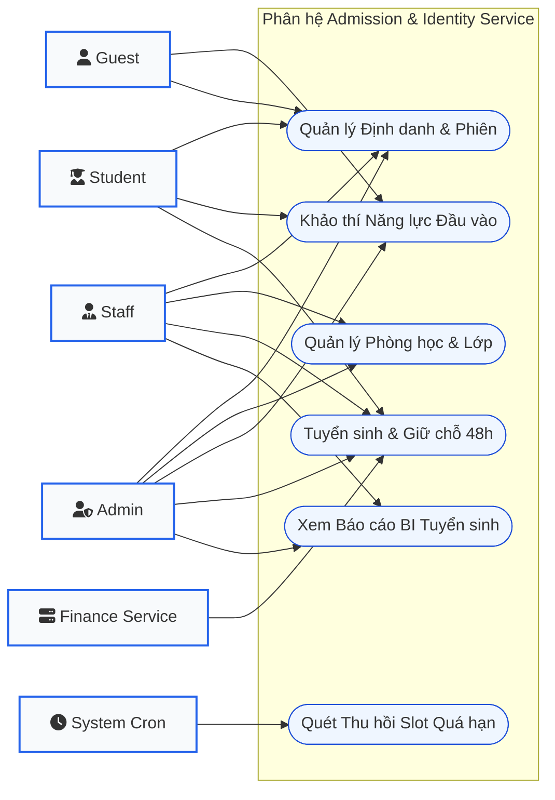

---

### 2.2. Phân hệ Định danh & Phân quyền (IAM Use Cases)

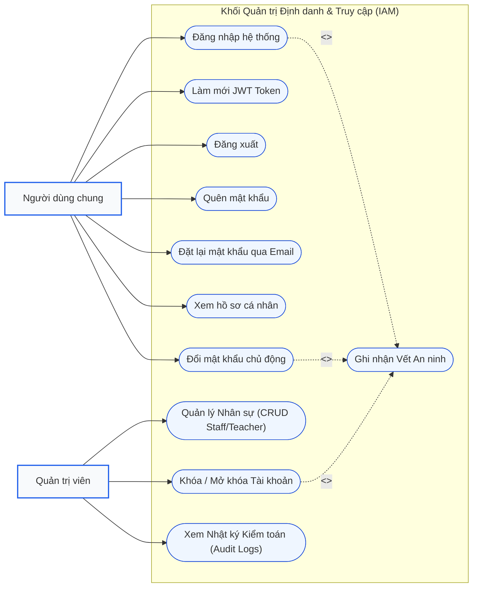

---

### 2.3. Phân hệ Cơ sở vật chất & Lớp học (Academic & Facility Use Cases)

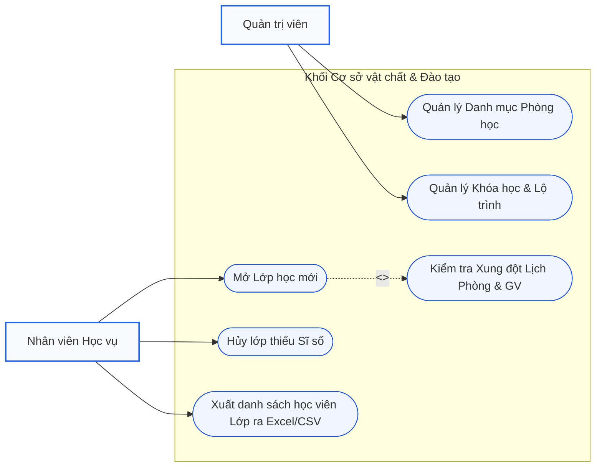

---

### 2.4. Phân hệ Khảo thí Đầu vào (Online Placement Test Use Cases)

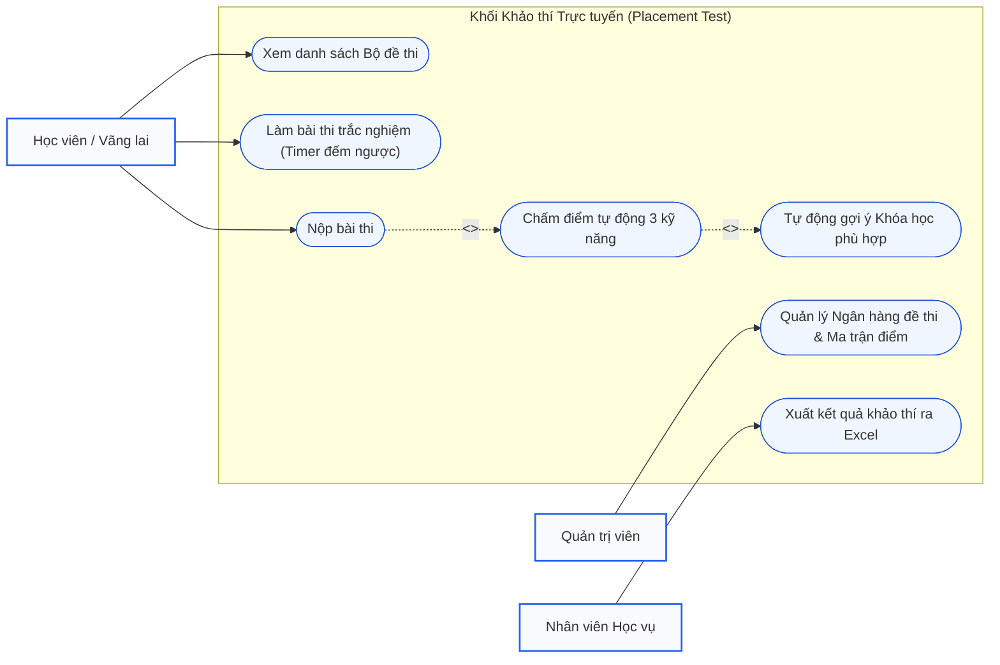

---

### 2.5. Phân hệ Tuyển sinh & Giữ chỗ 48h (Enrollment & Slot Holding Use Cases)

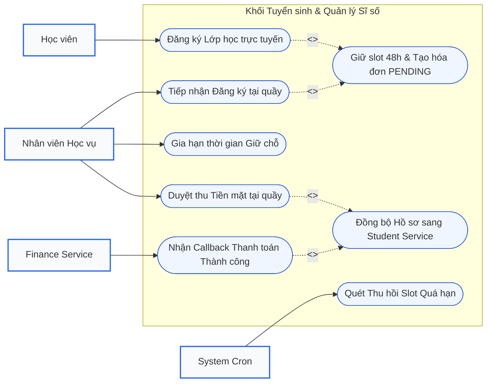

---

### 2.6. Đặc tả Chi tiết các Ca sử dụng Trọng yếu (Detailed Use Case Specifications)

#### Ca sử dụng 1: `UC-ENR-01` Đăng ký Nhập học & Giữ chỗ 48h
- **Tác nhân chính**: `STUDENT` hoặc `STAFF`.
- **Tiền điều kiện**: Lớp học mục tiêu đang có `status == 'OPEN'`.
- **Luồng sự kiện chính (Main Flow)**:
  1. Người dùng chọn lớp học và gửi yêu cầu đăng ký (`class_id`, `student_id`).
  2. Hệ thống bắt đầu transaction, khóa dòng lớp học (`FOR UPDATE`).
  3. Hệ thống tính toán slot trống khả dụng:  
     $$\text{Available Slots} = \text{max\_students} - \text{approved\_count} - \text{active\_held\_count}$$
  4. Nếu $\text{Available Slots} > 0$:
     - Tạo bản ghi `admission.enrollments` với `status = 'PENDING'`.
     - Gán thời hạn `hold_expires_at = CURRENT_TIMESTAMP + 48 HOURS`.
     - Gọi sang **Finance Service** (`POST /api/finance/invoices`) với số tiền `course.tuition_amount`.
     - Nhận về `invoice_code` và cập nhật vào đơn đăng ký.
     - Trả về mã đơn kèm thông tin chuyển khoản cho học viên.
- **Luồng ngoại lệ (Alternate Flows)**:
  - **3a. Hết chỗ (`Available Slots <= 0`)**: Hệ thống từ chối tiếp nhận, ném ngoại lệ `ADM_CLASS_FULL` (HTTP 400).
  - **4a. Finance Service tạm thời gián đoạn**: Đơn vẫn lưu `PENDING`, đưa thông điệp tạo hóa đơn vào hàng đợi retry.
- **Hậu điều kiện**: Slot giữ chỗ được bảo lưu 48h, sĩ số khả dụng của lớp giảm đi 1.

---

#### Ca sử dụng 2: `UC-ACA-02` Mở Lớp học & Chống Xung đột Lịch
- **Tác nhân chính**: `STAFF` hoặc `ADMIN`.
- **Tiền điều kiện**: Phòng học và Khóa học đã tồn tại trong hệ thống.
- **Luồng sự kiện chính (Main Flow)**:
  1. Học vụ nhập thông tin lớp: Khóa học, Phòng học, Giáo viên, Mẫu ngày (`day_pattern`), Giờ bắt đầu/kết thúc, Ngày bắt đầu/kết thúc, Sĩ số tối đa (`max_students`).
  2. Hệ thống kiểm tra: `max_students <= room.capacity`.
  3. Hệ thống quét tất cả các lớp đang mở (`OPEN`, `IN_PROGRESS`) tìm các lớp giao thoa thời gian (ngày, thứ, giờ).
  4. Xác nhận không có lớp nào trùng Phòng học và không có lớp nào trùng Giáo viên.
  5. Lưu lớp học mới với `status = 'OPEN'`.
- **Luồng ngoại lệ (Alternate Flows)**:
  - **2a. Sĩ số vượt sức chứa phòng**: Báo lỗi `ADM_ROOM_CAPACITY_EXCEEDED` (HTTP 400).
  - **4a. Trùng phòng học đã có lớp**: Báo lỗi `ADM_ROOM_CONFLICT` (HTTP 400).
  - **4b. Trùng giáo viên đã có lịch dạy**: Báo lỗi `ADM_TEACHER_CONFLICT` (HTTP 400).

---

## 3. Biểu đồ Lớp (UML Class Diagrams)

### 3.1. Biểu đồ Lớp Thực thể Miền Nghiệp vụ (Domain Model Class Diagram)

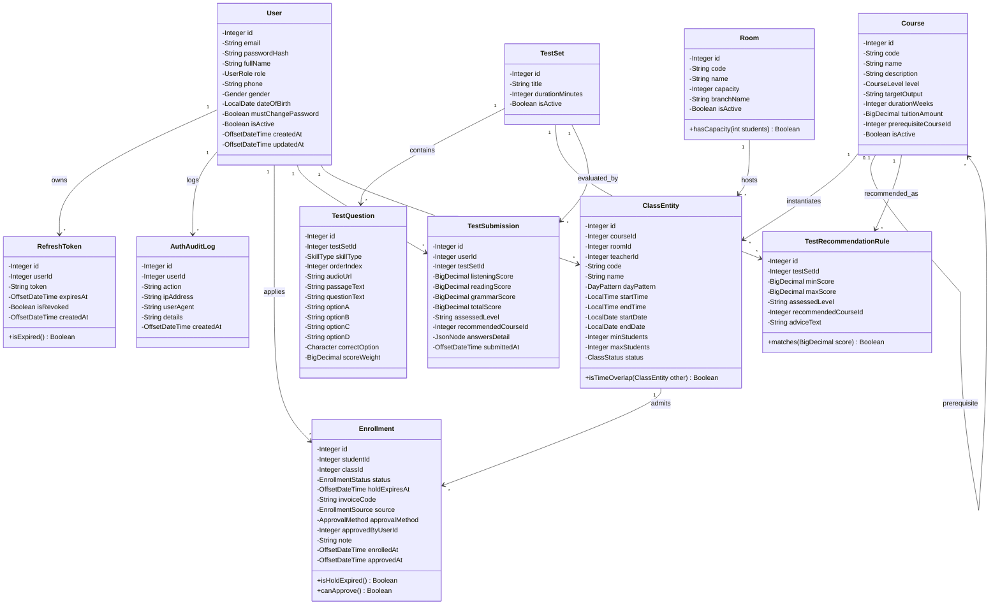

---

### 3.2. Biểu đồ Lớp Kiến trúc 3 Tầng (Controller - Service - Repository Architecture)

Minh họa kiến trúc phân tầng chuẩn của phân hệ Admission (áp dụng cho Khối Tuyển sinh `Enrollment`):

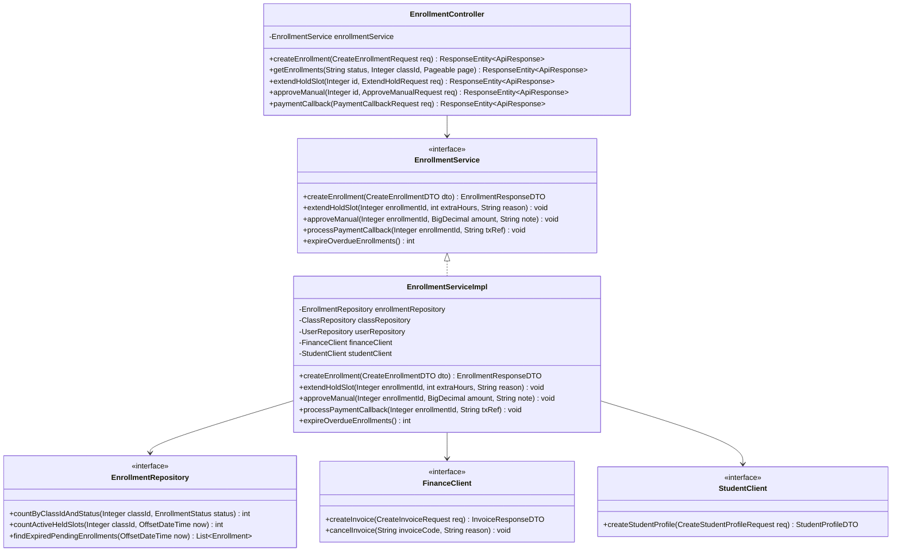

---

### 3.3. Biểu đồ Lớp Động cơ Chống Xung đột Lịch (Conflict Engine Class Diagram)

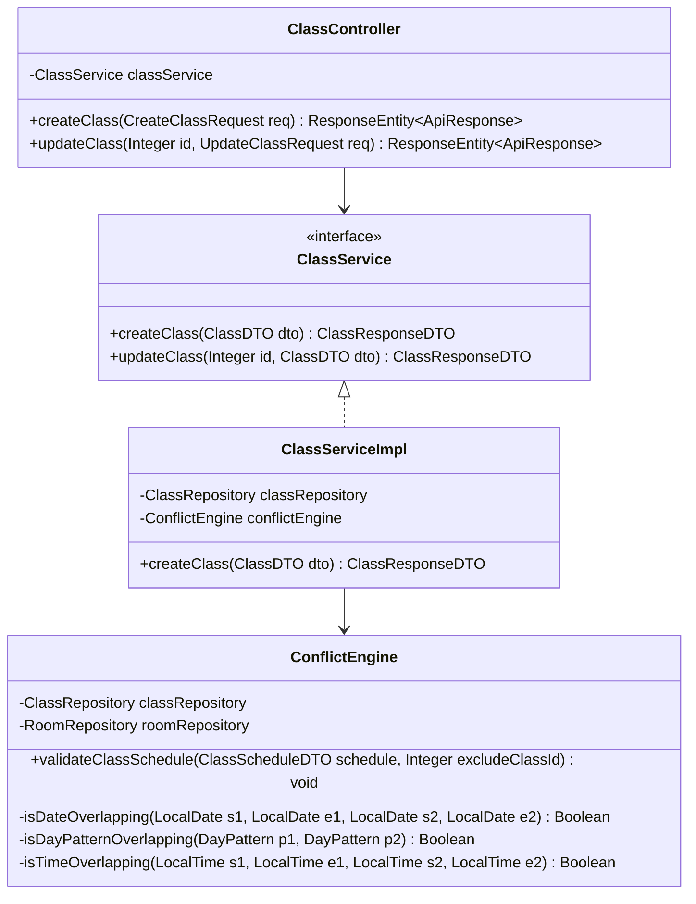

---

### 3.4. Biểu đồ Lớp Hạ tầng Bảo mật & JWT (Security & Filter Chain Class Diagram)

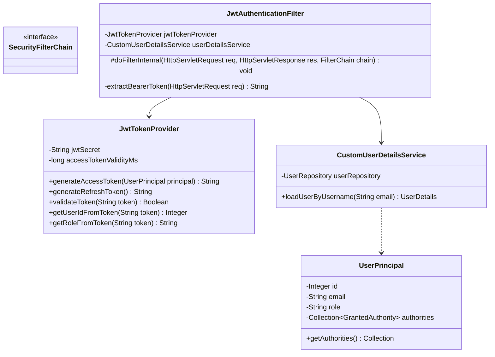

---

## 4. Biểu đồ Tuần tự (UML Sequence Diagrams)

### 4.1. Xác thực Đăng nhập & Cấp phát JWT Kép

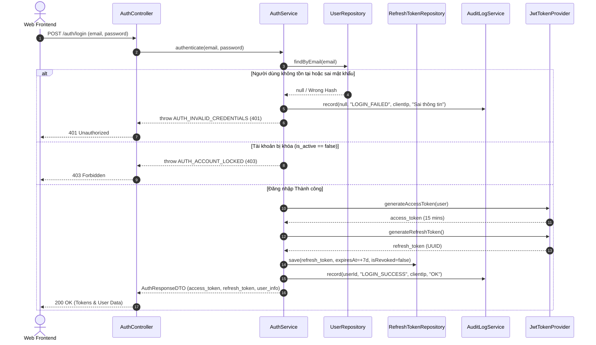

---

### 4.2. Mở Lớp học & Thuật toán Quét Xung đột Lịch

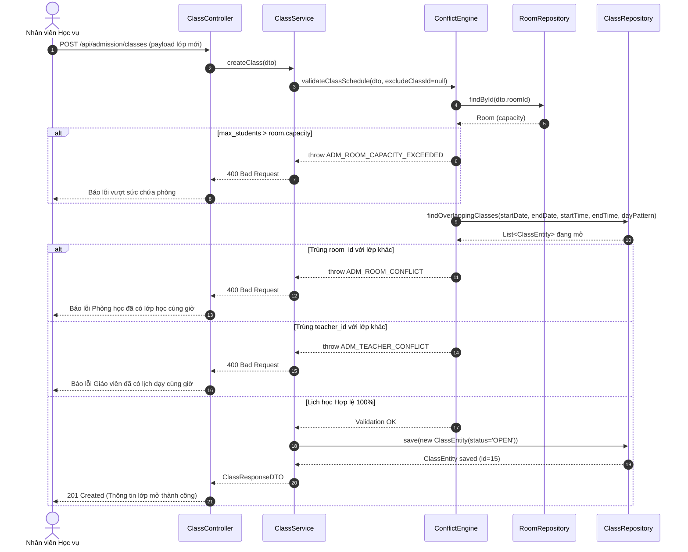

---

### 4.3. Khảo thí Trực tuyến 3 Kỹ năng & Tự động Đề xuất Khóa học

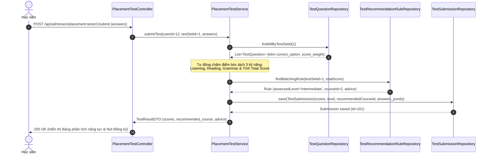

---

### 4.4. Đăng ký Nhập học, Giữ chỗ 48h & Bắt tay Thanh toán Liên Service

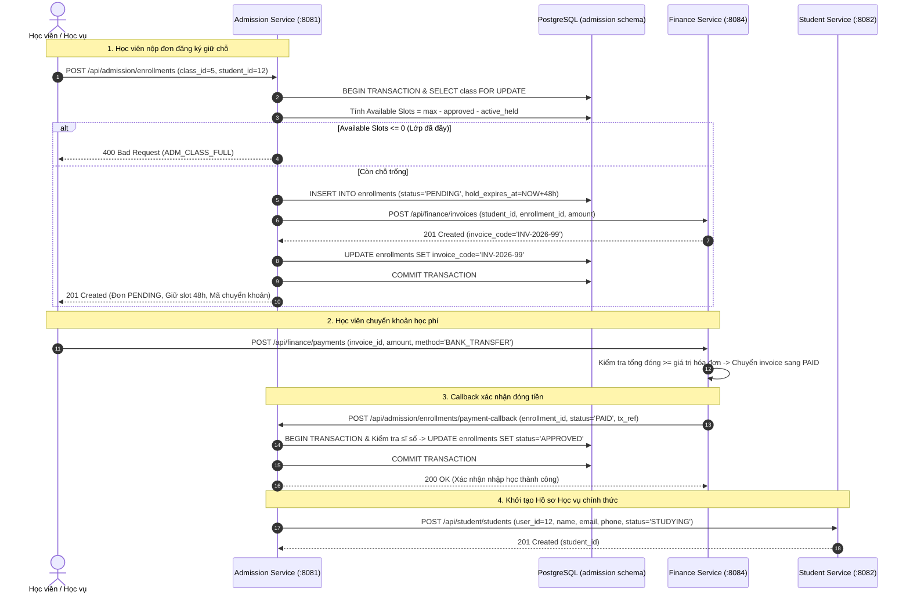

---

### 4.5. Tác vụ Quét Nền Thu hồi Slot Quá hạn 48h

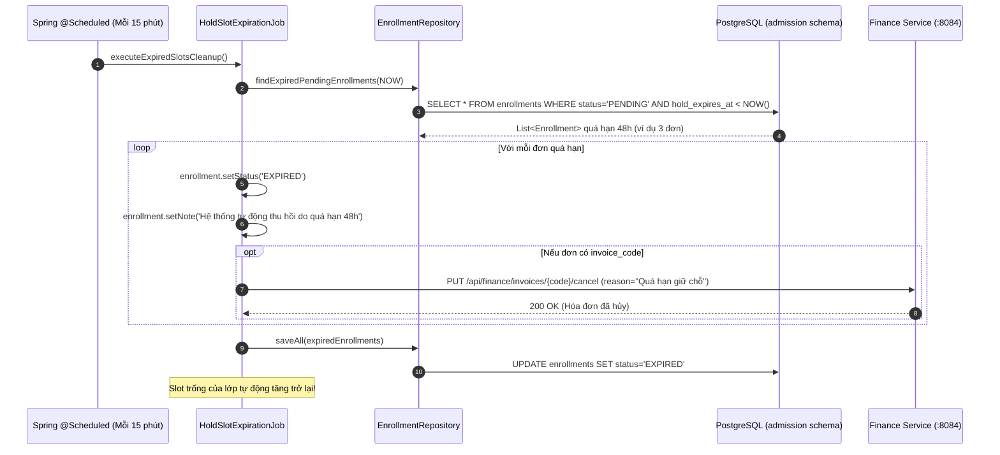

---

## 5. Biểu đồ Máy Trạng thái (UML State Machine Diagrams)

### 5.1. Vòng đời Đơn Đăng ký Tuyển sinh (Enrollment Lifecycle)

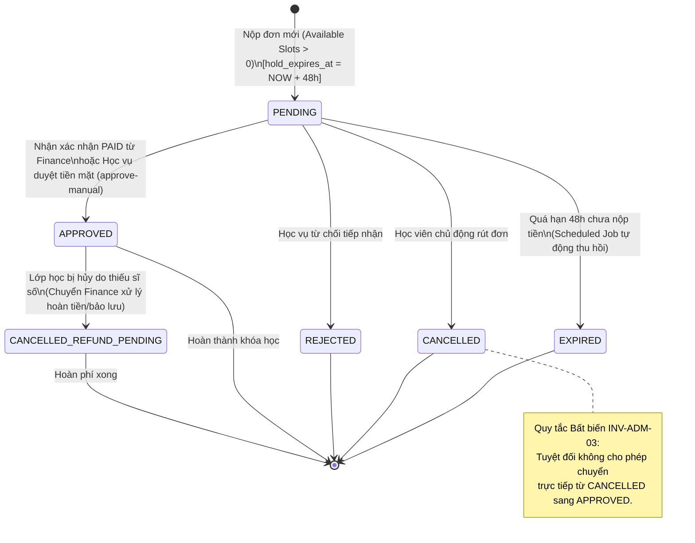

---

### 5.2. Vòng đời Lớp học (Class Lifecycle)

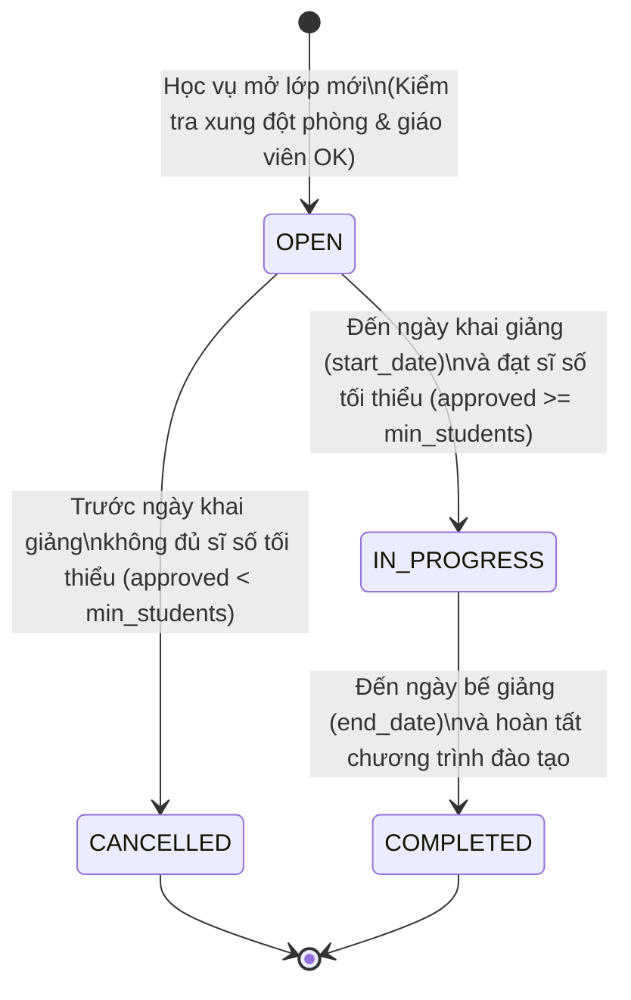

---

## 6. Biểu đồ Hoạt động (UML Activity Diagrams)

### 6.1. Hoạt động: Thuật toán Kiểm tra Xung đột Lịch Phòng học & Giáo viên

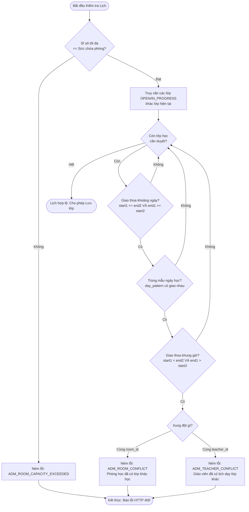

---

### 6.2. Hoạt động: Chấm điểm & Quy đổi Lộ trình Khảo thí

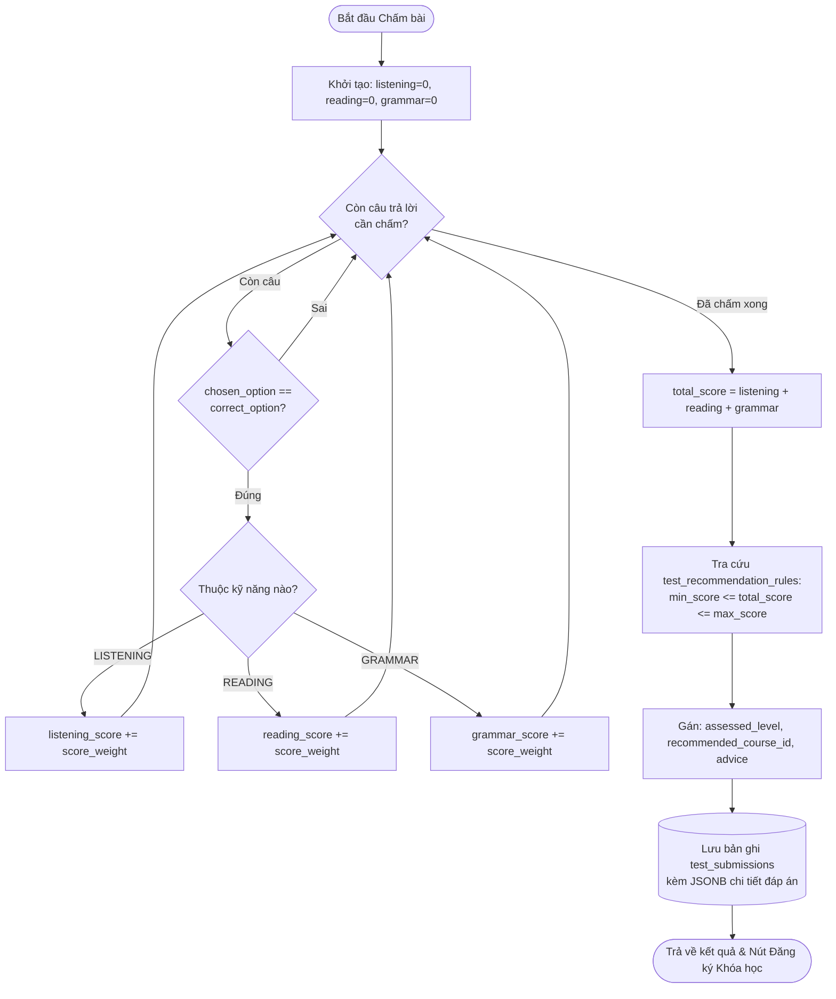

---

## 7. Ma trận Truy vết Yêu cầu sang Thiết kế (Requirements Traceability Matrix)

Ma trận chứng minh 100% các yêu cầu nghiệp vụ (`FR`), quy tắc bất biến (`INV`) đã được hiện thực hóa đầy đủ trong thiết kế UML:

| Mã Yêu cầu | Tên Yêu cầu Nghiệp vụ | Use Case UML | Lớp UML / Entity | Quy tắc Bất biến Bảo vệ |
|---|---|---|---|---|
| **FR-IAM-01** | Tự động tạo tài khoản Student | `UC_Auth` | `User`, `UserService` | Cách ly dữ liệu |
| **FR-IAM-03** | Xác thực JWT Token Kép | `UC_Login`, `UC_Refresh` | `JwtTokenProvider`, `JwtAuthenticationFilter` | Bảo mật phiên |
| **FR-IAM-04** | Refresh Token Rotation | `UC_Refresh` | `RefreshToken`, `AuthService` | Chống Replay attack |
| **FR-IAM-07** | Nhật ký Kiểm toán Đăng nhập | `UC_RecordAudit`, `UC_Audit` | `AuthAuditLog`, `AuditLogService` | Lưu vết kiểm toán |
| **FR-FAC-01** | Quản lý Danh mục Phòng học | `UC_Room` | `Room`, `RoomService` | Toàn vẹn cơ sở vật chất |
| **FR-FAC-03** | Ràng buộc Sức chứa Phòng | `UC_CheckConflict` | `Room.hasCapacity()`, `ConflictEngine` | Sức chứa vật lý |
| **FR-ACA-01** | CRUD Khóa học chuẩn | `UC_Course` | `Course`, `CourseService` | `INV-ADM-02` (Mã khóa duy nhất) |
| **FR-ACA-03** | Chống Xung đột Lịch Phòng & GV | `UC_CheckConflict` | `ConflictEngine`, `ClassService` | `INV-ADM-03` (Lịch không trùng) |
| **FR-TST-02** | Ngân hàng câu hỏi 3 kỹ năng | `UC_TakeTest` | `TestQuestion`, `PlacementTestService` | Đo lường năng lực chuẩn |
| **FR-TST-04** | Chấm điểm tự động & Đề xuất | `UC_AutoGrade`, `UC_Recommend` | `TestRecommendationRule`, `TestSubmission` | Khảo thí minh bạch |
| **FR-ENR-01** | Đăng ký Tuyển sinh Đa kênh | `UC_SelfEnroll`, `UC_StaffEnroll` | `EnrollmentController`, `EnrollmentService` | Trải nghiệm đa kênh |
| **FR-ENR-02** | Không bao giờ duyệt vượt sĩ số | `UC_Hold48h` | `EnrollmentService` (Pessimistic Lock) | **`INV-ADM-01`** (P0 - Zero Over-enrollment) |
| **FR-ENR-03** | Giữ chỗ 48h tự động thu hồi | `UC_Hold48h`, `UC_AutoExpire` | `HoldSlotExpirationJob`, `Enrollment` | Thu hồi tài nguyên rác |
| **FR-ENR-06** | Nhập học dựa trên thanh toán | `UC_CallbackPaid` | `EnrollmentService.processPaymentCallback` | Tính toàn vẹn thanh toán |
| **FR-ENR-08** | Đồng bộ Hồ sơ Học viên | `UC_SyncStudent` | `StudentClient`, `EnrollmentService` | Nhất quán dữ liệu liên service |
