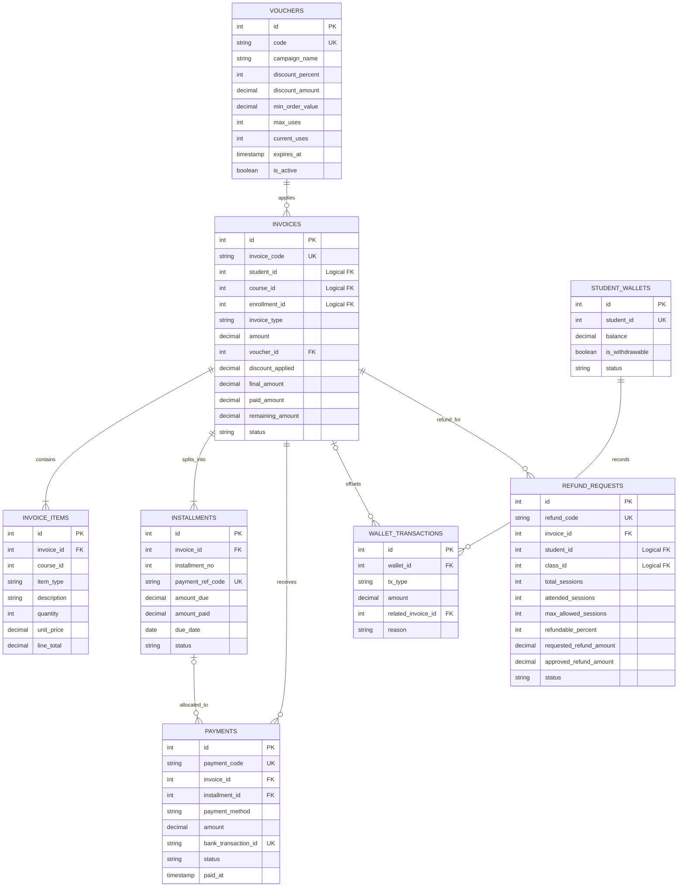
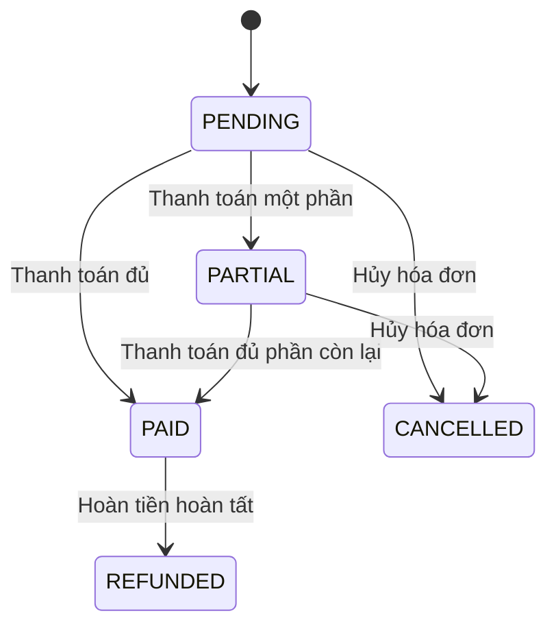
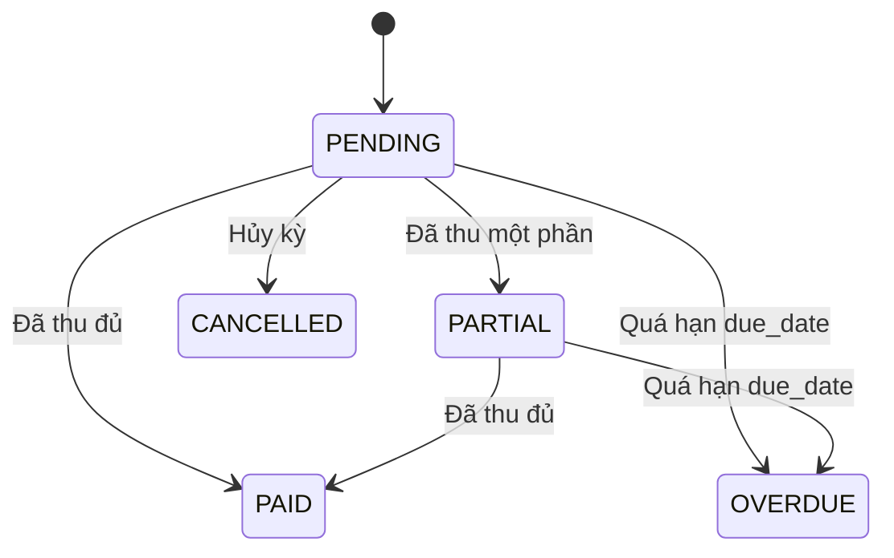
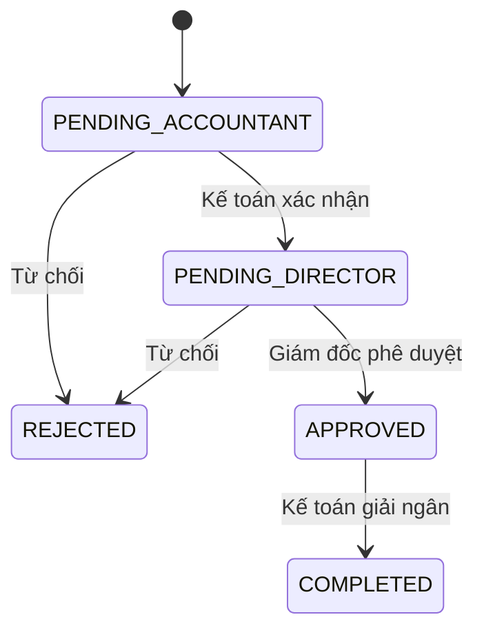

# ĐẶC TẢ CHI TIẾT CƠ SỞ DỮ LIỆU & TỪ ĐIỂN DỮ LIỆU (DATABASE SCHEMA SPECIFICATION)
## SCHEMA: `finance` (POSTGRESQL)

> **Dự án:** Hệ thống Quản lý Trung tâm Ngoại ngữ  
> **Service:** `finance-service`  
> **Port:** `8083`  
> **Database:** PostgreSQL  
> **Primary Key:** SERIAL  
> **Logical Foreign Key:** INTEGER  
> **Phiên bản thiết kế:** Finance Module 2.0

---

## MỤC LỤC
1. [Triết lý Thiết kế & Ranh giới Dữ liệu](#1-triết-lý-thiết-kế--ranh-giới-dữ-liệu)
2. [Sơ đồ Thực thể Quan hệ (ERD)](#2-sơ-đồ-thực-thể-quan-hệ-erd)
3. [Từ điển Dữ liệu Chi tiết 8 Bảng](#3-từ-điển-dữ-liệu-chi-tiết-8-bảng)
4. [Máy trạng thái & Quy tắc Bất biến](#4-máy-trạng-thái--quy-tắc-bất-biến)
5. [Toàn văn DDL PostgreSQL](#5-toàn-văn-ddl-postgresql)
6. [Định nghĩa 2 BI Views](#6-định-nghĩa-2-bi-views)

---

## 1. Triết lý Thiết kế & Ranh giới Dữ liệu

### 1.1. Schema Isolation

Finance Service chỉ truy cập schema `finance`. Các định danh thuộc service khác được lưu dưới dạng Logical FK kiểu INTEGER:
- `student_id`: tham chiếu logic tới dữ liệu học viên.
- `course_id`: tham chiếu logic tới khóa học.
- `class_id`: tham chiếu logic tới lớp học.
- `enrollment_id`: định danh đơn đăng ký liên quan.

Không JOIN hoặc tạo FK vật lý sang schema `admission` hay `learning`.

### 1.2. Quy ước khóa và dữ liệu

- Khóa chính sử dụng `SERIAL`.
- Khóa ngoại nội bộ Finance sử dụng `INTEGER`.
- Các ID liên service sử dụng `INTEGER` (Logical FK).
- Tên JSON field sử dụng `snake_case`.
- Giá trị tiền sử dụng `DECIMAL(12,2)`.
- Các trường thời gian trong DDL sử dụng `TIMESTAMP`; ngày đến hạn sử dụng `DATE`.
- Hệ quản trị cơ sở dữ liệu: PostgreSQL.

### 1.3. Danh mục thực thể

| STT | Bảng | Chức năng |
|---:|---|---|
| 1 | `finance.vouchers` | Chiến dịch mã giảm giá. |
| 2 | `finance.invoices` | Hóa đơn học phí. |
| 3 | `finance.invoice_items` | Chi tiết khoản mục hóa đơn. |
| 4 | `finance.installments` | Lịch đóng học phí nhiều đợt/đặt cọc. |
| 5 | `finance.payments` | Giao dịch thu tiền và gạch nợ. |
| 6 | `finance.student_wallets` | Ví bảo lưu học viên. |
| 7 | `finance.wallet_transactions` | Lịch sử giao dịch ví. |
| 8 | `finance.refund_requests` | Yêu cầu và phê duyệt hoàn tiền 3 cấp. |

---

## 2. Sơ đồ Thực thể Quan hệ (ERD)

Sơ đồ thể hiện đầy đủ **8 bảng nghiệp vụ** trong schema Finance.



### 2.1. Diễn giải quan hệ

- Một Voucher có thể được áp dụng cho nhiều hóa đơn; mỗi hóa đơn tham chiếu Voucher qua `voucher_id`.
- Một hóa đơn có các khoản mục chi tiết trong `invoice_items`.
- Một hóa đơn được chia thành các kỳ thanh toán trong `installments`.
- Một hóa đơn có thể nhận nhiều giao dịch trong `payments`.
- Một kỳ thanh toán có thể được liên kết với nhiều giao dịch payment; `installment_id` trên payment là quan hệ tùy chọn.
- Một ví bảo lưu có nhiều giao dịch trong `wallet_transactions`.
- Giao dịch ví có thể liên kết với hóa đơn được cấn trừ thông qua `related_invoice_id`.
- Một hóa đơn có thể phát sinh yêu cầu hoàn tiền trong `refund_requests`.
- `student_id`, `course_id`, `class_id`, `enrollment_id` là Logical FK; không tạo quan hệ FK vật lý ra schema khác.

---

## 3. Từ điển Dữ liệu Chi tiết 8 Bảng

Quy ước: Nullable = YES nếu cột không khai báo `NOT NULL` trong DDL; mặc định và CHECK/UNIQUE/FK được ghi theo định nghĩa cột/bảng.

### 3.1. Bảng `finance.vouchers`

**Mục đích:** Quản lý chiến dịch Voucher, hình thức giảm giá, điều kiện giá trị đơn hàng, giới hạn lượt sử dụng và thời hạn hiệu lực.

| Cột | Kiểu dữ liệu | Nullable | Mặc định | Ràng buộc | Diễn giải |
|---|---|:---:|---|---|---|
| `id` | SERIAL | NO | Auto | PK | Mã Voucher. |
| `code` | VARCHAR(50) | NO | – | UNIQUE | Mã Voucher duy nhất. |
| `campaign_name` | VARCHAR(150) | NO | 'Chiến dịch ưu đãi học phí' | – | Tên chiến dịch. |
| `discount_percent` | INT | YES | 0 | CHECK 0–100 | Tỷ lệ giảm giá theo phần trăm. |
| `discount_amount` | DECIMAL(12,2) | YES | 0 | CHECK >= 0 | Số tiền giảm cố định. |
| `min_order_value` | DECIMAL(12,2) | YES | 0 | CHECK >= 0 | Giá trị đơn hàng tối thiểu. |
| `max_discount_amount` | DECIMAL(12,2) | YES | NULL | – | Mức giảm tối đa. |
| `max_uses` | INT | YES | 100 | CHECK > 0 | Tổng lượt dùng tối đa. |
| `current_uses` | INT | YES | 0 | CHECK >= 0; <= max_uses | Số lượt đã sử dụng. |
| `valid_from` | TIMESTAMP | YES | CURRENT_TIMESTAMP | – | Thời điểm bắt đầu hiệu lực. |
| `expires_at` | TIMESTAMP | NO | – | – | Thời điểm hết hiệu lực. |
| `is_active` | BOOLEAN | YES | TRUE | – | Trạng thái kích hoạt Voucher. |
| `created_at` | TIMESTAMP | YES | CURRENT_TIMESTAMP | – | Thời điểm tạo. |

### 3.2. Bảng `finance.invoices`

**Mục đích:** Quản lý hóa đơn học phí, loại hóa đơn, Voucher áp dụng, số tiền phải thu, số đã thanh toán và số còn lại.

| Cột | Kiểu dữ liệu | Nullable | Mặc định | Ràng buộc | Diễn giải |
|---|---|:---:|---|---|---|
| `id` | SERIAL | NO | Auto | PK | Mã hóa đơn. |
| `invoice_code` | VARCHAR(50) | NO | – | UNIQUE | Mã hóa đơn duy nhất. |
| `student_id` | INT | NO | – | Logical FK | ID học viên. |
| `course_id` | INT | NO | – | Logical FK | ID khóa học. |
| `enrollment_id` | INT | YES | NULL | Logical FK | ID đăng ký khóa học. |
| `invoice_type` | VARCHAR(30) | NO | COURSE_PACKAGE | CHECK | COURSE_PACKAGE, STANDALONE_RETAKE, MIXED. |
| `amount` | DECIMAL(12,2) | NO | – | CHECK >= 0 | Giá trị hóa đơn trước giảm giá. |
| `voucher_id` | INT | YES | NULL | FK vouchers(id) | Voucher được áp dụng. |
| `discount_applied` | DECIMAL(12,2) | YES | 0 | CHECK >= 0 | Số tiền được giảm. |
| `final_amount` | DECIMAL(12,2) | NO | – | CHECK >= 0; final_amount = amount - discount_applied | Số tiền cuối cùng phải thu. |
| `paid_amount` | DECIMAL(12,2) | NO | 0 | CHECK >= 0; <= final_amount | Tổng số tiền đã thanh toán. |
| `remaining_amount` | DECIMAL(12,2) | Generated | Generated | GENERATED ALWAYS | Số tiền còn lại = final_amount - paid_amount. |
| `status` | VARCHAR(20) | NO | PENDING | CHECK | PENDING, PARTIAL, PAID, CANCELLED, REFUNDED. |
| `notes` | TEXT | YES | NULL | – | Ghi chú hóa đơn. |
| `created_at` | TIMESTAMP | YES | CURRENT_TIMESTAMP | – | Thời điểm tạo hóa đơn. |
| `paid_at` | TIMESTAMP | YES | NULL | – | Thời điểm thanh toán. |

### 3.3. Bảng `finance.invoice_items`

**Mục đích:** Lưu các khoản mục cấu thành hóa đơn, bao gồm gói học phí và phí học lại.

| Cột | Kiểu dữ liệu | Nullable | Mặc định | Ràng buộc | Diễn giải |
|---|---|:---:|---|---|---|
| `id` | SERIAL | NO | Auto | PK | Mã khoản mục. |
| `invoice_id` | INT | NO | – | FK invoices(id), ON DELETE CASCADE | Hóa đơn chứa khoản mục. |
| `course_id` | INT | YES | NULL | – | ID khóa học liên quan. |
| `item_type` | VARCHAR(30) | NO | – | CHECK | TUITION_PACKAGE hoặc RETAKE_FEE. |
| `description` | VARCHAR(255) | NO | – | – | Mô tả khoản mục. |
| `quantity` | INT | NO | 1 | CHECK > 0 | Số lượng. |
| `unit_price` | DECIMAL(12,2) | NO | – | CHECK >= 0 | Đơn giá. |
| `line_total` | DECIMAL(12,2) | NO | – | CHECK >= 0; quantity × unit_price | Thành tiền khoản mục. |
| `created_at` | TIMESTAMP | YES | CURRENT_TIMESTAMP | – | Thời điểm tạo. |

### 3.4. Bảng `finance.installments`

**Mục đích:** Quản lý lịch thanh toán theo nhiều đợt hoặc đặt cọc giữ chỗ.

| Cột | Kiểu dữ liệu | Nullable | Mặc định | Ràng buộc | Diễn giải |
|---|---|:---:|---|---|---|
| `id` | SERIAL | NO | Auto | PK | Mã kỳ thanh toán. |
| `invoice_id` | INT | NO | – | FK invoices(id), ON DELETE CASCADE | Hóa đơn sở hữu kỳ thanh toán. |
| `installment_no` | INT | NO | – | CHECK >= 1; UNIQUE theo invoice_id | Số thứ tự kỳ. |
| `payment_ref_code` | VARCHAR(50) | NO | – | UNIQUE | Mã tham chiếu thanh toán. |
| `amount_due` | DECIMAL(12,2) | NO | – | CHECK > 0 | Số tiền phải đóng trong kỳ. |
| `amount_paid` | DECIMAL(12,2) | NO | 0 | CHECK >= 0 | Số tiền đã đóng trong kỳ. |
| `due_date` | DATE | NO | – | – | Ngày đến hạn. |
| `status` | VARCHAR(20) | NO | PENDING | CHECK | PENDING, PARTIAL, PAID, OVERDUE, CANCELLED. |
| `paid_at` | TIMESTAMP | YES | NULL | – | Thời điểm hoàn tất thanh toán kỳ. |
| `created_at` | TIMESTAMP | YES | CURRENT_TIMESTAMP | – | Thời điểm tạo kỳ. |

### 3.5. Bảng `finance.payments`

**Mục đích:** Lưu các giao dịch thanh toán tiền mặt, VietQR hoặc cấn trừ ví.

| Cột | Kiểu dữ liệu | Nullable | Mặc định | Ràng buộc | Diễn giải |
|---|---|:---:|---|---|---|
| `id` | SERIAL | NO | Auto | PK | Mã giao dịch. |
| `payment_code` | VARCHAR(50) | NO | – | UNIQUE | Mã phiếu thu duy nhất. |
| `invoice_id` | INT | NO | – | FK invoices(id) | Hóa đơn được thanh toán. |
| `installment_id` | INT | YES | NULL | FK installments(id) | Kỳ thanh toán liên quan. |
| `payment_method` | VARCHAR(20) | NO | – | CHECK | CASH, VIETQR, WALLET_OFFSET. |
| `amount` | DECIMAL(12,2) | NO | – | CHECK > 0 | Số tiền giao dịch. |
| `bank_transaction_id` | VARCHAR(100) | YES | NULL | UNIQUE | Mã giao dịch ngân hàng. |
| `qr_reference_code` | VARCHAR(50) | YES | NULL | – | Mã tham chiếu QR. |
| `webhook_payload` | JSONB | YES | NULL | – | Payload Webhook từ ngân hàng. |
| `received_by_staff_id` | INT | YES | NULL | – | Nhân viên ghi nhận giao dịch. |
| `status` | VARCHAR(20) | NO | SUCCESS | CHECK | PENDING, SUCCESS, FAILED. |
| `paid_at` | TIMESTAMP | YES | CURRENT_TIMESTAMP | – | Thời điểm thanh toán. |

### 3.6. Bảng `finance.student_wallets`

**Mục đích:** Quản lý số dư ví bảo lưu nội bộ của từng học viên.

| Cột | Kiểu dữ liệu | Nullable | Mặc định | Ràng buộc | Diễn giải |
|---|---|:---:|---|---|---|
| `id` | SERIAL | NO | Auto | PK | Mã ví. |
| `student_id` | INT | NO | – | UNIQUE; Logical FK | Mỗi học viên có một ví. |
| `balance` | DECIMAL(12,2) | NO | 0 | CHECK >= 0 | Số dư ví. |
| `is_withdrawable` | BOOLEAN | NO | FALSE | – | Cờ cho phép rút tiền; mặc định FALSE. |
| `status` | VARCHAR(20) | NO | ACTIVE | CHECK | ACTIVE hoặc FROZEN. |
| `updated_at` | TIMESTAMP | YES | CURRENT_TIMESTAMP | – | Thời điểm cập nhật số dư. |

### 3.7. Bảng `finance.wallet_transactions`

**Mục đích:** Lưu lịch sử cộng tiền bảo lưu, cấn trừ học phí và điều chỉnh ví.

| Cột | Kiểu dữ liệu | Nullable | Mặc định | Ràng buộc | Diễn giải |
|---|---|:---:|---|---|---|
| `id` | SERIAL | NO | Auto | PK | Mã giao dịch ví. |
| `wallet_id` | INT | NO | – | FK student_wallets(id) | Ví liên quan. |
| `tx_type` | VARCHAR(30) | NO | – | CHECK | RESERVATION_CREDIT, TUITION_OFFSET, ADJUSTMENT. |
| `amount` | DECIMAL(12,2) | NO | – | CHECK > 0 | Số tiền giao dịch ví. |
| `related_invoice_id` | INT | YES | NULL | FK invoices(id) | Hóa đơn được cấn trừ. |
| `reason` | TEXT | NO | – | – | Lý do giao dịch. |
| `created_by_staff_id` | INT | YES | NULL | – | Nhân viên thực hiện. |
| `created_at` | TIMESTAMP | YES | CURRENT_TIMESTAMP | – | Thời điểm ghi nhận. |

### 3.8. Bảng `finance.refund_requests`

**Mục đích:** Quản lý yêu cầu hoàn phí, điều kiện số buổi học, thông tin nhận tiền và phê duyệt 3 cấp.

| Cột | Kiểu dữ liệu | Nullable | Mặc định | Ràng buộc | Diễn giải |
|---|---|:---:|---|---|---|
| `id` | SERIAL | NO | Auto | PK | Mã yêu cầu hoàn phí. |
| `refund_code` | VARCHAR(50) | NO | – | UNIQUE | Mã yêu cầu hoàn phí. |
| `invoice_id` | INT | NO | – | FK invoices(id) | Hóa đơn cần hoàn. |
| `student_id` | INT | NO | – | Logical FK | Học viên yêu cầu hoàn. |
| `class_id` | INT | YES | NULL | Logical FK | Lớp học liên quan. |
| `total_sessions` | INT | NO | – | CHECK > 0 | Tổng số buổi. |
| `attended_sessions` | INT | NO | – | CHECK >= 0 | Số buổi học viên đã tham gia. |
| `max_allowed_sessions` | INT | NO | 3 | – | Số buổi tối đa được xét hoàn. |
| `paid_amount_snapshot` | DECIMAL(12,2) | NO | – | – | Snapshot số tiền đã thanh toán. |
| `refundable_percent` | INT | NO | – | CHECK 0–100 | Tỷ lệ hoàn theo hợp đồng. |
| `deduction_amount` | DECIMAL(12,2) | NO | 0 | – | Số tiền khấu trừ. |
| `requested_refund_amount` | DECIMAL(12,2) | NO | – | CHECK >= 0 | Số tiền đề nghị hoàn. |
| `approved_refund_amount` | DECIMAL(12,2) | YES | NULL | CHECK >= 0 | Số tiền được duyệt hoàn. |
| `reason` | TEXT | NO | – | – | Lý do yêu cầu hoàn phí. |
| `bank_name` | VARCHAR(100) | YES | NULL | – | Ngân hàng nhận hoàn. |
| `bank_account_no` | VARCHAR(50) | YES | NULL | – | Số tài khoản nhận hoàn. |
| `bank_account_holder` | VARCHAR(150) | YES | NULL | – | Chủ tài khoản nhận hoàn. |
| `status` | VARCHAR(30) | NO | PENDING_ACCOUNTANT | CHECK | PENDING_ACCOUNTANT, PENDING_DIRECTOR, APPROVED, REJECTED, COMPLETED. |
| `requested_by_staff_id` | INT | NO | – | – | Nhân viên tạo yêu cầu. |
| `requested_at` | TIMESTAMP | YES | CURRENT_TIMESTAMP | – | Thời điểm tạo yêu cầu. |
| `verified_by_accountant_id` | INT | YES | NULL | – | Kế toán xác minh. |
| `verified_at` | TIMESTAMP | YES | NULL | – | Thời điểm xác minh. |
| `accountant_note` | TEXT | YES | NULL | – | Ghi chú kế toán. |
| `approved_by_director_id` | INT | YES | NULL | – | Giám đốc phê duyệt. |
| `approved_at` | TIMESTAMP | YES | NULL | – | Thời điểm phê duyệt. |
| `director_note` | TEXT | YES | NULL | – | Ghi chú phê duyệt. |
| `completed_at` | TIMESTAMP | YES | NULL | – | Thời điểm hoàn tất giải ngân. |

Ràng buộc cấp bảng: `attended_sessions <= max_allowed_sessions`.

---

## 4. Máy trạng thái & Quy tắc Bất biến

### 4.1. Trạng thái hóa đơn



### 4.2. Trạng thái kỳ thanh toán



### 4.3. Quy trình phê duyệt hoàn tiền



### 4.4. Bất biến tài chính

| Mã | Tên quy tắc | Ràng buộc |
|---|---|---|
| INV-FIN-01 | Hóa đơn đã thanh toán | Invoice PAID hoặc REFUNDED không được xóa hoặc sửa trực tiếp các cột amount, discount_applied, final_amount. |
| INV-FIN-02 | Đẳng thức hóa đơn và trả góp | final_amount = amount - discount_applied >= 0; 0 <= paid_amount <= final_amount; tổng amount_due của installments bằng final_amount. |
| INV-FIN-03 | Cô lập Schema | Finance chỉ truy cập schema finance; student_id, course_id, class_id là INTEGER Logical FK, không JOIN/FK vật lý sang admission hoặc learning. |
| INV-FIN-04 | Chống race condition Voucher | Kiểm tra is_active, expires_at, current_uses < max_uses và SELECT ... FOR UPDATE trước khi tăng current_uses. |
| INV-FIN-05 | Idempotency VietQR | bank_transaction_id UNIQUE; giao dịch đã tồn tại trả 200 OK nhưng không ghi nhận phiếu thu lần hai. |
| INV-FIN-06 | Khóa rút ví bảo lưu | is_withdrawable luôn FALSE; số dư chỉ giảm qua TUITION_OFFSET. |
| INV-FIN-07 | Điều kiện hoàn phí theo số buổi | Chỉ tạo yêu cầu khi attended_sessions <= max_allowed_sessions và đi qua đủ ba cấp duyệt. |

---

## 5. Toàn văn DDL PostgreSQL

```sql
-- ============================================================================
-- SCHEMA: finance
-- Primary Key / Logical Foreign Key: SERIAL / INTEGER
-- ============================================================================

CREATE SCHEMA IF NOT EXISTS finance;

-- 1. BẢNG CHIẾN DỊCH VOUCHER
CREATE TABLE IF NOT EXISTS finance.vouchers (
    id SERIAL PRIMARY KEY,
    code VARCHAR(50) UNIQUE NOT NULL,
    campaign_name VARCHAR(150) NOT NULL DEFAULT 'Chiến dịch ưu đãi học phí',
    discount_percent INT DEFAULT 0 CHECK (discount_percent >= 0 AND discount_percent <= 100),
    discount_amount DECIMAL(12, 2) DEFAULT 0 CHECK (discount_amount >= 0),
    min_order_value DECIMAL(12, 2) DEFAULT 0 CHECK (min_order_value >= 0),
    max_discount_amount DECIMAL(12, 2) DEFAULT NULL,
    max_uses INT DEFAULT 100 CHECK (max_uses > 0),
    current_uses INT DEFAULT 0 CHECK (current_uses >= 0),
    valid_from TIMESTAMP DEFAULT CURRENT_TIMESTAMP,
    expires_at TIMESTAMP NOT NULL,
    is_active BOOLEAN DEFAULT TRUE,
    created_at TIMESTAMP DEFAULT CURRENT_TIMESTAMP,
    CONSTRAINT chk_voucher_usage_limit CHECK (current_uses <= max_uses)
);

-- 2. BẢNG HÓA ĐƠN
CREATE TABLE IF NOT EXISTS finance.invoices (
    id SERIAL PRIMARY KEY,
    invoice_code VARCHAR(50) UNIQUE NOT NULL,
    student_id INT NOT NULL,
    course_id INT NOT NULL,
    enrollment_id INT,
    invoice_type VARCHAR(30) NOT NULL DEFAULT 'COURSE_PACKAGE'
        CHECK (invoice_type IN ('COURSE_PACKAGE', 'STANDALONE_RETAKE', 'MIXED')),
    amount DECIMAL(12, 2) NOT NULL CHECK (amount >= 0),
    voucher_id INT REFERENCES finance.vouchers(id),
    discount_applied DECIMAL(12, 2) DEFAULT 0 CHECK (discount_applied >= 0),
    final_amount DECIMAL(12, 2) NOT NULL CHECK (final_amount >= 0),
    paid_amount DECIMAL(12, 2) NOT NULL DEFAULT 0 CHECK (paid_amount >= 0),
    remaining_amount DECIMAL(12, 2) GENERATED ALWAYS AS (final_amount - paid_amount) STORED,
    status VARCHAR(20) NOT NULL DEFAULT 'PENDING'
        CHECK (status IN ('PENDING', 'PARTIAL', 'PAID', 'CANCELLED', 'REFUNDED')),
    notes TEXT,
    created_at TIMESTAMP DEFAULT CURRENT_TIMESTAMP,
    paid_at TIMESTAMP,
    CONSTRAINT chk_invoice_math CHECK (final_amount = amount - discount_applied),
    CONSTRAINT chk_invoice_paid_bound CHECK (paid_amount <= final_amount)
);

-- 3. BẢNG CHI TIẾT KHOẢN MỤC HÓA ĐƠN
CREATE TABLE IF NOT EXISTS finance.invoice_items (
    id SERIAL PRIMARY KEY,
    invoice_id INT NOT NULL REFERENCES finance.invoices(id) ON DELETE CASCADE,
    course_id INT,
    item_type VARCHAR(30) NOT NULL
        CHECK (item_type IN ('TUITION_PACKAGE', 'RETAKE_FEE')),
    description VARCHAR(255) NOT NULL,
    quantity INT NOT NULL DEFAULT 1 CHECK (quantity > 0),
    unit_price DECIMAL(12, 2) NOT NULL CHECK (unit_price >= 0),
    line_total DECIMAL(12, 2) NOT NULL CHECK (line_total >= 0),
    created_at TIMESTAMP DEFAULT CURRENT_TIMESTAMP,
    CONSTRAINT chk_line_total_math CHECK (line_total = quantity * unit_price)
);

-- 4. BẢNG LỊCH ĐÓNG HỌC PHÍ NHIỀU ĐỢT / ĐẶT CỌC
CREATE TABLE IF NOT EXISTS finance.installments (
    id SERIAL PRIMARY KEY,
    invoice_id INT NOT NULL REFERENCES finance.invoices(id) ON DELETE CASCADE,
    installment_no INT NOT NULL CHECK (installment_no >= 1),
    payment_ref_code VARCHAR(50) UNIQUE NOT NULL,
    amount_due DECIMAL(12, 2) NOT NULL CHECK (amount_due > 0),
    amount_paid DECIMAL(12, 2) NOT NULL DEFAULT 0 CHECK (amount_paid >= 0),
    due_date DATE NOT NULL,
    status VARCHAR(20) NOT NULL DEFAULT 'PENDING'
        CHECK (status IN ('PENDING', 'PARTIAL', 'PAID', 'OVERDUE', 'CANCELLED')),
    paid_at TIMESTAMP,
    created_at TIMESTAMP DEFAULT CURRENT_TIMESTAMP,
    UNIQUE (invoice_id, installment_no)
);

-- 5. BẢNG GIAO DỊCH THU TIỀN & GẠCH NỢ VIETQR
CREATE TABLE IF NOT EXISTS finance.payments (
    id SERIAL PRIMARY KEY,
    payment_code VARCHAR(50) UNIQUE NOT NULL,
    invoice_id INT NOT NULL REFERENCES finance.invoices(id),
    installment_id INT REFERENCES finance.installments(id),
    payment_method VARCHAR(20) NOT NULL
        CHECK (payment_method IN ('CASH', 'VIETQR', 'WALLET_OFFSET')),
    amount DECIMAL(12, 2) NOT NULL CHECK (amount > 0),
    bank_transaction_id VARCHAR(100) UNIQUE,
    qr_reference_code VARCHAR(50),
    webhook_payload JSONB,
    received_by_staff_id INT,
    status VARCHAR(20) NOT NULL DEFAULT 'SUCCESS'
        CHECK (status IN ('PENDING', 'SUCCESS', 'FAILED')),
    paid_at TIMESTAMP DEFAULT CURRENT_TIMESTAMP
);

-- 6. BẢNG VÍ BẢO LƯU HỌC VIÊN
CREATE TABLE IF NOT EXISTS finance.student_wallets (
    id SERIAL PRIMARY KEY,
    student_id INT UNIQUE NOT NULL,
    balance DECIMAL(12, 2) NOT NULL DEFAULT 0 CHECK (balance >= 0),
    is_withdrawable BOOLEAN NOT NULL DEFAULT FALSE,
    status VARCHAR(20) NOT NULL DEFAULT 'ACTIVE'
        CHECK (status IN ('ACTIVE', 'FROZEN')),
    updated_at TIMESTAMP DEFAULT CURRENT_TIMESTAMP
);

-- 7. BẢNG LỊCH SỬ GIAO DỊCH VÍ BẢO LƯU
CREATE TABLE IF NOT EXISTS finance.wallet_transactions (
    id SERIAL PRIMARY KEY,
    wallet_id INT NOT NULL REFERENCES finance.student_wallets(id),
    tx_type VARCHAR(30) NOT NULL
        CHECK (tx_type IN ('RESERVATION_CREDIT', 'TUITION_OFFSET', 'ADJUSTMENT')),
    amount DECIMAL(12, 2) NOT NULL CHECK (amount > 0),
    related_invoice_id INT REFERENCES finance.invoices(id),
    reason TEXT NOT NULL,
    created_by_staff_id INT,
    created_at TIMESTAMP DEFAULT CURRENT_TIMESTAMP
);

-- 8. BẢNG YÊU CẦU & PHÊ DUYỆT HOÀN TIỀN 3 CẤP
CREATE TABLE IF NOT EXISTS finance.refund_requests (
    id SERIAL PRIMARY KEY,
    refund_code VARCHAR(50) UNIQUE NOT NULL,
    invoice_id INT NOT NULL REFERENCES finance.invoices(id),
    student_id INT NOT NULL,
    class_id INT,
    total_sessions INT NOT NULL CHECK (total_sessions > 0),
    attended_sessions INT NOT NULL CHECK (attended_sessions >= 0),
    max_allowed_sessions INT NOT NULL DEFAULT 3,
    paid_amount_snapshot DECIMAL(12, 2) NOT NULL,
    refundable_percent INT NOT NULL CHECK (refundable_percent BETWEEN 0 AND 100),
    deduction_amount DECIMAL(12, 2) NOT NULL DEFAULT 0,
    requested_refund_amount DECIMAL(12, 2) NOT NULL CHECK (requested_refund_amount >= 0),
    approved_refund_amount DECIMAL(12, 2) CHECK (approved_refund_amount >= 0),
    reason TEXT NOT NULL,
    bank_name VARCHAR(100),
    bank_account_no VARCHAR(50),
    bank_account_holder VARCHAR(150),
    status VARCHAR(30) NOT NULL DEFAULT 'PENDING_ACCOUNTANT'
        CHECK (status IN (
            'PENDING_ACCOUNTANT',
            'PENDING_DIRECTOR',
            'APPROVED',
            'REJECTED',
            'COMPLETED'
        )),
    requested_by_staff_id INT NOT NULL,
    requested_at TIMESTAMP DEFAULT CURRENT_TIMESTAMP,
    verified_by_accountant_id INT,
    verified_at TIMESTAMP,
    accountant_note TEXT,
    approved_by_director_id INT,
    approved_at TIMESTAMP,
    director_note TEXT,
    completed_at TIMESTAMP,
    CONSTRAINT chk_valid_early_withdrawal CHECK (attended_sessions <= max_allowed_sessions)
);

-- VIEW 1: BÁO CÁO DOANH THU THỰC THU VÀ HOÀN PHÍ THEO THÁNG
CREATE OR REPLACE VIEW finance.vw_bi_cash_revenue_monthly AS
WITH cash_in AS (
    SELECT
        DATE_TRUNC('month', paid_at) AS report_month,
        SUM(CASE WHEN payment_method = 'CASH' THEN amount ELSE 0 END) AS cash_at_counter,
        SUM(CASE WHEN payment_method = 'VIETQR' THEN amount ELSE 0 END) AS vietqr_transfer,
        SUM(CASE WHEN payment_method IN ('CASH', 'VIETQR') THEN amount ELSE 0 END) AS gross_cash_in
    FROM finance.payments
    WHERE status = 'SUCCESS'
    GROUP BY DATE_TRUNC('month', paid_at)
),
cash_refund AS (
    SELECT
        DATE_TRUNC('month', completed_at) AS report_month,
        COUNT(id) AS refund_count,
        SUM(approved_refund_amount) AS total_refunded
    FROM finance.refund_requests
    WHERE status = 'COMPLETED'
    GROUP BY DATE_TRUNC('month', completed_at)
)
SELECT
    COALESCE(ci.report_month, cr.report_month) AS report_month,
    COALESCE(ci.cash_at_counter, 0) AS cash_at_counter,
    COALESCE(ci.vietqr_transfer, 0) AS vietqr_transfer,
    COALESCE(ci.gross_cash_in, 0) AS gross_cash_in,
    COALESCE(cr.refund_count, 0) AS refund_count,
    COALESCE(cr.total_refunded, 0) AS total_refunded,
    (COALESCE(ci.gross_cash_in, 0) - COALESCE(cr.total_refunded, 0)) AS net_cash_revenue,
    CASE
        WHEN COALESCE(ci.gross_cash_in, 0) > 0
        THEN ROUND((COALESCE(cr.total_refunded, 0) / ci.gross_cash_in) * 100, 2)
        ELSE 0
    END AS refund_rate_pct
FROM cash_in ci
FULL OUTER JOIN cash_refund cr ON ci.report_month = cr.report_month
ORDER BY report_month DESC;

-- VIEW 2: BÁO CÁO HIỆU QUẢ CHIẾN DỊCH VOUCHER
CREATE OR REPLACE VIEW finance.vw_bi_voucher_campaigns AS
SELECT
    v.id AS voucher_id,
    v.code,
    v.campaign_name,
    v.discount_percent,
    v.discount_amount,
    v.max_uses,
    v.current_uses,
    ROUND((v.current_uses::DECIMAL / v.max_uses) * 100, 2) AS usage_rate_pct,
    COUNT(i.id) AS total_invoices,
    COALESCE(SUM(i.discount_applied), 0) AS total_discount_given,
    COALESCE(SUM(i.paid_amount), 0) AS actual_cash_collected
FROM finance.vouchers v
LEFT JOIN finance.invoices i ON v.id = i.voucher_id AND i.status != 'CANCELLED'
GROUP BY v.id;
```

---

## 6. Định nghĩa 2 BI Views

### 6.1. `finance.vw_bi_cash_revenue_monthly`

View tổng hợp doanh thu thực thu và hoàn phí theo tháng:
- `cash_at_counter`: tiền mặt thu tại quầy.
- `vietqr_transfer`: tiền chuyển khoản VietQR.
- `gross_cash_in`: tổng thực thu từ CASH và VIETQR.
- `refund_count`: số yêu cầu hoàn tiền hoàn tất.
- `total_refunded`: tổng tiền hoàn.
- `net_cash_revenue`: gross_cash_in trừ total_refunded.
- `refund_rate_pct`: tỷ lệ hoàn phí trên tổng thực thu.

Chỉ tính payment có `status = 'SUCCESS'`; WALLET_OFFSET không được tính vào dòng tiền mới.

### 6.2. `finance.vw_bi_voucher_campaigns`

View tổng hợp hiệu quả Voucher:
- Thông tin Voucher: code, campaign_name, discount_percent, discount_amount.
- Hạn mức và lượt dùng: max_uses, current_uses, usage_rate_pct.
- Số hóa đơn áp dụng: total_invoices.
- Tổng giá trị giảm giá: total_discount_given.
- Tổng số tiền đã thu từ hóa đơn áp dụng Voucher: actual_cash_collected.
