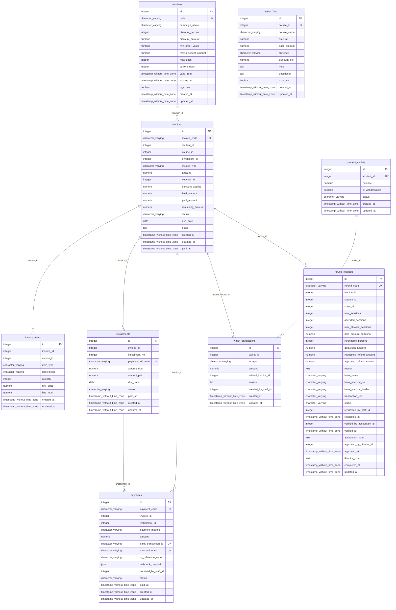
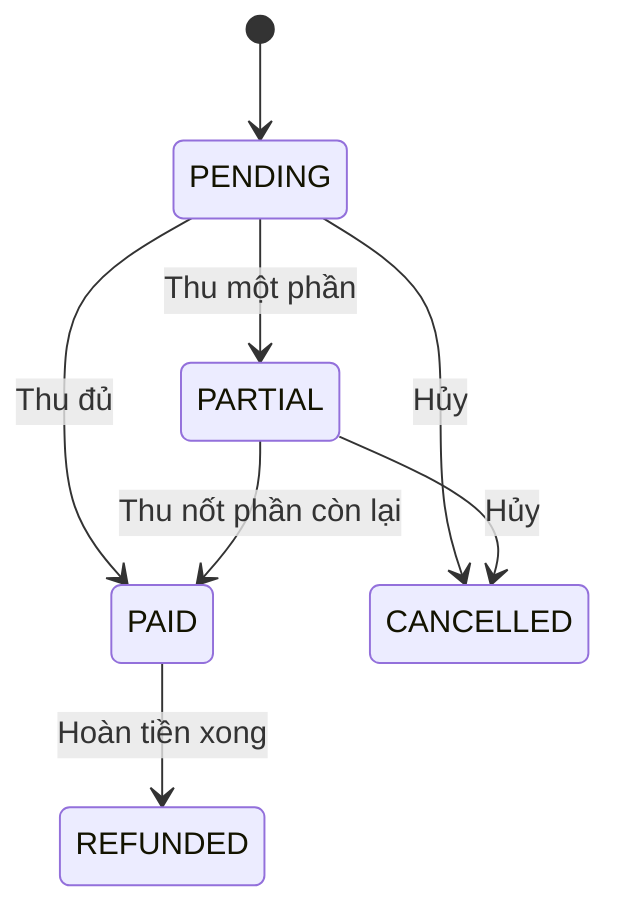
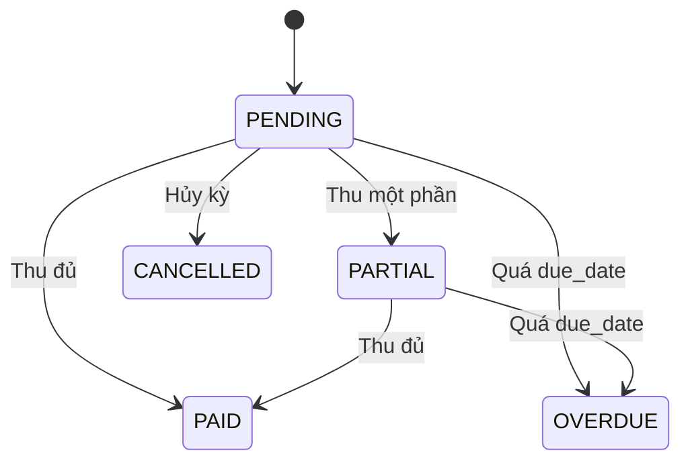
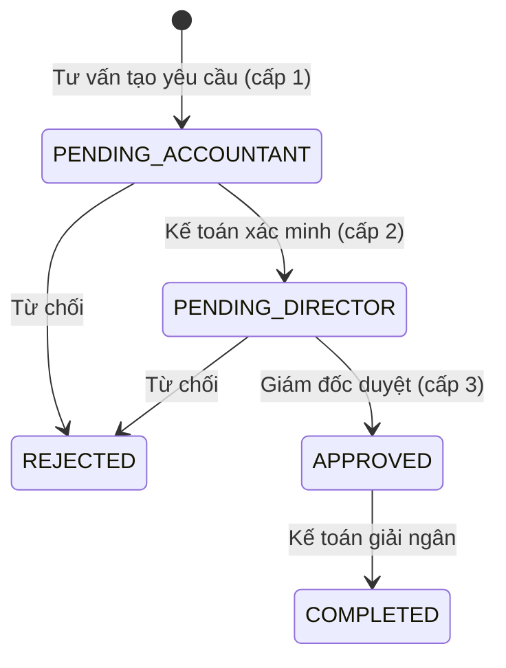

# ĐẶC TẢ CƠ SỞ DỮ LIỆU CHÍNH THỨC: SCHEMA `finance`

> **Dịch vụ:** `finance-service` (port 8084) | **Công nghệ:** Python 3.11, FastAPI, SQLAlchemy | **Phụ trách:** Nhóm 4 (Chi, Phúc)  
> **Phiên bản:** Final 1.0 (bản tổng hợp cuối của Leader) | **CSDL:** PostgreSQL 16, schema `finance`  
> **Tài liệu liên quan:** [`docs/MASTER_DB_AND_API_RULES.md`](../../../docs/MASTER_DB_AND_API_RULES.md) (quy tắc API liên service), [`docs/invariants.md`](../../../docs/invariants.md) (bất biến hệ thống).

## Mục lục

1. Phạm vi & ranh giới dữ liệu
2. Danh mục thực thể
3. Sơ đồ ERD
4. Liên kết logic liên service
5. Từ điển dữ liệu chi tiết
6. View báo cáo
7. Máy trạng thái
8. Quy tắc bất biến
9. Quy tắc API liên service
10. Ghi chú triển khai & quyết định thiết kế

---

## 1. Phạm vi & ranh giới dữ liệu

Finance quản lý **biểu phí khóa học (`tuition_fees`)**, **hóa đơn học phí (`invoices`, `invoice_items`, `installments`)**,
**chiến dịch ưu đãi (`vouchers`)**, **thanh toán (`payments`: tiền mặt, VietQR, cấn trừ ví)**, **ví bảo lưu (`student_wallets`, `wallet_transactions`)**
và **hoàn tiền 3 cấp duyệt (`refund_requests`)**. Finance không biết sĩ số hay điểm danh: số buổi đã học lấy qua Student (INV-FIN-07).
Port chính thức của Finance Service là **8084** theo `docker-compose.yml` và `gateway/nginx.conf`.

### Quy tắc chung (áp dụng cho mọi module)

| Mã | Quy tắc |
|---|---|
| R-ISO-1 (INV-SYS-02) | Service chỉ truy cập schema của chính mình. Cấm JOIN và cấm FK vật lý sang schema khác. |
| R-ID-1 | Quy ước định danh người học: ở `admission` và `finance`, `student_id` = `admission.users.id`. Ở `student` và `learning`, `student_id` = `student.students.id`. Cầu nối là `student.students.user_id`. |
| R-API-1 (INV-SYS-01) | JSON và query param dùng `snake_case`; phản hồi `{success, data, message}` hoặc `{success, error:{code, message}}`. |
| R-API-2 | Mã lỗi có tiền tố theo module: `AUTH_`, `ADM_`, `STU_`, `LRN_`, `FIN_`. |
| R-AUTH-1 | Mọi API (trừ Public) dùng `Authorization: Bearer <JWT>`; JWT ký bằng `JWT_SECRET` lấy từ biến môi trường (INV-SEC-03). |
| R-INT-1 | API nội bộ (`/internal/...`, webhook) bắt buộc header `X-Internal-Secret`, không công bố qua Gateway. |
| R-INT-2 | Gọi liên service: timeout 5 giây, retry tối đa 3 lần (backoff lũy thừa); mọi POST nội bộ phải idempotent (có `event_id` hoặc khóa tự nhiên). |
| R-TIME-1 | Thời điểm dùng `TIMESTAMPTZ` (UTC) ở admission/student/learning; finance dùng `TIMESTAMP` theo spec nhóm Finance; ngày dùng `DATE`. |
| R-MONEY-1 | Tiền tệ dùng `NUMERIC/DECIMAL`, không dùng FLOAT. |

## 2. Danh mục thực thể

| STT | Đối tượng | Loại | Số cột | Chức năng |
|--:|---|---|--:|---|
| 1 | `finance.vw_bi_cash_revenue_monthly` | View | 8 | BI: doanh thu thực thu (tiền mặt + VietQR) và hoàn phí theo tháng. WALLET_OFFSET không tính là dòng tiền mới. |
| 2 | `finance.vw_bi_voucher_campaigns` | View | 11 | BI: hiệu quả từng chiến dịch voucher (tỷ lệ dùng, tổng giảm, tiền thực thu). |
| 3 | `finance.tuition_fees` | Bảng | 12 | Biểu phí chuẩn theo khóa học (FIN-01 / contract.md); hỗ trợ tra cứu học phí niêm yết và mức ưu đãi mặc định. |
| 4 | `finance.vouchers` | Bảng | 14 | Chiến dịch mã giảm giá học phí. |
| 5 | `finance.invoices` | Bảng | 18 | Hóa đơn học phí. Sau khi PAID/REFUNDED không được sửa amount, discount_applied, final_amount (INV-FIN-01). |
| 6 | `finance.invoice_items` | Bảng | 10 | Khoản mục cấu thành hóa đơn (gói học phí, phí học lại). |
| 7 | `finance.installments` | Bảng | 11 | Lịch đóng học phí nhiều đợt hoặc đặt cọc. Tổng amount_due các kỳ bằng final_amount hóa đơn (INV-FIN-02). |
| 8 | `finance.payments` | Bảng | 15 | Phiếu thu: tiền mặt, VietQR hoặc cấn trừ ví. bank_transaction_id / transaction_ref UNIQUE đảm bảo idempotency (INV-FIN-05). |
| 9 | `finance.student_wallets` | Bảng | 7 | Ví bảo lưu học phí, mỗi học viên một ví. Không cho rút tiền (INV-FIN-06). |
| 10 | `finance.wallet_transactions` | Bảng | 9 | Sổ cái ví bảo lưu: cộng tiền bảo lưu, cấn trừ học phí, điều chỉnh. |
| 11 | `finance.refund_requests` | Bảng | 29 | Yêu cầu hoàn học phí, duyệt 3 cấp: tư vấn tạo, kế toán xác minh, giám đốc duyệt, kế toán giải ngân (INV-FIN-07/08). |

## 3. Sơ đồ ERD (quan hệ trong schema)



Quan hệ sang schema khác là **liên kết logic** (mục 4), không vẽ trong ERD vì không có khóa ngoại vật lý.

## 4. Liên kết logic liên service

**Schema này trỏ ra ngoài (chỉ lưu INTEGER, không REFERENCES):**

| Cột | Trỏ tới | Ý nghĩa |
|---|---|---|
| `finance.tuition_fees.course_id` | `admission.courses.id` | Khóa học áp dụng biểu phí chuẩn (FIN-01) |
| `finance.invoices.student_id` | `admission.users.id` | Người học (R-ID-1: dùng users.id) |
| `finance.invoices.course_id` | `admission.courses.id` | Khóa học thu phí |
| `finance.invoices.enrollment_id` | `admission.enrollments.id` | Đơn đăng ký phát sinh hóa đơn |
| `finance.invoice_items.course_id` | `admission.courses.id` | Khóa học của khoản mục |
| `finance.payments.received_by_staff_id` | `admission.users.id` | Nhân viên thu tiền |
| `finance.student_wallets.student_id` | `admission.users.id` | Chủ ví (R-ID-1) |
| `finance.wallet_transactions.created_by_staff_id` | `admission.users.id` | Nhân viên thao tác ví |
| `finance.refund_requests.student_id` | `admission.users.id` | Học viên được hoàn (R-ID-1) |
| `finance.refund_requests.class_id` | `admission.classes.id` | Lớp liên quan |
| `finance.refund_requests.requested_by_staff_id` | `admission.users.id` | Nhân viên tạo yêu cầu (cấp 1) |
| `finance.refund_requests.verified_by_accountant_id` | `admission.users.id` | Kế toán xác minh (cấp 2) |
| `finance.refund_requests.approved_by_director_id` | `admission.users.id` | Giám đốc duyệt (cấp 3) |

**Schema khác trỏ vào đây:**

| Cột nguồn | Trỏ tới | Ý nghĩa |
|---|---|---|
| `admission.enrollments.invoice_code` | `finance.invoices.invoice_code` | Mã hóa đơn Finance cấp (tham chiếu theo mã) |

Toàn vẹn tham chiếu của các liên kết này do **tầng ứng dụng** bảo đảm (kiểm tra bằng REST trước khi ghi). Khi xóa dữ liệu gốc, dùng xóa mềm (`is_active`, `status`) thay vì xóa cứng.

## 5. Từ điển dữ liệu chi tiết

#### `finance.tuition_fees`

Biểu phí chuẩn theo khóa học (FIN-01 / contract.md); hỗ trợ tra cứu học phí niêm yết và mức ưu đãi mặc định.

Số dòng seed: **4**

| # | Cột | Kiểu dữ liệu | Null | Mặc định | Ràng buộc | Diễn giải |
|--:|---|---|:--:|---|---|---|
| 1 | `id` | integer | NO | `auto (SERIAL)` | `PK` | Khóa chính. |
| 2 | `course_id` | integer | NO |  | `UNIQUE` | Logical FK sang admission.courses.id (UNIQUE). |
| 3 | `course_name` | character varying(255) | NO | `''` |  | Tên khóa học hiển thị trên bảng giá. |
| 4 | `amount` | numeric(12,2) | NO | `0` | `CHECK ((amount >= (0)::numeric))` | Mức học phí niêm yết theo contract.md (VND), >= 0; đồng bộ tự động với base_amount. |
| 5 | `base_amount` | numeric(12,2) | NO | `0` | `CHECK ((base_amount >= (0)::numeric))` | Mức học phí gốc (VND), >= 0; đồng bộ tự động với amount. |
| 6 | `currency` | character varying(10) | NO | `'VND'` |  | Đơn vị tiền tệ (mặc định VND). |
| 7 | `discount_pct` | numeric(5,2) | NO | `0` | `CHECK (((discount_pct >= (0)::numeric) AND (discount_pct <= (100)::numeric)))` | Phần trăm giảm giá mặc định (0-100). |
| 8 | `note` | text | YES |  |  | Ghi chú biểu phí (theo contract.md; đồng bộ tự động với description). |
| 9 | `description` | text | YES |  |  | Mô tả chính sách học phí của khóa. |
| 10 | `is_active` | boolean | NO | `true` |  | TRUE = đang áp dụng. |
| 11 | `created_at` | timestamp without time zone | NO | `CURRENT_TIMESTAMP` |  | Thời điểm tạo. |
| 12 | `updated_at` | timestamp without time zone | NO | `CURRENT_TIMESTAMP` |  | Thời điểm cập nhật gần nhất. |

**Index:**

- `idx_tuition_fees_course`: `CREATE INDEX idx_tuition_fees_course ON finance.tuition_fees USING btree (course_id)`
- `tuition_fees_course_id_key`: `CREATE UNIQUE INDEX tuition_fees_course_id_key ON finance.tuition_fees USING btree (course_id)`
- `tuition_fees_pkey`: `CREATE UNIQUE INDEX tuition_fees_pkey ON finance.tuition_fees USING btree (id)`

**Trigger:**

- `trg_tuition_fees_compat`: `CREATE TRIGGER trg_tuition_fees_compat BEFORE INSERT OR UPDATE ON finance.tuition_fees FOR EACH ROW EXECUTE FUNCTION finance.sync_tuition_fees_compat()`
- `trg_tuition_fees_updated_at`: `CREATE TRIGGER trg_tuition_fees_updated_at BEFORE UPDATE ON finance.tuition_fees FOR EACH ROW EXECUTE FUNCTION set_updated_at()`

#### `finance.vouchers`

Chiến dịch mã giảm giá học phí.

Số dòng seed: **2**

| # | Cột | Kiểu dữ liệu | Null | Mặc định | Ràng buộc | Diễn giải |
|--:|---|---|:--:|---|---|---|
| 1 | `id` | integer | NO | `auto (SERIAL)` | `PK` | Khóa chính. |
| 2 | `code` | character varying(50) | NO |  | `UNIQUE` | Mã voucher duy nhất. |
| 3 | `campaign_name` | character varying(150) | NO | `'Chiến dịch ưu đãi học phí'` |  | Tên chiến dịch. |
| 4 | `discount_percent` | integer | NO | `0` | `CHECK (((discount_percent >= 0) AND (discount_percent <= 100)))` | Giảm theo phần trăm (0-100). |
| 5 | `discount_amount` | numeric(12,2) | NO | `0` | `CHECK ((discount_amount >= (0)::numeric))` | Giảm số tiền cố định (VND). |
| 6 | `min_order_value` | numeric(12,2) | NO | `0` | `CHECK ((min_order_value >= (0)::numeric))` | Giá trị hóa đơn tối thiểu để áp dụng. |
| 7 | `max_discount_amount` | numeric(12,2) | YES |  |  | Mức giảm tối đa khi giảm theo phần trăm; NULL = không giới hạn. |
| 8 | `max_uses` | integer | NO | `100` | `CHECK nhiều cột: chk_voucher_usage_limit`<br>`CHECK ((max_uses > 0))` | Tổng lượt dùng tối đa. |
| 9 | `current_uses` | integer | NO | `0` | `CHECK nhiều cột: chk_voucher_usage_limit`<br>`CHECK ((current_uses >= 0))` | Số lượt đã dùng (<= max_uses). Phải SELECT ... FOR UPDATE trước khi tăng (INV-FIN-04). |
| 10 | `valid_from` | timestamp without time zone | NO | `CURRENT_TIMESTAMP` | `CHECK nhiều cột: chk_voucher_dates` | Bắt đầu hiệu lực. |
| 11 | `expires_at` | timestamp without time zone | NO |  | `CHECK nhiều cột: chk_voucher_dates` | Hết hiệu lực (> valid_from). |
| 12 | `is_active` | boolean | NO | `true` |  | Công tắc bật/tắt chiến dịch. |
| 13 | `created_at` | timestamp without time zone | NO | `CURRENT_TIMESTAMP` |  | Thời điểm tạo. |
| 14 | `updated_at` | timestamp without time zone | NO | `CURRENT_TIMESTAMP` |  | Thời điểm cập nhật gần nhất. |

**Ràng buộc cấp bảng (nhiều cột):**

| Tên | Loại | Định nghĩa |
|---|---|---|
| `chk_voucher_dates` | CHECK | `CHECK ((expires_at > valid_from))` |
| `chk_voucher_usage_limit` | CHECK | `CHECK ((current_uses <= max_uses))` |

**Index:**

- `vouchers_code_key`: `CREATE UNIQUE INDEX vouchers_code_key ON finance.vouchers USING btree (code)`
- `vouchers_pkey`: `CREATE UNIQUE INDEX vouchers_pkey ON finance.vouchers USING btree (id)`

**Trigger:**

- `trg_vouchers_updated_at`: `CREATE TRIGGER trg_vouchers_updated_at BEFORE UPDATE ON finance.vouchers FOR EACH ROW EXECUTE FUNCTION set_updated_at()`

#### `finance.invoices`

Hóa đơn học phí. Sau khi PAID/REFUNDED không được sửa amount, discount_applied, final_amount (INV-FIN-01).

Số dòng seed: **3**

| # | Cột | Kiểu dữ liệu | Null | Mặc định | Ràng buộc | Diễn giải |
|--:|---|---|:--:|---|---|---|
| 1 | `id` | integer | NO | `auto (SERIAL)` | `PK` | Khóa chính. |
| 2 | `invoice_code` | character varying(50) | NO | `auto (INV-YYYY-NNNN)` | `UNIQUE` | Mã hóa đơn duy nhất (sinh tự động nếu không truyền); Admission lưu lại ở enrollments.invoice_code. |
| 3 | `student_id` | integer | NO |  |  | users.id của người học (quy ước R-ID-1) vì hóa đơn được sinh khi đơn còn PENDING, lúc chưa có hồ sơ student.students. |
| 4 | `course_id` | integer | NO | `1` |  | Logical FK sang admission.courses.id. |
| 5 | `enrollment_id` | integer | YES |  |  | Logical FK sang admission.enrollments.id; NULL với hóa đơn học lại độc lập. |
| 6 | `invoice_type` | character varying(30) | NO | `'COURSE_PACKAGE'` | `CHECK (((invoice_type)::text = ANY ((ARRAY['COURSE_PACKAGE'::character varying, 'STANDALONE_RETAKE'::character varying, 'MIXED'::character varying])::text[])))` | COURSE_PACKAGE \| STANDALONE_RETAKE \| MIXED. |
| 7 | `amount` | numeric(12,2) | NO |  | `CHECK nhiều cột: chk_invoice_math`<br>`CHECK ((amount >= (0)::numeric))` | Giá trị trước giảm giá (>= 0). |
| 8 | `voucher_id` | integer | YES |  | `FK REFERENCES finance.vouchers(id) ON DELETE SET NULL` | Voucher đã áp dụng; NULL nếu không có. |
| 9 | `discount_applied` | numeric(12,2) | NO | `0` | `CHECK nhiều cột: chk_invoice_math`<br>`CHECK ((discount_applied >= (0)::numeric))` | Số tiền được giảm (>= 0). |
| 10 | `final_amount` | numeric(12,2) | NO |  | `CHECK nhiều cột: chk_invoice_math`<br>`CHECK nhiều cột: chk_invoice_paid_bound`<br>`CHECK ((final_amount >= (0)::numeric))` | Số phải thu = amount - discount_applied (tự động tính qua trigger nếu không truyền). |
| 11 | `paid_amount` | numeric(12,2) | NO | `0` | `CHECK nhiều cột: chk_invoice_paid_bound`<br>`CHECK ((paid_amount >= (0)::numeric))` | Tổng đã thu, 0 <= paid_amount <= final_amount. |
| 12 | `remaining_amount` | numeric(12,2) | YES | `GENERATED: (final_amount - paid_amount)` |  | Cột sinh tự động = final_amount - paid_amount. |
| 13 | `status` | character varying(20) | NO | `'PENDING'` | `CHECK (((status)::text = ANY ((ARRAY['PENDING'::character varying, 'UNPAID'::character varying, 'PARTIAL'::character varying, 'PAID'::character varying, 'OVERDUE'::character varying, 'CANCELLED'::character varying, 'REFUNDED'::character varying])::text[])))` | PENDING \| UNPAID \| PARTIAL \| PAID \| OVERDUE \| CANCELLED \| REFUNDED. |
| 14 | `due_date` | date | YES |  |  | Hạn thanh toán. Cột mở rộng của bản tổng hợp. |
| 15 | `notes` | text | YES |  |  | Ghi chú. |
| 16 | `created_at` | timestamp without time zone | NO | `CURRENT_TIMESTAMP` |  | Thời điểm tạo. |
| 17 | `updated_at` | timestamp without time zone | NO | `CURRENT_TIMESTAMP` |  | Thời điểm cập nhật gần nhất. |
| 18 | `paid_at` | timestamp without time zone | YES |  |  | Thời điểm thanh toán đủ. |

**Ràng buộc cấp bảng (nhiều cột):**

| Tên | Loại | Định nghĩa |
|---|---|---|
| `chk_invoice_math` | CHECK | `CHECK ((final_amount = (amount - discount_applied)))` |
| `chk_invoice_paid_bound` | CHECK | `CHECK ((paid_amount <= final_amount))` |

**Index:**

- `idx_invoices_code`: `CREATE INDEX idx_invoices_code ON finance.invoices USING btree (invoice_code)`
- `idx_invoices_enrollment`: `CREATE INDEX idx_invoices_enrollment ON finance.invoices USING btree (enrollment_id)`
- `idx_invoices_status`: `CREATE INDEX idx_invoices_status ON finance.invoices USING btree (status)`
- `idx_invoices_student`: `CREATE INDEX idx_invoices_student ON finance.invoices USING btree (student_id)`
- `invoices_invoice_code_key`: `CREATE UNIQUE INDEX invoices_invoice_code_key ON finance.invoices USING btree (invoice_code)`
- `invoices_pkey`: `CREATE UNIQUE INDEX invoices_pkey ON finance.invoices USING btree (id)`

**Trigger:**

- `trg_invoices_normalize`: `CREATE TRIGGER trg_invoices_normalize BEFORE INSERT OR UPDATE ON finance.invoices FOR EACH ROW EXECUTE FUNCTION finance.normalize_invoice_row()`
- `trg_invoices_updated_at`: `CREATE TRIGGER trg_invoices_updated_at BEFORE UPDATE ON finance.invoices FOR EACH ROW EXECUTE FUNCTION set_updated_at()`

#### `finance.invoice_items`

Khoản mục cấu thành hóa đơn (gói học phí, phí học lại).

Số dòng seed: **3**

| # | Cột | Kiểu dữ liệu | Null | Mặc định | Ràng buộc | Diễn giải |
|--:|---|---|:--:|---|---|---|
| 1 | `id` | integer | NO | `auto (SERIAL)` | `PK` | Khóa chính. |
| 2 | `invoice_id` | integer | NO |  | `FK REFERENCES finance.invoices(id) ON DELETE CASCADE` | Hóa đơn chứa khoản mục (xóa hóa đơn thì xóa khoản mục). |
| 3 | `course_id` | integer | YES |  |  | Logical FK sang admission.courses.id. |
| 4 | `item_type` | character varying(30) | NO |  | `CHECK (((item_type)::text = ANY ((ARRAY['TUITION_PACKAGE'::character varying, 'RETAKE_FEE'::character varying])::text[])))` | TUITION_PACKAGE \| RETAKE_FEE. |
| 5 | `description` | character varying(255) | NO |  |  | Mô tả khoản mục. |
| 6 | `quantity` | integer | NO | `1` | `CHECK nhiều cột: chk_line_total_math`<br>`CHECK ((quantity > 0))` | Số lượng (> 0). |
| 7 | `unit_price` | numeric(12,2) | NO |  | `CHECK nhiều cột: chk_line_total_math`<br>`CHECK ((unit_price >= (0)::numeric))` | Đơn giá (>= 0). |
| 8 | `line_total` | numeric(12,2) | NO |  | `CHECK nhiều cột: chk_line_total_math`<br>`CHECK ((line_total >= (0)::numeric))` | Thành tiền = quantity x unit_price (CHECK). |
| 9 | `created_at` | timestamp without time zone | NO | `CURRENT_TIMESTAMP` |  | Thời điểm tạo. |
| 10 | `updated_at` | timestamp without time zone | NO | `CURRENT_TIMESTAMP` |  | Thời điểm cập nhật gần nhất. |

**Ràng buộc cấp bảng (nhiều cột):**

| Tên | Loại | Định nghĩa |
|---|---|---|
| `chk_line_total_math` | CHECK | `CHECK ((line_total = ((quantity)::numeric * unit_price)))` |

**Index:**

- `invoice_items_pkey`: `CREATE UNIQUE INDEX invoice_items_pkey ON finance.invoice_items USING btree (id)`

**Trigger:**

- `trg_invoice_items_updated_at`: `CREATE TRIGGER trg_invoice_items_updated_at BEFORE UPDATE ON finance.invoice_items FOR EACH ROW EXECUTE FUNCTION set_updated_at()`

#### `finance.installments`

Lịch đóng học phí nhiều đợt hoặc đặt cọc. Tổng amount_due các kỳ bằng final_amount hóa đơn (INV-FIN-02).

Số dòng seed: **4**

| # | Cột | Kiểu dữ liệu | Null | Mặc định | Ràng buộc | Diễn giải |
|--:|---|---|:--:|---|---|---|
| 1 | `id` | integer | NO | `auto (SERIAL)` | `PK` | Khóa chính. |
| 2 | `invoice_id` | integer | NO |  | `FK REFERENCES finance.invoices(id) ON DELETE CASCADE`<br>`UNIQUE(invoice_id, installment_no)` | Hóa đơn sở hữu kỳ. |
| 3 | `installment_no` | integer | NO |  | `CHECK ((installment_no >= 1))`<br>`UNIQUE(invoice_id, installment_no)` | Số thứ tự kỳ (>= 1), duy nhất theo hóa đơn. |
| 4 | `payment_ref_code` | character varying(50) | NO |  | `UNIQUE` | Mã tham chiếu thanh toán duy nhất (nội dung chuyển khoản VietQR). |
| 5 | `amount_due` | numeric(12,2) | NO |  | `CHECK ((amount_due > (0)::numeric))` | Số phải đóng trong kỳ (> 0). |
| 6 | `amount_paid` | numeric(12,2) | NO | `0` | `CHECK ((amount_paid >= (0)::numeric))` | Số đã đóng (>= 0). |
| 7 | `due_date` | date | NO |  |  | Ngày đến hạn. |
| 8 | `status` | character varying(20) | NO | `'PENDING'` | `CHECK (((status)::text = ANY ((ARRAY['PENDING'::character varying, 'PARTIAL'::character varying, 'PAID'::character varying, 'OVERDUE'::character varying, 'CANCELLED'::character varying])::text[])))` | PENDING \| PARTIAL \| PAID \| OVERDUE \| CANCELLED. |
| 9 | `paid_at` | timestamp without time zone | YES |  |  | Thời điểm đóng đủ kỳ. |
| 10 | `created_at` | timestamp without time zone | NO | `CURRENT_TIMESTAMP` |  | Thời điểm tạo. |
| 11 | `updated_at` | timestamp without time zone | NO | `CURRENT_TIMESTAMP` |  | Thời điểm cập nhật gần nhất. |

**Ràng buộc cấp bảng (nhiều cột):**

| Tên | Loại | Định nghĩa |
|---|---|---|
| `installments_invoice_id_installment_no_key` | UNIQUE | `UNIQUE (invoice_id, installment_no)` |

**Index:**

- `idx_installments_invoice`: `CREATE INDEX idx_installments_invoice ON finance.installments USING btree (invoice_id, status)`
- `installments_invoice_id_installment_no_key`: `CREATE UNIQUE INDEX installments_invoice_id_installment_no_key ON finance.installments USING btree (invoice_id, installment_no)`
- `installments_payment_ref_code_key`: `CREATE UNIQUE INDEX installments_payment_ref_code_key ON finance.installments USING btree (payment_ref_code)`
- `installments_pkey`: `CREATE UNIQUE INDEX installments_pkey ON finance.installments USING btree (id)`

**Trigger:**

- `trg_installments_updated_at`: `CREATE TRIGGER trg_installments_updated_at BEFORE UPDATE ON finance.installments FOR EACH ROW EXECUTE FUNCTION set_updated_at()`

#### `finance.payments`

Phiếu thu: tiền mặt, VietQR hoặc cấn trừ ví. bank_transaction_id / transaction_ref UNIQUE đảm bảo idempotency (INV-FIN-05).

Số dòng seed: **2**

| # | Cột | Kiểu dữ liệu | Null | Mặc định | Ràng buộc | Diễn giải |
|--:|---|---|:--:|---|---|---|
| 1 | `id` | integer | NO | `auto (SERIAL)` | `PK` | Khóa chính. |
| 2 | `payment_code` | character varying(50) | NO | `auto (PAY-YYYY-NNNN)` | `UNIQUE` | Mã phiếu thu duy nhất (sinh tự động nếu không truyền). |
| 3 | `invoice_id` | integer | NO |  | `FK REFERENCES finance.invoices(id) ON DELETE RESTRICT` | Hóa đơn được thanh toán. |
| 4 | `installment_id` | integer | YES |  | `FK REFERENCES finance.installments(id) ON DELETE SET NULL` | Kỳ thanh toán được gạch nợ; NULL nếu thu không theo kỳ. |
| 5 | `payment_method` | character varying(20) | NO |  | `CHECK (((payment_method)::text = ANY ((ARRAY['CASH'::character varying, 'VIETQR'::character varying, 'WALLET_OFFSET'::character varying, 'BANK_TRANSFER'::character varying, 'CARD'::character varying, 'MOMO'::character varying])::text[])))` | CASH \| VIETQR \| WALLET_OFFSET \| BANK_TRANSFER \| CARD \| MOMO. |
| 6 | `amount` | numeric(12,2) | NO |  | `CHECK ((amount > (0)::numeric))` | Số tiền giao dịch (> 0). |
| 7 | `bank_transaction_id` | character varying(100) | YES |  | `UNIQUE` | Mã giao dịch ngân hàng, duy nhất; giao dịch trùng trả 200 OK nhưng không ghi lần hai. |
| 8 | `transaction_ref` | character varying(100) | YES |  | `UNIQUE` | Alias mã tham chiếu giao dịch (tương thích contract.md & skeleton; đồng bộ 2 chiều với bank_transaction_id). |
| 9 | `qr_reference_code` | character varying(50) | YES |  |  | Mã tham chiếu trong nội dung QR. |
| 10 | `webhook_payload` | jsonb | YES |  |  | JSONB: payload gốc từ ngân hàng để đối soát. |
| 11 | `received_by_staff_id` | integer | YES |  |  | Logical FK sang admission.users.id: nhân viên thu tiền mặt. |
| 12 | `status` | character varying(20) | NO | `'SUCCESS'` | `CHECK (((status)::text = ANY ((ARRAY['PENDING'::character varying, 'SUCCESS'::character varying, 'FAILED'::character varying])::text[])))` | PENDING \| SUCCESS \| FAILED. |
| 13 | `paid_at` | timestamp without time zone | NO | `CURRENT_TIMESTAMP` |  | Thời điểm thanh toán. |
| 14 | `created_at` | timestamp without time zone | NO | `CURRENT_TIMESTAMP` |  | Thời điểm tạo bản ghi. |
| 15 | `updated_at` | timestamp without time zone | NO | `CURRENT_TIMESTAMP` |  | Thời điểm cập nhật gần nhất. |

**Index:**

- `idx_payments_bank_txn`: `CREATE INDEX idx_payments_bank_txn ON finance.payments USING btree (bank_transaction_id) WHERE (bank_transaction_id IS NOT NULL)`
- `idx_payments_invoice`: `CREATE INDEX idx_payments_invoice ON finance.payments USING btree (invoice_id)`
- `payments_bank_transaction_id_key`: `CREATE UNIQUE INDEX payments_bank_transaction_id_key ON finance.payments USING btree (bank_transaction_id)`
- `payments_payment_code_key`: `CREATE UNIQUE INDEX payments_payment_code_key ON finance.payments USING btree (payment_code)`
- `payments_pkey`: `CREATE UNIQUE INDEX payments_pkey ON finance.payments USING btree (id)`
- `payments_transaction_ref_key`: `CREATE UNIQUE INDEX payments_transaction_ref_key ON finance.payments USING btree (transaction_ref)`

**Trigger:**

- `trg_payments_sync_refs`: `CREATE TRIGGER trg_payments_sync_refs BEFORE INSERT OR UPDATE ON finance.payments FOR EACH ROW EXECUTE FUNCTION finance.sync_payment_refs()`
- `trg_payments_updated_at`: `CREATE TRIGGER trg_payments_updated_at BEFORE UPDATE ON finance.payments FOR EACH ROW EXECUTE FUNCTION set_updated_at()`

#### `finance.student_wallets`

Ví bảo lưu học phí, mỗi học viên một ví. Không cho rút tiền (INV-FIN-06).

Số dòng seed: **3**

| # | Cột | Kiểu dữ liệu | Null | Mặc định | Ràng buộc | Diễn giải |
|--:|---|---|:--:|---|---|---|
| 1 | `id` | integer | NO | `auto (SERIAL)` | `PK` | Khóa chính. |
| 2 | `student_id` | integer | NO |  | `UNIQUE` | users.id của học viên (R-ID-1), duy nhất = mỗi người một ví. |
| 3 | `balance` | numeric(12,2) | NO | `0` | `CHECK ((balance >= (0)::numeric))` | Số dư (>= 0). |
| 4 | `is_withdrawable` | boolean | NO | `false` |  | Luôn FALSE; số dư chỉ giảm bằng TUITION_OFFSET. |
| 5 | `status` | character varying(20) | NO | `'ACTIVE'` | `CHECK (((status)::text = ANY ((ARRAY['ACTIVE'::character varying, 'FROZEN'::character varying])::text[])))` | ACTIVE \| FROZEN. |
| 6 | `created_at` | timestamp without time zone | NO | `CURRENT_TIMESTAMP` |  | Thời điểm mở ví. |
| 7 | `updated_at` | timestamp without time zone | NO | `CURRENT_TIMESTAMP` |  | Thời điểm cập nhật số dư. |

**Index:**

- `idx_wallets_student`: `CREATE INDEX idx_wallets_student ON finance.student_wallets USING btree (student_id)`
- `student_wallets_pkey`: `CREATE UNIQUE INDEX student_wallets_pkey ON finance.student_wallets USING btree (id)`
- `student_wallets_student_id_key`: `CREATE UNIQUE INDEX student_wallets_student_id_key ON finance.student_wallets USING btree (student_id)`

**Trigger:**

- `trg_student_wallets_updated_at`: `CREATE TRIGGER trg_student_wallets_updated_at BEFORE UPDATE ON finance.student_wallets FOR EACH ROW EXECUTE FUNCTION set_updated_at()`

#### `finance.wallet_transactions`

Sổ cái ví bảo lưu: cộng tiền bảo lưu, cấn trừ học phí, điều chỉnh.

Số dòng seed: **0**

| # | Cột | Kiểu dữ liệu | Null | Mặc định | Ràng buộc | Diễn giải |
|--:|---|---|:--:|---|---|---|
| 1 | `id` | integer | NO | `auto (SERIAL)` | `PK` | Khóa chính. |
| 2 | `wallet_id` | integer | NO |  | `FK REFERENCES finance.student_wallets(id) ON DELETE RESTRICT` | Ví liên quan. |
| 3 | `tx_type` | character varying(30) | NO |  | `CHECK (((tx_type)::text = ANY ((ARRAY['RESERVATION_CREDIT'::character varying, 'TUITION_OFFSET'::character varying, 'ADJUSTMENT'::character varying])::text[])))` | RESERVATION_CREDIT \| TUITION_OFFSET \| ADJUSTMENT. |
| 4 | `amount` | numeric(12,2) | NO |  | `CHECK ((amount > (0)::numeric))` | Số tiền (> 0); chiều cộng/trừ do tx_type quyết định. |
| 5 | `related_invoice_id` | integer | YES |  | `FK REFERENCES finance.invoices(id) ON DELETE SET NULL` | Hóa đơn được cấn trừ (khi TUITION_OFFSET). |
| 6 | `reason` | text | NO |  |  | Lý do giao dịch (bắt buộc để truy vết). |
| 7 | `created_by_staff_id` | integer | YES |  |  | Logical FK sang admission.users.id: nhân viên thực hiện. |
| 8 | `created_at` | timestamp without time zone | NO | `CURRENT_TIMESTAMP` |  | Thời điểm ghi nhận. |
| 9 | `updated_at` | timestamp without time zone | NO | `CURRENT_TIMESTAMP` |  | Thời điểm cập nhật gần nhất. |

**Index:**

- `idx_wallet_tx_wallet`: `CREATE INDEX idx_wallet_tx_wallet ON finance.wallet_transactions USING btree (wallet_id, created_at DESC)`
- `wallet_transactions_pkey`: `CREATE UNIQUE INDEX wallet_transactions_pkey ON finance.wallet_transactions USING btree (id)`

**Trigger:**

- `trg_wallet_transactions_updated_at`: `CREATE TRIGGER trg_wallet_transactions_updated_at BEFORE UPDATE ON finance.wallet_transactions FOR EACH ROW EXECUTE FUNCTION set_updated_at()`

#### `finance.refund_requests`

Yêu cầu hoàn học phí, duyệt 3 cấp: tư vấn tạo, kế toán xác minh, giám đốc duyệt, kế toán giải ngân (INV-FIN-07/08).

Số dòng seed: **0**

| # | Cột | Kiểu dữ liệu | Null | Mặc định | Ràng buộc | Diễn giải |
|--:|---|---|:--:|---|---|---|
| 1 | `id` | integer | NO | `auto (SERIAL)` | `PK` | Khóa chính. |
| 2 | `refund_code` | character varying(50) | NO |  | `UNIQUE` | Mã yêu cầu duy nhất. |
| 3 | `invoice_id` | integer | NO |  | `FK REFERENCES finance.invoices(id) ON DELETE RESTRICT` | Hóa đơn cần hoàn. |
| 4 | `student_id` | integer | NO |  |  | users.id của học viên (R-ID-1). |
| 5 | `class_id` | integer | YES |  |  | Logical FK sang admission.classes.id. |
| 6 | `total_sessions` | integer | NO |  | `CHECK ((total_sessions > 0))` | Tổng số buổi của khóa (> 0). |
| 7 | `attended_sessions` | integer | NO |  | `CHECK nhiều cột: chk_valid_early_withdrawal`<br>`CHECK ((attended_sessions >= 0))` | Số buổi đã học; phải <= max_allowed_sessions. |
| 8 | `max_allowed_sessions` | integer | NO | `3` | `CHECK nhiều cột: chk_valid_early_withdrawal` | Ngưỡng buổi tối đa được xét hoàn (mặc định 3). |
| 9 | `paid_amount_snapshot` | numeric(12,2) | NO |  |  | Ảnh chụp số đã thanh toán tại thời điểm yêu cầu. |
| 10 | `refundable_percent` | integer | NO |  | `CHECK (((refundable_percent >= 0) AND (refundable_percent <= 100)))` | Tỷ lệ hoàn (0-100). |
| 11 | `deduction_amount` | numeric(12,2) | NO | `0` |  | Số tiền khấu trừ. |
| 12 | `requested_refund_amount` | numeric(12,2) | NO |  | `CHECK ((requested_refund_amount >= (0)::numeric))` | Số tiền đề nghị hoàn (>= 0). |
| 13 | `approved_refund_amount` | numeric(12,2) | YES |  | `CHECK ((approved_refund_amount >= (0)::numeric))` | Số tiền được duyệt (>= 0). |
| 14 | `reason` | text | NO |  |  | Lý do hoàn. |
| 15 | `bank_name` | character varying(100) | YES |  |  | Ngân hàng nhận. |
| 16 | `bank_account_no` | character varying(50) | YES |  |  | Số tài khoản nhận. |
| 17 | `bank_account_holder` | character varying(150) | YES |  |  | Chủ tài khoản. |
| 18 | `transaction_ref` | character varying(100) | YES |  |  | Mã chứng từ chuyển khoản giải ngân hoàn tiền (FIN-F08 / API_CATALOG). |
| 19 | `status` | character varying(30) | NO | `'PENDING_ACCOUNTANT'` | `CHECK (((status)::text = ANY ((ARRAY['PENDING_ACCOUNTANT'::character varying, 'PENDING_DIRECTOR'::character varying, 'APPROVED'::character varying, 'REJECTED'::character varying, 'COMPLETED'::character varying])::text[])))` | PENDING_ACCOUNTANT \| PENDING_DIRECTOR \| APPROVED \| REJECTED \| COMPLETED. |
| 20 | `requested_by_staff_id` | integer | NO |  |  | Logical FK sang admission.users.id: nhân viên tạo (cấp 1). |
| 21 | `requested_at` | timestamp without time zone | NO | `CURRENT_TIMESTAMP` |  | Thời điểm tạo. |
| 22 | `verified_by_accountant_id` | integer | YES |  |  | Logical FK sang admission.users.id: kế toán xác minh (cấp 2). |
| 23 | `verified_at` | timestamp without time zone | YES |  |  | Thời điểm xác minh. |
| 24 | `accountant_note` | text | YES |  |  | Ghi chú kế toán. |
| 25 | `approved_by_director_id` | integer | YES |  |  | Logical FK sang admission.users.id (ADMIN): giám đốc duyệt (cấp 3). |
| 26 | `approved_at` | timestamp without time zone | YES |  |  | Thời điểm duyệt. |
| 27 | `director_note` | text | YES |  |  | Ghi chú giám đốc. |
| 28 | `completed_at` | timestamp without time zone | YES |  |  | Thời điểm giải ngân xong. |
| 29 | `updated_at` | timestamp without time zone | NO | `CURRENT_TIMESTAMP` |  | Thời điểm cập nhật gần nhất. |

**Ràng buộc cấp bảng (nhiều cột):**

| Tên | Loại | Định nghĩa |
|---|---|---|
| `chk_valid_early_withdrawal` | CHECK | `CHECK ((attended_sessions <= max_allowed_sessions))` |

**Index:**

- `idx_refund_invoice`: `CREATE INDEX idx_refund_invoice ON finance.refund_requests USING btree (invoice_id)`
- `idx_refund_student`: `CREATE INDEX idx_refund_student ON finance.refund_requests USING btree (student_id, status)`
- `refund_requests_pkey`: `CREATE UNIQUE INDEX refund_requests_pkey ON finance.refund_requests USING btree (id)`
- `refund_requests_refund_code_key`: `CREATE UNIQUE INDEX refund_requests_refund_code_key ON finance.refund_requests USING btree (refund_code)`

**Trigger:**

- `trg_refund_requests_updated_at`: `CREATE TRIGGER trg_refund_requests_updated_at BEFORE UPDATE ON finance.refund_requests FOR EACH ROW EXECUTE FUNCTION set_updated_at()`

## 6. View báo cáo

### `finance.vw_bi_cash_revenue_monthly`

BI: doanh thu thực thu (tiền mặt + VietQR) và hoàn phí theo tháng. WALLET_OFFSET không tính là dòng tiền mới.

| Cột | Kiểu |
|---|---|
| `report_month` | timestamp without time zone |
| `cash_at_counter` | numeric |
| `vietqr_transfer` | numeric |
| `gross_cash_in` | numeric |
| `refund_count` | bigint |
| `total_refunded` | numeric |
| `net_cash_revenue` | numeric |
| `refund_rate_pct` | numeric |

```sql
CREATE OR REPLACE VIEW finance.vw_bi_cash_revenue_monthly AS
WITH cash_in AS (
         SELECT date_trunc('month'::text, payments.paid_at) AS report_month,
            sum(
                CASE
                    WHEN payments.payment_method::text = 'CASH'::text THEN payments.amount
                    ELSE 0::numeric
                END) AS cash_at_counter,
            sum(
                CASE
                    WHEN payments.payment_method::text = 'VIETQR'::text THEN payments.amount
                    ELSE 0::numeric
                END) AS vietqr_transfer,
            sum(
                CASE
                    WHEN payments.payment_method::text = ANY (ARRAY['CASH'::character varying, 'VIETQR'::character varying]::text[]) THEN payments.amount
                    ELSE 0::numeric
                END) AS gross_cash_in
           FROM finance.payments
          WHERE payments.status::text = 'SUCCESS'::text
          GROUP BY (date_trunc('month'::text, payments.paid_at))
        ), cash_refund AS (
         SELECT date_trunc('month'::text, refund_requests.completed_at) AS report_month,
            count(refund_requests.id) AS refund_count,
            sum(refund_requests.approved_refund_amount) AS total_refunded
           FROM finance.refund_requests
          WHERE refund_requests.status::text = 'COMPLETED'::text
          GROUP BY (date_trunc('month'::text, refund_requests.completed_at))
        )
 SELECT COALESCE(ci.report_month, cr.report_month) AS report_month,
    COALESCE(ci.cash_at_counter, 0::numeric) AS cash_at_counter,
    COALESCE(ci.vietqr_transfer, 0::numeric) AS vietqr_transfer,
    COALESCE(ci.gross_cash_in, 0::numeric) AS gross_cash_in,
    COALESCE(cr.refund_count, 0::bigint) AS refund_count,
    COALESCE(cr.total_refunded, 0::numeric) AS total_refunded,
    COALESCE(ci.gross_cash_in, 0::numeric) - COALESCE(cr.total_refunded, 0::numeric) AS net_cash_revenue,
        CASE
            WHEN COALESCE(ci.gross_cash_in, 0::numeric) > 0::numeric THEN round(COALESCE(cr.total_refunded, 0::numeric) / ci.gross_cash_in * 100::numeric, 2)
            ELSE 0::numeric
        END AS refund_rate_pct
   FROM cash_in ci
     FULL JOIN cash_refund cr ON ci.report_month = cr.report_month
  ORDER BY (COALESCE(ci.report_month, cr.report_month)) DESC;
```

### `finance.vw_bi_voucher_campaigns`

BI: hiệu quả từng chiến dịch voucher (tỷ lệ dùng, tổng giảm, tiền thực thu).

| Cột | Kiểu |
|---|---|
| `voucher_id` | integer |
| `code` | character varying(50) |
| `campaign_name` | character varying(150) |
| `discount_percent` | integer |
| `discount_amount` | numeric(12,2) |
| `max_uses` | integer |
| `current_uses` | integer |
| `usage_rate_pct` | numeric |
| `total_invoices` | bigint |
| `total_discount_given` | numeric |
| `actual_cash_collected` | numeric |

```sql
CREATE OR REPLACE VIEW finance.vw_bi_voucher_campaigns AS
SELECT v.id AS voucher_id,
    v.code,
    v.campaign_name,
    v.discount_percent,
    v.discount_amount,
    v.max_uses,
    v.current_uses,
    round(v.current_uses::numeric / NULLIF(v.max_uses, 0)::numeric * 100::numeric, 2) AS usage_rate_pct,
    count(i.id) AS total_invoices,
    COALESCE(sum(i.discount_applied), 0::numeric) AS total_discount_given,
    COALESCE(sum(i.paid_amount), 0::numeric) AS actual_cash_collected
   FROM finance.vouchers v
     LEFT JOIN finance.invoices i ON v.id = i.voucher_id AND i.status::text <> 'CANCELLED'::text
  GROUP BY v.id;
```

## 7. Máy trạng thái

### Hóa đơn `invoices.status`



### Kỳ thanh toán `installments.status`



### Hoàn tiền `refund_requests.status`



### Ví bảo lưu

`student_wallets.status`: `ACTIVE <-> FROZEN`. Số dư chỉ tăng bằng `RESERVATION_CREDIT` / `ADJUSTMENT`, chỉ giảm bằng `TUITION_OFFSET`.

## 8. Quy tắc bất biến

| Mã | Quy tắc |
|---|---|
| **INV-FIN-01 (module)** | Invoice PAID hoặc REFUNDED không được xóa hay sửa `amount`, `discount_applied`, `final_amount` (trigger hoặc kiểm tra ở service). |
| **INV-FIN-02 (module)** | `final_amount = amount - discount_applied >= 0`; `0 <= paid_amount <= final_amount` (CHECK); `SUM(installments.amount_due) = final_amount` (kiểm tra ở service). |
| **INV-FIN-03 (module)** | Finance chỉ truy cập schema `finance`; `student_id`, `course_id`, `class_id`, `enrollment_id` là INTEGER logic. |
| **INV-FIN-04 (module)** | Voucher: kiểm tra `is_active`, `valid_from <= now < expires_at`, `current_uses < max_uses`, `min_order_value`, và `SELECT ... FOR UPDATE` trước khi tăng `current_uses`. |
| **INV-FIN-05 (module)** | `payments.bank_transaction_id` / `transaction_ref` UNIQUE: giao dịch đã có trả 200 OK, không ghi phiếu thu lần hai (idempotency VietQR). |
| **INV-FIN-06 (module)** | `is_withdrawable` luôn FALSE; số dư chỉ giảm qua `TUITION_OFFSET`. |
| **INV-FIN-07 (module)** | Chỉ tạo hoàn tiền khi `attended_sessions <= max_allowed_sessions` (CHECK `chk_valid_early_withdrawal`). |
| **INV-FIN-08 (module)** | Hoàn tiền phải đi đủ PENDING_ACCOUNTANT, PENDING_DIRECTOR, APPROVED, COMPLETED; không nhảy cấp. |
| **INV-FIN-01 (hệ thống)** | `payment.amount > 0` và `invoice.amount >= 0` (CHECK). |
| **INV-FIN-02 (hệ thống)** | Không ghi nhận trùng giao dịch cùng mã tham chiếu (`bank_transaction_id` / `transaction_ref` UNIQUE). |
| **INV-FIN-03 (hệ thống)** | Invoice chỉ PAID khi tổng payment SUCCESS `>=` `final_amount`. |

## 9. Quy tắc API liên service

### 9.1. API công khai của module

| Method | Endpoint | Quyền |
|---|---|---|
| GET / POST | `/api/finance/tuition-fees` | ADMIN, STAFF |
| POST / GET | `/api/finance/vouchers` | ADMIN, STAFF |
| POST | `/api/finance/vouchers/validate` | ADMIN, STAFF, STUDENT |
| POST | `/api/finance/invoices/auto-generate` | ADMIN, STAFF, Internal |
| GET / POST | `/api/finance/invoices`, `/api/finance/invoices/{id}` | ADMIN, STAFF, STUDENT (chỉ của mình) |
| POST | `/api/finance/payments/cash` (hoặc `/api/finance/payments`) | ADMIN, STAFF |
| GET | `/api/finance/invoices/{id}/vietqr` | STUDENT, STAFF |
| POST | `/api/finance/webhooks/vietqr` | Ngân hàng |
| GET | `/api/finance/wallets/{student_id}` | ADMIN, STAFF, STUDENT |
| POST | `/api/finance/wallets/{student_id}/reserve` | ADMIN, STAFF |
| POST | `/api/finance/refunds` | STAFF (cấp 1) |
| PUT | `/api/finance/refunds/{id}/verify` | STAFF kế toán (cấp 2) |
| PUT | `/api/finance/refunds/{id}/approve` | ADMIN giám đốc (cấp 3) |
| PUT | `/api/finance/refunds/{id}/complete` | STAFF kế toán |
| GET | `/api/finance/bi/cash-revenue`, `/bi/voucher-campaigns`, `/bi/refund-summary` | ADMIN, STAFF |

Danh mục đầy đủ: [`../tasks/API_CATALOG.md`](../tasks/API_CATALOG.md).

### 9.2. API nội bộ module cung cấp (header `X-Internal-Secret`)

| Endpoint | Người gọi | Mục đích |
|---|---|---|
| `POST /api/finance/invoices/auto-generate` | Admission | Sinh hóa đơn khi nộp đơn tuyển sinh (idempotent theo `enrollment_id`) |
| `GET /api/finance/internal/wallets?student_id=` | Student | Kiểm tra ví bảo lưu khi duyệt RESERVE |
| `POST /api/finance/webhooks/vietqr` | Ngân hàng | Gạch nợ tự động (idempotent theo `bank_transaction_id`) |

### 9.3. API module gọi sang service khác

| Gọi tới | Khi nào | Nội dung |
|---|---|---|
| `POST admission /api/admission/webhooks/payment-success` | Invoice chuyển PAID | Báo duyệt đơn; kèm `event_id` duy nhất |
| `GET admission /api/admission/internal/courses/{id}` | Lập hóa đơn | Lấy `tuition_amount` |
| `GET student /api/student/internal/attendance/summary` | Tạo yêu cầu hoàn tiền | Lấy `attended_sessions` |

Nguyên tắc chung (timeout, retry, idempotency, định dạng) xem [`docs/MASTER_DB_AND_API_RULES.md`](../../../docs/MASTER_DB_AND_API_RULES.md) mục 8 và 9.

## 10. Ghi chú triển khai & quyết định thiết kế

- **Công thức giảm giá (đề xuất):** giảm theo phần trăm `LEAST(amount * discount_percent / 100, COALESCE(max_discount_amount, amount))`; giảm cố định `discount_amount`; kết quả không vượt `amount`; chỉ áp dụng khi `amount >= min_order_value`.
- **Tên mã bất biến bị trùng:** `docs/invariants.md` (cấp hệ thống) và spec Finance (cấp module) cùng dùng `INV-FIN-01..03` với nghĩa khác nhau. Tài liệu này ghi rõ "(module)" hoặc "(hệ thống)".
- **Tương thích ngược ("thừa còn hơn thiếu"):**
  - Bổ sung bảng `finance.tuition_fees` (theo `docs/contract.md` và `FIN-01`) bên cạnh 8 bảng nghiệp vụ chính.
  - `invoices`: có sequence `finance.invoice_code_seq` tự sinh `invoice_code`, `course_id DEFAULT 1`, trigger `finance.normalize_invoice_row()` tự tính `final_amount = amount - discount_applied` nếu INSERT không truyền `final_amount`, và mở rộng `status` chấp nhận cả `'UNPAID'`, `'OVERDUE'` bên cạnh `'PENDING'`, `'PARTIAL'`, `'PAID'`, `'CANCELLED'`, `'REFUNDED'`.
  - `payments`: có sequence `finance.payment_code_seq` tự sinh `payment_code`, trigger `finance.sync_payment_refs()` đồng bộ 2 chiều `bank_transaction_id <-> transaction_ref`, và mở rộng `payment_method` chấp nhận cả `'BANK_TRANSFER'`, `'CARD'`, `'MOMO'` bên cạnh `'CASH'`, `'VIETQR'`, `'WALLET_OFFSET'`.
- **Cột sinh tự động:** `invoices.remaining_amount` là `GENERATED ALWAYS ... STORED`, không được INSERT/UPDATE trực tiếp (ORM phải đánh dấu `Computed`/`server_default`).

---
