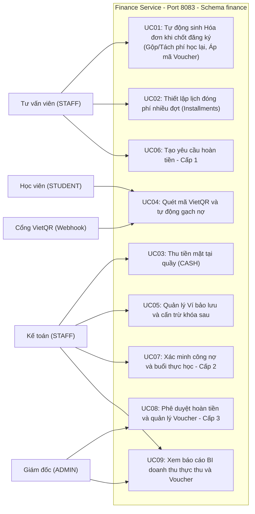
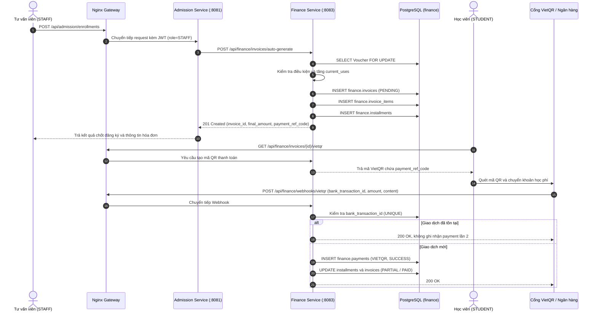
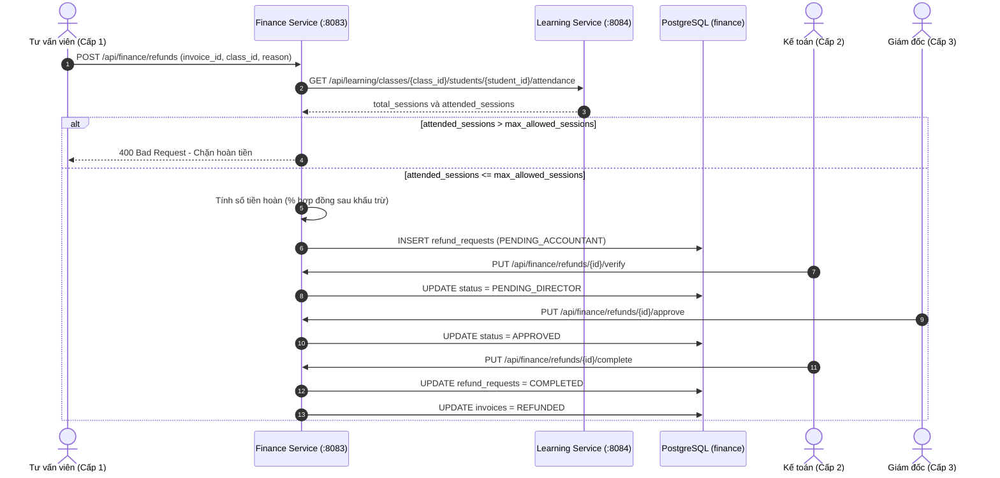
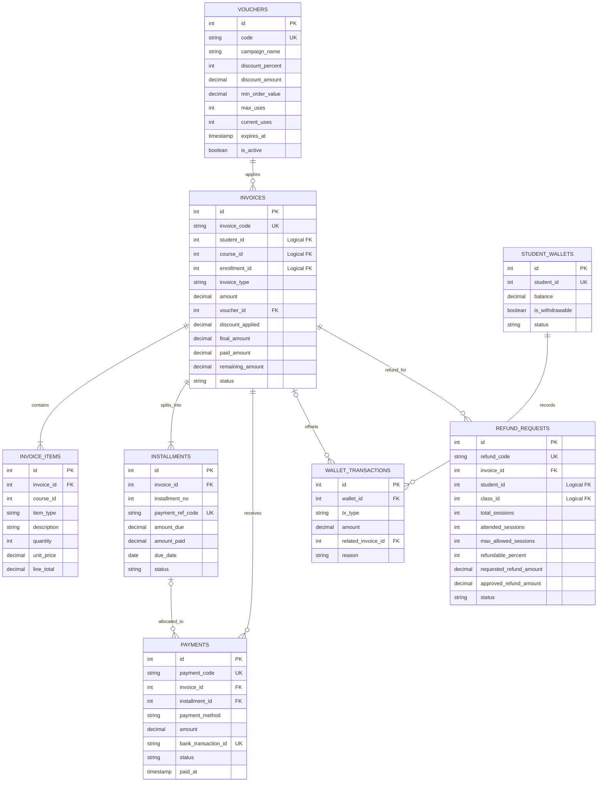

# ĐẶC TẢ THIẾT KẾ MÔ HÌNH HÓA UML (UML DESIGN SPECIFICATION)
## PHÂN HỆ TÀI CHÍNH (FINANCE SERVICE)

> **Service:** `finance-service`  
> **Port:** `8083`  
> **Gateway:** `/api/finance/...`  
> **Schema:** `finance`  
> **Chuẩn khóa:** SERIAL / INTEGER  
> **Phiên bản thiết kế:** Finance Module 2.0

---

## MỤC LỤC
1. [Tổng quan Mô hình hóa](#1-tổng-quan-mô-hình-hóa)
2. [Sơ đồ Use Case Tổng thể](#2-sơ-đồ-use-case-tổng-thể)
3. [Sơ đồ Tuần tự: Sinh Hóa đơn và Gạch nợ VietQR](#3-sơ-đồ-tuần-tự-sinh-hóa-đơn-và-gạch-nợ-vietqr)
4. [Sơ đồ Tuần tự: Phê duyệt Hoàn tiền 3 cấp](#4-sơ-đồ-tuần-tự-phê-duyệt-hoàn-tiền-3-cấp)
5. [Sơ đồ Thực thể Liên kết ERD](#5-sơ-đồ-thực-thể-liên-kết-erd)

---

## 1. Tổng quan Mô hình hóa

Finance Service gồm các nhóm nghiệp vụ: tự động sinh hóa đơn, thiết lập Installments, thu tiền mặt, thanh toán VietQR, quản lý ví bảo lưu, xử lý hoàn tiền 3 cấp và báo cáo BI.

Các tác nhân:
- **Học viên (STUDENT):** sử dụng VietQR.
- **Tư vấn viên (STAFF):** chốt đăng ký, khởi tạo yêu cầu hoàn tiền.
- **Kế toán (STAFF):** ghi nhận tiền mặt, quản lý ví, xác minh và hoàn tất hoàn tiền.
- **Giám đốc (ADMIN):** phê duyệt hoàn tiền và xem báo cáo.
- **Cổng VietQR (Webhook):** gửi thông tin giao dịch.
- **Admission Service:** gọi Finance để sinh hóa đơn.
- **Learning Service:** cung cấp tổng số buổi và số buổi học viên tham gia.

---

## 2. Sơ đồ Use Case Tổng thể

### 2.1. Danh sách Use Case

| Mã | Use Case | Tác nhân chính |
|---|---|---|
| UC01 | Tự động sinh hóa đơn khi chốt đăng ký; gộp/tách phí học lại và áp Voucher | Tư vấn viên / Admission |
| UC02 | Thiết lập lịch đóng phí nhiều đợt | Tư vấn viên / Admission |
| UC03 | Thu tiền mặt tại quầy | Kế toán |
| UC04 | Quét mã VietQR và tự động gạch nợ | Học viên, Cổng VietQR |
| UC05 | Quản lý ví bảo lưu và cấn trừ khóa sau | Kế toán |
| UC06 | Tạo yêu cầu hoàn tiền, kiểm tra số buổi học | Tư vấn viên |
| UC07 | Xác minh công nợ và buổi thực học | Kế toán |
| UC08 | Phê duyệt hoàn tiền và quản lý chiến dịch Voucher | Giám đốc |
| UC09 | Xem báo cáo BI doanh thu thực thu và Voucher | Kế toán, Giám đốc |

---

## 3. Sơ đồ Tuần tự: Sinh Hóa đơn và Gạch nợ VietQR

Sơ đồ thể hiện luồng từ lúc tư vấn viên chốt đăng ký trên Admission, Finance tự động sinh hóa đơn và lịch thanh toán, đến khi học viên thanh toán qua VietQR và hệ thống tự động gạch nợ.

### 3.1. Các bước xử lý chính

1. Admission chốt đăng ký và gọi Finance bằng endpoint auto-generate.
2. Finance kiểm tra Voucher có khóa dòng để tránh vượt giới hạn sử dụng.
3. Finance tạo hóa đơn, chi tiết hóa đơn và các kỳ thanh toán.
4. Học viên lấy mã VietQR gắn với `payment_ref_code`.
5. Ngân hàng gửi Webhook chứa `bank_transaction_id`, `amount`, `content`.
6. Finance kiểm tra tính duy nhất của mã giao dịch; giao dịch trùng không được ghi nhận lần hai.
7. Giao dịch mới được ghi vào `finance.payments`; trạng thái kỳ và hóa đơn được cập nhật.

---

## 4. Sơ đồ Tuần tự: Phê duyệt Hoàn tiền 3 cấp

Sơ đồ thể hiện quá trình lấy dữ liệu điểm danh từ Learning Service, kiểm tra điều kiện số buổi, tính tiền hoàn và thực hiện ba cấp phê duyệt.

### 4.1. Trình tự phê duyệt

| Cấp | Người thực hiện | Endpoint | Trạng thái |
|---|---|---|---|
| 1 | Tư vấn viên (STAFF) | POST `/api/finance/refunds` | PENDING_ACCOUNTANT |
| 2 | Kế toán (STAFF) | PUT `/api/finance/refunds/{id}/verify` | PENDING_DIRECTOR |
| 3 | Giám đốc (ADMIN) | PUT `/api/finance/refunds/{id}/approve` | APPROVED |
| Hoàn tất | Kế toán (STAFF) | PUT `/api/finance/refunds/{id}/complete` | COMPLETED |

Điều kiện tiếp nhận: `attended_sessions <= max_allowed_sessions`. Sau khi hoàn tất, yêu cầu ở trạng thái `COMPLETED` và hóa đơn liên quan chuyển sang `REFUNDED`.

---

## 5. Sơ đồ Thực thể Liên kết ERD

Sơ đồ thể hiện đầy đủ **8 bảng Finance** theo mô hình SERIAL/INTEGER; các quan hệ nội bộ dùng FK trong schema Finance. Các định danh học viên, khóa học, lớp học và đăng ký là Logical FK.

### 5.1. Các quan hệ dữ liệu

| Quan hệ | Ý nghĩa |
|---|---|
| `vouchers` → `invoices` | Voucher được áp dụng cho hóa đơn. |
| `invoices` → `invoice_items` | Hóa đơn gồm các khoản mục học phí/học lại. |
| `invoices` → `installments` | Hóa đơn được chia thành nhiều kỳ thanh toán. |
| `invoices` → `payments` | Hóa đơn nhận các giao dịch thanh toán. |
| `installments` → `payments` | Payment có thể gắn với một kỳ thanh toán. |
| `student_wallets` → `wallet_transactions` | Ví có lịch sử giao dịch. |
| `invoices` → `wallet_transactions` | Giao dịch ví có thể cấn trừ một hóa đơn. |
| `invoices` → `refund_requests` | Hóa đơn có thể phát sinh yêu cầu hoàn tiền. |
