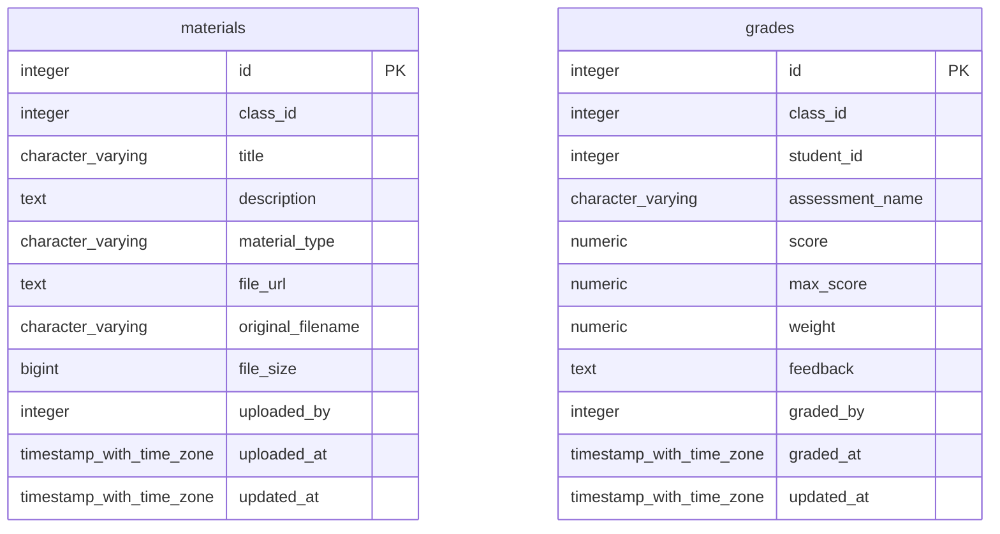

# ĐẶC TẢ CƠ SỞ DỮ LIỆU CHÍNH THỨC: SCHEMA `learning`

> **Dịch vụ:** `learning-service` (port 8083) | **Công nghệ:** Python 3.10+, FastAPI, SQLAlchemy | **Phụ trách:** Nhóm 3 (Nam, Hồng Phong)
> **Phiên bản:** Final 1.1 (đã đồng bộ với `learning-tech-spec.md`, `learning-uml-spec.md`, `MASTER_DB_AND_API_RULES.md`)
> **CSDL:** PostgreSQL 16, schema `learning`
> **Tài liệu liên quan:** [`docs/MASTER_DB_AND_API_RULES.md`](../../../docs/MASTER_DB_AND_API_RULES.md) (quy tắc API liên service), [`docs/invariants.md`](../../../docs/invariants.md) (bất biến hệ thống).

## Mục lục

1. Phạm vi & ranh giới dữ liệu
2. Danh mục thực thể
3. Sơ đồ ERD
4. Liên kết logic liên service
5. Từ điển dữ liệu chi tiết
6. View báo cáo
7. Máy trạng thái
8. Quy tắc bất biến
9. Quy tắc API liên service
10. Ghi chú triển khai & quyết định thiết kế

---

## 1. Phạm vi & ranh giới dữ liệu

Learning quản lý **học liệu** theo lớp và **điểm đánh giá** của học viên, cung cấp 2 view báo cáo kết quả học tập.
Learning không biết giáo viên của lớp là ai: phải hỏi Admission trước khi ghi điểm (INV-LRN-03).

### Quy tắc chung (áp dụng cho mọi module)

| Mã                  | Quy tắc                                                                                                                                                                                                                              |
| -------------------- | ------------------------------------------------------------------------------------------------------------------------------------------------------------------------------------------------------------------------------------- |
| R-ISO-1 (INV-SYS-02) | Service chỉ truy cập schema của chính mình. Cấm JOIN và cấm FK vật lý sang schema khác.                                                                                                                                    |
| R-ID-1               | Quy ước định danh người học: ở `admission` và `finance`, `student_id` = `admission.users.id`. Ở `student` và `learning`, `student_id` = `student.students.id`. Cầu nối là `student.students.user_id`. |
| R-API-1 (INV-SYS-01) | JSON và query param dùng `snake_case`; phản hồi `{success, data, message}` hoặc `{success, error:{code, message}}`.                                                                                                        |
| R-API-2              | Mã lỗi có tiền tố theo module: `AUTH_`, `ADM_`, `STU_`, `LRN_`, `FIN_`.                                                                                                                                                |
| R-AUTH-1             | Mọi API (trừ Public) dùng `Authorization: Bearer <JWT>`; JWT ký bằng `JWT_SECRET` lấy từ biến môi trường (INV-SEC-03).                                                                                                 |
| R-INT-1              | API nội bộ (`/internal/...`, webhook) bắt buộc header `X-Internal-Secret`, không công bố qua Gateway.                                                                                                                      |
| R-INT-2              | Gọi liên service: timeout 5 giây, retry tối đa 3 lần (backoff lũy thừa); mọi POST nội bộ phải idempotent (có `event_id` hoặc khóa tự nhiên).                                                                       |
| R-TIME-1             | Thời điểm dùng `TIMESTAMPTZ` (UTC) ở admission/student/learning; finance dùng `TIMESTAMP` theo spec nhóm Finance; ngày dùng `DATE`.                                                                                    |
| R-MONEY-1            | Tiền tệ dùng `NUMERIC/DECIMAL`, không dùng FLOAT.                                                                                                                                                                              |

## 2. Danh mục thực thể

| STT | Đối tượng                        | Loại | Số cột | Chức năng                                                                                                  |
| --: | ------------------------------------ | ----- | -------: | ------------------------------------------------------------------------------------------------------------ |
|   1 | `learning.materials`               | Bảng |       11 | Học liệu (tài liệu, video, bài tập, slide) gắn với từng lớp.                                       |
|   2 | `learning.grades`                  | Bảng |       11 | Điểm đánh giá của học viên theo từng đầu điểm trong lớp.                                       |
|   3 | `learning.v_student_grade_summary` | View  |        6 | Tổng kết điểm có trọng số (chuẩn hóa thang 100%); Pass nếu average_percentage >= 50% (INV-LRN-05). |
|   4 | `learning.v_class_pass_rate`       | View  |        5 | Tỷ lệ Pass/Fail theo lớp; dùng cho báo cáo kết quả học tập.                                        |

## 3. Sơ đồ ERD (quan hệ trong schema)




Quan hệ sang schema khác là **liên kết logic** (mục 4), không vẽ trong ERD vì không có khóa ngoại vật lý.

## 4. Liên kết logic liên service

**Schema này trỏ ra ngoài (chỉ lưu INTEGER, không REFERENCES):**

| Cột                               | Trỏ tới                | Ý nghĩa                                        |
| ---------------------------------- | ------------------------ | ------------------------------------------------ |
| `learning.materials.class_id`    | `admission.classes.id` | Lớp sở hữu học liệu                         |
| `learning.materials.uploaded_by` | `admission.users.id`   | Giáo viên upload                               |
| `learning.grades.class_id`       | `admission.classes.id` | Lớp chấm điểm                                |
| `learning.grades.student_id`     | `student.students.id`  | Học viên được chấm (KHÔNG phải users.id) |
| `learning.grades.graded_by`      | `admission.users.id`   | Giáo viên chấm                                |

**Schema khác trỏ vào đây:**

_Không có._

Toàn vẹn tham chiếu của các liên kết này do **tầng ứng dụng** bảo đảm (kiểm tra bằng REST trước khi ghi). Khi xóa dữ liệu gốc, dùng xóa mềm (`is_active`, `status`) thay vì xóa cứng.

## 5. Từ điển dữ liệu chi tiết

#### `learning.materials`

Học liệu (tài liệu, video, bài tập, slide) gắn với từng lớp.

Số dòng seed: **3**

|  # | Cột                  | Kiểu dữ liệu          | Null | Mặc định           | Ràng buộc                                                                                                                                                                       | Diễn giải                                                                                         |
| -: | --------------------- | ------------------------ | :--: | --------------------- | --------------------------------------------------------------------------------------------------------------------------------------------------------------------------------- | --------------------------------------------------------------------------------------------------- |
|  1 | `id`                | integer                  |  NO  | `auto (SERIAL)`     | `PK`                                                                                                                                                                            | Khóa chính.                                                                                       |
|  2 | `class_id`          | integer                  |  NO  |                       |                                                                                                                                                                                   | Logical FK sang `admission.classes.id`.                                                           |
|  3 | `title`             | character varying(255)   |  NO  |                       |                                                                                                                                                                                   | Tiêu đề học liệu.                                                                              |
|  4 | `description`       | text                     | YES |                       |                                                                                                                                                                                   | Mô tả.                                                                                            |
|  5 | `material_type`     | character varying(50)    |  NO  | `'DOCUMENT'`        | `CHECK (((material_type)::text = ANY ((ARRAY['DOCUMENT'::character varying, 'VIDEO'::character varying, 'EXERCISE'::character varying, 'SLIDE'::character varying])::text[])))` | DOCUMENT \| VIDEO \| EXERCISE \| SLIDE.                                                             |
|  6 | `file_url`          | text                     |  NO  |                       | `CHECK ((btrim(file_url) <> ''::text))`                                                                                                                                         | Đường dẫn file hoặc link; không được rỗng (INV-LRN-04).                                   |
|  7 | `original_filename` | character varying(255)   | YES |                       |                                                                                                                                                                                   | Tên file gốc khi upload.                                                                          |
|  8 | `file_size`         | bigint                   | YES |                       | `CHECK ((file_size >= 0))`                                                                                                                                                      | Kích thước file (byte), >= 0.                                                                    |
|  9 | `uploaded_by`       | integer                  | YES |                       |                                                                                                                                                                                   | Logical FK sang `admission.users.id` (giáo viên upload). Cột mở rộng.                        |
| 10 | `uploaded_at`       | timestamp with time zone |  NO  | `CURRENT_TIMESTAMP` |                                                                                                                                                                                   | Thời điểm upload.                                                                                |
| 11 | `updated_at`        | timestamp with time zone |  NO  | `CURRENT_TIMESTAMP` |                                                                                                                                                                                   | Thời điểm cập nhật gần nhất; tự động cập nhật qua trigger `trg_materials_updated_at`. |

**Index:**

- `idx_materials_class`: `CREATE INDEX idx_materials_class ON learning.materials USING btree (class_id)`
- `idx_materials_type`: `CREATE INDEX idx_materials_type ON learning.materials USING btree (class_id, material_type)`
- `materials_pkey`: `CREATE UNIQUE INDEX materials_pkey ON learning.materials USING btree (id)`

**Trigger:**

- `trg_materials_updated_at`: `CREATE TRIGGER trg_materials_updated_at BEFORE UPDATE ON learning.materials FOR EACH ROW EXECUTE FUNCTION set_updated_at()`

#### `learning.grades`

Điểm đánh giá của học viên theo từng đầu điểm trong lớp.

Số dòng seed: **3**

|  # | Cột                | Kiểu dữ liệu          | Null | Mặc định           | Ràng buộc                                                                      | Diễn giải                                                                                                              |
| -: | ------------------- | ------------------------ | :--: | --------------------- | -------------------------------------------------------------------------------- | ------------------------------------------------------------------------------------------------------------------------ |
|  1 | `id`              | integer                  |  NO  | `auto (SERIAL)`     | `PK`                                                                           | Khóa chính.                                                                                                            |
|  2 | `class_id`        | integer                  |  NO  |                       | `UNIQUE(class_id, student_id, assessment_name)`                                | Logical FK sang `admission.classes.id`.                                                                                |
|  3 | `student_id`      | integer                  |  NO  |                       | `UNIQUE(class_id, student_id, assessment_name)`                                | Logical FK sang `student.students.id` (KHÔNG phải users.id — R-ID-1).                                               |
|  4 | `assessment_name` | character varying(255)   |  NO  |                       | `UNIQUE(class_id, student_id, assessment_name)`                                | Tên đầu điểm (Quiz 1, Midterm...); duy nhất theo (lớp, học viên) (INV-LRN-06).                                  |
|  5 | `score`           | numeric(5,2)             |  NO  |                       | `CHECK ((score <= max_score))` (`chk_score_lte_max`)`CHECK ((score >= 0))` | Điểm đạt được, >= 0 và <= max_score (INV-LRN-01).                                                                |
|  6 | `max_score`       | numeric(5,2)             |  NO  | `100.0`             | `CHECK nhiều cột: chk_score_lte_maxCHECK ((max_score > 0))`                  | Thang điểm tối đa, > 0, mặc định 100.                                                                             |
|  7 | `weight`          | numeric(3,2)             | YES | `1.0`               | `CHECK (((weight IS NULL) OR ((weight > 0) AND (weight <= 1))))`               | Trọng số trong (0, 1], dùng tính điểm trung bình có trọng số. NULL được view coi là 1.0.                   |
|  8 | `feedback`        | text                     | YES |                       |                                                                                  | Nhận xét của giáo viên.                                                                                             |
|  9 | `graded_by`       | integer                  | YES |                       |                                                                                  | Logical FK sang `admission.users.id`: giáo viên chấm; phải là giáo viên của lớp (INV-LRN-03). Cột mở rộng. |
| 10 | `graded_at`       | timestamp with time zone |  NO  | `CURRENT_TIMESTAMP` |                                                                                  | Thời điểm chấm.                                                                                                      |
| 11 | `updated_at`      | timestamp with time zone |  NO  | `CURRENT_TIMESTAMP` |                                                                                  | Thời điểm cập nhật gần nhất; tự động cập nhật qua trigger `trg_grades_updated_at`.                         |

**Ràng buộc cấp bảng (nhiều cột):**

| Tên                                               | Loại  | Định nghĩa                                      |
| -------------------------------------------------- | ------ | -------------------------------------------------- |
| `chk_score_lte_max`                              | CHECK  | `CHECK ((score <= max_score))`                   |
| `grades_class_id_student_id_assessment_name_key` | UNIQUE | `UNIQUE (class_id, student_id, assessment_name)` |

**Index:**

- `grades_class_id_student_id_assessment_name_key`: `CREATE UNIQUE INDEX ... ON learning.grades USING btree (class_id, student_id, assessment_name)`
- `grades_pkey`: `CREATE UNIQUE INDEX ... ON learning.grades USING btree (id)`
- `idx_grades_class_assessment`: `CREATE INDEX ... ON learning.grades USING btree (class_id, assessment_name)`
- `idx_grades_class_student`: `CREATE INDEX ... ON learning.grades USING btree (class_id, student_id)`
- `idx_grades_student`: `CREATE INDEX ... ON learning.grades USING btree (student_id)`

**Trigger:**

- `trg_grades_updated_at`: `CREATE TRIGGER trg_grades_updated_at BEFORE UPDATE ON learning.grades FOR EACH ROW EXECUTE FUNCTION set_updated_at()`

## 6. View báo cáo

### `learning.v_student_grade_summary`

Điểm tổng kết có trọng số của từng học viên trong từng lớp. Đạt (Pass) khi `average_percentage >= 50` (INV-LRN-05).

| Cột                   | Kiểu   |
| ---------------------- | ------- |
| `class_id`           | integer |
| `student_id`         | integer |
| `total_assessments`  | bigint  |
| `weighted_avg_score` | numeric |
| `average_percentage` | numeric |
| `result`             | text    |

```sql
CREATE OR REPLACE VIEW learning.v_student_grade_summary AS
SELECT class_id,
    student_id,
    count(id) AS total_assessments,
    round(sum(score * COALESCE(weight, 1.0)) / NULLIF(sum(COALESCE(weight, 1.0)), 0::numeric), 2) AS weighted_avg_score,
    round(sum(score / max_score * 100.0 * COALESCE(weight, 1.0)) / NULLIF(sum(COALESCE(weight, 1.0)), 0::numeric), 2) AS average_percentage,
        CASE
            WHEN (sum(score / max_score * 100.0 * COALESCE(weight, 1.0)) / NULLIF(sum(COALESCE(weight, 1.0)), 0::numeric)) >= 50::numeric THEN 'Pass'::text
            ELSE 'Fail'::text
        END AS result
   FROM learning.grades
  GROUP BY class_id, student_id;
```

### `learning.v_class_pass_rate`

Tỷ lệ đạt/trượt của từng lớp, dựa trên `v_student_grade_summary`.

| Cột                     | Kiểu   |
| ------------------------ | ------- |
| `class_id`             | integer |
| `total_students`       | bigint  |
| `pass_count`           | bigint  |
| `fail_count`           | bigint  |
| `pass_rate_percentage` | numeric |

```sql
CREATE OR REPLACE VIEW learning.v_class_pass_rate AS
SELECT class_id,
    count(DISTINCT student_id) AS total_students,
    count(DISTINCT student_id) FILTER (WHERE result = 'Pass'::text) AS pass_count,
    count(DISTINCT student_id) FILTER (WHERE result = 'Fail'::text) AS fail_count,
    round(count(DISTINCT student_id) FILTER (WHERE result = 'Pass'::text)::numeric / NULLIF(count(DISTINCT student_id), 0)::numeric * 100::numeric, 2) AS pass_rate_percentage
   FROM learning.v_student_grade_summary
  GROUP BY class_id;
```

## 7. Máy trạng thái

Learning không có máy trạng thái. Vòng đời điểm: tạo → (sửa trong thời hạn cho phép) → khóa khi lớp `COMPLETED` (quy tắc đề xuất, kiểm tra qua `GET admission /internal/classes/{id}`).

## 8. Quy tắc bất biến

| Mã                  | Quy tắc                                                                                                                          |
| -------------------- | --------------------------------------------------------------------------------------------------------------------------------- |
| **INV-LRN-01** | `0 <= score <= max_score`: CHECK ở DB (`chk_score_lte_max`, `score >= 0`) và kiểm tra ở Pydantic.                       |
| **INV-LRN-02** | STUDENT chỉ xem điểm của chính mình; `student_id` lấy từ JWT chứ không từ query param.                               |
| **INV-LRN-03** | Giáo viên chỉ nhập điểm cho lớp mình dạy: so `classes.teacher_id` (hỏi Admission) với `sub` của JWT (INV-SEC-02). |
| **INV-LRN-04** | `file_url` không được rỗng: `CHECK (btrim(file_url) <> '')`.                                                             |
| **INV-LRN-05** | Đạt (Pass) khi `average_percentage >= 50`, ngược lại Fail.                                                                 |
| **INV-LRN-06** | Mỗi đầu điểm chỉ có một bản ghi cho mỗi (lớp, học viên): `UNIQUE(class_id, student_id, assessment_name)`.          |

## 9. Quy tắc API liên service

### 9.1. API công khai của module

| Method | Endpoint                                                                 | Quyền                                                      |
| ------ | ------------------------------------------------------------------------ | ----------------------------------------------------------- |
| GET    | `/api/learning/materials?class_id=&material_type=&search=&page=&size=` | Đã đăng nhập (STUDENT chỉ lớp mình học)            |
| GET    | `/api/learning/materials/{material_id}`                                | Đã đăng nhập (STUDENT chỉ lớp mình học)            |
| POST   | `/api/learning/materials`                                              | ADMIN, STAFF, TEACHER (đúng lớp — INV-LRN-03)           |
| DELETE | `/api/learning/materials/{material_id}`                                | ADMIN, STAFF, TEACHER (đúng lớp)                         |
| GET    | `/api/learning/grades?class_id=&student_id=`                           | Đã đăng nhập (STUDENT chỉ điểm mình — INV-LRN-02) |
| POST   | `/api/learning/grades`                                                 | TEACHER (lớp mình dạy), STAFF, ADMIN                     |
| PUT    | `/api/learning/grades/{grade_id}`                                      | TEACHER (lớp mình dạy), STAFF, ADMIN                     |
| GET    | `/api/learning/reports/class-summary?class_id=`                        | ADMIN, STAFF, TEACHER                                       |
| GET    | `/api/learning/reports/student-summary?class_id=&student_id=`          | ADMIN, STAFF, TEACHER, STUDENT (chỉ của mình)            |

### 9.2. API nội bộ module cung cấp (header `X-Internal-Secret`)

Learning **không nhận** lời gọi nội bộ từ module khác trong vòng lặp 1. Nếu BI cần điểm, đọc qua API công khai `GET /api/learning/grades` với vai trò STAFF.

### 9.3. API module gọi sang service khác

| Gọi tới                                                        | Khi nào                          | Mục đích                                                                                       |
| ---------------------------------------------------------------- | --------------------------------- | ------------------------------------------------------------------------------------------------- |
| `GET admission /api/admission/internal/classes/{id}`           | Upload học liệu, POST/PUT grade | Xác minh lớp tồn tại + đối chiếu `teacher_id` với JWT `sub` (INV-LRN-03 / INV-SEC-02) |
| `GET student /api/student/internal/students/{id}`              | POST/PUT grade                    | Xác minh học viên tồn tại và `status='STUDYING'`                                          |
| `GET student /api/student/internal/students?user_id={jwt.sub}` | GET grades khi role=STUDENT       | Map `admission.users.id` → `student.students.id` theo R-ID-1 (INV-LRN-02)                    |

Nguyên tắc chung (timeout 5 giây, retry tối đa 3 lần, idempotency, header `X-Internal-Secret`) xem [`docs/MASTER_DB_AND_API_RULES.md`](../../../docs/MASTER_DB_AND_API_RULES.md) mục 8 và 9.

### 9.4. Danh mục mã lỗi chuẩn (`LRN_*`)

| Mã                              | HTTP | Khi nào                                                                    |
| -------------------------------- | ---- | --------------------------------------------------------------------------- |
| `LRN_INVALID_SCORE`            | 400  | `score < 0`, `score > max_score`, hoặc `max_score <= 0` (INV-LRN-01) |
| `LRN_INVALID_WEIGHT`           | 400  | `weight` không NULL và nằm ngoài `(0, 1]`                           |
| `LRN_EMPTY_FILE_URL`           | 400  | `btrim(file_url) = ''` (INV-LRN-04)                                       |
| `LRN_FORBIDDEN_CLASS`          | 403  | TEACHER không phải giáo viên lớp (INV-LRN-03 / INV-SEC-02)             |
| `LRN_FORBIDDEN_STUDENT_GRADES` | 403  | STUDENT truy cập điểm người khác (INV-LRN-02)                         |
| `LRN_MATERIAL_NOT_FOUND`       | 404  | Không có học liệu theo ID                                               |
| `LRN_GRADE_NOT_FOUND`          | 404  | Không có bản ghi điểm theo ID                                          |
| `LRN_CLASS_NOT_FOUND`          | 404  | Lớp không tồn tại ở Admission                                          |
| `LRN_STUDENT_NOT_FOUND`        | 404  | Học viên không tồn tại / không `STUDYING`                           |
| `LRN_DUPLICATE_ASSESSMENT`     | 409  | Trùng `(class_id, student_id, assessment_name)` (INV-LRN-06)             |

### 9.5. Response format (INV-SYS-01)

```json
// Success
{ "success": true, "data": { ... }, "message": "..." }

// Error
{ "success": false, "error": { "code": "LRN_XXX", "message": "..." } }

// Paginated list
{
  "success": true,
  "data": {
    "items": [ ... ],
    "total": 100,
    "page": 1,
    "size": 20,
    "total_pages": 5
  }
}
```

### 9.6. Ghi chú đối chiếu với MASTER

Hai điểm **MASTER cần cập nhật** (theo schema-spec này là chuẩn):

1. **`learning.materials` có 11 cột, không phải 10.** MASTER §5.1 thiếu cột `updated_at` (trigger `trg_materials_updated_at` duy trì). Đúng theo `DATA_DICTIONARY_INDEX.md` (11 cột).
2. **`learning.grades.weight` cho phép NULL.** MASTER §5.1 ghi `NOT NULL` — SAI. Đúng theo `contract.md` §1.C ("NULL coi là 1.0") và CHECK constraint: `weight IS NULL OR (weight > 0 AND weight <= 1)`. View dùng `COALESCE(weight, 1.0)`.

## 10. Ghi chú triển khai & quyết định thiết kế

- **Công thức tổng kết chuẩn hóa thang 100%:** `average_percentage = ROUND(SUM((score / max_score * 100.0) * COALESCE(weight, 1.0)) / NULLIF(SUM(COALESCE(weight, 1.0)), 0), 2)`. Công thức này chuẩn hóa từng bài kiểm tra về tỷ lệ phần trăm trước khi nhân trọng số, giúp lớp có cả bài thang 10 (`Quiz 1`) và bài thang 100 (`Midterm`) tính điểm chính xác tuyệt đối.
- **Trọng số `weight`:** cho phép `NULL` (mặc định `1.0`), với `CHECK (weight IS NULL OR (weight > 0 AND weight <= 1))`; khi `weight IS NULL` thì view tự động dùng `COALESCE(weight, 1.0)`.
- **`material_type`:** hỗ trợ đầy đủ `'DOCUMENT'`, `'VIDEO'`, `'EXERCISE'`, `'SLIDE'`.
- **Sắp xếp thứ tự hiển thị API:** theo `uploaded_at DESC` (materials) và `graded_at DESC` (grades) làm mặc định khi không có `?sort=`
