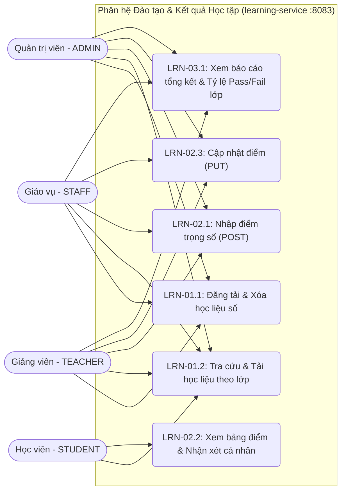

# ĐẶC TẢ KỸ THUẬT (TECHNICAL SPECIFICATION) - PHÂN HỆ ĐÀO TẠO & KẾT QUẢ HỌC TẬP (`learning`)

> **Phiên bản:** Final 1.1 (đã xóa toàn bộ marker trích dẫn `[cite: ...]` và đồng bộ §2.3 với `learning-schema-spec.md`)

## 1. Công nghệ & Kiến trúc sử dụng

- **Ngôn ngữ Backend:** Python 3.10+
- **Framework:** FastAPI (RESTful API, Pydantic v2 validation, OpenAPI/Swagger)
- **ORM:** SQLAlchemy 2.0 (khai báo schema `learning`)
- **Database:** PostgreSQL 16 (schema `learning` độc lập, tuân thủ `INV-SYS-02`)
- **Xác thực:** Stateless JWT (`HS256`) dùng biến môi trường `JWT_SECRET` dùng chung với Admission Service (`ADR 003`, `INV-SEC-03`)
- **Giao tiếp liên Service:** HTTP REST qua `httpx` kèm header `X-Internal-Secret: <INTERNAL_SECRET_KEY>`, timeout 5 giây, retry tối đa 3 lần (`R-INT-1`, `R-INT-2`).

## 2. Thiết kế Cơ sở dữ liệu (Database Schema `learning`)

### 2.1. Bảng `learning.materials` (11 cột)

- `id` (`SERIAL`, PK)
- `class_id` (`INTEGER`, `NOT NULL`) — *Logical FK trỏ tới `admission.classes.id`*
- `title` (`VARCHAR(255)`, `NOT NULL`)
- `description` (`TEXT`, Nullable)
- `material_type` (`VARCHAR(50)`, `NOT NULL`, `DEFAULT 'DOCUMENT'`, `CHECK IN ('DOCUMENT', 'VIDEO', 'EXERCISE', 'SLIDE')`)
- `file_url` (`TEXT`, `NOT NULL`, `CHECK (btrim(file_url) <> '')` — `INV-LRN-04`)
- `original_filename` (`VARCHAR(255)`, Nullable)
- `file_size` (`BIGINT`, Nullable, `CHECK (file_size >= 0)`)
- `uploaded_by` (`INTEGER`, Nullable) — *Logical FK trỏ tới `admission.users.id`*
- `uploaded_at` (`TIMESTAMPTZ`, `NOT NULL`, `DEFAULT CURRENT_TIMESTAMP`)
- `updated_at` (`TIMESTAMPTZ`, `NOT NULL`, `DEFAULT CURRENT_TIMESTAMP`, tự động cập nhật qua trigger `trg_materials_updated_at`)

### 2.2. Bảng `learning.grades` (11 cột)

- `id` (`SERIAL`, PK)
- `class_id` (`INTEGER`, `NOT NULL`) — *Logical FK trỏ tới `admission.classes.id`*
- `student_id` (`INTEGER`, `NOT NULL`) — *Logical FK trỏ tới `student.students.id` (Tuân thủ `R-ID-1`: KHÔNG lưu `users.id`)*
- `assessment_name` (`VARCHAR(255)`, `NOT NULL`)
- `score` (`NUMERIC(5,2)`, `NOT NULL`, `CHECK (score >= 0 AND score <= max_score)` — `INV-LRN-01`)
- `max_score` (`NUMERIC(5,2)`, `NOT NULL`, `DEFAULT 100.0`, `CHECK (max_score > 0)`)
- `weight` (`NUMERIC(3,2)`, Nullable, `DEFAULT 1.0`, `CHECK (weight IS NULL OR (weight > 0 AND weight <= 1))`)
- `feedback` (`TEXT`, Nullable)
- `graded_by` (`INTEGER`, Nullable) — *Logical FK trỏ tới `admission.users.id`*
- `graded_at` (`TIMESTAMPTZ`, `NOT NULL`, `DEFAULT CURRENT_TIMESTAMP`)
- `updated_at` (`TIMESTAMPTZ`, `NOT NULL`, `DEFAULT CURRENT_TIMESTAMP`, tự động cập nhật qua trigger `trg_grades_updated_at`)
- **Ràng buộc cấp bảng:** `UNIQUE (class_id, student_id, assessment_name)` (`INV-LRN-06`).

### 2.3. Views Báo cáo Tích hợp

**`learning.v_student_grade_summary`** — điểm tổng kết có trọng số, chuẩn hóa thang 100%:

```sql
CREATE OR REPLACE VIEW learning.v_student_grade_summary AS
SELECT class_id,
    student_id,
    count(id) AS total_assessments,
    round(sum(score * COALESCE(weight, 1.0)) / NULLIF(sum(COALESCE(weight, 1.0)), 0::numeric), 2) AS weighted_avg_score,
    round(sum(score / max_score * 100.0 * COALESCE(weight, 1.0)) / NULLIF(sum(COALESCE(weight, 1.0)), 0::numeric), 2) AS average_percentage,
        CASE
            WHEN (sum(score / max_score * 100.0 * COALESCE(weight, 1.0)) / NULLIF(sum(COALESCE(weight, 1.0)), 0::numeric)) >= 50::numeric THEN 'Pass'::text
            ELSE 'Fail'::text
        END AS result
   FROM learning.grades
  GROUP BY class_id, student_id;
```


**`learning.v_class_pass_rate`** — tỷ lệ Pass/Fail theo lớp:

```sql
CREATE OR REPLACE VIEW learning.v_class_pass_rate AS
SELECT class_id,
    count(DISTINCT student_id) AS total_students,
    count(DISTINCT student_id) FILTER (WHERE result = 'Pass'::text) AS pass_count,
    count(DISTINCT student_id) FILTER (WHERE result = 'Fail'::text) AS fail_count,
    round(count(DISTINCT student_id) FILTER (WHERE result = 'Pass'::text)::numeric / NULLIF(count(DISTINCT student_id), 0)::numeric * 100::numeric, 2) AS pass_rate_percentage
   FROM learning.v_student_grade_summary
  GROUP BY class_id;
```

## 3. Thiết kế API Endpoints (`http://localhost:8080/api/learning/...`)

Tất cả API tuân thủ cấu trúc JSON `snake_case` (`INV-SYS-01`): `{ "success": true, "data": ..., "message": "..." }` hoặc `{ "success": false, "error": { "code": "LRN_...", "message": "..." } }`.

### 3.1. Nhóm API Học liệu (LRN-01)

- **`GET /api/learning/materials`**: Lấy danh sách học liệu (lọc theo `class_id`, `material_type`, `search`, phân trang `page`, `size`).
- **`GET /api/learning/materials/{material_id}`**: Xem chi tiết 1 học liệu.
- **`POST /api/learning/materials`**: Tạo mới học liệu (`ADMIN`, `STAFF`, `TEACHER`). Kiểm tra `btrim(file_url) <> ''` (`INV-LRN-04`) và gọi Admission xác thực lớp/giáo viên.
- **`DELETE /api/learning/materials/{material_id}`**: Xóa học liệu (`ADMIN`, `STAFF`, `TEACHER` phụ trách lớp).

### 3.2. Nhóm API Bảng điểm (LRN-02)

- **`GET /api/learning/grades`**: Lấy danh sách điểm.
  - *Logic bảo mật (`INV-LRN-02`):* Nếu JWT `role == 'STUDENT'`, hệ thống gọi `student-service` (`GET /api/student/internal/students?user_id={jwt.sub}`) để lấy `student.students.id` của chính học viên đó và chỉ trả về bảng điểm của `student_id` này. Mọi tham số `student_id` của người khác truyền vào đều bị chặn (`403 LRN_FORBIDDEN_STUDENT_GRADES`) hoặc ghi đè về chính mình.
- **`POST /api/learning/grades`**: Nhập điểm mới cho học viên (`TEACHER`, `STAFF`, `ADMIN`).
  - *Logic kiểm tra:*
    1. Kiểm tra `0 <= score <= max_score` (`INV-LRN-01`), vi phạm trả `400 LRN_INVALID_SCORE`.
    2. Nếu `role == 'TEACHER'`, gọi `GET http://admission-service:8081/api/admission/internal/classes/{class_id}` kiểm tra `teacher_id == jwt.sub` (`INV-LRN-03` / `INV-SEC-02`), nếu khác trả `403 LRN_FORBIDDEN_CLASS`.
    3. Gọi `GET http://student-service:8082/api/student/internal/students/{student_id}` xác minh học viên tồn tại và đang `STUDYING`.
    4. Nếu trùng `(class_id, student_id, assessment_name)` (`INV-LRN-06`), trả `409 LRN_DUPLICATE_ASSESSMENT`.
- **`PUT /api/learning/grades/{grade_id}`**: Cập nhật điểm hoặc nhận xét của bài kiểm tra đã chấm (`TEACHER` dạy lớp, `STAFF`, `ADMIN`).
  - *Logic kiểm tra:* tương tự POST, cộng thêm bước `SELECT` bản ghi theo `grade_id`; nếu không tồn tại trả `404 LRN_GRADE_NOT_FOUND`.

### 3.3. Nhóm API Báo cáo Kết quả Học tập (LRN-03)

- **`GET /api/learning/reports/class-summary?class_id={id}`**: Trả về thống kê tỷ lệ Đạt/Trượt của lớp từ `v_class_pass_rate` kèm danh sách điểm tổng kết từng học viên từ `v_student_grade_summary` (`ADMIN`, `STAFF`, `TEACHER`).
- **`GET /api/learning/reports/student-summary?class_id={id}&student_id={sid}`**: Trả về kết quả tổng kết chuẩn hóa thang 100% (`weighted_avg_score`, `average_percentage`, `result`: `Pass`/`Fail`) của học viên. STUDENT chỉ gọi được với `student_id` của chính mình.

## 4. Danh mục Mã lỗi Chuẩn (`LRN_*`)

| Mã lỗi                         | HTTP Status | Mô tả                                                                                              |
| :------------------------------- | :---------: | :--------------------------------------------------------------------------------------------------- |
| `LRN_INVALID_SCORE`            |     400     | Điểm số `< 0` hoặc `> max_score`, hoặc `max_score <= 0` (`INV-LRN-01`).                 |
| `LRN_INVALID_WEIGHT`           |     400     | Trọng số nằm ngoài khoảng `(0, 1]`.                                                           |
| `LRN_EMPTY_FILE_URL`           |     400     | Đường dẫn tài liệu `file_url` bị rỗng (`INV-LRN-04`).                                    |
| `LRN_FORBIDDEN_CLASS`          |     403     | Giáo viên không được phân công phụ trách lớp học này (`INV-LRN-03` / `INV-SEC-02`). |
| `LRN_FORBIDDEN_STUDENT_GRADES` |     403     | Học viên cố tình truy cập bảng điểm của học viên khác (`INV-LRN-02`).                  |
| `LRN_MATERIAL_NOT_FOUND`       |     404     | Không tìm thấy học liệu theo ID.                                                                |
| `LRN_GRADE_NOT_FOUND`          |     404     | Không tìm thấy bản ghi điểm theo ID.                                                           |
| `LRN_CLASS_NOT_FOUND`          |     404     | Lớp học không tồn tại bên Admission Service.                                                   |
| `LRN_STUDENT_NOT_FOUND`        |     404     | Học viên không tồn tại hoặc không ở trạng thái hợp lệ bên Student Service.              |
| `LRN_DUPLICATE_ASSESSMENT`     |     409     | Đầu điểm `assessment_name` đã tồn tại cho học viên trong lớp này (`INV-LRN-06`).     |

## 5. Cấu trúc thư mục triển khai

```
services/learning/
├── backend/
│   ├── app/
│   │   ├── main.py              # Khởi tạo FastAPI, mount routers, đọc env
│   │   ├── config.py            # Settings (JWT_SECRET, INTERNAL_SECRET_KEY, DATABASE_URL)
│   │   ├── database.py          # SQLAlchemy engine + session
│   │   ├── models.py            # ORM models: Material, Grade
│   │   ├── schemas.py           # Pydantic v2 schemas (request/response)
│   │   ├── deps.py              # Dependency: verify JWT, require_role, internal_secret
│   │   ├── clients/
│   │   │   ├── admission.py     # httpx client gọi /api/admission/internal/classes/{id}
│   │   │   └── student.py       # httpx client gọi /api/student/internal/students...
│   │   └── routers/
│   │       ├── materials.py
│   │       ├── grades.py
│   │       └── reports.py
│   ├── requirements.txt         # fastapi, uvicorn, sqlalchemy, asyncpg, httpx, pydantic, python-jose
│   └── Dockerfile
└── frontend/
    ├── materials.html
    ├── grades.html
    └── reports.html
```

## 6. Ghi chú triển khai

- Toàn bộ response lỗi phải dùng helper chung để đảm bảo format `{success: false, error: {code, message}}`.
- Mọi truy vấn `INSERT`/`UPDATE` vào `learning.grades` phải bọc trong transaction để tránh race condition khi UNIQUE bị vi phạm đồng thời (bắt `IntegrityError` → trả `409 LRN_DUPLICATE_ASSESSMENT`).
- Cross-service call dùng `httpx.AsyncClient` với `timeout=5.0` và `tenacity` retry 3 lần exponential backoff.
- Healthcheck: `GET /health` trả `{status: "ok"}` (không cần auth, dùng cho docker-compose).

```

---

# FILE 3: `learning-uml-spec.md` (BẢN FULL ĐÃ SỬA)

```markdown
# ĐẶC TẢ SƠ ĐỒ UML - PHÂN HỆ ĐÀO TẠO & KẾT QUẢ HỌC TẬP (`learning`)

> **Phiên bản:** Final 1.1 (bổ sung UC-LRN-02.3, sequence §3.3, activity §4.2 cho luồng PUT)

## PHẦN 1: SƠ ĐỒ USE CASE (USE CASE DIAGRAM)


