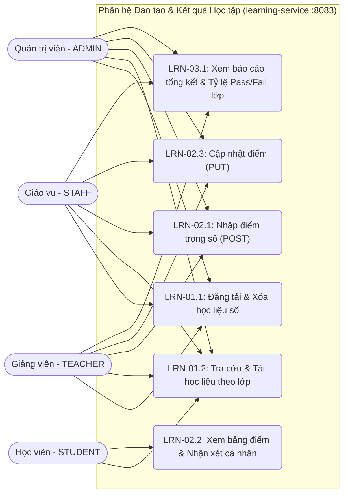
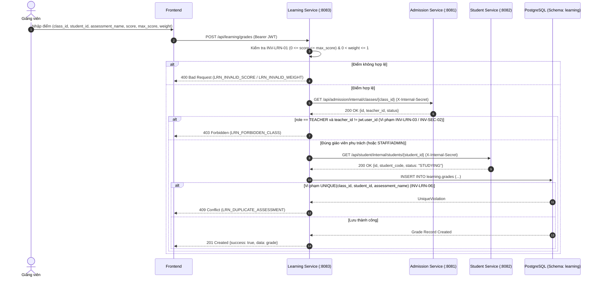
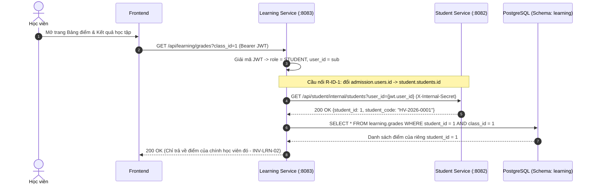
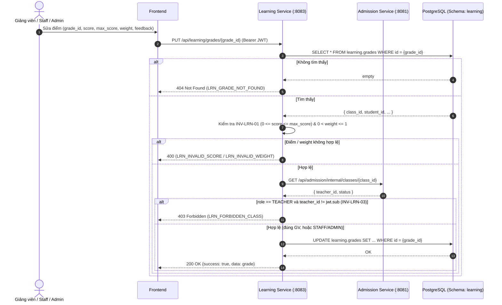
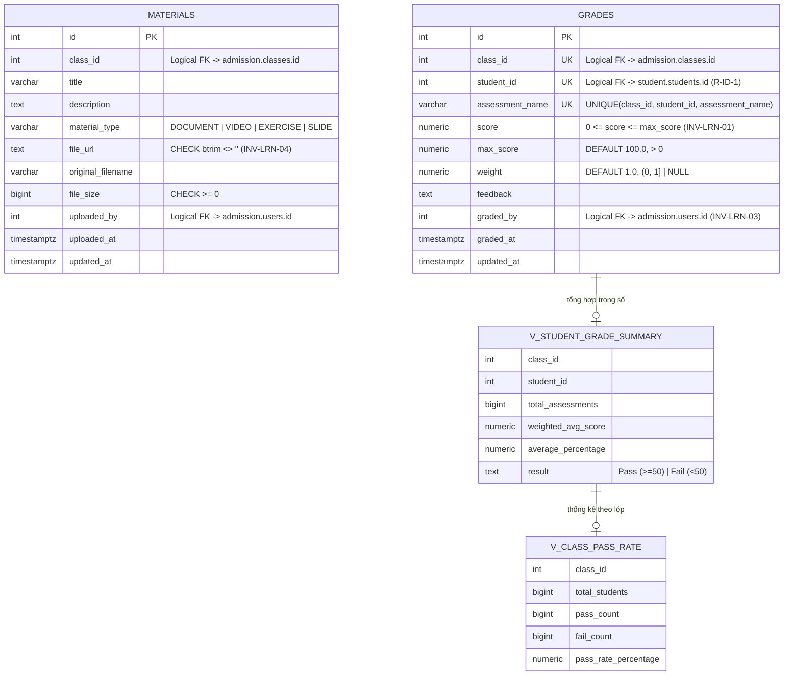

# ĐẶC TẢ SƠ ĐỒ UML - PHÂN HỆ ĐÀO TẠO & KẾT QUẢ HỌC TẬP (`learning`)

> **Phiên bản:** Final 1.1 (bổ sung UC-LRN-02.3, sequence §3.3, activity §4.2 cho luồng PUT)

## PHẦN 1: SƠ ĐỒ USE CASE (USE CASE DIAGRAM)




## PHẦN 2: ĐẶC TẢ USE CASE CHI TIẾT

### UC-LRN-01.1: Đăng tải & Xóa học liệu số

* **Actor:** Teacher, Staff, Admin.
* **Luồng chính:** Chọn lớp (`class_id`), nhập tiêu đề, chọn loại (`DOCUMENT`, `VIDEO`, `EXERCISE`, `SLIDE`), nhập `file_url` → Hệ thống kiểm tra `file_url` khác rỗng (`INV-LRN-04`) → Xác thực lớp qua Admission Service → Lưu vào bảng `learning.materials`.
* **Ngoại lệ:** `file_url` rỗng → Trả lỗi `400 LRN_EMPTY_FILE_URL`; Giáo viên upload vào lớp không dạy → `403 LRN_FORBIDDEN_CLASS`.

### UC-LRN-02.1: Nhập điểm trọng số (POST)

* **Actor:** Teacher, Staff, Admin.
* **Luồng chính:** Chọn lớp, chọn học viên (`student_id`), nhập tên bài kiểm tra (`assessment_name`), `score`, `max_score`, `weight`, `feedback` → Kiểm tra `0 <= score <= max_score` (`INV-LRN-01`) → Gọi Admission kiểm tra `teacher_id` (`INV-LRN-03`) → Gọi Student kiểm tra học viên đang `STUDYING` → Lưu vào `learning.grades`.
* **Ngoại lệ:** Điểm âm hoặc vượt `max_score` → `400 LRN_INVALID_SCORE`; Trùng đầu điểm → `409 LRN_DUPLICATE_ASSESSMENT`; Sai giáo viên → `403 LRN_FORBIDDEN_CLASS`.

### UC-LRN-02.3: Cập nhật điểm đã chấm (PUT)

* **Actor:** Teacher (dạy lớp), Staff, Admin.
* **Luồng chính:** Chọn bản ghi điểm theo `grade_id` → Nhập giá trị mới (`score`, `max_score`, `weight`, `feedback`) → Kiểm tra `0 <= score <= max_score` (`INV-LRN-01`) → Nếu `role == TEACHER`, gọi Admission kiểm tra `teacher_id == jwt.sub` (`INV-LRN-03`) → Cập nhật `learning.grades`.
* **Ngoại lệ:** Điểm âm hoặc vượt max → `400 LRN_INVALID_SCORE`; `weight` ngoài khoảng → `400 LRN_INVALID_WEIGHT`; Sai giáo viên → `403 LRN_FORBIDDEN_CLASS`; Không tìm thấy `grade_id` → `404 LRN_GRADE_NOT_FOUND`.

### UC-LRN-02.2: Xem bảng điểm & Nhận xét cá nhân

* **Actor:** Student.
* **Luồng chính:** Học viên mở trang Bảng điểm → Hệ thống trích xuất `user_id` từ JWT → Ánh xạ sang `student.students.id` (`R-ID-1`) → Trả về danh sách điểm và kết quả tổng kết từ `v_student_grade_summary` của riêng học viên đó (`INV-LRN-02`).
* **Ngoại lệ:** Nếu không tìm thấy `student.students.id` tương ứng → trả danh sách rỗng (không lỗi 404 vì user có thể chưa được sync sang Student).

### UC-LRN-03.1: Xem báo cáo tổng kết & Tỷ lệ Pass/Fail lớp

* **Actor:** Teacher, Staff, Admin.
* **Luồng chính:** Chọn `class_id` → Hệ thống truy vấn `learning.v_class_pass_rate` và `learning.v_student_grade_summary` → Trả về sĩ số có điểm, số lượng Pass/Fail, tỷ lệ đỗ (%) và bảng xếp hạng điểm chuẩn hóa thang 100%.

## PHẦN 3: SƠ ĐỒ TUẦN TỰ (SEQUENCE DIAGRAMS)

### 3.1. Luồng Giảng viên Nhập điểm & Kiểm tra Liên Service (`INV-LRN-01`, `INV-LRN-03`, `INV-LRN-06`)



### 3.2. Luồng Học viên Xem Bảng điểm Cô lập (`INV-LRN-02` & Cầu nối `R-ID-1`)



### 3.3. Luồng Cập nhật điểm (PUT) — Kiểm tra quyền & tương thích INV-LRN-01/03



## PHẦN 4: SƠ ĐỒ HOẠT ĐỘNG (ACTIVITY DIAGRAMS)

### 4.1. Luồng Chấm điểm & Tính Kết quả Tổng kết Chuẩn hóa Thang 100%

```mermaid
flowchart TD
    Start([Bắt đầu]) --> InputGrade[Giảng viên gửi request chấm điểm]
    InputGrade --> ValidateScore{0 <= score <= max_score\n& 0 < weight <= 1?}
    ValidateScore -- Sai --> ErrScore[Trả lỗi 400 LRN_INVALID_SCORE / LRN_INVALID_WEIGHT] --> End([Kết thúc])
    ValidateScore -- Đúng --> CheckRole{User role == TEACHER?}
    CheckRole -- Có --> CallAdm[Gọi Admission lấy thông tin lớp]
    CallAdm --> MatchTeacher{class.teacher_id == jwt.sub?}
    MatchTeacher -- Không --> ErrForbidden[Trả lỗi 403 LRN_FORBIDDEN_CLASS] --> End
    MatchTeacher -- Có --> CallStu[Gọi Student xác minh student_id]
    CheckRole -- STAFF / ADMIN --> CallStu
    CallStu --> CheckStu{Học viên tồn tại & STUDYING?}
    CheckStu -- Không --> ErrStu[Trả lỗi 404 LRN_STUDENT_NOT_FOUND] --> End
    CheckStu -- Có --> InsertDB[Lưu vào bảng learning.grades]
    InsertDB --> UpdateView[View v_student_grade_summary tự động tính lại:\naverage_percentage = SUM((score/max*100)*weight)/SUM(weight)]
    UpdateView --> EvalPass{average_percentage >= 50?}
    EvalPass -- Có --> MarkPass[Kết quả: Pass] --> End
    EvalPass -- Không --> MarkFail[Kết quả: Fail] --> End
```

### 4.2. Luồng Cập nhật điểm (PUT)

```mermaid
flowchart TD
    Start([Bắt đầu]) --> FindGrade[SELECT grade theo grade_id]
    FindGrade --> Exists{Tồn tại?}
    Exists -- Không --> ErrNotFound[404 LRN_GRADE_NOT_FOUND] --> End([Kết thúc])
    Exists -- Có --> ValidateScore{0 <= score <= max_score\n& 0 < weight <= 1?}
    ValidateScore -- Sai --> ErrScore[400 LRN_INVALID_SCORE / LRN_INVALID_WEIGHT] --> End
    ValidateScore -- Đúng --> CheckRole{role == TEACHER?}
    CheckRole -- Có --> CallAdm[GET admission /internal/classes/{class_id}]
    CallAdm --> MatchTeacher{teacher_id == jwt.sub?}
    MatchTeacher -- Không --> ErrForbidden[403 LRN_FORBIDDEN_CLASS] --> End
    MatchTeacher -- Có --> UpdateDB[UPDATE learning.grades]
    CheckRole -- STAFF/ADMIN --> UpdateDB
    UpdateDB --> UpdateView[View tự tính lại average_percentage] --> End
```

### 4.3. Luồng Upload học liệu

```mermaid
flowchart TD
    Start([Bắt đầu]) --> InputMat[Nhận request tạo học liệu]
    InputMat --> ValidateURL{file_url trim != '' ?}
    ValidateURL -- Không --> ErrURL[400 LRN_EMPTY_FILE_URL] --> End([Kết thúc])
    ValidateURL -- Có --> CheckRole{role == TEACHER?}
    CheckRole -- Có --> CallAdm[GET admission /internal/classes/{class_id}]
    CallAdm --> MatchTeacher{teacher_id == jwt.sub?}
    MatchTeacher -- Không --> ErrForbidden[403 LRN_FORBIDDEN_CLASS] --> End
    MatchTeacher -- Có --> InsertMat[INSERT learning.materials]
    CheckRole -- STAFF/ADMIN --> InsertMat
    InsertMat --> Response[201 Created] --> End
```

## PHẦN 5: LƯỢC ĐỒ CƠ SỞ DỮ LIỆU (ERD & VIEWS SCHEMA `learning`)


