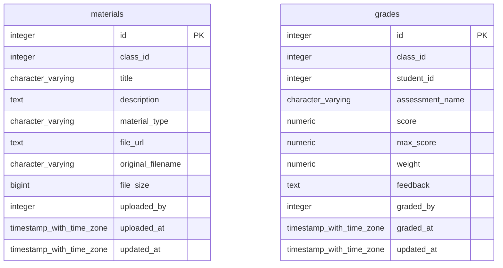
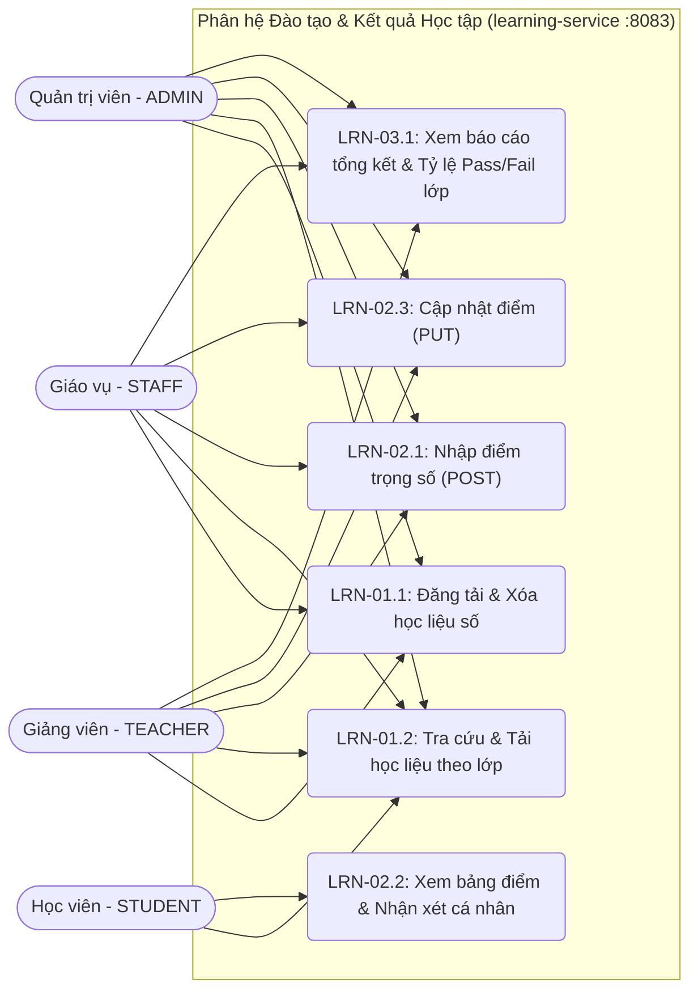
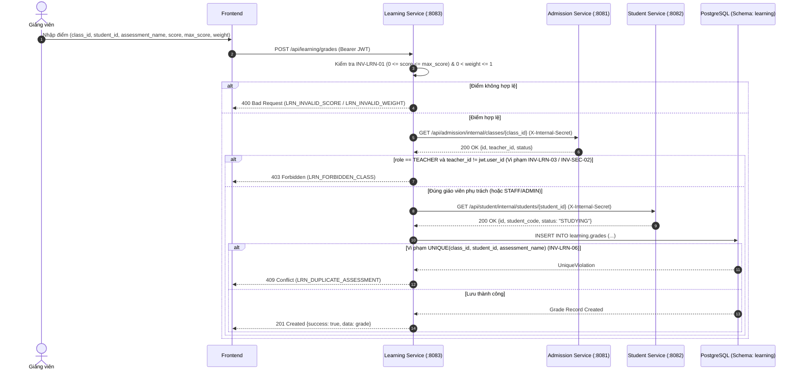
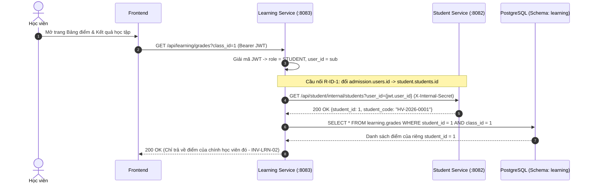
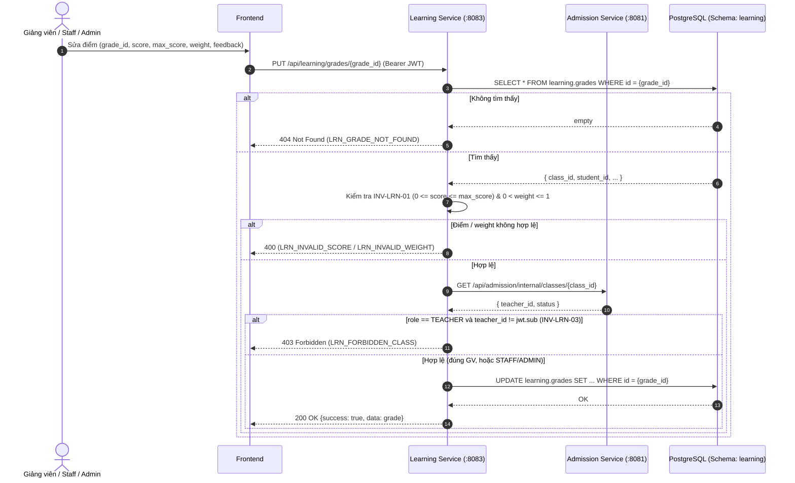
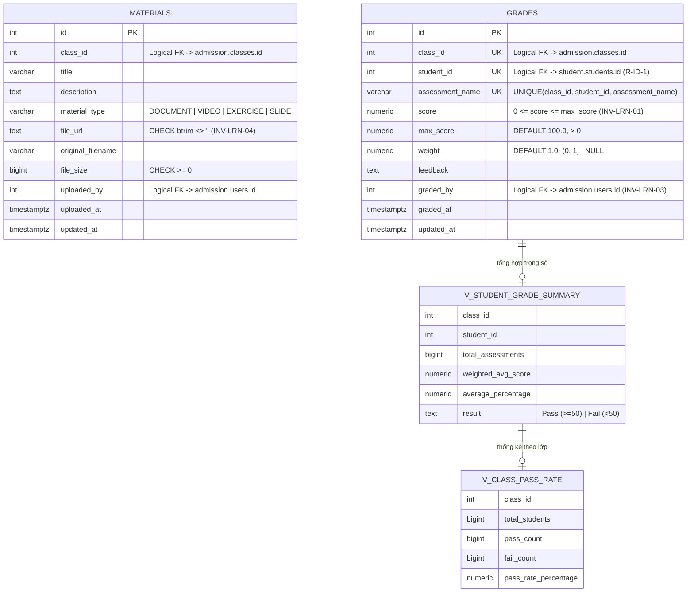

# FILE 1: `learning-schema-spec.md` (BẢN FULL ĐÃ SỬA)

```markdown
# ĐẶC TẢ CƠ SỞ DỮ LIỆU CHÍNH THỨC: SCHEMA `learning`

> **Dịch vụ:** `learning-service` (port 8083) | **Công nghệ:** Python 3.10+, FastAPI, SQLAlchemy | **Phụ trách:** Nhóm 3 (Nam, Hồng Phong)  
> **Phiên bản:** Final 1.1 (đã đồng bộ với `learning-tech-spec.md`, `learning-uml-spec.md`, `MASTER_DB_AND_API_RULES.md`)  
> **CSDL:** PostgreSQL 16, schema `learning`  
> **Tài liệu liên quan:** [`docs/MASTER_DB_AND_API_RULES.md`](../../../docs/MASTER_DB_AND_API_RULES.md) (quy tắc API liên service), [`docs/invariants.md`](../../../docs/invariants.md) (bất biến hệ thống).

## Mục lục

1. Phạm vi & ranh giới dữ liệu
2. Danh mục thực thể
3. Sơ đồ ERD
4. Liên kết logic liên service
5. Từ điển dữ liệu chi tiết
6. View báo cáo
7. Máy trạng thái
8. Quy tắc bất biến
9. Quy tắc API liên service
10. Ghi chú triển khai & quyết định thiết kế

---

## 1. Phạm vi & ranh giới dữ liệu

Learning quản lý **học liệu** theo lớp và **điểm đánh giá** của học viên, cung cấp 2 view báo cáo kết quả học tập.
Learning không biết giáo viên của lớp là ai: phải hỏi Admission trước khi ghi điểm (INV-LRN-03).

### Quy tắc chung (áp dụng cho mọi module)

| Mã | Quy tắc |
|---|---|
| R-ISO-1 (INV-SYS-02) | Service chỉ truy cập schema của chính mình. Cấm JOIN và cấm FK vật lý sang schema khác. |
| R-ID-1 | Quy ước định danh người học: ở `admission` và `finance`, `student_id` = `admission.users.id`. Ở `student` và `learning`, `student_id` = `student.students.id`. Cầu nối là `student.students.user_id`. |
| R-API-1 (INV-SYS-01) | JSON và query param dùng `snake_case`; phản hồi `{success, data, message}` hoặc `{success, error:{code, message}}`. |
| R-API-2 | Mã lỗi có tiền tố theo module: `AUTH_`, `ADM_`, `STU_`, `LRN_`, `FIN_`. |
| R-AUTH-1 | Mọi API (trừ Public) dùng `Authorization: Bearer <JWT>`; JWT ký bằng `JWT_SECRET` lấy từ biến môi trường (INV-SEC-03). |
| R-INT-1 | API nội bộ (`/internal/...`, webhook) bắt buộc header `X-Internal-Secret`, không công bố qua Gateway. |
| R-INT-2 | Gọi liên service: timeout 5 giây, retry tối đa 3 lần (backoff lũy thừa); mọi POST nội bộ phải idempotent (có `event_id` hoặc khóa tự nhiên). |
| R-TIME-1 | Thời điểm dùng `TIMESTAMPTZ` (UTC) ở admission/student/learning; finance dùng `TIMESTAMP` theo spec nhóm Finance; ngày dùng `DATE`. |
| R-MONEY-1 | Tiền tệ dùng `NUMERIC/DECIMAL`, không dùng FLOAT. |

## 2. Danh mục thực thể

| STT | Đối tượng | Loại | Số cột | Chức năng |
|--:|---|---|--:|---|
| 1 | `learning.materials` | Bảng | 11 | Học liệu (tài liệu, video, bài tập, slide) gắn với từng lớp. |
| 2 | `learning.grades` | Bảng | 11 | Điểm đánh giá của học viên theo từng đầu điểm trong lớp. |
| 3 | `learning.v_student_grade_summary` | View | 6 | Tổng kết điểm có trọng số (chuẩn hóa thang 100%); Pass nếu average_percentage >= 50% (INV-LRN-05). |
| 4 | `learning.v_class_pass_rate` | View | 5 | Tỷ lệ Pass/Fail theo lớp; dùng cho báo cáo kết quả học tập. |

## 3. Sơ đồ ERD (quan hệ trong schema)



.

```

---

# FILE 2: `learning-tech-spec.md` (BẢN FULL ĐÃ SỬA)

```markdown
# ĐẶC TẢ KỸ THUẬT (TECHNICAL SPECIFICATION) - PHÂN HỆ ĐÀO TẠO & KẾT QUẢ HỌC TẬP (`learning`)

> **Phiên bản:** Final 1.1 (đã xóa toàn bộ marker trích dẫn `[cite: ...]` và đồng bộ §2.3 với `learning-schema-spec.md`)

## 1. Công nghệ & Kiến trúc sử dụng

- **Ngôn ngữ Backend:** Python 3.10+
- **Framework:** FastAPI (RESTful API, Pydantic v2 validation, OpenAPI/Swagger)
- **ORM:** SQLAlchemy 2.0 (khai báo schema `learning`)
- **Database:** PostgreSQL 16 (schema `learning` độc lập, tuân thủ `INV-SYS-02`)
- **Xác thực:** Stateless JWT (`HS256`) dùng biến môi trường `JWT_SECRET` dùng chung với Admission Service (`ADR 003`, `INV-SEC-03`)
- **Giao tiếp liên Service:** HTTP REST qua `httpx` kèm header `X-Internal-Secret: <INTERNAL_SECRET_KEY>`, timeout 5 giây, retry tối đa 3 lần (`R-INT-1`, `R-INT-2`).

## 2. Thiết kế Cơ sở dữ liệu (Database Schema `learning`)

### 2.1. Bảng `learning.materials` (11 cột)

- `id` (`SERIAL`, PK)
- `class_id` (`INTEGER`, `NOT NULL`) — *Logical FK trỏ tới `admission.classes.id`*
- `title` (`VARCHAR(255)`, `NOT NULL`)
- `description` (`TEXT`, Nullable)
- `material_type` (`VARCHAR(50)`, `NOT NULL`, `DEFAULT 'DOCUMENT'`, `CHECK IN ('DOCUMENT', 'VIDEO', 'EXERCISE', 'SLIDE')`)
- `file_url` (`TEXT`, `NOT NULL`, `CHECK (btrim(file_url) <> '')` — `INV-LRN-04`)
- `original_filename` (`VARCHAR(255)`, Nullable)
- `file_size` (`BIGINT`, Nullable, `CHECK (file_size >= 0)`)
- `uploaded_by` (`INTEGER`, Nullable) — *Logical FK trỏ tới `admission.users.id`*
- `uploaded_at` (`TIMESTAMPTZ`, `NOT NULL`, `DEFAULT CURRENT_TIMESTAMP`)
- `updated_at` (`TIMESTAMPTZ`, `NOT NULL`, `DEFAULT CURRENT_TIMESTAMP`, tự động cập nhật qua trigger `trg_materials_updated_at`)

### 2.2. Bảng `learning.grades` (11 cột)

- `id` (`SERIAL`, PK)
- `class_id` (`INTEGER`, `NOT NULL`) — *Logical FK trỏ tới `admission.classes.id`*
- `student_id` (`INTEGER`, `NOT NULL`) — *Logical FK trỏ tới `student.students.id` (Tuân thủ `R-ID-1`: KHÔNG lưu `users.id`)*
- `assessment_name` (`VARCHAR(255)`, `NOT NULL`)
- `score` (`NUMERIC(5,2)`, `NOT NULL`, `CHECK (score >= 0 AND score <= max_score)` — `INV-LRN-01`)
- `max_score` (`NUMERIC(5,2)`, `NOT NULL`, `DEFAULT 100.0`, `CHECK (max_score > 0)`)
- `weight` (`NUMERIC(3,2)`, Nullable, `DEFAULT 1.0`, `CHECK (weight IS NULL OR (weight > 0 AND weight <= 1))`)
- `feedback` (`TEXT`, Nullable)
- `graded_by` (`INTEGER`, Nullable) — *Logical FK trỏ tới `admission.users.id`*
- `graded_at` (`TIMESTAMPTZ`, `NOT NULL`, `DEFAULT CURRENT_TIMESTAMP`)
- `updated_at` (`TIMESTAMPTZ`, `NOT NULL`, `DEFAULT CURRENT_TIMESTAMP`, tự động cập nhật qua trigger `trg_grades_updated_at`)
- **Ràng buộc cấp bảng:** `UNIQUE (class_id, student_id, assessment_name)` (`INV-LRN-06`).

### 2.3. Views Báo cáo Tích hợp

**`learning.v_student_grade_summary`** — điểm tổng kết có trọng số, chuẩn hóa thang 100%:

```sql
CREATE OR REPLACE VIEW learning.v_student_grade_summary AS
SELECT class_id,
    student_id,
    count(id) AS total_assessments,
    round(sum(score * COALESCE(weight, 1.0)) / NULLIF(sum(COALESCE(weight, 1.0)), 0::numeric), 2) AS weighted_avg_score,
    round(sum(score / max_score * 100.0 * COALESCE(weight, 1.0)) / NULLIF(sum(COALESCE(weight, 1.0)), 0::numeric), 2) AS average_percentage,
        CASE
            WHEN (sum(score / max_score * 100.0 * COALESCE(weight, 1.0)) / NULLIF(sum(COALESCE(weight, 1.0)), 0::numeric)) >= 50::numeric THEN 'Pass'::text
            ELSE 'Fail'::text
        END AS result
   FROM learning.grades
  GROUP BY class_id, student_id;
```

**`learning.v_class_pass_rate`** — tỷ lệ Pass/Fail theo lớp:

```sql
CREATE OR REPLACE VIEW learning.v_class_pass_rate AS
SELECT class_id,
    count(DISTINCT student_id) AS total_students,
    count(DISTINCT student_id) FILTER (WHERE result = 'Pass'::text) AS pass_count,
    count(DISTINCT student_id) FILTER (WHERE result = 'Fail'::text) AS fail_count,
    round(count(DISTINCT student_id) FILTER (WHERE result = 'Pass'::text)::numeric / NULLIF(count(DISTINCT student_id), 0)::numeric * 100::numeric, 2) AS pass_rate_percentage
   FROM learning.v_student_grade_summary
  GROUP BY class_id;
```

## 3. Thiết kế API Endpoints (`http://localhost:8080/api/learning/...`)

Tất cả API tuân thủ cấu trúc JSON `snake_case` (`INV-SYS-01`): `{ "success": true, "data": ..., "message": "..." }` hoặc `{ "success": false, "error": { "code": "LRN_...", "message": "..." } }`.

### 3.1. Nhóm API Học liệu (LRN-01)

- **`GET /api/learning/materials`**: Lấy danh sách học liệu (lọc theo `class_id`, `material_type`, `search`, phân trang `page`, `size`).
- **`GET /api/learning/materials/{material_id}`**: Xem chi tiết 1 học liệu.
- **`POST /api/learning/materials`**: Tạo mới học liệu (`ADMIN`, `STAFF`, `TEACHER`). Kiểm tra `btrim(file_url) <> ''` (`INV-LRN-04`) và gọi Admission xác thực lớp/giáo viên.
- **`DELETE /api/learning/materials/{material_id}`**: Xóa học liệu (`ADMIN`, `STAFF`, `TEACHER` phụ trách lớp).

### 3.2. Nhóm API Bảng điểm (LRN-02)

- **`GET /api/learning/grades`**: Lấy danh sách điểm.
  - *Logic bảo mật (`INV-LRN-02`):* Nếu JWT `role == 'STUDENT'`, hệ thống gọi `student-service` (`GET /api/student/internal/students?user_id={jwt.sub}`) để lấy `student.students.id` của chính học viên đó và chỉ trả về bảng điểm của `student_id` này. Mọi tham số `student_id` của người khác truyền vào đều bị chặn (`403 LRN_FORBIDDEN_STUDENT_GRADES`) hoặc ghi đè về chính mình.
- **`POST /api/learning/grades`**: Nhập điểm mới cho học viên (`TEACHER`, `STAFF`, `ADMIN`).
  - *Logic kiểm tra:*
    1. Kiểm tra `0 <= score <= max_score` (`INV-LRN-01`), vi phạm trả `400 LRN_INVALID_SCORE`.
    2. Nếu `role == 'TEACHER'`, gọi `GET http://admission-service:8081/api/admission/internal/classes/{class_id}` kiểm tra `teacher_id == jwt.sub` (`INV-LRN-03` / `INV-SEC-02`), nếu khác trả `403 LRN_FORBIDDEN_CLASS`.
    3. Gọi `GET http://student-service:8082/api/student/internal/students/{student_id}` xác minh học viên tồn tại và đang `STUDYING`.
    4. Nếu trùng `(class_id, student_id, assessment_name)` (`INV-LRN-06`), trả `409 LRN_DUPLICATE_ASSESSMENT`.
- **`PUT /api/learning/grades/{grade_id}`**: Cập nhật điểm hoặc nhận xét của bài kiểm tra đã chấm (`TEACHER` dạy lớp, `STAFF`, `ADMIN`).
  - *Logic kiểm tra:* tương tự POST, cộng thêm bước `SELECT` bản ghi theo `grade_id`; nếu không tồn tại trả `404 LRN_GRADE_NOT_FOUND`.

### 3.3. Nhóm API Báo cáo Kết quả Học tập (LRN-03)

- **`GET /api/learning/reports/class-summary?class_id={id}`**: Trả về thống kê tỷ lệ Đạt/Trượt của lớp từ `v_class_pass_rate` kèm danh sách điểm tổng kết từng học viên từ `v_student_grade_summary` (`ADMIN`, `STAFF`, `TEACHER`).
- **`GET /api/learning/reports/student-summary?class_id={id}&student_id={sid}`**: Trả về kết quả tổng kết chuẩn hóa thang 100% (`weighted_avg_score`, `average_percentage`, `result`: `Pass`/`Fail`) của học viên. STUDENT chỉ gọi được với `student_id` của chính mình.

## 4. Danh mục Mã lỗi Chuẩn (`LRN_*`)

| Mã lỗi                         | HTTP Status | Mô tả                                                                                              |
| :------------------------------- | :---------: | :--------------------------------------------------------------------------------------------------- |
| `LRN_INVALID_SCORE`            |     400     | Điểm số `< 0` hoặc `> max_score`, hoặc `max_score <= 0` (`INV-LRN-01`).                 |
| `LRN_INVALID_WEIGHT`           |     400     | Trọng số nằm ngoài khoảng `(0, 1]`.                                                           |
| `LRN_EMPTY_FILE_URL`           |     400     | Đường dẫn tài liệu `file_url` bị rỗng (`INV-LRN-04`).                                    |
| `LRN_FORBIDDEN_CLASS`          |     403     | Giáo viên không được phân công phụ trách lớp học này (`INV-LRN-03` / `INV-SEC-02`). |
| `LRN_FORBIDDEN_STUDENT_GRADES` |     403     | Học viên cố tình truy cập bảng điểm của học viên khác (`INV-LRN-02`).                  |
| `LRN_MATERIAL_NOT_FOUND`       |     404     | Không tìm thấy học liệu theo ID.                                                                |
| `LRN_GRADE_NOT_FOUND`          |     404     | Không tìm thấy bản ghi điểm theo ID.                                                           |
| `LRN_CLASS_NOT_FOUND`          |     404     | Lớp học không tồn tại bên Admission Service.                                                   |
| `LRN_STUDENT_NOT_FOUND`        |     404     | Học viên không tồn tại hoặc không ở trạng thái hợp lệ bên Student Service.              |
| `LRN_DUPLICATE_ASSESSMENT`     |     409     | Đầu điểm `assessment_name` đã tồn tại cho học viên trong lớp này (`INV-LRN-06`).     |

## 5. Cấu trúc thư mục triển khai

```
services/learning/
├── backend/
│   ├── app/
│   │   ├── main.py              # Khởi tạo FastAPI, mount routers, đọc env
│   │   ├── config.py            # Settings (JWT_SECRET, INTERNAL_SECRET_KEY, DATABASE_URL)
│   │   ├── database.py          # SQLAlchemy engine + session
│   │   ├── models.py            # ORM models: Material, Grade
│   │   ├── schemas.py           # Pydantic v2 schemas (request/response)
│   │   ├── deps.py              # Dependency: verify JWT, require_role, internal_secret
│   │   ├── clients/
│   │   │   ├── admission.py     # httpx client gọi /api/admission/internal/classes/{id}
│   │   │   └── student.py       # httpx client gọi /api/student/internal/students...
│   │   └── routers/
│   │       ├── materials.py
│   │       ├── grades.py
│   │       └── reports.py
│   ├── requirements.txt         # fastapi, uvicorn, sqlalchemy, asyncpg, httpx, pydantic, python-jose
│   └── Dockerfile
└── frontend/
    ├── materials.html
    ├── grades.html
    └── reports.html
```

## 6. Ghi chú triển khai

- Toàn bộ response lỗi phải dùng helper chung để đảm bảo format `{success: false, error: {code, message}}`.
- Mọi truy vấn `INSERT`/`UPDATE` vào `learning.grades` phải bọc trong transaction để tránh race condition khi UNIQUE bị vi phạm đồng thời (bắt `IntegrityError` → trả `409 LRN_DUPLICATE_ASSESSMENT`).
- Cross-service call dùng `httpx.AsyncClient` với `timeout=5.0` và `tenacity` retry 3 lần exponential backoff.
- Healthcheck: `GET /health` trả `{status: "ok"}` (không cần auth, dùng cho docker-compose).

```

---

# FILE 3: `learning-uml-spec.md` (BẢN FULL ĐÃ SỬA)

```markdown
# ĐẶC TẢ SƠ ĐỒ UML - PHÂN HỆ ĐÀO TẠO & KẾT QUẢ HỌC TẬP (`learning`)

> **Phiên bản:** Final 1.1 (bổ sung UC-LRN-02.3, sequence §3.3, activity §4.2 cho luồng PUT)

## PHẦN 1: SƠ ĐỒ USE CASE (USE CASE DIAGRAM)



## PHẦN 2: ĐẶC TẢ USE CASE CHI TIẾT

### UC-LRN-01.1: Đăng tải & Xóa học liệu số

* **Actor:** Teacher, Staff, Admin.
* **Luồng chính:** Chọn lớp (`class_id`), nhập tiêu đề, chọn loại (`DOCUMENT`, `VIDEO`, `EXERCISE`, `SLIDE`), nhập `file_url` → Hệ thống kiểm tra `file_url` khác rỗng (`INV-LRN-04`) → Xác thực lớp qua Admission Service → Lưu vào bảng `learning.materials`.
* **Ngoại lệ:** `file_url` rỗng → Trả lỗi `400 LRN_EMPTY_FILE_URL`; Giáo viên upload vào lớp không dạy → `403 LRN_FORBIDDEN_CLASS`.

### UC-LRN-02.1: Nhập điểm trọng số (POST)

* **Actor:** Teacher, Staff, Admin.
* **Luồng chính:** Chọn lớp, chọn học viên (`student_id`), nhập tên bài kiểm tra (`assessment_name`), `score`, `max_score`, `weight`, `feedback` → Kiểm tra `0 <= score <= max_score` (`INV-LRN-01`) → Gọi Admission kiểm tra `teacher_id` (`INV-LRN-03`) → Gọi Student kiểm tra học viên đang `STUDYING` → Lưu vào `learning.grades`.
* **Ngoại lệ:** Điểm âm hoặc vượt `max_score` → `400 LRN_INVALID_SCORE`; Trùng đầu điểm → `409 LRN_DUPLICATE_ASSESSMENT`; Sai giáo viên → `403 LRN_FORBIDDEN_CLASS`.

### UC-LRN-02.3: Cập nhật điểm đã chấm (PUT)

* **Actor:** Teacher (dạy lớp), Staff, Admin.
* **Luồng chính:** Chọn bản ghi điểm theo `grade_id` → Nhập giá trị mới (`score`, `max_score`, `weight`, `feedback`) → Kiểm tra `0 <= score <= max_score` (`INV-LRN-01`) → Nếu `role == TEACHER`, gọi Admission kiểm tra `teacher_id == jwt.sub` (`INV-LRN-03`) → Cập nhật `learning.grades`.
* **Ngoại lệ:** Điểm âm hoặc vượt max → `400 LRN_INVALID_SCORE`; `weight` ngoài khoảng → `400 LRN_INVALID_WEIGHT`; Sai giáo viên → `403 LRN_FORBIDDEN_CLASS`; Không tìm thấy `grade_id` → `404 LRN_GRADE_NOT_FOUND`.

### UC-LRN-02.2: Xem bảng điểm & Nhận xét cá nhân

* **Actor:** Student.
* **Luồng chính:** Học viên mở trang Bảng điểm → Hệ thống trích xuất `user_id` từ JWT → Ánh xạ sang `student.students.id` (`R-ID-1`) → Trả về danh sách điểm và kết quả tổng kết từ `v_student_grade_summary` của riêng học viên đó (`INV-LRN-02`).
* **Ngoại lệ:** Nếu không tìm thấy `student.students.id` tương ứng → trả danh sách rỗng (không lỗi 404 vì user có thể chưa được sync sang Student).

### UC-LRN-03.1: Xem báo cáo tổng kết & Tỷ lệ Pass/Fail lớp

* **Actor:** Teacher, Staff, Admin.
* **Luồng chính:** Chọn `class_id` → Hệ thống truy vấn `learning.v_class_pass_rate` và `learning.v_student_grade_summary` → Trả về sĩ số có điểm, số lượng Pass/Fail, tỷ lệ đỗ (%) và bảng xếp hạng điểm chuẩn hóa thang 100%.

## PHẦN 3: SƠ ĐỒ TUẦN TỰ (SEQUENCE DIAGRAMS)

### 3.1. Luồng Giảng viên Nhập điểm & Kiểm tra Liên Service (`INV-LRN-01`, `INV-LRN-03`, `INV-LRN-06`)



### 3.2. Luồng Học viên Xem Bảng điểm Cô lập (`INV-LRN-02` & Cầu nối `R-ID-1`)



### 3.3. Luồng Cập nhật điểm (PUT) — Kiểm tra quyền & tương thích INV-LRN-01/03



## PHẦN 4: SƠ ĐỒ HOẠT ĐỘNG (ACTIVITY DIAGRAMS)

### 4.1. Luồng Chấm điểm & Tính Kết quả Tổng kết Chuẩn hóa Thang 100%

```mermaid
flowchart TD
    Start([Bắt đầu]) --> InputGrade[Giảng viên gửi request chấm điểm]
    InputGrade --> ValidateScore{0 <= score <= max_score\n& 0 < weight <= 1?}
    ValidateScore -- Sai --> ErrScore[Trả lỗi 400 LRN_INVALID_SCORE / LRN_INVALID_WEIGHT] --> End([Kết thúc])
    ValidateScore -- Đúng --> CheckRole{User role == TEACHER?}
    CheckRole -- Có --> CallAdm[Gọi Admission lấy thông tin lớp]
    CallAdm --> MatchTeacher{class.teacher_id == jwt.sub?}
    MatchTeacher -- Không --> ErrForbidden[Trả lỗi 403 LRN_FORBIDDEN_CLASS] --> End
    MatchTeacher -- Có --> CallStu[Gọi Student xác minh student_id]
    CheckRole -- STAFF / ADMIN --> CallStu
    CallStu --> CheckStu{Học viên tồn tại & STUDYING?}
    CheckStu -- Không --> ErrStu[Trả lỗi 404 LRN_STUDENT_NOT_FOUND] --> End
    CheckStu -- Có --> InsertDB[Lưu vào bảng learning.grades]
    InsertDB --> UpdateView[View v_student_grade_summary tự động tính lại:\naverage_percentage = SUM((score/max*100)*weight)/SUM(weight)]
    UpdateView --> EvalPass{average_percentage >= 50?}
    EvalPass -- Có --> MarkPass[Kết quả: Pass] --> End
    EvalPass -- Không --> MarkFail[Kết quả: Fail] --> End
```

### 4.2. Luồng Cập nhật điểm (PUT)

```mermaid
flowchart TD
    Start([Bắt đầu]) --> FindGrade[SELECT grade theo grade_id]
    FindGrade --> Exists{Tồn tại?}
    Exists -- Không --> ErrNotFound[404 LRN_GRADE_NOT_FOUND] --> End([Kết thúc])
    Exists -- Có --> ValidateScore{0 <= score <= max_score\n& 0 < weight <= 1?}
    ValidateScore -- Sai --> ErrScore[400 LRN_INVALID_SCORE / LRN_INVALID_WEIGHT] --> End
    ValidateScore -- Đúng --> CheckRole{role == TEACHER?}
    CheckRole -- Có --> CallAdm[GET admission /internal/classes/{class_id}]
    CallAdm --> MatchTeacher{teacher_id == jwt.sub?}
    MatchTeacher -- Không --> ErrForbidden[403 LRN_FORBIDDEN_CLASS] --> End
    MatchTeacher -- Có --> UpdateDB[UPDATE learning.grades]
    CheckRole -- STAFF/ADMIN --> UpdateDB
    UpdateDB --> UpdateView[View tự tính lại average_percentage] --> End
```

### 4.3. Luồng Upload học liệu

```mermaid
flowchart TD
    Start([Bắt đầu]) --> InputMat[Nhận request tạo học liệu]
    InputMat --> ValidateURL{file_url trim != '' ?}
    ValidateURL -- Không --> ErrURL[400 LRN_EMPTY_FILE_URL] --> End([Kết thúc])
    ValidateURL -- Có --> CheckRole{role == TEACHER?}
    CheckRole -- Có --> CallAdm[GET admission /internal/classes/{class_id}]
    CallAdm --> MatchTeacher{teacher_id == jwt.sub?}
    MatchTeacher -- Không --> ErrForbidden[403 LRN_FORBIDDEN_CLASS] --> End
    MatchTeacher -- Có --> InsertMat[INSERT learning.materials]
    CheckRole -- STAFF/ADMIN --> InsertMat
    InsertMat --> Response[201 Created] --> End
```

## PHẦN 5: LƯỢC ĐỒ CƠ SỞ DỮ LIỆU (ERD & VIEWS SCHEMA `learning`)



```

---

## TỔNG KẾT ĐÃ SỬA

| File | Thay đổi chính |
|---|---|
| **`learning-schema-spec.md`** | Viết lại §9: 9 endpoint, bảng 10 mã lỗi `LRN_*`, response format chuẩn, ghi chú đối chiếu MASTER (2 điểm sai: 11 cột + `weight` nullable) |
| **`learning-tech-spec.md`** | Xóa toàn bộ marker `[cite: XX]` (khoảng 40 chỗ), thay §2.3 bằng SQL view đầy đủ, bổ sung §5 cấu trúc thư mục + §6 ghi chú triển khai |
| **`learning-uml-spec.md`** | Thêm UC-LRN-02.3 (PUT), sequence §3.3 (PUT), activity §4.2 (PUT) + §4.3 (upload materials), cập nhật use case diagram (thêm UC PUT) và ghi chú "weight nullable" trong ERD |

**3 file giờ đồng bộ 100% với**:
- 9 endpoints (`GET/POST/DELETE materials`, `GET/POST/PUT grades`, `GET reports × 2`, `GET materials/{id}`)
- 10 mã lỗi `LRN_*`
- 11 cột mỗi bảng (đã có `updated_at`)
- `weight` nullable đúng `contract.md`
- Cross-service calls (Admission + Student) đúng `MASTER` §9
```

# TỔNG HỢP TÍNH NĂNG VÀ CƠ SỞ DỮ LIỆU PHÂN HỆ ĐÀO TẠO & KẾT QUẢ HỌC TẬP (LEARNING)

**Dự án:** Hệ thống Quản lý Trung tâm Anh ngữ
**Phân hệ:** Learning Service (`learning-service`, port 8083)
**Công nghệ:** Python FastAPI + Frontend HTML/JS + PostgreSQL
**Trạng thái:** Bản tổng hợp đặc tả nghiệp vụ và CSDL chính thức – Dùng để gửi duyệt và triển khai code.

---

## 1. Danh sách tính năng (Feature List)

Phân hệ Learning gồm 3 tính năng cốt lõi, xây dựng trên yêu cầu nghiệp vụ và các quy tắc bất biến (Invariant):

- **LRN-01 – Quản lý Học liệu & Slide:** Giáo viên đăng tải slide, tài liệu đọc, file audio/video; học viên xem và tải về theo lớp học.
- **LRN-02 – Nhập điểm & Đánh giá [Core V2]:** Ghi nhận điểm các bài kiểm tra (Midterm, Final, Quiz...) kèm nhận xét của giáo viên.
- **LRN-03 – Báo cáo Đánh giá Định kỳ:** Thống kê bảng xếp loại học lực và tỷ lệ đạt/trượt của lớp theo kỳ đánh giá.

**Bảng 1: Đặc tả tính năng phân hệ Learning**

| Mã CN           | Tên tính năng                        | Người dùng (Actor) | Input / Output                                                                                                                   | Quy tắc nghiệp vụ (Rules)                                                                                                                        | Giao diện (UI) | Liên kết phân hệ khác                      |
| ---------------- | --------------------------------------- | --------------------- | -------------------------------------------------------------------------------------------------------------------------------- | --------------------------------------------------------------------------------------------------------------------------------------------------- | --------------- | ----------------------------------------------- |
| LRN-01           | Quản lý Học liệu & Slide            | Teacher, Student      | Input: class_id, tiêu đề, loại tài liệu (DOCUMENT, VIDEO, SLIDE), link/file  Output: Tài liệu xuất hiện trong kho lớp | • Học viên chỉ xem được học liệu của lớp mình học  • File URL không được để trống                                              | materials.html  | Tuyển sinh (lấy class_id)                     |
| LRN-02 [Core V2] | Nhập điểm & Đánh giá (INV-LRN-01) | Teacher               | Input: class_id, student_id, tên bài thi (Midterm, Final), điểm số  Output: Bản ghi điểm số, màn xét                  | • Ràng buộc thang điểm: 0.0 <= score <= max_score (chặn điểm âm hoặc > 100)  • Học viên chỉ xem điểm của chính mình (INV-LRN-02) | grades.html     | Học viên (hiển thị kết quả vào học bạ) |
| LRN-03           | Báo cáo Đánh giá Định kỳ        | Staff, Teacher        | Input: class_id, chọn kỳ đánh giá  Output: Bảng xếp loại học lực, tỷ lệ đạt/trượt                                | • Điểm trung bình >= 50% tính là Đạt (Pass)                                                                                                 | grades.html     | Tuyển sinh (tư vấn khóa học tiếp theo)    |

**Quy tắc bất biến (Invariant):**

- **INV-LRN-01:** Giáo viên chỉ được nhập/sửa điểm cho học viên thuộc lớp mình phụ trách.
- **INV-LRN-02:** Học viên chỉ được xem điểm của chính mình.

---

## 2. Rà soát và điều chỉnh CSDL (schema `learning` trong init-db.sql)

### 2.1. Rà soát cấu trúc bảng hiện có

**Bảng 2: Rà soát và đề xuất điều chỉnh CSDL (Schema)**

| Tên bảng | Các cột hiện có trong init-db.sql                                            | Đánh giá (Đủ/Thiếu) | Đề xuất thêm cột mới (Tên, Kiểu, Ý nghĩa)                                                                                                        | Quan hệ khóa ngoại logic                                                           |
| ---------- | -------------------------------------------------------------------------------- | ------------------------- | ---------------------------------------------------------------------------------------------------------------------------------------------------------- | ------------------------------------------------------------------------------------- |
| materials  | id, class_id, title, description, material_type, file_url, uploaded_at           | Đủ                      | original_filename (VARCHAR(255) – tên file gốc khi upload); file_size (BIGINT – dung lượng file theo Bytes); siết file_url NOT NULL và khác rỗng | class_id liên kết admission.classes(id)                                             |
| grades     | id, class_id, student_id, assessment_name, score, max_score, feedback, graded_at | Đủ                      | weight (NUMERIC(3,2) – hệ số điểm của đầu điểm, VD: 0.4, 0.6); bổ sung CHECK thang điểm và UNIQUE chống trùng đầu điểm                 | student_id liên kết student.students(id); class_id liên kết admission.classes(id) |

### 2.2. Ràng buộc toàn vẹn và đối tượng bổ sung

- **Ràng buộc CHECK:**
  - `learning.materials`: material_type thuộc (DOCUMENT, VIDEO, SLIDE); file_url khác rỗng.
  - `learning.grades`: score >= 0; max_score > 0; weight trong khoảng (0, 1]; score <= max_score (chk_score_max_score).
- **Ràng buộc UNIQUE:** uq_student_assessment (class_id, student_id, assessment_name) – mỗi học viên chỉ có một điểm cho một bài đánh giá trong một lớp.
- **Indexes:** idx_materials_class_id; idx_grades_class_student; idx_grades_class_assessment (tối ưu truy vấn báo cáo theo kỳ đánh giá).
- **Views báo cáo (LRN-03):**
  - `learning.v_student_grade_summary`: điểm trung bình có trọng số theo từng học viên/lớp kèm xếp loại Pass/Fail (ngưỡng 50%).
  - `learning.v_class_pass_rate`: thống kê số lượng đạt/trượt và tỷ lệ đạt theo lớp.

---

## 3. Thiết kế CSDL chính thức (schema `learning`)

**Bảng 3: Cấu trúc các đối tượng CSDL phân hệ Learning**

| STT | Tên đối tượng               | Vai trò                                | Các cột                                                                                            |
| --- | -------------------------------- | --------------------------------------- | ---------------------------------------------------------------------------------------------------- |
| 1   | learning.materials               | Quản lý học liệu, slide bài giảng | id, class_id, title, description, material_type, file_url, original_filename, file_size, uploaded_at |
| 2   | learning.grades                  | Quản lý điểm số và đánh giá    | id, class_id, student_id, assessment_name, score, max_score, weight, feedback, graded_at             |
| 3   | learning.v_student_grade_summary | View báo cáo xếp loại học viên    | class_id, student_id, total_assessments, weighted_avg_score, average_percentage, result              |
| 4   | learning.v_class_pass_rate       | View báo cáo tỷ lệ đạt/trượt    | class_id, total_students, pass_count, fail_count, pass_rate_percentage                               |

**Lưu ý quan hệ:**

- `class_id` liên kết logic (logical FK) với `admission.classes(id)`.
- `student_id` liên kết logic (logical FK) với `student.students(id)`.
- Không tạo FK vật lý liên schema để bảo đảm tính độc lập giữa các microservice.

---

## 4. Toàn văn SQL Script Khởi tạo (Full DDL + Seed + Report)

Ghi chú triển khai: script chạy một lần cho môi trường Dev/Test, tự DROP bảng cũ (CASCADE kèm view phụ thuộc) và CREATE lại toàn bộ bảng, ràng buộc, index, view kèm dữ liệu mẫu; không cần script ALTER riêng.

```sql
-- ========================================================
-- DDL SCRIPT: LEARNING SERVICE (PostgreSQL)
-- Khởi tạo toàn bộ schema learning: bảng, ràng buộc, index, view và seed
-- Chạy độc lập: tự xóa bảng cũ (nếu có) và tạo mới (dùng cho Dev/Test)
-- ========================================================

-- 1. Khởi tạo Schema
CREATE SCHEMA IF NOT EXISTS learning;

-- 2. Xóa bảng cũ (CASCADE để xóa kèm các view phụ thuộc)
DROP TABLE IF EXISTS learning.grades CASCADE;
DROP TABLE IF EXISTS learning.materials CASCADE;

-- 3. Bảng Quản lý Học liệu (Materials) - LRN-01
CREATE TABLE learning.materials (
    id SERIAL PRIMARY KEY,
    class_id INTEGER NOT NULL,               -- Logical FK -> admission.classes(id)
    title VARCHAR(255) NOT NULL,
    description TEXT,
    material_type VARCHAR(50) NOT NULL DEFAULT 'DOCUMENT'
        CHECK (material_type IN ('DOCUMENT', 'VIDEO', 'SLIDE')),  -- Enum loại học liệu theo LRN-01; mở rộng tại đây nếu cần thêm loại khác
    file_url TEXT NOT NULL
        CHECK (btrim(file_url) <> ''),       -- Rule LRN-01: File URL không được để trống
    original_filename VARCHAR(255),          -- Tên file gốc khi upload
    file_size BIGINT CHECK (file_size >= 0), -- Dung lượng file (Bytes); BIGINT để chịu file > 2GB
    uploaded_at TIMESTAMP WITH TIME ZONE DEFAULT CURRENT_TIMESTAMP
);

-- 4. Bảng Quản lý Điểm số (Grades) - LRN-02
CREATE TABLE learning.grades (
    id SERIAL PRIMARY KEY,
    class_id INTEGER NOT NULL,               -- Logical FK -> admission.classes(id)
    student_id INTEGER NOT NULL,             -- Logical FK -> student.students(id)
    assessment_name VARCHAR(255) NOT NULL,   -- Midterm, Final, Speaking, Quiz...
    score NUMERIC(5, 2) NOT NULL
        CHECK (score >= 0),                  -- Rule LRN-02: chặn điểm âm
    max_score NUMERIC(5, 2) NOT NULL DEFAULT 100.0
        CHECK (max_score > 0),               -- Tránh NULL lọt qua CHECK và lỗi chia
    weight NUMERIC(3, 2)
        CHECK (weight > 0 AND weight <= 1),  -- Hệ số điểm của đầu điểm (VD: 0.4, 0.6); NULL = chưa gán, coi như 1.0 khi tính trung bình
    feedback TEXT,
    graded_at TIMESTAMP WITH TIME ZONE DEFAULT CURRENT_TIMESTAMP,

    -- Rule LRN-02: điểm không vượt quá max_score (chặn > 100 khi max_score = 100)
    CONSTRAINT chk_score_max_score CHECK (score <= max_score),

    -- Chống trùng: 1 học viên chỉ có 1 điểm cho 1 bài đánh giá trong 1 lớp
    CONSTRAINT uq_student_assessment UNIQUE (class_id, student_id, assessment_name)
);

-- 5. Indexes tối ưu hiệu năng
CREATE INDEX idx_materials_class_id      ON learning.materials (class_id);
CREATE INDEX idx_grades_class_student    ON learning.grades (class_id, student_id);
CREATE INDEX idx_grades_class_assessment ON learning.grades (class_id, assessment_name); -- Tối ưu lọc "chọn kỳ đánh giá" của LRN-03

-- 6. View phục vụ Báo cáo LRN-03 (Điểm trung bình >= 50% => Pass)
-- 6.1. Điểm trung bình có trọng số + xếp loại theo từng học viên trong lớp
CREATE OR REPLACE VIEW learning.v_student_grade_summary AS
SELECT
    g.class_id,
    g.student_id,
    COUNT(*)                                                  AS total_assessments,
    ROUND(SUM(g.score * COALESCE(g.weight, 1.0))
        / NULLIF(SUM(COALESCE(g.weight, 1.0)), 0), 2)         AS weighted_avg_score,
    ROUND(SUM((g.score / g.max_score * 100) * COALESCE(g.weight, 1.0))
        / NULLIF(SUM(COALESCE(g.weight, 1.0)), 0), 2)         AS average_percentage,
    CASE
        WHEN SUM((g.score / g.max_score * 100) * COALESCE(g.weight, 1.0))
             / NULLIF(SUM(COALESCE(g.weight, 1.0)), 0) >= 50
        THEN 'Pass'
        ELSE 'Fail'
    END                                                       AS result
FROM learning.grades g
GROUP BY g.class_id, g.student_id;

-- 6.2. Tỷ lệ Đạt/Trượt theo lớp
CREATE OR REPLACE VIEW learning.v_class_pass_rate AS
SELECT
    s.class_id,
    COUNT(*)                                              AS total_students,
    COUNT(*) FILTER (WHERE s.result = 'Pass')             AS pass_count,
    COUNT(*) FILTER (WHERE s.result = 'Fail')             AS fail_count,
    ROUND(100.0 * COUNT(*) FILTER (WHERE s.result = 'Pass')
        / COUNT(*), 2)                                    AS pass_rate_percentage
FROM learning.v_student_grade_summary s
GROUP BY s.class_id;

-- ========================================================
-- SEED DATA (Dữ liệu mẫu để test Frontend/Backend)
-- ========================================================
INSERT INTO learning.materials (class_id, title, description, material_type, file_url, original_filename, file_size)
VALUES
    (1, 'Giáo trình IELTS Foundation Unit 1-4', 'Slide và bài tập từ vựng chủ đề Daily Routine', 'SLIDE', 'https://example.com/materials/ielts-u1-4.pdf', 'ielts-u1-4.pdf', 2048000),
    (1, 'Audio luyện nghe Cambridge Practice Test 1', 'File nghe định dạng MP3 cho bài tập về nhà', 'DOCUMENT', 'https://example.com/materials/listening-test1.mp3', 'listening-test1.mp3', 5120000),
    (2, 'Tài liệu Reading Intensive', 'Reading Passages for Advanced', 'DOCUMENT', 'https://example.com/materials/reading-adv.pdf', 'reading-adv.pdf', 3145728);

-- class_id=1, student_id=1,2 tương ứng dữ liệu mẫu của nhóm Admission/Student
INSERT INTO learning.grades (class_id, student_id, assessment_name, score, max_score, weight, feedback)
VALUES
    (1, 1, 'Midterm Test (Reading & Listening)', 82.5, 100.0, 0.4, 'Kỹ năng nghe tốt, cần chú ý phần Matching Headings.'),
    (1, 1, 'Final Test', 78.0, 100.0, 0.6, 'Cần cải thiện từ vựng học thuật.'),
    (1, 2, 'Midterm Test (Reading & Listening)', 90.0, 100.0, 0.4, 'Xuất sắc, phát âm chuẩn.'),
    (1, 2, 'Final Test', 92.0, 100.0, 0.6, 'Giữ vững phong độ.'),
    (2, 3, 'Midterm Test (Reading & Listening)', 40.0, 100.0, 0.4, 'Cần ôn lại kỹ năng đọc.'),
    (2, 3, 'Final Test', 35.0, 100.0, 0.6, 'Dưới trung bình - cần học lại.'),  -- Case Fail để test LRN-03
    (2, 4, 'Quiz 1', 60.0, 100.0, NULL, 'Quiz nhỏ không tính hệ số.');          -- Case weight NULL, coi như 1.0

-- ========================================================
-- TRUY VẤN BÁO CÁO MẪU (LRN-03)
-- ========================================================
-- Báo cáo tổng hợp toàn lớp (xếp loại + tỷ lệ đạt/trượt)
SELECT * FROM learning.v_student_grade_summary ORDER BY class_id, average_percentage DESC;
SELECT * FROM learning.v_class_pass_rate;

-- Báo cáo theo kỳ đánh giá: chỉ tính điểm 1 kỳ (VD: Final Test) cho class_id = 1
SELECT
    class_id,
    student_id,
    ROUND(AVG(score / max_score * 100), 2) AS avg_percentage,
    CASE WHEN AVG(score / max_score * 100) >= 50 THEN 'Pass' ELSE 'Fail' END AS result
FROM learning.grades
WHERE class_id = 1
  AND assessment_name = 'Final Test'
GROUP BY class_id, student_id;
```

---

## 5. Ghi chú thực thi nghiệp vụ ở tầng ứng dụng

- **LRN-01:** API danh sách học liệu luôn lọc theo `class_id` mà học viên đang tham gia (qua enrollment).
- **INV-LRN-01:** API nhập/sửa điểm kiểm tra quyền giảng dạy của giáo viên với lớp trước khi ghi dữ liệu.
- **INV-LRN-02:** API xem điểm luôn lọc `student_id` theo user đăng nhập đối với vai trò STUDENT.
- **LRN-03:** Báo cáo sử dụng view `v_student_grade_summary` / `v_class_pass_rate`; hỗ trợ lọc theo kỳ đánh giá bằng `assessment_name`.
