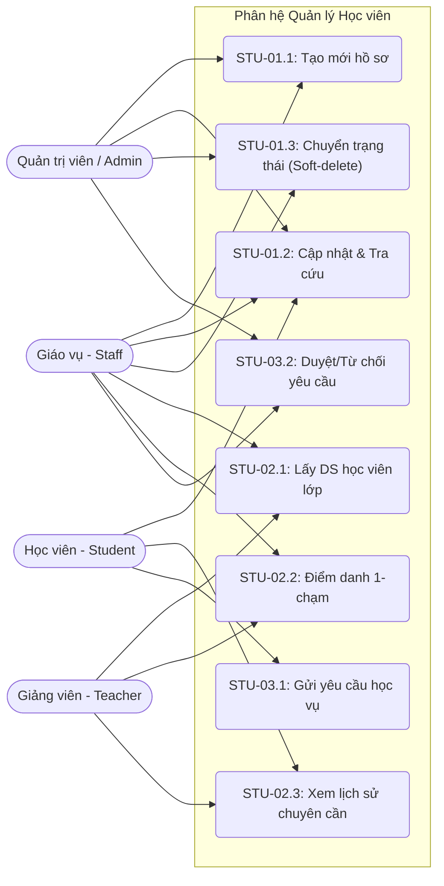
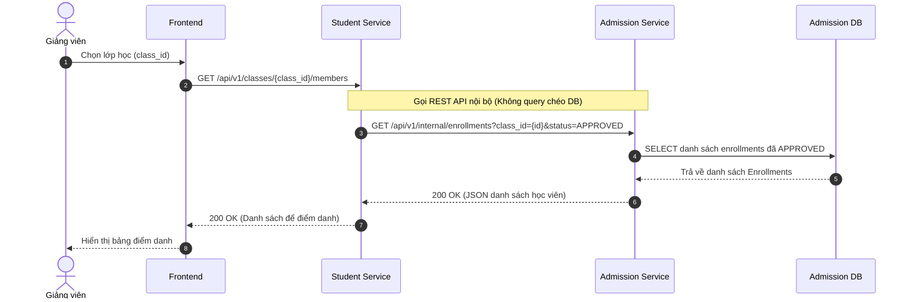
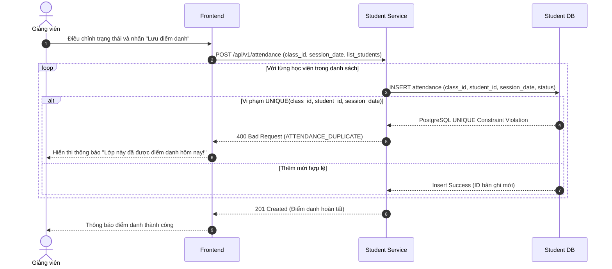
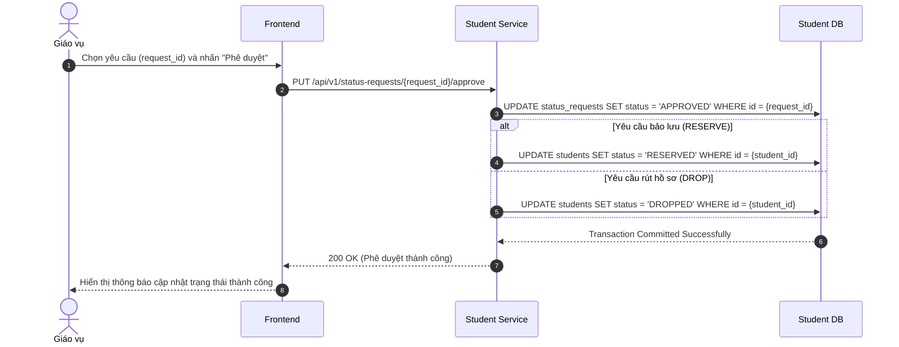
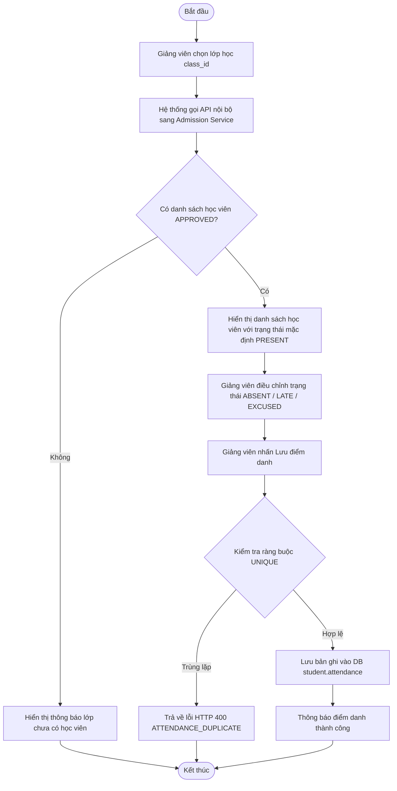
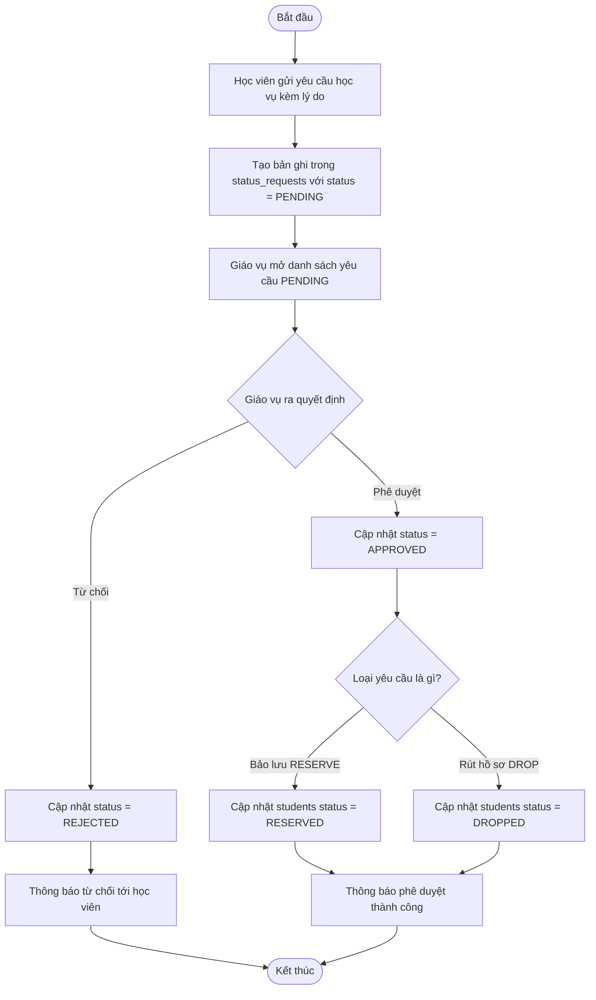
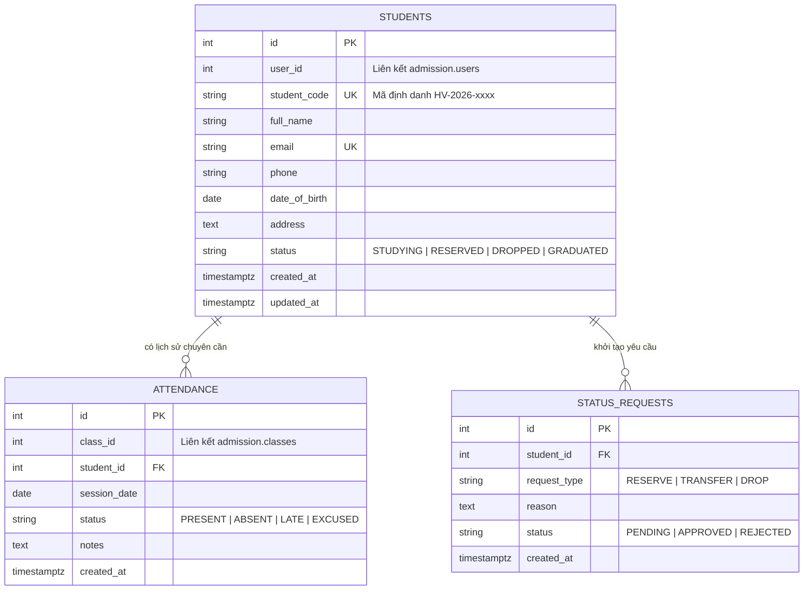

# ĐẶC TẢ SƠ ĐỒ UML - PHÂN HỆ QUẢN LÝ HỌC VIÊN (STUDENT)

Tài liệu này mô tả trực quan kiến trúc, luồng nghiệp vụ và cấu trúc dữ liệu của Phân hệ Học viên.

## PHẦN 1: SƠ ĐỒ USE CASE (USE CASE DIAGRAM)
*Mô tả sự tương tác giữa các tác nhân và các chức năng của hệ thống.*

## PHẦN 2: ĐẶC TẢ USE CASE CHI TIẾT 

### UC-STU-01.1: Tạo mới hồ sơ
* Actor: Staff, Admin.
* Luồng chính: Nhập thông tin -> Hệ thống tự sinh student_code (HV-2026-xxxx) -> Lưu DB với status STUDYING.
* Ngoại lệ: Trùng Email/SĐT -> Trả về lỗi HTTP 400.

### UC-STU-01.2: Cập nhật & Tra cứu
* Actor: Staff, Học viên.
* Luồng chính: Tìm kiếm theo Mã/Tên/SĐT -> Hiển thị kết quả -> Cập nhật thông tin -> Ghi nhận updated_at. Học viên chỉ được sửa hồ sơ của mình.

### UC-STU-02.1: Lấy DS học viên trong lớp
* Actor: Teacher, Staff.
* Luồng chính: Student Service gọi API nội bộ sang Admission Service (GET /api/v1/internal/enrollments?class_id={id}&status=APPROVED) để lấy danh sách chính thức.

### UC-STU-02.2: Điểm danh 1-chạm
* Actor: Teacher, Staff.
* Luồng chính: Chọn lớp -> Hệ thống load DS -> Chọn trạng thái (PRESENT, ABSENT, LATE, EXCUSED) -> Lưu.
* Ngoại lệ: Vi phạm UNIQUE(class_id, student_id, session_date) -> Báo lỗi HTTP 400 ATTENDANCE_DUPLICATE.

### UC-STU-03.1 & 03.2: Yêu cầu học vụ (Bảo lưu/Rút hồ sơ)
* Actor: Học viên (gửi), Staff (duyệt).
* Luồng chính: Học viên gửi đơn (RESERVE, DROP) -> PENDING. Staff duyệt -> APPROVED -> Tự động UPDATE trạng thái bên bảng students thành RESERVED hoặc DROPPED.

## PHẦN 3: SƠ ĐỒ TUẦN TỰ (SEQUENCE DIAGRAMS)
### 3.1. Luồng Lấy danh sách học viên (Giao tiếp Microservices)

*Mô tả luồng tương tác giữa Giảng viên, Frontend, Student Service và Admission Service khi lấy danh sách học viên thuộc một lớp để thực hiện điểm danh.*

### 3.2. Luồng Điểm danh 1-chạm (Xử lý Lưu & Chặn trùng)

*Mô tả luồng giảng viên lưu điểm danh cho cả lớp, hệ thống kiểm tra dữ liệu trùng lặp trước khi ghi nhận.*

### 3.3. Luồng Phê duyệt Yêu cầu Học vụ (Bảo lưu / Rút hồ sơ)

*Mô tả quá trình Giáo vụ phê duyệt yêu cầu học vụ của học viên. Hệ thống cập nhật trạng thái yêu cầu và trạng thái tương ứng của học viên trong cơ sở dữ liệu.*

## PHẦN 4: SƠ ĐỒ HOẠT ĐỘNG (ACTIVITY DIAGRAMS)
### 4.1. Luồng Điểm danh Điện tử

*Mô tả quy trình giảng viên thực hiện điểm danh học viên trong một lớp học, từ lúc chọn lớp, tải danh sách học viên đến khi lưu kết quả điểm danh vào hệ thống.*

### 4.2. Luồng Xử lý Yêu cầu Bảo lưu / Rút hồ sơ

*Mô tả quy trình học viên gửi yêu cầu bảo lưu hoặc rút hồ sơ, giáo vụ tiếp nhận và đưa ra quyết định phê duyệt hoặc từ chối. Nếu được phê duyệt, hệ thống cập nhật trạng thái tương ứng của học viên.*

## PHẦN 5: LƯỢC ĐỒ CƠ SỞ DỮ LIỆU (ERD)

*Sơ đồ ERD mô tả cấu trúc dữ liệu của Student Service, bao gồm ba bảng chính: STUDENTS, ATTENDANCE và STATUS_REQUESTS, cùng mối quan hệ giữa chúng.*

