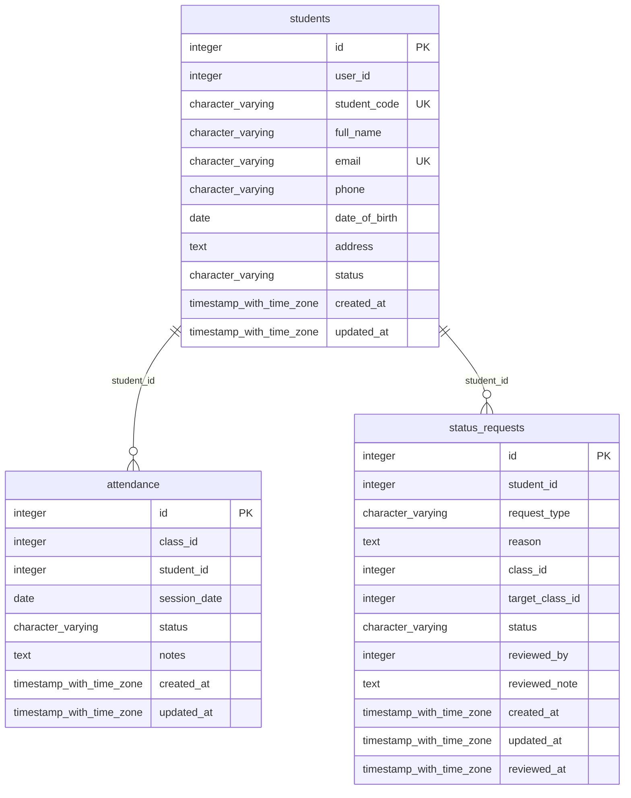
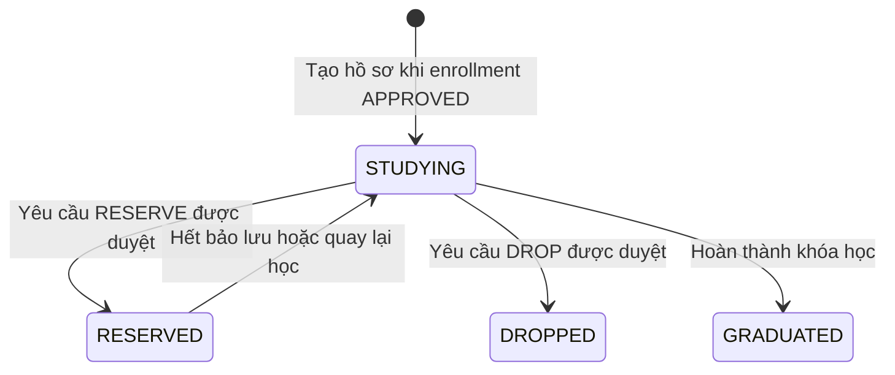
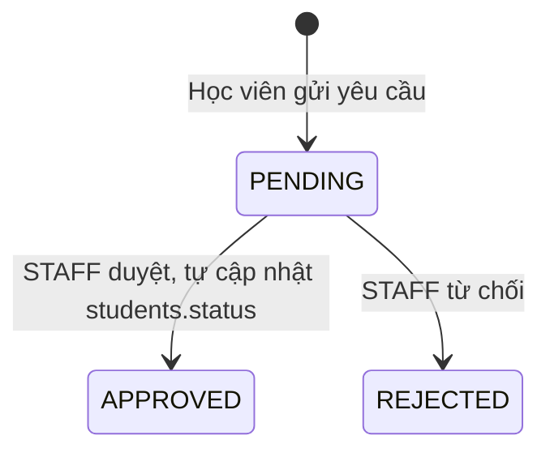

# ĐẶC TẢ CƠ SỞ DỮ LIỆU CHÍNH THỨC: SCHEMA `student`

> **Dịch vụ:** `student-service` (port 8082) | **Công nghệ:** Python 3.10+, FastAPI, SQLAlchemy | **Phụ trách:** Nhóm 2 (Hữu Phong, Trúc Phương)  
> **Phiên bản:** Final 1.0 (bản tổng hợp cuối của Leader) | **CSDL:** PostgreSQL 16, schema `student`  
> **Tài liệu liên quan:** [`docs/MASTER_DB_AND_API_RULES.md`](../../../docs/MASTER_DB_AND_API_RULES.md) (quy tắc API liên service), [`docs/invariants.md`](../../../docs/invariants.md) (bất biến hệ thống).

## Mục lục

1. Phạm vi & ranh giới dữ liệu
2. Danh mục thực thể
3. Sơ đồ ERD
4. Liên kết logic liên service
5. Từ điển dữ liệu chi tiết
6. View báo cáo
7. Máy trạng thái
8. Quy tắc bất biến
9. Quy tắc API liên service
10. Ghi chú triển khai & quyết định thiết kế

---

## 1. Phạm vi & ranh giới dữ liệu

Student quản lý **hồ sơ học vụ**, **điểm danh** và **yêu cầu học vụ** (bảo lưu, chuyển lớp, bỏ học).
Student **không có bảng `class_members`** (INV-STU-03): danh sách học viên của lớp luôn lấy từ Admission qua REST
(`enrollments` có `status = APPROVED`).

### Quy tắc chung (áp dụng cho mọi module)

| Mã | Quy tắc |
|---|---|
| R-ISO-1 (INV-SYS-02) | Service chỉ truy cập schema của chính mình. Cấm JOIN và cấm FK vật lý sang schema khác. |
| R-ID-1 | Quy ước định danh người học: ở `admission` và `finance`, `student_id` = `admission.users.id`. Ở `student` và `learning`, `student_id` = `student.students.id`. Cầu nối là `student.students.user_id`. |
| R-API-1 (INV-SYS-01) | JSON và query param dùng `snake_case`; phản hồi `{success, data, message}` hoặc `{success, error:{code, message}}`. |
| R-API-2 | Mã lỗi có tiền tố theo module: `AUTH_`, `ADM_`, `STU_`, `LRN_`, `FIN_`. |
| R-AUTH-1 | Mọi API (trừ Public) dùng `Authorization: Bearer <JWT>`; JWT ký bằng `JWT_SECRET` lấy từ biến môi trường (INV-SEC-03). |
| R-INT-1 | API nội bộ (`/internal/...`, webhook) bắt buộc header `X-Internal-Secret`, không công bố qua Gateway. |
| R-INT-2 | Gọi liên service: timeout 5 giây, retry tối đa 3 lần (backoff lũy thừa); mọi POST nội bộ phải idempotent (có `event_id` hoặc khóa tự nhiên). |
| R-TIME-1 | Thời điểm dùng `TIMESTAMPTZ` (UTC) ở admission/student/learning; finance dùng `TIMESTAMP` theo spec nhóm Finance; ngày dùng `DATE`. |
| R-MONEY-1 | Tiền tệ dùng `NUMERIC/DECIMAL`, không dùng FLOAT. |

## 2. Danh mục thực thể

| STT | Đối tượng | Loại | Số cột | Chức năng |
|--:|---|---|--:|---|
| 1 | `student.students` | Bảng | 11 | Hồ sơ học vụ của học viên; tạo tự động khi enrollment được APPROVED. |
| 2 | `student.attendance` | Bảng | 8 | Điểm danh theo buổi học. Mỗi học viên chỉ có một bản ghi cho mỗi buổi của mỗi lớp (INV-STU-01). |
| 3 | `student.status_requests` | Bảng | 12 | Yêu cầu học vụ của học viên: bảo lưu, chuyển lớp, bỏ học; do STAFF duyệt. |

## 3. Sơ đồ ERD (quan hệ trong schema)

Quan hệ sang schema khác là **liên kết logic** (mục 4), không vẽ trong ERD vì không có khóa ngoại vật lý.

## 4. Liên kết logic liên service

**Schema này trỏ ra ngoài (chỉ lưu INTEGER, không REFERENCES):**

| Cột | Trỏ tới | Ý nghĩa |
|---|---|---|
| `student.students.user_id` | `admission.users.id` | Cầu nối hồ sơ học viên và tài khoản đăng nhập |
| `student.attendance.class_id` | `admission.classes.id` | Lớp được điểm danh |
| `student.status_requests.class_id` | `admission.classes.id` | Lớp đang học |
| `student.status_requests.target_class_id` | `admission.classes.id` | Lớp muốn chuyển đến |
| `student.status_requests.reviewed_by` | `admission.users.id` | Nhân viên duyệt |

**Schema khác trỏ vào đây:**

| Cột nguồn | Trỏ tới | Ý nghĩa |
|---|---|---|
| `learning.grades.student_id` | `student.students.id` | Học viên được chấm (KHÔNG phải users.id) |

Toàn vẹn tham chiếu của các liên kết này do **tầng ứng dụng** bảo đảm (kiểm tra bằng REST trước khi ghi). Khi xóa dữ liệu gốc, dùng xóa mềm (`is_active`, `status`) thay vì xóa cứng.

## 5. Từ điển dữ liệu chi tiết

#### `student.students`

Hồ sơ học vụ của học viên; tạo tự động khi enrollment được APPROVED.

Số dòng seed: **3**

| # | Cột | Kiểu dữ liệu | Null | Mặc định | Ràng buộc | Diễn giải |
|--:|---|---|:--:|---|---|---|
| 1 | `id` | integer | NO | `auto (SERIAL)` | `PK` | Khóa chính = student.students.id; được tham chiếu logic bởi learning.grades.student_id. |
| 2 | `user_id` | integer | YES |  |  | Logical FK sang admission.users.id (cầu nối giữa hồ sơ học viên và tài khoản). KHÔNG có FK vật lý. |
| 3 | `student_code` | character varying(30) | NO | `auto (HV-YYYY-NNNN)` | `UNIQUE` | Mã học viên duy nhất, dạng HV-YYYY-NNNN, sinh tự động qua sequence nếu không truyền (INV-STU-05). |
| 4 | `full_name` | character varying(255) | NO |  |  | Họ tên học viên. |
| 5 | `email` | character varying(255) | NO |  | `UNIQUE` | Email duy nhất (INV-STU-06). |
| 6 | `phone` | character varying(50) | YES |  |  | Số điện thoại. |
| 7 | `date_of_birth` | date | YES |  |  | Ngày sinh. |
| 8 | `address` | text | YES |  |  | Địa chỉ liên hệ. |
| 9 | `status` | character varying(50) | NO | `'STUDYING'` | `CHECK (((status)::text = ANY ((ARRAY['STUDYING'::character varying, 'RESERVED'::character varying, 'DROPPED'::character varying, 'GRADUATED'::character varying])::text[])))` | STUDYING \| RESERVED \| DROPPED \| GRADUATED (INV-STU-02). RESERVED tối đa 6 tháng (INV-STU-04). |
| 10 | `created_at` | timestamp with time zone | NO | `CURRENT_TIMESTAMP` |  | Thời điểm tạo hồ sơ. |
| 11 | `updated_at` | timestamp with time zone | NO | `CURRENT_TIMESTAMP` |  | Thời điểm cập nhật gần nhất. |

**Index:**

- `idx_students_code`: `CREATE INDEX idx_students_code ON student.students USING btree (student_code)`
- `idx_students_email`: `CREATE INDEX idx_students_email ON student.students USING btree (email)`
- `idx_students_status`: `CREATE INDEX idx_students_status ON student.students USING btree (status)`
- `idx_students_user_id`: `CREATE INDEX idx_students_user_id ON student.students USING btree (user_id)`
- `students_email_key`: `CREATE UNIQUE INDEX students_email_key ON student.students USING btree (email)`
- `students_pkey`: `CREATE UNIQUE INDEX students_pkey ON student.students USING btree (id)`
- `students_student_code_key`: `CREATE UNIQUE INDEX students_student_code_key ON student.students USING btree (student_code)`

**Trigger:**

- `trg_students_updated_at`: `CREATE TRIGGER trg_students_updated_at BEFORE UPDATE ON student.students FOR EACH ROW EXECUTE FUNCTION set_updated_at()`

#### `student.attendance`

Điểm danh theo buổi học. Mỗi học viên chỉ có một bản ghi cho mỗi buổi của mỗi lớp (INV-STU-01).

Số dòng seed: **4**

| # | Cột | Kiểu dữ liệu | Null | Mặc định | Ràng buộc | Diễn giải |
|--:|---|---|:--:|---|---|---|
| 1 | `id` | integer | NO | `auto (SERIAL)` | `PK` | Khóa chính. |
| 2 | `class_id` | integer | NO |  | `UNIQUE(class_id, student_id, session_date)` | Logical FK sang admission.classes.id. |
| 3 | `student_id` | integer | NO |  | `FK REFERENCES student.students(id) ON DELETE CASCADE` `UNIQUE(class_id, student_id, session_date)` | Học viên (FK nội bộ student.students, xóa hồ sơ thì xóa điểm danh). |
| 4 | `session_date` | date | NO |  | `UNIQUE(class_id, student_id, session_date)` | Ngày của buổi học. |
| 5 | `status` | character varying(20) | NO | `'PRESENT'` | `CHECK (((status)::text = ANY ((ARRAY['PRESENT'::character varying, 'ABSENT'::character varying, 'LATE'::character varying, 'EXCUSED'::character varying])::text[])))` | PRESENT \| ABSENT \| LATE \| EXCUSED. |
| 6 | `notes` | text | YES |  |  | Ghi chú (lý do vắng, đi trễ...). |
| 7 | `created_at` | timestamp with time zone | NO | `CURRENT_TIMESTAMP` |  | Thời điểm ghi nhận. |
| 8 | `updated_at` | timestamp with time zone | NO | `CURRENT_TIMESTAMP` |  | Thời điểm cập nhật gần nhất. |

**Ràng buộc cấp bảng (nhiều cột):**

| Tên | Loại | Định nghĩa |
|---|---|---|
| `attendance_class_id_student_id_session_date_key` | UNIQUE | `UNIQUE (class_id, student_id, session_date)` |

**Index:**

- `attendance_class_id_student_id_session_date_key`: `CREATE UNIQUE INDEX attendance_class_id_student_id_session_date_key ON student.attendance USING btree (class_id, student_id, session_date)`
- `attendance_pkey`: `CREATE UNIQUE INDEX attendance_pkey ON student.attendance USING btree (id)`
- `idx_attendance_class`: `CREATE INDEX idx_attendance_class ON student.attendance USING btree (class_id, session_date)`
- `idx_attendance_student`: `CREATE INDEX idx_attendance_student ON student.attendance USING btree (student_id, session_date DESC)`

**Trigger:**

- `trg_attendance_updated_at`: `CREATE TRIGGER trg_attendance_updated_at BEFORE UPDATE ON student.attendance FOR EACH ROW EXECUTE FUNCTION set_updated_at()`

#### `student.status_requests`

Yêu cầu học vụ của học viên: bảo lưu, chuyển lớp, bỏ học; do STAFF duyệt.

Số dòng seed: **1**

| # | Cột | Kiểu dữ liệu | Null | Mặc định | Ràng buộc | Diễn giải |
|--:|---|---|:--:|---|---|---|
| 1 | `id` | integer | NO | `auto (SERIAL)` | `PK` | Khóa chính. |
| 2 | `student_id` | integer | NO |  | `FK REFERENCES student.students(id) ON DELETE CASCADE` | Học viên gửi yêu cầu. |
| 3 | `request_type` | character varying(20) | NO |  | `CHECK (((request_type)::text = ANY ((ARRAY['RESERVE'::character varying, 'TRANSFER'::character varying, 'DROP'::character varying])::text[])))` | RESERVE (bảo lưu) \| TRANSFER (chuyển lớp) \| DROP (bỏ học). |
| 4 | `reason` | text | NO |  |  | Lý do học viên nêu. |
| 5 | `class_id` | integer | YES |  |  | Logical FK sang admission.classes.id: lớp đang học. Cột mở rộng của bản tổng hợp. |
| 6 | `target_class_id` | integer | YES |  |  | Logical FK sang admission.classes.id: lớp muốn chuyển đến (chỉ dùng với TRANSFER). Cột mở rộng. |
| 7 | `status` | character varying(20) | NO | `'PENDING'` | `CHECK (((status)::text = ANY ((ARRAY['PENDING'::character varying, 'APPROVED'::character varying, 'REJECTED'::character varying])::text[])))` | PENDING \| APPROVED \| REJECTED. |
| 8 | `reviewed_by` | integer | YES |  |  | Logical FK sang admission.users.id: nhân viên duyệt. Cột mở rộng. |
| 9 | `reviewed_note` | text | YES |  |  | Ghi chú của người duyệt. Cột mở rộng. |
| 10 | `created_at` | timestamp with time zone | NO | `CURRENT_TIMESTAMP` |  | Thời điểm gửi yêu cầu. |
| 11 | `updated_at` | timestamp with time zone | NO | `CURRENT_TIMESTAMP` |  | Thời điểm cập nhật gần nhất. |
| 12 | `reviewed_at` | timestamp with time zone | YES |  |  | Thời điểm duyệt. Cột mở rộng. |

**Index:**

- `idx_status_req_student`: `CREATE INDEX idx_status_req_student ON student.status_requests USING btree (student_id, status)`
- `status_requests_pkey`: `CREATE UNIQUE INDEX status_requests_pkey ON student.status_requests USING btree (id)`

**Trigger:**

- `trg_status_requests_updated_at`: `CREATE TRIGGER trg_status_requests_updated_at BEFORE UPDATE ON student.status_requests FOR EACH ROW EXECUTE FUNCTION set_updated_at()`

## 6. View báo cáo

_Schema này không có view._

## 7. Máy trạng thái

### Hồ sơ học viên `students.status`

### Yêu cầu học vụ `status_requests.status`

Hiệu ứng khi duyệt (APPROVED):

| `request_type` | Hiệu ứng |
|---|---|
| `RESERVE` | `students.status = RESERVED`; có thể gọi Finance cộng tiền vào ví bảo lưu (`RESERVATION_CREDIT`) |
| `TRANSFER` | Gọi Admission chuyển đơn từ `class_id` sang `target_class_id` (kiểm tra sĩ số lớp đích) |
| `DROP` | `students.status = DROPPED`; Admission hủy đơn tương ứng |

## 8. Quy tắc bất biến

| Mã | Quy tắc |
|---|---|
| **INV-STU-01** | Một học viên chỉ có một bản ghi điểm danh cho mỗi buổi của mỗi lớp: `UNIQUE(class_id, student_id, session_date)`. |
| **INV-STU-02** | `students.status` chỉ nhận STUDYING, RESERVED, DROPPED, GRADUATED (CHECK). |
| **INV-STU-03** | Không tạo bảng `class_members`; danh sách lớp lấy từ Admission qua REST. |
| **INV-STU-04** | Bảo lưu (RESERVED) tối đa 6 tháng (kiểm tra ở tầng ứng dụng khi duyệt và job nhắc hạn). |
| **INV-STU-05** | `student_code` duy nhất, dạng `HV-YYYY-NNNN`, sinh tự động ở DB (sequence `student.student_code_seq`) hoặc tầng service. |
| **INV-STU-06** | `students.email` duy nhất. |
| **INV-SEC-01** | Học viên chỉ xem và sửa hồ sơ của chính mình (so khớp `students.user_id` với `sub` trong JWT). |

## 9. Quy tắc API liên service

### 9.1. API công khai của module

| Method | Endpoint qua Gateway (`nginx.conf`) | Alias trong Spec nội bộ | Quyền |
|---|---|---|---|
| GET | `/api/student/students` | `/api/v1/students` | ADMIN, STAFF |
| POST | `/api/student/students` | `/api/v1/students` | ADMIN, STAFF |
| GET / PUT | `/api/student/students/{id}` | `/api/v1/students/{id}` | ADMIN, STAFF, STUDENT (chỉ của mình) |
| GET | `/api/student/classes/{class_id}/members` | `/api/v1/classes/{class_id}/members` | TEACHER, STAFF |
| GET / POST | `/api/student/attendance` | `/api/v1/attendance` | TEACHER (lớp mình dạy), STAFF |
| GET / POST | `/api/student/status-requests` | `/api/v1/status-requests` | STUDENT, STAFF |
| PUT | `/api/student/status-requests/{id}/approve` | `/api/v1/status-requests/{id}/approve` | STAFF |

### 9.2. API nội bộ module cung cấp (header `X-Internal-Secret`)

| Endpoint | Người gọi | Mục đích |
|---|---|---|
| `POST /api/student/internal/students` (hoặc `/api/student/students`) | Admission | Tạo hồ sơ khi enrollment APPROVED; idempotent theo `user_id` / `email` |
| `GET /api/student/internal/students/{id}` | Learning | Xác minh học viên tồn tại và đang STUDYING |
| `GET /api/student/internal/students?user_id=` | Finance | Tra hồ sơ từ tài khoản (R-ID-1) |
| `GET /api/student/internal/attendance/summary?student_id=&class_id=` | Finance | Số buổi đã học để xét hoàn tiền (INV-FIN-07) |

### 9.3. API module gọi sang service khác

| Gọi tới | Khi nào | Nội dung |
|---|---|---|
| `GET admission /api/admission/internal/enrollments?class_id=&status=APPROVED` | Xem danh sách lớp, điểm danh | Lấy học viên của lớp |
| `GET admission /api/admission/internal/classes/{id}` | Điểm danh, duyệt yêu cầu | Kiểm tra lớp và giáo viên phụ trách |
| `GET finance /api/finance/internal/wallets?student_id=` | Duyệt bảo lưu | Kiểm tra ví bảo lưu |

Nguyên tắc chung (timeout, retry, idempotency, định dạng) xem [`docs/MASTER_DB_AND_API_RULES.md`](../../../docs/MASTER_DB_AND_API_RULES.md) mục 8 và 9.

## 10. Ghi chú triển khai & quyết định thiết kế

- **Sinh mã `student_code` tự động ở DB:** Sequence `student.student_code_seq` (bắt đầu từ 100) kết hợp `DEFAULT ('HV-' || EXTRACT(YEAR FROM CURRENT_DATE)::INT || '-' || LPAD(nextval('student.student_code_seq')::TEXT, 4, '0'))` giúp các câu lệnh INSERT không truyền `student_code` (như trong skeleton `services/student/backend/main.py`) vẫn thành công và đúng chuẩn `INV-STU-05`.
- **Cột mở rộng so với docs nhóm Student:** `status_requests.class_id`, `target_class_id`, `reviewed_by`, `reviewed_note`, `reviewed_at` được bổ sung để hỗ trợ chuyển lớp và truy vết người duyệt (các cột đều nullable).
- **Tạo hồ sơ idempotent:** `POST /api/student/internal/students` gặp `user_id` hoặc `email` đã có hồ sơ thì trả hồ sơ hiện có (HTTP 200).

---
